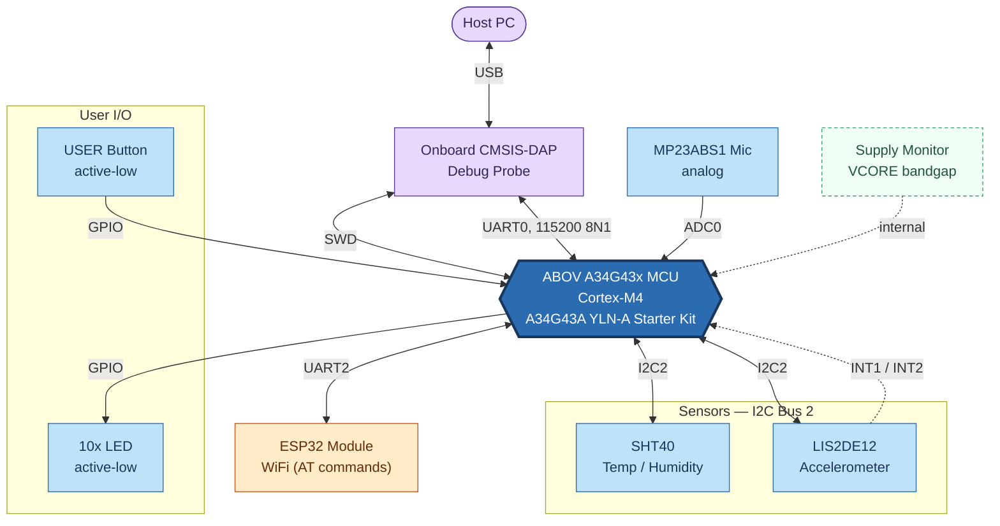
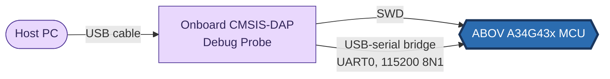

<a>English</a> | <a href="docs-tr/Hardware.md">Türkçe</a>

<table class="sphinxhide" width="100%">
  <tr>
    <td align="center">
      <picture>
        <source media="(prefers-color-scheme: dark)" srcset="images/tiremo_sub_brand_1_mono_white.png">
        
      </picture>
       
      
      <h1>Hardware Overview</h1>
      Tiremo Cortex Tutorials — ESP32 + Tiremo Cloud firmware, from first blink to a fleet-ready device
    </td>
  </tr>
</table>

# Hardware Overview

Board-level reference: what's on the Tiremo Cortex board, how it's wired
to the MCU, and how a host PC talks to it. No firmware here — see
[Getting Started](./Getting_Started/) to start writing code against
this hardware.

## Board Block Diagram

Hexagon = MCU · rounded stadium = off-board host · dashed border =
internal-only, no external pin · exact port/pin numbers are in the
**Pinout Reference** table below, not repeated here.

## Host Connection

How a developer's PC actually reaches the MCU — no separate programmer
needed, the debug probe is on-board. One USB cable carries both paths
at once: SWD for flashing/debugging, and a virtual serial port for the
UART0 log console.

## Pinout Reference

| Port · Pin | Function | Notes |
|---|---|---|
| PA0 | Microphone analog input (AN0) | ADC0 channel 0, Timer1-triggered burst capture |
| PA4 | LIS2DE12 INT1 | Accelerometer interrupt |
| PA5 | LIS2DE12 INT2 | Accelerometer interrupt |
| PA8 | ESP32 UART2 RX | ESP32 TX → MCU RX |
| PA9 | ESP32 UART2 TX | MCU TX → ESP32 RX |
| PA12 | ESP32 power gate | Active-high (HIGH = powered) |
| PB4 | LED1 | Active-low |
| PB5 | LED4 | Active-low |
| PB6 | I2C Bus 2 SCL | Shared: SHT40 + LIS2DE12 |
| PB7 | I2C Bus 2 SDA | Shared: SHT40 + LIS2DE12 |
| PB9 | LED2 | Active-low |
| PB10 | LED5 | Active-low |
| PB11 | LED6 | Active-low |
| PB12 | LED7 | Active-low |
| PB13 | LED8 | Active-low |
| PB14 | LED9 | Active-low |
| PB15 | LED10 | Active-low |
| PC9 | USER button | Active-low |
| PF7 | LED3 | Active-low |
| — | Supply voltage monitor | Internal ADC1 channel 23 (VCORE bandgap); no external pin |
| — | Debug UART (UART0) | Fixed by the starter kit's onboard USB-serial bridge, not board-configurable |

Source of truth: the reference firmware's `board_config.h`. If your
own board revision differs, that file — not this page — is what your
code should follow.

Tiremo Cortex Tutorials — Empa Electronics

