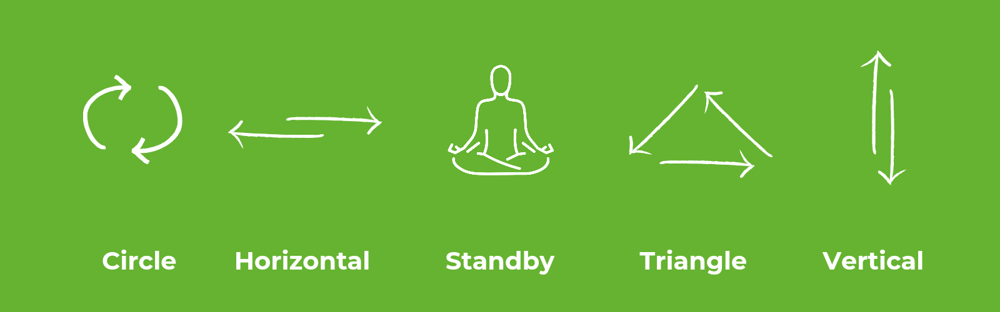
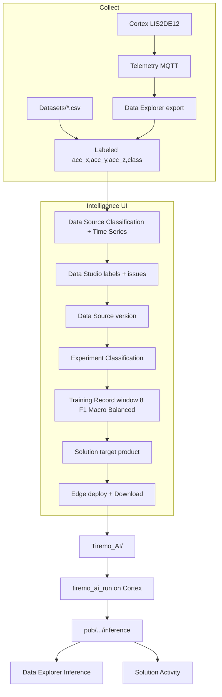
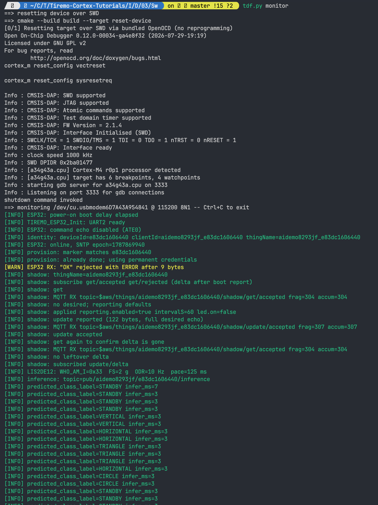

<p class="sphinxhide" align="right"><a>English</a> | <a href="../../../docs-tr/Intelligence/Design_Tutorials/03-HMR_Edge_Deployment/README.md">Türkçe</a></p>
<table class="sphinxhide" width="100%">
  <tr>
    <td align="center">
      <picture>
        <source media="(prefers-color-scheme: dark)" srcset="../../../images/tiremo_sub_brand_1_mono_white.png">
        
      </picture>
      <br>
      
      <h1>HMR Gesture Classifier on the Edge</h1>
      <sub>Tiremo Cortex Tutorials: ESP32 + Tiremo Cloud firmware, from first blink to a fleet-ready device</sub>
    </td>
  </tr>
</table>

# HMR Gesture Classifier on the Edge

***Board: Tiremo Cortex (ESP32) · Section: Intelligence / Design Tutorials · Difficulty: Hard***

## Introduction

Feature tutorials 01–04 each teach one Intelligence object in general (export, Data Source, Experiment, Solution). This design tutorial applies that chain to something you would actually ship: **Human Motion Recognition** on the Tiremo Cortex LIS2DE12: five gestures, three axes, a model that fits the MCU, results published as inference.

The capture started at **128 Hz**. That file is too dense for an 8-sample TinyML window, so the same recording was decimated to **8 Hz** and **4 Hz**. Those three CSVs are in [`Datasets/`](./Datasets/). The Edge package that came out of Intelligence for this case is in [`Tiremo_AI/`](./Tiremo_AI/), a verbatim copy of `Tiremo-Secure-Iot-Sw-Cloud-Collect-Infer/Tiremo_Lib/Tiremo_AI`, not a hand-written driver.

There is no extra Feature-Tutorial `Sw/` tree here. Training and deploy are Tiremo UI. The Cortex binary for this case is [`Sw/`](./Sw/); it includes the generated library (`tiremo_makefile.mk` source list, hard FPU, `TIREMO_AI_DIR=../Tiremo_AI`).

## You Will Learn

- Why 128 Hz was captured, and why 8 Hz and 4 Hz exist
- How to think about rate, window, labels, and class balance *before* opening Intelligence
- Which platform objects this case uses (Data Explorer, Data Source, Data Studio, Experiment, Solution, Edge download)
- The exact UI configuration (Classification + Time Series, F1 Macro, window 8, Edge, …) and why each knob was set that way
- How to call `tiremo_ai_run` / `tiremo_ai_format_mqtt_json` with a 24-float window

## Prerequisites

- All four [Intelligence Feature Tutorials](../../Feature_Tutorials/)
- A Tiremo UI login that can create Data Sources / Experiments / Solutions
- Optional: a provisioned Cortex publishing `acc_x` / `acc_y` / `acc_z` if you recapture instead of using `Datasets/`
- Optional: [Getting Started](../../../Getting_Started/) + this tutorial's [`Sw/`](./Sw/) to compile `Tiremo_AI/` on the board

## Firmware (`Sw/`)

[`Sw/`](./Sw/) is the Cortex binary for this case. It reuses the Tiremo Cloud 05 session (WiFi, SNTP, provision, shadow), fills the same 8×3 tumbling window as [02](../02-Accelerometer_Windowing/), calls `tiremo_ai_run`, logs `predicted_class_label` on UART, and publishes the generated MQTT JSON on `pub/<product_id>/<device_id>/inference`. `TIREMO_AI_DIR` is `../Tiremo_AI` (sibling of `Sw/`, not a second copy). CMake enables hard-float (`-mfloat-abi=hard -mfpu=fpv4-sp-d16`) and `EXTRN_FPU_USED`.

Copy secrets and claim PEMs as in [01](../01-Accelerometer_Telemetry/), then from `Sw/`:

```text
tdf.py build
tdf.py flash
tdf.py monitor
```

There is no extra Feature-Tutorial `Sw/` tree. Training and deploy stay in the Tiremo UI.

## The three files: same motion, three clocks

Header on all three:

```text
acc_x,acc_y,acc_z,class
```

Units are milli-g (same conversion as [LIS2DE12](../../../Sensors_And_Storage/Feature_Tutorials/03-LIS2DE12_Accelerometer/)). Classes: `CIRCLE`, `HORIZONTAL`, `STANDBY`, `TRIANGLE`, `VERTICAL`.



| File | Rows | Bytes | Rate | Samples / class (CIRCLE … VERTICAL) |
|---|---:|---:|---|---|
| [`Dataset_HMR_3Axis_TiremoCortex_128Hz.csv`](./Datasets/Dataset_HMR_3Axis_TiremoCortex_128Hz.csv) | 450 048 | ~9.7 MB | 128 Hz | 105216, 91648, 57216, 105344, 90624 |
| [`Dataset_HMR_3Axis_TiremoCortex_8Hz.csv`](./Datasets/Dataset_HMR_3Axis_TiremoCortex_8Hz.csv) | 28 128 | ~0.61 MB | 8 Hz | 6576, 5728, 3576, 6584, 5664 |
| [`Dataset_HMR_3Axis_TiremoCortex_4Hz.csv`](./Datasets/Dataset_HMR_3Axis_TiremoCortex_4Hz.csv) | 14 064 | ~0.30 MB | 4 Hz | 3288, 2864, 1788, 3292, 2832 |

Every class count at 8 Hz is the 128 Hz count **÷ 16**. Every 4 Hz count is the 128 Hz count **÷ 32**. Wall-clock length is the same **~58.6 minutes** (`450048 / 128 = 14064 / 4 = 3516 s`). This is not three different recording sessions; it is one capture, keep-every-Nth.

### Why capture 128 Hz at all

A gesture is a **shape in time**. If you only ever sampled at 4 Hz, you would never know whether a fast flick was aliased into something that looks like `STANDBY`. High-rate capture is cheap insurance while the human is holding the board: you can always throw samples away later; you cannot invent the ones you never took.

The Sensors tutorial programs the LIS2DE12 at **100 Hz** by default. 128 Hz is the rate **this HMR set was named and stored at**: a capture-time choice, not a claim that tutorial 03's `Configure()` was left at 100 Hz. If you recapture, pick one ODR, write it down, and keep it for the whole session.

### Why 8 Hz and 4 Hz were tried

Edge inference in this pipeline uses a **fixed window of 8 samples** (see [`Tiremo_AI/tiremo_config.h`](./Tiremo_AI/tiremo_config.h): `TIREMO_WINDOW_SIZE 8`, `TIREMO_NUM_FEATURES 3`, `TIREMO_INPUT_SIZE 24`). That window's **duration** is `8 / f_s`:

| Rate | Duration of 8 samples | Fits a hand-drawn CIRCLE / TRIANGLE? |
|---|---|---|
| 128 Hz | 62.5 ms | No; that is a twitch, not a gesture |
| 8 Hz | 1.0 s | Borderline / short gestures |
| 4 Hz | 2.0 s | Yes; a full shape in one window |

Keeping 128 Hz and stretching the window to 2 s instead would be `128 × 2 × 3 = 768` features per inference. That explodes RAM/flash and the TFLM arena (`TIREMO_ARENA_SIZE` in the snapshot is **6144 bytes**). Decimation keeps the *time* span of a gesture and throws away redundant samples along a smooth orbit.

8 Hz was the intermediate check: does 1 s of context already classify, or does the model need 2 s? Train both as **two Data Source versions** (or two Training Records) if you want the comparison; the bundled `Tiremo_AI` is the 8-sample ANN that Intelligence emitted for this case: use **4 Hz + window 8** as the configuration that matches a 2 s gesture, or **8 Hz + window 8** for a 1 s gesture. Do not mix a 4 Hz file with a window sized as if the data were still 128 Hz.

`TIREMO_SAMPLING_FREQUENCY_HZ` in the snapshot is `0.0` because training set **Window Size** explicitly (tutorial 03: when window size is set, sampling frequency and inference interval are ignored). The Hz still matters in the *physical* world: the firmware must feed `tiremo_ai_run` at the same rate the CSV was trained on.

## How to think about collection (even if you use `Datasets/`)

Write these down before the first gesture:

1. **Question.** "Which of five named motions is the board doing?" → Classification, not anomaly, not regression.
2. **Axes and units.** Three-axis mg, keys `acc_x,acc_y,acc_z`. Same names in telemetry, CSV, and `features[]`.
3. **Rate vs window vs MCU.** Choose the *time* you need (here ~1–2 s), then `window = rate × seconds`, then check that `window × n_axes` fits RAM. If it does not, lower the rate, not the physics.
4. **Labels.** Five names, collected long enough that Data Studio does not fail row-count. `STANDBY` is ~54% of `CIRCLE` even in this set; F1 Macro exists for that. Do not "fix" imbalance by deleting motion classes.
5. **Train/serve skew.** Whatever you publish in production (ODR, milli-g vs g, axis order, whether gravity is included) must match training. The cloud export from Data Explorer is `data.acc_x` until you rename it; that rename is part of the collection design.

Recapture path: Feature Tutorial 01 (Data Explorer) → label → 02. Skip path: import `Dataset_HMR_3Axis_TiremoCortex_4Hz.csv` as in 02.

## What the Tiremo AIoT platform is doing here



| Object | Role in this case |
|---|---|
| **Data Explorer** | Prove telemetry (or later inference) exists; export raw logs. Not under the Intelligence menu. |
| **Data Source** | Owns the HMR files. Task Classification, type Time Series. |
| **Data Studio** | Label column `class`, analyze issues, save. |
| **Experiment** | Search over models for that task. |
| **Training Record** | One search run: window 8, F1 Macro, Balanced, Medium depth. |
| **Solution** | Ties the experiment to the Cortex **Product**. |
| **Edge deployment** | Compiles the selected model; Download yields `Tiremo_AI/`. |
| **This folder's `Tiremo_AI/`** | The worked download so the tutorial is complete offline. |

## Configuration used (and why)

### Data Source

| Field | Value | Why |
|---|---|---|
| Data Source Task | **Classification** | Five mutually exclusive gesture names. Anomaly Detection would be normal-vs-fault. Regression has no class names. Forecasting predicts future mg, not "this is a triangle." |
| Data Source Type | **Time Series** | A gesture is ordered samples. Tabular would treat each row as independent and never see an orbit. |
| Label | column `class` | File already contains labels (`File contains label column`). |
| Timestamp | none in the bundled CSV | Row order *is* time; optional timestamp is for Explorer exports. |

### Experiment / Training Record

| Field | Value | Why |
|---|---|---|
| Task | **Classification** | Must match the Data Source. |
| Optimization Objective | **F1 Macro** | Classes are not equal size (`STANDBY` smallest). Accuracy would look fine while `STANDBY` fails. |
| Inference Objective | **Balanced** | Edge must fit RAM/flash, not only F1. Raw would ignore the MCU. |
| Window Size | **8** | Explicit window; matches `TIREMO_WINDOW_SIZE`. Sampling frequency left unused. |
| Search Depth | **Medium** | Default; Shallow for a smoke test, Deep if Medium underfits. |
| Max RAM / Flash | defaults or MCU budget | Snapshot arena is 6 KB; defaults (2048 / 1024 KB) are plenty for marking Edge. Tighten if you want the search to reject large LSTMs. |

### Solution / Edge

| Field | Value | Why |
|---|---|---|
| Deployment target | **Edge** | Inference on the Cortex, not a cloud window on telemetry. |
| Core Type | **ARM Cortex-M4** if you want CMSIS-NN like this snapshot; **Generic / Reference Kernels** if unsure; **ARM Cortex-M3** if targeting the ABOV integer-only core | Locks after first Edge. This snapshot's makefile defines `CMSIS_NN`. |
| Alias | short unique slug | Baked as `TIREMO_DEPLOYMENT_ALIAS` (snapshot: `deneme1`; your UI download will differ). |

Do not copy the snapshot's UUIDs into a new Solution. They identify *this* generated package.

## Solution

UI path (same as Feature 02–04, with the 4 Hz file):

1. Create Data Source: Classification + Time Series
2. Import [`Datasets/Dataset_HMR_3Axis_TiremoCortex_4Hz.csv`](./Datasets/Dataset_HMR_3Axis_TiremoCortex_4Hz.csv) (repeat with 8 Hz as a second dataset/version if you want the comparison)
3. Data Studio: label column `class` → Analyze → Save
4. Create version e.g. `4Hz-v1`
5. Experiment: Classification; link that version
6. Start Training: F1 Macro, Balanced, advanced **Window Size** `8`
7. When **Completed**, select an Edge-capable model (the snapshot is ANN)
8. Solution → Edge → Create Edge → Download

Or skip the wait and use [`Tiremo_AI/`](./Tiremo_AI/) as that download.

**Verified contents of the snapshot** (generated 2026-08-24, config hash `a7ad8992e5fc917e`):

```text
TIREMO_TASK_TYPE            CLASSIFICATION
TIREMO_WINDOW_SIZE          8
TIREMO_NUM_FEATURES         3
TIREMO_INPUT_SIZE           24
TIREMO_NUM_CLASSES          5
TIREMO_CLASS_NAMES          CIRCLE, HORIZONTAL, STANDBY, TRIANGLE, VERTICAL
algorithmName               ANN
TIREMO_MQTT_TOPIC_SUFFIX    inference
```

See [`Tiremo_AI/API.md`](./Tiremo_AI/API.md).

## Walkthrough

### 1. Pick a rate and import

Start from the 128 Hz file only if you intend to decimate yourself. For the Edge window of 8, import **4 Hz** (2 s context) or **8 Hz** (1 s). Feature 02's import/Data Studio/version steps apply unchanged.


### 2. Train with window 8

Feature 03. Name the Training Record so the rate is obvious (`HMR-4Hz-w8`). If you train 128 Hz with window 8 by mistake, the matrix will look like noise; that is the 62.5 ms window failing, not "ANN is bad."


### 3. Deploy Edge and open the package

Feature 04. Download, or stay on [`Tiremo_AI/`](./Tiremo_AI/).


Generated files are marked `GENERATED FILE. Do not edit.` Include the makefile from a firmware `Makefile`:

```make
-include $(TIREMO_DIR)/Tiremo_AI/tiremo_makefile.mk
```

In this tutorial the tree lives at `Intelligence/Design_Tutorials/03-HMR_Edge_Deployment/Tiremo_AI/`. Point `TIREMO_AI_DIR` (or copy the folder next to your `Sw/`) so that include resolves. Link the ELF with `$(CXX)`; it is C++17 TFLM. Enable an FPU when the core type expects one (`-mfloat-abi=hard` …) as noted at the bottom of `tiremo_makefile.mk`.

### 4. Feed windows from the LIS2DE12

Buffer 8 samples. Layout is a flat `float[24]`:

```c
/* sample 0: x,y,z; sample 1: x,y,z; ... sample 7 */
float features[TIREMO_INPUT_SIZE];
TiremoInferenceResult result;
int rc = tiremo_ai_run(features, &result);
/* result.predicted_class_label → "CIRCLE" / ... */
```

Call `tiremo_init()` implicitly via `tiremo_ai_run` (first use). Time the call; pass elapsed ms plus window start/finish Unix ms into `tiremo_ai_format_mqtt_json` and publish on `pub/<product_id>/<device_id>/inference`.

Push samples into that buffer at **4 Hz or 8 Hz to match the CSV you trained**, not at the 128 Hz capture rate, unless you trained 128 Hz with a *much* larger window. [`Sw/`](./Sw/) logs `predicted_class_label` on UART and publishes the MQTT body.



### 5. Close the loop in the UI

Data Explorer → Data Type **Inference** → that Solution. Solution **Activity** graph should move between the five labels when you repeat the gestures.


## Done When

- You can explain 128 → 8 → 4 as **same capture, decimated so an 8-sample window covers a gesture**
- A Data Source exists as **Classification + Time Series** on one of the CSVs, with a frozen version
- A Training Record completed with **window 8** and an Edge-selected model
- Either a UI Edge **Download** or this folder's [`Tiremo_AI/`](./Tiremo_AI/) runs `tiremo_ai_run` on 24 floats and names one of the five classes

This folder's [`Sw/`](./Sw/) is the Cortex binary that feeds the window and publishes inference.

<p align="center"></p>

<p class="sphinxhide" align="center"><sub>Tiremo Cortex Tutorials, Empa Electronics</sub></p>
