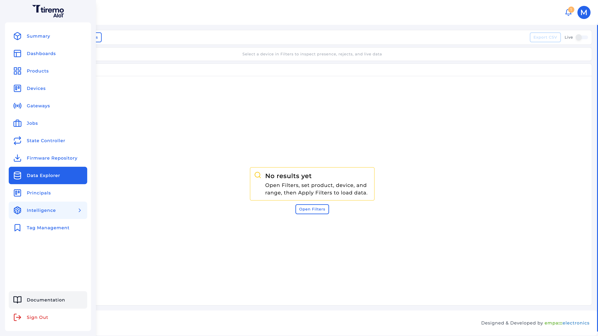
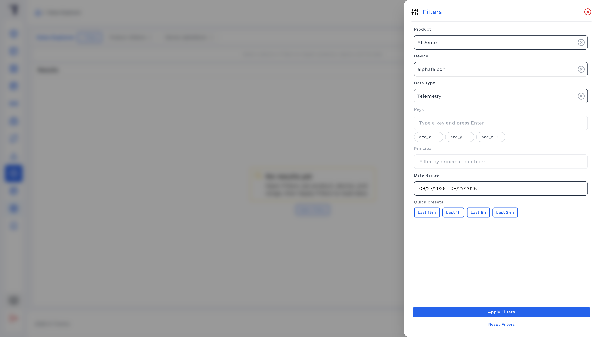
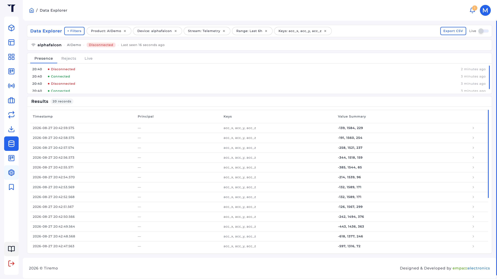

<a>English</a> | <a href="../../../docs-tr/Intelligence/Feature_Tutorials/01-Data_Collection_Via_Data_Explorer/README.md">Türkçe</a>

<table class="sphinxhide" width="100%">
  <tr>
    <td align="center">
      <picture>
        <source media="(prefers-color-scheme: dark)" srcset="../../../images/tiremo_sub_brand_1_mono_white.png">
        
      </picture>
       
      
      <h1>Data Collection via Data Explorer</h1>
      Tiremo Cortex Tutorials: ESP32 + Tiremo Cloud firmware, from first blink to a fleet-ready device
    </td>
  </tr>
</table>

# Data Collection via Data Explorer

***Board: Tiremo Cortex (ESP32) · Section: Intelligence / Feature Tutorials · Difficulty: Easy***

## Introduction

Intelligence cannot invent a training set. A Thing already on Tiremo Cloud publishes samples as **telemetry**. **Data Explorer** is where you prove those samples arrived, filter them down to the keys you will use as features, and export a CSV. That export is the raw material for [02-Data_Sources](../02-Data_Sources/).

Data Explorer lives in the main sidebar, not under **Intelligence**. It queries historical telemetry, alarms, and inference, plus a live MQTT tail, for one product/device over a date range of at most 30 days.

The walkthrough below uses a motion-classification capture as a concrete example (`acc_x`, `acc_y`, `acc_z`). The same filters and export apply to any telemetry keys a Cortex (or other Thing) publishes.

## You Will Learn

- How Data Explorer's filters map onto a collection session (product, device, data type, keys, range)
- Why training features should be exported as **Telemetry**, not Alarms or Inference
- How the exported CSV is shaped (`timestamp`, `deviceIdentifier`, flattened `data.<key>` columns) and why that is *not* yet a Data Source file
- How labels get onto the file: one class per export (**One class file**) or a label column after export

## Prerequisites

- A Tiremo Cloud account and a provisioned Cortex (or any Thing on the same product) that publishes the telemetry keys you intend to train on. For a motion-classification example, that is `acc_x`, `acc_y`, `acc_z` in milli-g, the same axis names as the HMR CSVs in the Design Tutorial. [Tiremo Cloud / 06 Publishing Alarms and Telemetry](../../../Tiremo_Cloud/Feature_Tutorials/06-Publishing_Alarms_And_Telemetry/) is the firmware tutorial for that publish path; it is still a scaffold, so a device already sending those keys, or the Device Simulator, is enough for this UI walkthrough
- Optional, for the motion example: [Sensors & Local Storage / 03 LIS2DE12 Accelerometer](../../../Sensors_And_Storage/Feature_Tutorials/03-LIS2DE12_Accelerometer/) so you know what the samples mean
- The Tiremo UI at [`iot.tiremo.ai`](https://iot.tiremo.ai)

If you cannot recapture live data, skip the physical session and use the labeled files shipped with [Design Tutorial 03](../../Design_Tutorials/03-HMR_Edge_Deployment/), then come back here when a device is publishing.

## Understanding a Collection Session

A useful capture is not "leave the board on the desk and export whatever arrived." You are collecting **features** at a known rate and, for classification, **classes** the model should learn.

For a motion-classification application those classes might be `CIRCLE`, `HORIZONTAL`, `STANDBY`, `TRIANGLE`, `VERTICAL`. Each class needs a contiguous stretch of samples at a **known rate**, with the board actually performing that motion (or sitting still, for `STANDBY`). The same idea applies to other Cortex streams: operating states, vibration regimes, and so on.

Three decisions belong here, before Intelligence ever sees a file:

1. **Keys.** Publish only the fields you will train on, not a single packed string, and not extra sensors mixed into the same object if you can avoid it. Data Explorer's **Keys** filter is an allow-list on those JSON fields. Extra keys are extra columns you will have to drop later. For motion classification, that is typically `acc_x`, `acc_y`, `acc_z`.
2. **Rate.** Time-series training infers sampling frequency from timestamps. Whatever you pick must be **stable** for the whole session; a jittery rate becomes a Data Studio warning. The LIS2DE12 tutorial's default ODR is 100 Hz; the HMR capture used **128 Hz** so a later downsample still had headroom (see the Design Tutorial).
3. **How labels get onto the file.** Data Explorer does not know which class you meant. Two workable patterns:

   - **One class per export.** Perform only one class for N minutes, export, import as Data Studio **One class file** with that Class Name (for example `CIRCLE`). Repeat for each class. Cleanest if you can control the session.
   - **Label column after export.** One long capture covering all classes, then add a `class` column (by timestamp ranges) before import, and tell Data Studio **File contains label column**.

The HMR files in the Design Tutorial already have `acc_x,acc_y,acc_z,class`; that is the *after labeling* shape, not the raw Explorer export.

## Solution

There is no `Sw/` for this tutorial. The worked path is the UI.

1. Sidebar **Data Explorer**
2. **+ Filters** → Product, Device, **Data Type** = Telemetry, **Keys** = each feature key followed by Enter (for example `acc_x`, `acc_y`, `acc_z` for a 3-axis motion set), a date range that covers the session, **Apply Filters** / **View Data**
3. Confirm the table shows samples; optionally turn **Live** on while the device produces the behavior you care about
4. **Export CSV** → `device-<id>-telemetry-export.csv`
5. Rename flattened columns and add labels as above before [02-Data_Sources](../02-Data_Sources/)

## Walkthrough

### 1. Open Data Explorer

The item is a top-level sidebar entry (`/data-explorer`), next to Devices, not inside **Intelligence**. Quick Actions on the Summary page also links here. Until you apply filters the page stays on **No results yet**.

### 2. Filter to one device and telemetry

Required: **Product**, **Device**, **Data Type**, **Date Range** (maximum 30 days). Quick presets: Last 15m / 1h / 6h / 24h.

**Data Type** for collecting features is **Telemetry**. **Alarm** is threshold events. **Inference** is *outputs* of a Solution already deployed; useful later to debug an Edge package, useless as a training set. Inference also requires a **Solution** filter.

**Keys:** type each feature key and press Enter. Empty Keys means "all keys on that device," which is a mess if the Thing also publishes humidity while you only need, for example, accelerometer axes.

### 3. Read the table, then export

**View Data** loads the overview. Columns you will actually use: **Timestamp**, **Keys**, **Value Summary**. Open a row for the JSON payload if a value looks wrong.

**Live** tails MQTT for the selected product/device. Use it while you produce the behavior (for example a gesture) so you know the cloud saw it, then export the historical range that covers it.

**Export CSV** downloads the filtered range. Telemetry rows flatten the JSON payload: a key such as `acc_x` in the message becomes a column `data.acc_x`, alongside `timestamp`, `deviceIdentifier`, `principalIdentifier`. That is a log of cloud ingest, not a training table.

Rename `data.<key>` → `<key>` before import (for the motion example, `data.acc_x` → `acc_x`, and the same for y/z). Drop identity columns unless you have a reason to keep them. Add `class` *or* keep the file class-pure for **One class file**.

### 4. What "enough data" means

Data Studio will later reject or warn on thin sets (row count, class balance, missing values). How much is enough depends on the task. For HMR-scale gestures, minutes per class at 4–128 Hz beats a few seconds of noisy waving. The bundled 128 Hz HMR file is ~58.6 minutes of wall-clock capture across five classes (~450 k rows); that is the size of a *serious* collection, not a minimum.

Keep the board's sample rate and the publish rate aligned. Publishing every sample at 128 Hz is a different cloud bill than publishing at 4 Hz; the Design Tutorial is about why those rates were both tried for that HMR case.

## Done When

You have a CSV whose feature columns are numeric, the timestamps cover only the interval you meant to record, and you know whether the next import will be a **One class file** or a file with a `class` column. Nothing is trained yet; that is tutorial 02 and 03.

Tiremo Cortex Tutorials, Empa Electronics

