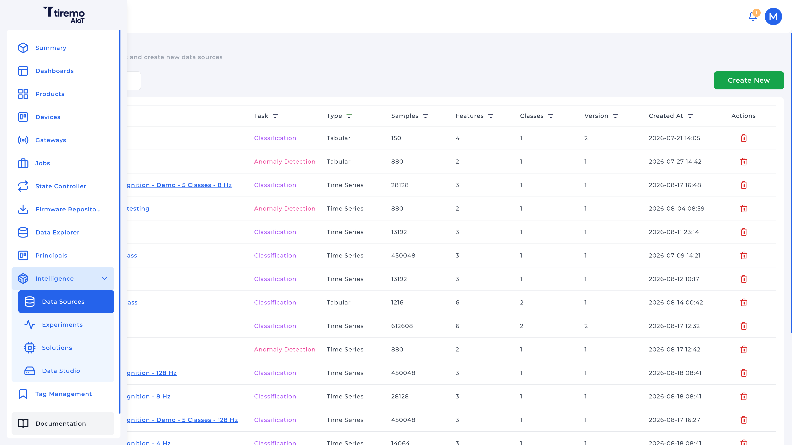
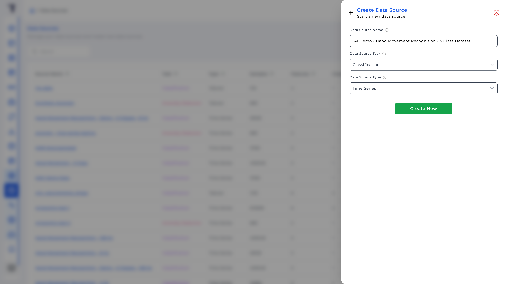
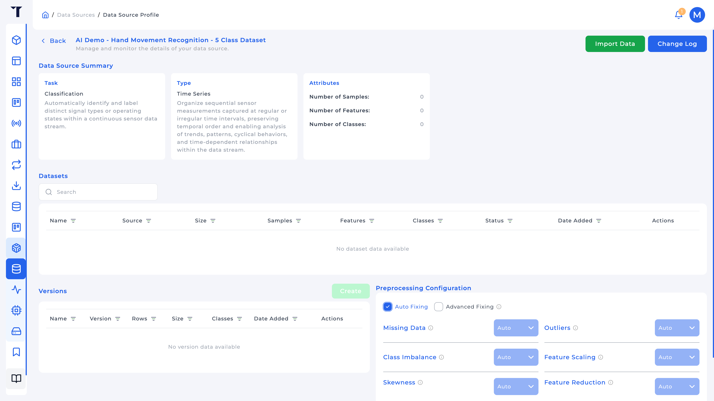
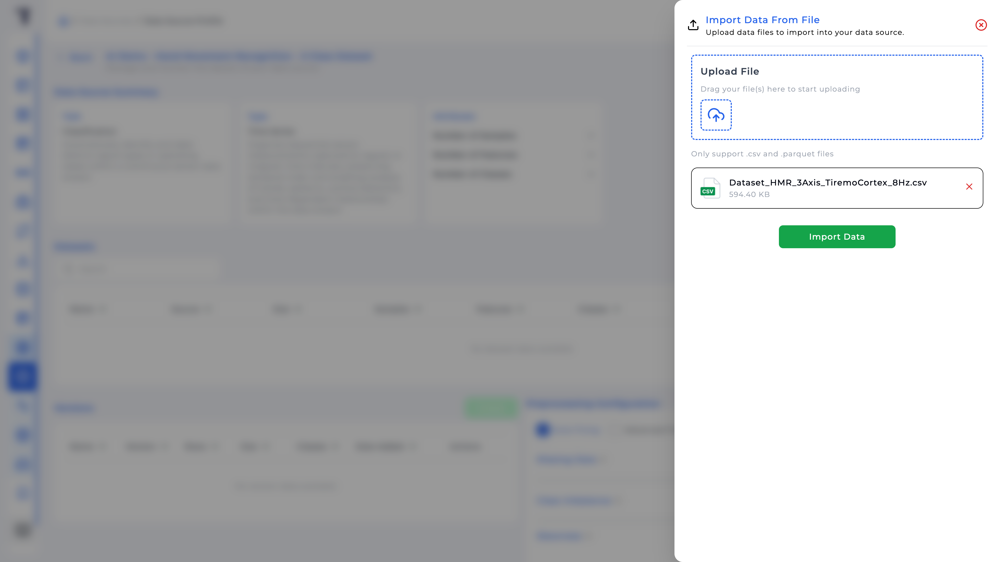
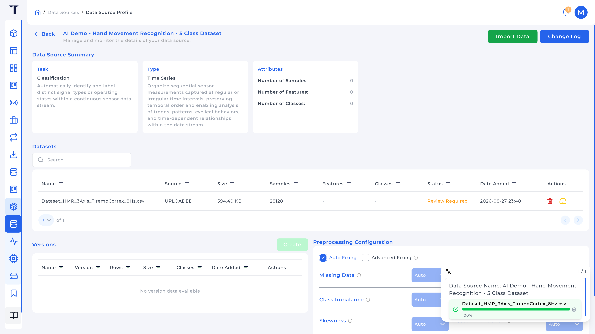
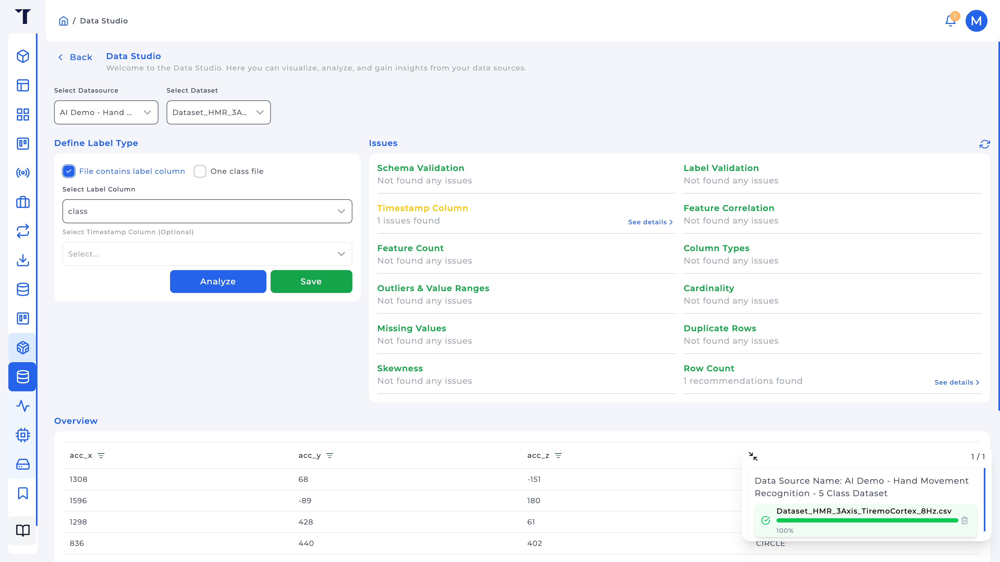
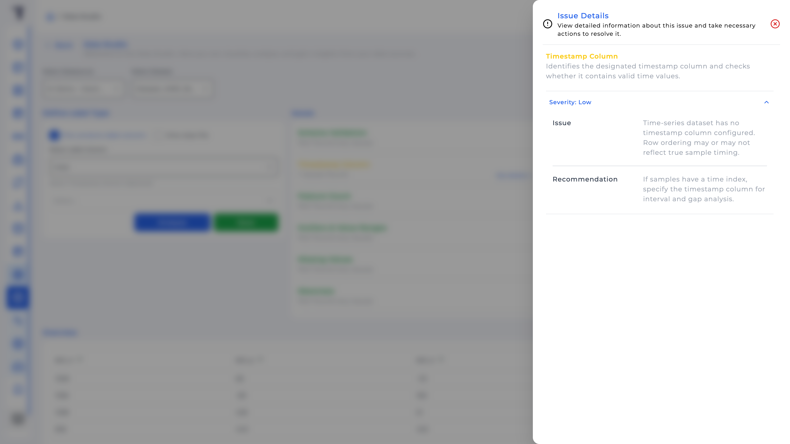
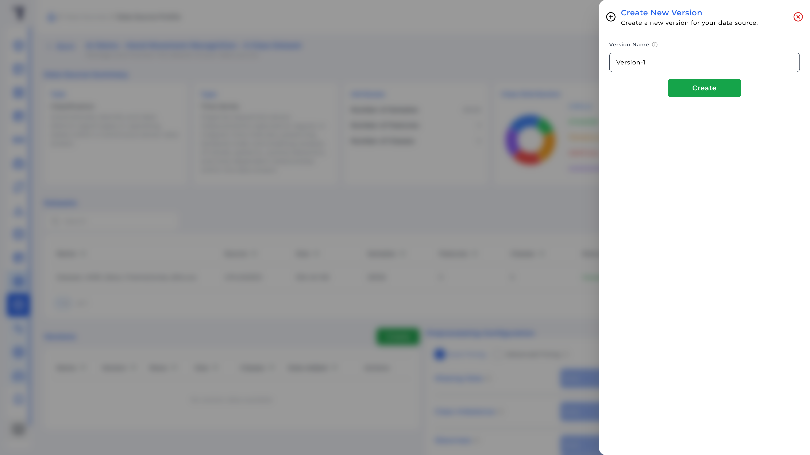

<p class="sphinxhide" align="right"><a>English</a> | <a href="../../../docs-tr/Intelligence/Feature_Tutorials/02-Data_Sources/README.md">Türkçe</a></p>
<table class="sphinxhide" width="100%">
  <tr>
    <td align="center">
      <picture>
        <source media="(prefers-color-scheme: dark)" srcset="../../../images/tiremo_sub_brand_1_mono_white.png">
        
      </picture>
      <br>
      
      <h1>Data Sources</h1>
      <sub>Tiremo Cortex Tutorials: ESP32 + Tiremo Cloud firmware, from first blink to a fleet-ready device</sub>
    </td>
  </tr>
</table>

# Data Sources

***Board: Tiremo Cortex (ESP32) · Section: Intelligence / Feature Tutorials · Difficulty: Easy***

## Introduction

A **Data Source** is the Intelligence object that owns datasets, their analysis, and the frozen **versions** an Experiment is allowed to train on. Creating one is a one-way choice of **task** and **type**; those cannot be changed later, so this tutorial is about picking them on purpose, not clicking through the drawer.

You will import a CSV from [01-Data_Collection_Via_Data_Explorer](../01-Data_Collection_Via_Data_Explorer/) (or any labeled file you already have), run it through **Data Studio**, and create a version. The screenshots and sample header below use the HMR motion set as a worked example; the same screens apply to other feature columns and class names.

## You Will Learn

- **Data Source Task:** Classification, Anomaly Detection, Regression, Forecasting, and how to pick one for the problem you have
- **Data Source Type:** Time Series vs Tabular, and why sensor streams that are *shapes over time* are Time Series
- Importing `.csv` / `.parquet`, labeling in Data Studio, reading the Issues panel
- Why training uses a **Version**, not the live upload

## Prerequisites

- [01-Data_Collection_Via_Data_Explorer](../01-Data_Collection_Via_Data_Explorer/) *or* a ready file such as [`Dataset_HMR_3Axis_TiremoCortex_4Hz.csv`](../../Design_Tutorials/03-HMR_Edge_Deployment/Datasets/Dataset_HMR_3Axis_TiremoCortex_4Hz.csv) (the HMR example)
- Tiremo UI at [`iot.tiremo.ai`](https://iot.tiremo.ai), permission to create Data Sources

## Understanding Task and Type

These two fields are the whole contract. An Experiment can only link a Data Source whose **task** matches the Experiment. Getting them wrong means deleting and starting over.

### Task

| Task | What the model answers | When to use it on Cortex data |
|---|---|---|
| **Classification** | Which named state is this window? | Distinct operating states or gestures with labels. Example: HMR classes `CIRCLE`, `STANDBY`, … |
| **Anomaly Detection** | Is this window unusual vs "normal"? | A large *normal* class and rare/unknown faults, not a set of named shapes. Needs exactly two classes when you freeze a version. |
| **Regression** | What continuous number? | Estimate a quantity (for example remaining useful life), not a class name. |
| **Forecasting** | What comes *next* in the series? | Predict future samples; not "which state is happening now." |

Named-gesture HMR is Classification because each window should map to one of several **known** labels. Anomaly Detection would collapse that to normal-vs-not, which throws away `TRIANGLE` vs `CIRCLE`. Pick Anomaly Detection when you do not have those named states.

### Type

| Type | Meaning | When to use it |
|---|---|---|
| **Time Series** | Row order (and timing) matter. Models may window consecutive samples. | Sensor streams: accelerometer, vibration, anything where the event is a *shape over time*. Example: HMR. |
| **Tabular** | Each row is an independent sample. No windowing. | Spreadsheets, one-row-per-inspection features, iris-style tables. |

A CIRCLE is not one `(x,y,z)` triple; it is a sequence. Tabular would treat each millig reading as its own example and never see the orbit. Time Series is what lets training set a **Window Size** (for the HMR Edge snapshot that is 8 samples, 24 floats: 8 × 3 axes) in tutorial 03.

Classification + Time Series also requires at least 2 and at most 50 classes before you can create a version. Anomaly Detection versions need exactly 2.

## Solution

No `Sw/`. In the Tiremo UI:

1. **Intelligence → Data Sources → Create New**
2. Name (3+ characters), **Data Source Task** and **Data Source Type** for *your* problem (for named-gesture time series like HMR: Classification + Time Series) → **Create New**
3. Open the source → **Import Data** → upload CSV/Parquet
4. **Intelligence → Data Studio**: pick the source and dataset, define labels, **Analyze**, fix Issues, **Save**
5. Back on the Data Source profile → **Versions → Create** once the dataset is **Dataset Ready**



## Walkthrough

### 1. Create the Data Source

Sidebar **Intelligence** expands to Data Sources, Experiments, Solutions, Data Studio. Open **Data Sources**.



Suggested name for the HMR example: `HMR 3-axis Cortex`. Task and type lock at create time. After **Create New** the profile is empty (no datasets, no versions) until you import.



### 2. Import a file

On the profile, **Import Data**. Only `.csv` and `.parquet`. Feature columns must be numeric. For classification, either include a label column or import one class per file.

The HMR example header is:

```text
acc_x,acc_y,acc_z,class
```

Values are milli-g integers, labels are the five gesture names. If you came from Data Explorer, rename `data.<key>` → `<key>` first (for this example, `data.acc_x` → `acc_x`) and ensure there is either a `class` column or a single implicit class.



Status moves through upload / extract / analysis (`Upload in Progress`, `Statistics Extraction in Progress`, `Analysis in Progress`, then **Dataset Ready** or **Review Required** / **Dataset Improper**). Data Studio is how you clear review. After import the dataset row appears on the profile; **Review Required** means labels and issues are not saved yet.



### 3. Data Studio: labels and issues

**Intelligence → Data Studio**. Select the Data Source and the uploaded dataset.

**Define Label Type:**

- **File contains label column**: set **Select Label Column** to the label field. For the HMR CSVs that is `class`. Optional timestamp column if you have one (Explorer exports do; the bundled HMR files do not; row order is the time axis).
- **One class file**: whole file is one class; type the Class Name (`CIRCLE`, …). For anomaly, the UI offers Normal / Anomaly.

**Analyze**, then read **Issues**: schema, row count, feature count, column types (features must be numeric), missing values, duplicates, outliers, correlation, skewness, **Label Validation**, timestamp checks. Classification will show class distribution; the bundled 4 Hz HMR file is unbalanced (`STANDBY` is the smallest class). That is a warning to think about, not an automatic fail.





**Save** when you accept the labeling. Saved datasets cannot change label type.

On the Data Source profile, **Preprocessing Configuration** can stay **Auto Fixing** unless you have a reason to pick missing-data / outlier / imbalance / scaling strategies by hand.

### 4. Freeze a version

**Versions → Create**, give a name you can recognize later (`4Hz-labeled`, `128Hz-raw`, …). Experiments link *this* version, not "whatever was last uploaded." New captures become new datasets and, when you are ready, a new version.



## Done When

The Data Source summary shows the task and type you chose, a sample count, feature and class counts that match the file, and at least one version you can select from an Experiment. Tutorial 03 links that version and trains.

<p align="center"></p>

<p class="sphinxhide" align="center"><sub>Tiremo Cortex Tutorials, Empa Electronics</sub></p>
