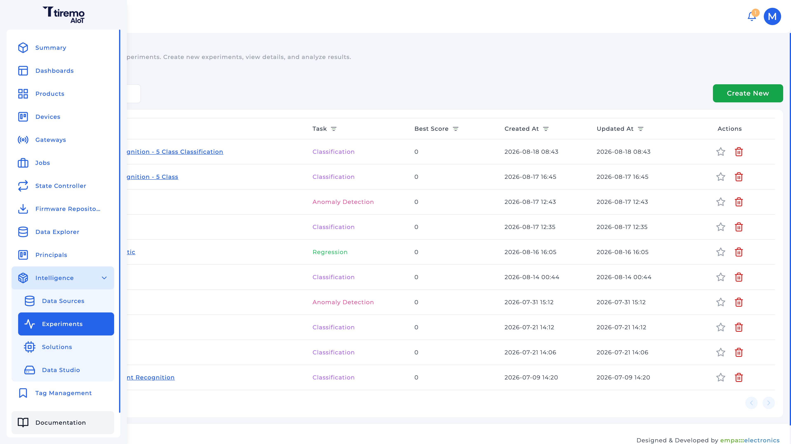
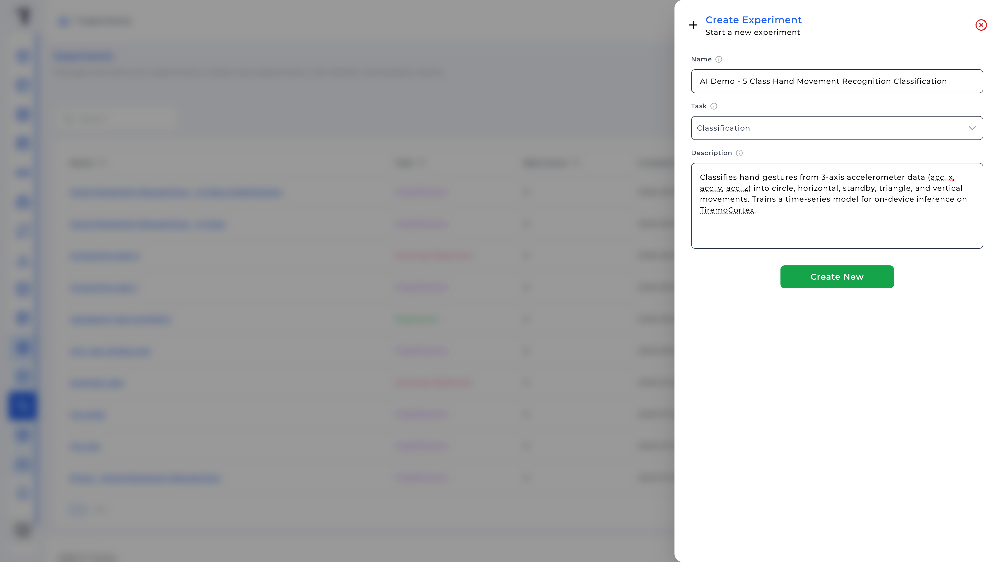
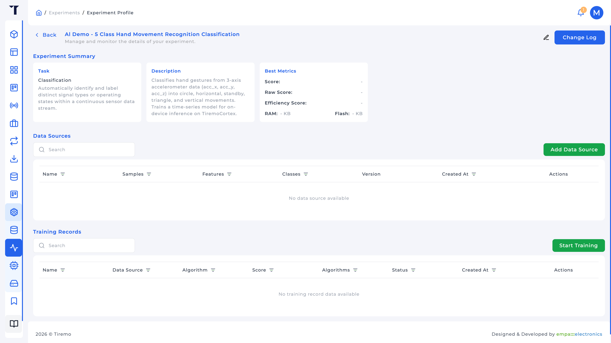
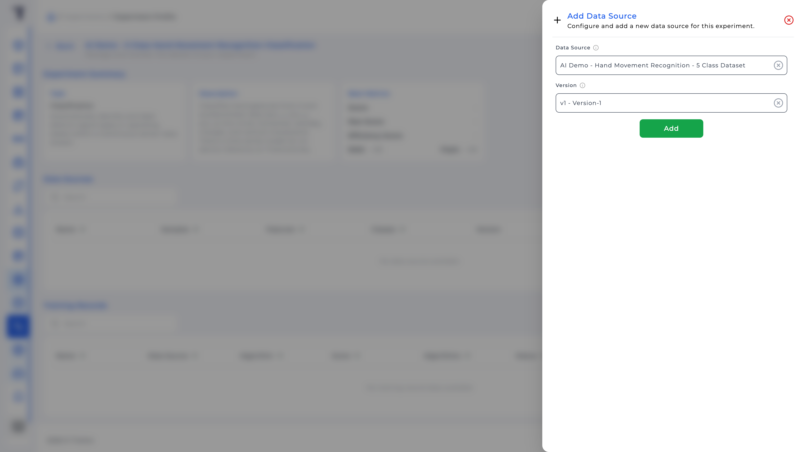
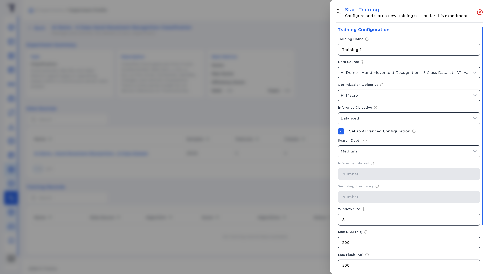
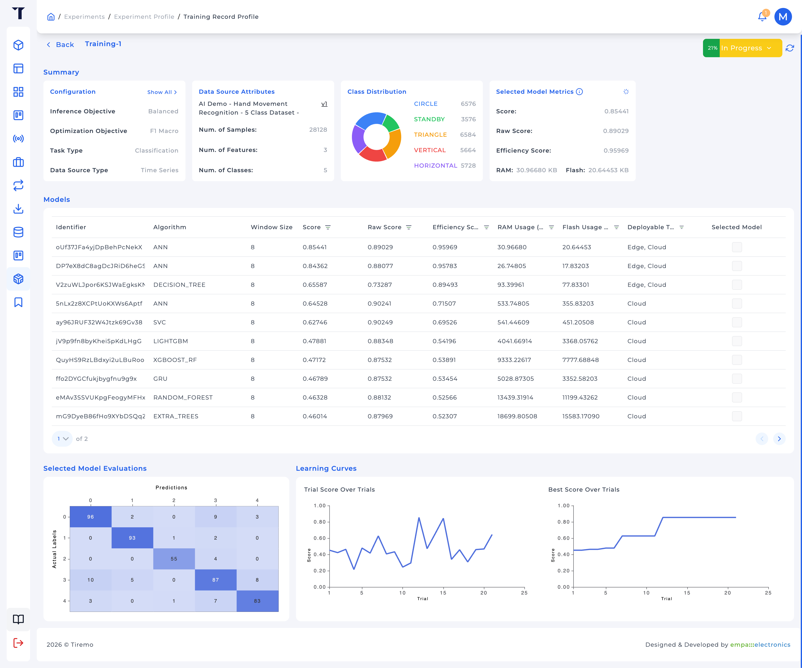

<a>English</a> | <a href="../../../docs-tr/Intelligence/Feature_Tutorials/03-Experiments/README.md">Türkçe</a>

<table class="sphinxhide" width="100%">
  <tr>
    <td align="center">
      <picture>
        <source media="(prefers-color-scheme: dark)" srcset="../../../images/tiremo_sub_brand_1_mono_white.png">
        
      </picture>
       
      
      <h1>Experiments</h1>
      Tiremo Cortex Tutorials: ESP32 + Tiremo Cloud firmware, from first blink to a fleet-ready device
    </td>
  </tr>
</table>

# Experiments

***Board: Tiremo Cortex (ESP32) · Section: Intelligence / Feature Tutorials · Difficulty: Medium***

## Introduction

An **Experiment** is the search: same task as the Data Source, one or more linked source versions, then **Training Records** that try algorithms under a RAM/flash budget. You do not pick "ANN" by hand up front; you set objectives, optionally a window, and the platform searches. You *do* pick which finished model is **Selected** for a later Solution.

The table of training knobs below includes a worked HMR Edge example. Use those values when you are following that case; change them when the problem, class balance, or MCU budget is different.

## You Will Learn

- Creating an Experiment (name, task, description); task is locked
- Linking a compatible Data Source version
- **Start Training**: optimization vs inference objectives, search depth, window size vs sampling frequency
- Reading Score / Raw Score / Efficiency Score, RAM, flash, and **Deployable Targets**
- Selecting the model a Solution will deploy

## Prerequisites

- [02-Data_Sources](../02-Data_Sources/) with a **Dataset Ready** version whose task matches the Experiment you will create (Classification + Time Series for the HMR example)
- Tiremo UI at [`iot.tiremo.ai`](https://iot.tiremo.ai)

## Understanding Training Configuration

**Create Experiment** only asks for Name, **Task**, Description. Task must match the Data Source (`CLASSIFICATION` for the HMR example). It cannot be edited later.

**Start Training** is where the search is specified.

| Field | What it does | Example: HMR Edge |
|---|---|---|
| **Training Name** | Label in the list, not a model id | e.g. `HMR 4Hz window8 balanced` |
| **Data Source** | Linked version to learn from | The version from tutorial 02 |
| **Optimization Objective** | Accuracy metric to maximize | **F1 Macro** when classes are uneven (`STANDBY` smaller than `CIRCLE`/`TRIANGLE`); macro F1 does not let majority classes hide that. Use Accuracy when classes are balanced and you mean it. |
| **Inference Objective** | How hard to punish on-device cost | **Balanced** for Edge. **Raw** ignores RAM/flash. **Memory** / **Storage** / **Latency** pull toward those costs |
| **Search Depth** | How many trials | **Medium** is the platform default (Shallow faster, Deep slower) |
| **Window Size** | Consecutive Time Series samples per input | **8** for the shipped `Tiremo_AI` (`TIREMO_WINDOW_SIZE`). When set, sampling frequency and inference interval are ignored. Leave unset, or pick another size, when your event duration is different. |
| **Sampling Frequency** (Hz) | Sensor rate, used with inference interval to size the window | Use this *or* Window Size, not both. 4 or 8 if you did not fix the window in the HMR files |
| **Inference Interval** (s) | Gap between windows | Ignored when Window Size is set |
| **Max RAM / Max Flash (KB)** | Ceiling for marking a trial Edge-deployable | Leave empty for platform defaults (2048 KB RAM, 1024 KB flash), or set the MCU budget |
| **Minimum Score Threshold** | Drop weak trials | Default 0.40 if empty |

Window size 8 on 3-axis HMR data is a 24-float vector. That is small enough for an MCU; it is also why the Design Tutorial downsampled 128 Hz: eight samples at 128 Hz is 62.5 ms, which is not a gesture. A different stream (one feature, a slower event, a tabular Data Source) will not use that window.

Time Series Classification will try classical models plus ANN / CNN / LSTM / GRU. Tabular drops the convolutional/recurrent ones. You will see that as rows in **Models**.

## Solution

No `Sw/`.

1. **Intelligence → Experiments → Create New**: same **Task** as the Data Source (Classification for the HMR example)
2. Open the experiment → **Add Data Source** → pick the source + version
3. **Start Training** with knobs that match the problem (enable **Setup Advanced Configuration** if you need Window Size / RAM / flash; the HMR Edge example is in the table above)
4. Wait until status is **Completed** (progress arrives over the websocket; refresh if needed)
5. Open the Training Record → inspect **Models** → check **Selected Model** on a row whose **Deployable Targets** match where you will deploy (Edge if you will download firmware)

## Walkthrough

### 1. Create the Experiment

Name and description are search/display only. Task is the one that must match. After create, the profile has empty Data Sources and Training Records until you add a version and start a search.

### 2. Link a Data Source

On the profile, **Data Sources → Add Data Source**. Only sources whose task matches this Experiment are listed. Pick a **Version**: if the version list is empty, go back to tutorial 02 and create one.

### 3. Start Training

**Start Training**. Fill Training Configuration, then optionally **Setup Advanced Configuration**.

Status: Pending → In Progress → Completed (or Failed / Stopped). You can **Stop Training** from the record while it runs.

### 4. Read the record and pick a model

The Training Record summary repeats inference/optimization objectives, task, data type, sample/feature/class counts, class distribution, and the **selected** model's Score / Raw / Efficiency / RAM / Flash.

**Models** is the trial table: algorithm name, window size, scores, RAM, flash, **Deployable Targets** (e.g. Edge), **Selected Model** checkbox. You can change the selection after **Completed** or **Stopped**.

**Selected Model Evaluations** (same page, below the table) is a confusion matrix for Classification (actual vs predicted). Use it to see whether a quiet class is being eaten by a motion class (for HMR, whether `STANDBY` is lost) before you promote the record to a Solution. The search can still be **In Progress**; the table and matrix update as trials finish.

The shipped Edge snapshot in the Design Tutorial is an **ANN** with window 8, 3 features, 5 classes; one plausible winner of that HMR search, not a requirement that you select ANN if another trial is better on your split.

## Done When

A Training Record is **Completed**, a model with the **Deployable Target** you need is **Selected** (Edge if you will download firmware), and you could explain the optimization, inference, and window choices. Tutorial 04 wraps that record in a Solution.

Tiremo Cortex Tutorials, Empa Electronics

