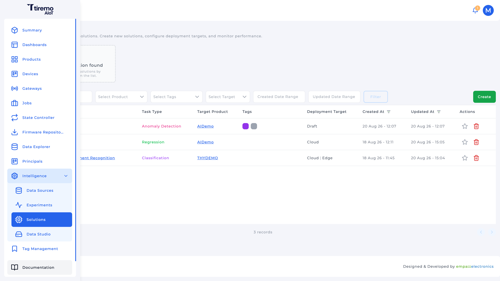
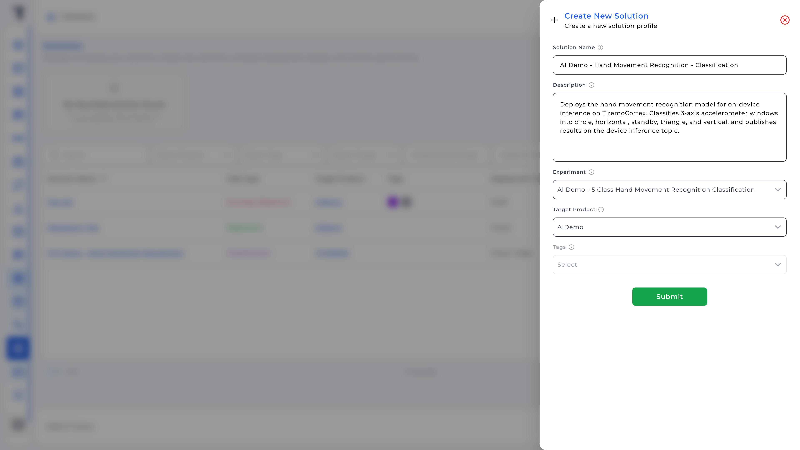
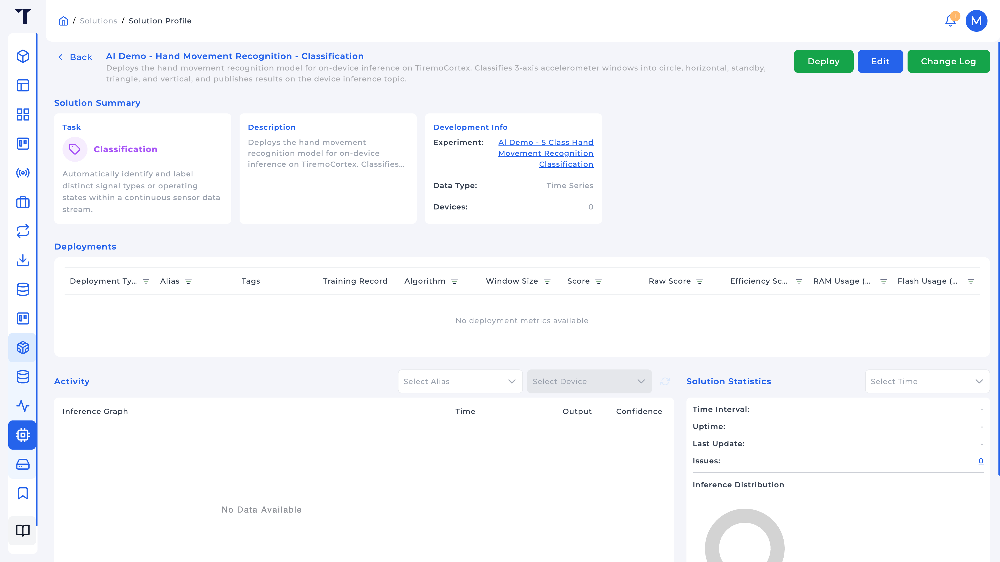
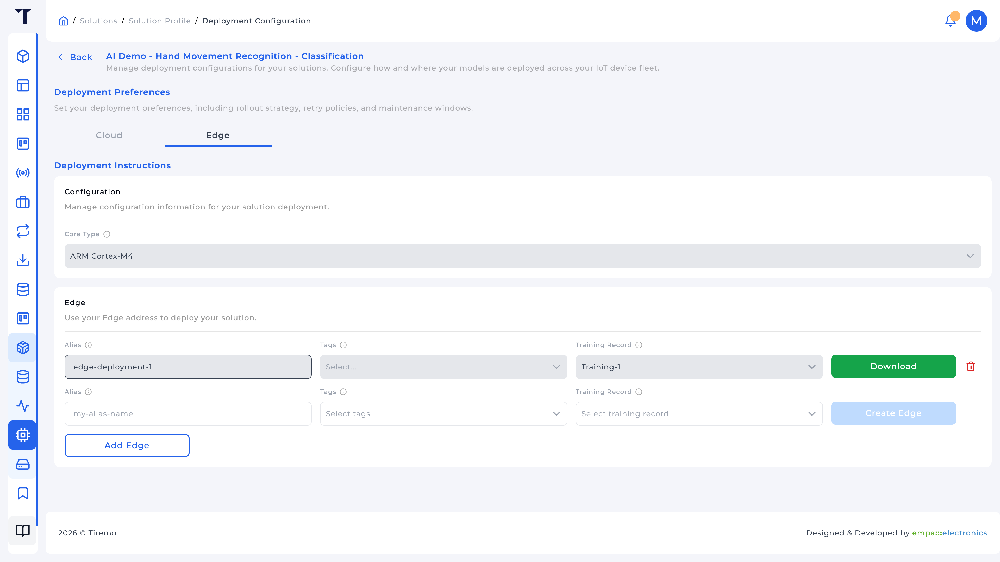
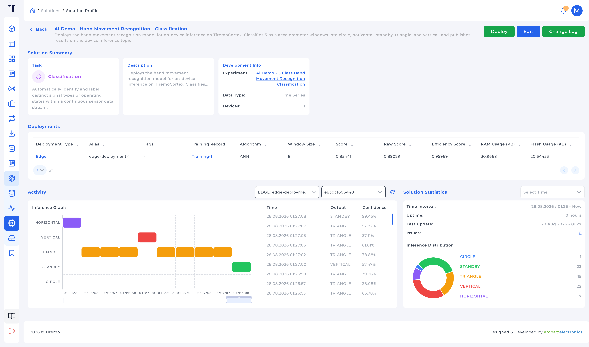

<a>English</a> | <a href="../../../docs-tr/Intelligence/Feature_Tutorials/04-Solutions/README.md">Türkçe</a>

<table class="sphinxhide" width="100%">
  <tr>
    <td align="center">
      <picture>
        <source media="(prefers-color-scheme: dark)" srcset="../../../images/tiremo_sub_brand_1_mono_white.png">
        
      </picture>
       
      
      <h1>Solutions</h1>
      Tiremo Cortex Tutorials: ESP32 + Tiremo Cloud firmware, from first blink to a fleet-ready device
    </td>
  </tr>
</table>

# Solutions

***Board: Tiremo Cortex (ESP32) · Section: Intelligence / Feature Tutorials · Difficulty: Medium***

## Introduction

A **Solution** is what you deploy: it points at an Experiment (locked after create), a target **Product**, and later one or more **Edge** or **Cloud** deployments that compile the selected Training Record into something a device or the platform can run.

This tutorial walks **Edge**: download a generated `Tiremo_AI` tree. Cloud is the other target on the same Solution; the platform scores ingested telemetry instead of the MCU. Pick Edge when inference must stay on the device, for example a motion classifier on a Tiremo Cortex, with results published on `pub/<product_id>/<device_id>/inference`.

## You Will Learn

- Creating a Solution from an Experiment + target product
- **Deploy → Edge** vs Cloud: core type, alias, training record, tags
- Why core type locks after the first Edge
- Downloading the package and what `tiremo_config.h` baked in
- Using Data Explorer **Inference** (and the Solution **Activity** graph) to see live results

## Prerequisites

- [03-Experiments](../03-Experiments/) with a **Completed** Training Record and a **Selected Model** whose **Deployable Targets** include Edge if you will download firmware
- A Product whose devices should run the model (the Cortex product you provisioned in [Tiremo Cloud](../../../Tiremo_Cloud/))
- Tiremo UI at [`iot.tiremo.ai`](https://iot.tiremo.ai)

## Understanding Edge vs Cloud

| Target | Where inference runs | You download |
|---|---|---|
| **Edge** | On the device, TensorFlow Lite Micro via `tiremo_ai_run()` | A C/C++ package (`Tiremo_AI/`): model blob, API, TFLM |
| **Cloud** | Platform pipeline on ingested telemetry | An endpoint; **Prediction Sleep Interval** paces windows |

**Core Type** tells the compiler which kernels to emit. Hover the options in the UI. Honest choices for a Cortex-class board:

- **ARM Cortex-M4**: CMSIS-NN, FPU. The HMR snapshot in the Design Tutorial was built with `-DCMSIS_NN` (see [`tiremo_makefile.mk`](../../Design_Tutorials/03-Edge_Deployment_HMR/Sw/Tiremo_AI/tiremo_makefile.mk)).
- **ARM Cortex-M3**: integer-only; closer to the ABOV A34G43A if you are compiling *for that chip* without an FPU.
- **Generic / Reference Kernels**: portable default when the MCU is unclear (`host-reference`). The UI defaults here until you pick otherwise.

Core type **locks after the first Edge** on that Solution. Pick it as if you meant it.

**Alias** is a short name baked into the firmware (`TIREMO_DEPLOYMENT_ALIAS`): lowercase, numbers, hyphens, unique on the Solution. Inference JSON carries it so Data Explorer can tell deployments apart.

**Tags** optionally scope which devices of the target product receive the deployment. The same tag set cannot pair twice with the same Training Record.

Identity macros in the generated header also include `TIREMO_SOLUTION_IDENTIFIER` and `TIREMO_DEPLOYMENT_IDENTIFIER`. Do not edit generated files; a new download replaces the tree.

## Solution

No `Sw/` in *this* tutorial; download only. Wiring the package into firmware is the Design Tutorial (HMR on the Cortex is the worked case).

1. **Intelligence → Solutions → Create New**
2. Name, description, **Experiment**, **Target Product**, optional tags
3. Open the Solution → **Deploy** → **Edge** (or **Cloud** if inference should stay in the platform)
4. For Edge: set **Core Type**, add a row: **Alias**, **Training Record**, optional device tags → **Create Edge**
5. Wait until status is **Ready** (or **In Service**) → **Download**
6. Unzip; you should see `tiremo_api.h`, `tiremo_config.h`, `tiremo_makefile.mk`, `API.md`, and `tflm/`

The Design Tutorial already contains one such unzip, copied from `Tiremo-Secure-Iot-Sw-Cloud-Collect-Infer/Tiremo_Lib/Tiremo_AI`, so you can read the API without waiting on a compile.

## Walkthrough

### 1. Create the Solution

**Experiment** should already have a completed Training Record. **Target Product** is whose devices will publish inference. Tags on the Solution itself are for filtering the Solutions list, not the same as device tags on the Edge row. After submit, the profile shows summary cards, an empty Deployments table, and an empty Activity pane until you create an Edge and devices publish inference.

### 2. Create an Edge

**Deploy** (header) → tab **Edge** (not Cloud), unless you intentionally want platform-side scoring.

Statuses you will see: Pending, Creating, Ready, In Service, Failed, …. A **Ready** (or **In Service**) row exposes **Download** on the same page; Failed rows show a reason.

### 3. What you just downloaded

Open `API.md` and `tiremo_config.h` in the zip (or the snapshot under the Design Tutorial). The generated header records *your* search: task, window, feature count, class names. For the HMR snapshot that is:

- Task `CLASSIFICATION`, window 8, 3 features, input size 24, 5 classes
- Labels `CIRCLE`, `HORIZONTAL`, `STANDBY`, `TRIANGLE`, `VERTICAL`
- `tiremo_ai_run(features, &result)` then `tiremo_ai_format_mqtt_json(...)` for the EDGE JSON body
- Topic suffix `inference` → `pub/<product_id>/<device_id>/inference`

Fill the input buffer as consecutive samples in the same order and units you trained on (for HMR, `features[24]` as 8 samples of `acc_x, acc_y, acc_z` in milli-g).

### 4. Confirm results in the UI

Once firmware publishes inference:

- Solution profile **Activity**: pick device + alias, watch the predicted class (or other output) over time
- **Data Explorer**, Data Type **Inference**, same device, **Solution** required; columns include predicted class, inference time, deployment alias

## Done When

An Edge row is **Ready**, you have a zip (or you have inspected the bundled `Tiremo_AI/`), and Data Explorer can be pointed at **Inference** for that Solution. Putting `tiremo_ai_run` in the Cortex loop for the HMR case is [Design Tutorial 03](../../Design_Tutorials/03-Edge_Deployment_HMR/).

Tiremo Cortex Tutorials, Empa Electronics

