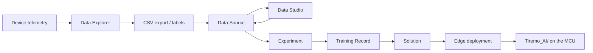

<table class="sphinxhide" width="100%">
  <tr>
    <td align="center">
      <picture>
        <source media="(prefers-color-scheme: dark)" srcset="../images/tiremo_sub_brand_1_mono_white.png">
        
      </picture>
       
      
      <h1>Intelligence</h1>
      Tiremo Cortex Tutorials: ESP32 + Tiremo Cloud firmware, from first blink to a fleet-ready device
    </td>
  </tr>
</table>

# Intelligence

Collect telemetry from a live Tiremo Cortex (or any Thing on the product), turn it into a trainable Data Source, search models in an Experiment, and deploy a Solution, including an on-device Edge package, from the **Tiremo UI** at [`iot.tiremo.ai`](https://iot.tiremo.ai). Feature Tutorials teach those Intelligence objects with no new `Sw/` firmware. The Design Tutorials then apply the same chain to one complete Human Motion Recognition (HMR) case, from 128 Hz capture through a generated `Tiremo_AI/` Edge library, and ship three Cortex binaries (telemetry, windowing, on-device inference).

The platform objects sit in a chain. Data Explorer is *not* under the Intelligence menu; it is how you inspect and export what a device already published, but it is the usual first step toward a Data Source:

- The [**Feature Tutorials**](./Feature_Tutorials/) cover one Intelligence capability each: Data Collection (Data Explorer or any preferred method), Data Sources, Experiments, Solutions. Worked examples (for instance accelerometer keys for motion classification) appear in the details, not as the only purpose of the object.
- The [**Design Tutorials**](./Design_Tutorials/) combine those objects into one shipped HMR case and flash three LIS2DE12 firmwares.

UI screenshots live in [`figures/`](./figures/). Design-tutorial captures (gestures, UART inference) live next to [`03-Edge_Deployment_HMR/figures/`](./Design_Tutorials/03-Edge_Deployment_HMR/figures/).

Tiremo Cortex Tutorials, Empa Electronics

