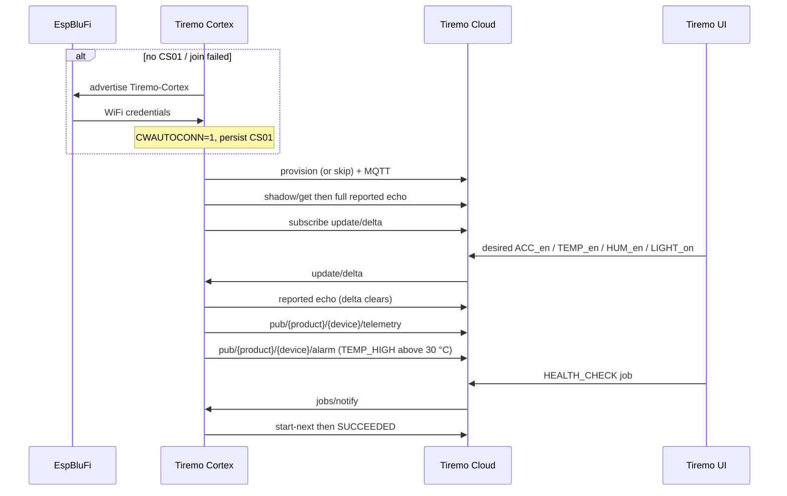
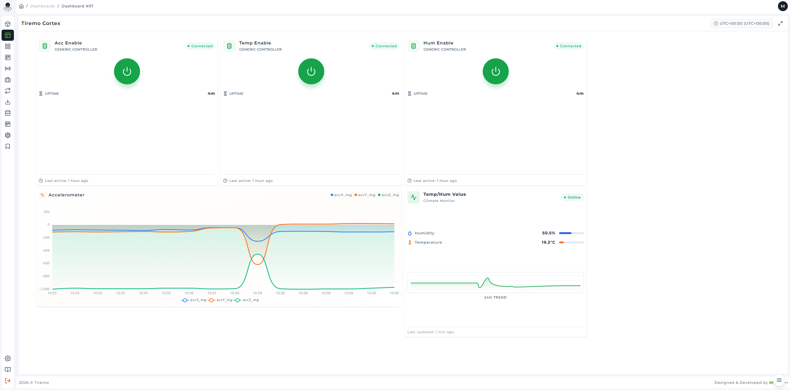
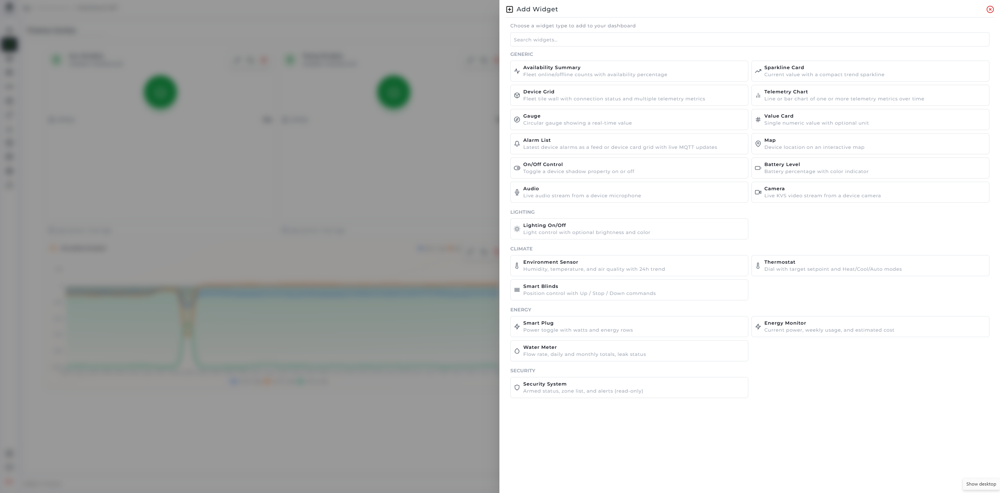

<p class="sphinxhide" align="right"><a>English</a> | <a href="../../../docs-tr/Tiremo_Cloud/Design_Tutorials/01-Sensor_Telemetry_And_Shadow_Control/README.md">Türkçe</a></p>
<table class="sphinxhide" width="100%">
  <tr>
    <td align="center">
      <picture>
        <source media="(prefers-color-scheme: dark)" srcset="../../../images/tiremo_sub_brand_1_mono_white.png">
        
      </picture>
      <br>
      
      <h1>Sensor Telemetry and Shadow Control</h1>
      <sub>Tiremo Cortex Tutorials — ESP32 + Tiremo Cloud firmware, from first blink to a fleet-ready device</sub>
    </td>
  </tr>
</table>


# Sensor Telemetry and Shadow Control

***Board: Tiremo Cortex (ABOV A34G43A, Cortex-M4) · Section: Tiremo Cloud / Design Tutorials · Difficulty: Hard***

## Introduction

This is the first Tiremo Cloud **demo** that looks like a product: BluFi (with module auto-connect) brings WiFi up, fleet provisioning joins Tiremo Cloud, a boot GET / apply / report plus live `update/delta` keep the classic shadow in sync, a **HEALTH_CHECK** job completes, the onboard sensors publish on the data plane — gated by three shadow flags — a fourth flag switches the board's ten LEDs, and a **TEMP_HIGH** alarm fires when the temperature goes above 30 °C:

```json
{"ACC_en":true,"TEMP_en":true,"HUM_en":true,"LIGHT_on":false}
```

Each flag is JSON `true`/`false` (Tiremo UI) or integer `0`/`1`. Telemetry includes only the enabled sensor keys. The Tiremo Cortex board has a LIS2DE12 accelerometer and an SHT40 temperature / humidity sensor (there is no gyroscope).

No `wifi_secrets.h`. WiFi follows the [boot cascade](../../../ESP32_Connectivity/Design_Tutorials/01-Boot_Cascade_Saved_WiFi_Then_BluFi/): saved CS01 record, else a rejoin from the module's own NVS (SSID only, no MCU password), else BluFi.

## The Exchange, at a Glance



## You Will Learn

- Combining the BluFi cascade with Tiremo Cloud (no hardcoded SSID)
- Boot shadow GET plus a standing live delta in the same ready loop
- Gating `pub/{product}/{device}/telemetry` with `ACC_en` / `TEMP_en` / `HUM_en`
- Switching the board's LEDs from the shadow with `LIGHT_on`
- Raising and clearing a temperature alarm on `pub/{product}/{device}/alarm` from a real sensor
- Completing a **HEALTH_CHECK** job (`1_<uuid>` → `SUCCEEDED`)
- Building a Tiremo UI dashboard: On/Off shadow widgets plus telemetry charts

## Prerequisites

- [ESP32 Connectivity design: Boot Cascade](../../../ESP32_Connectivity/Design_Tutorials/01-Boot_Cascade_Saved_WiFi_Then_BluFi/) (EspBluFi on a phone)
- Feature tutorials [01](../../Feature_Tutorials/01-Device_Identity_From_MAC/)–[07](../../Feature_Tutorials/07-Tiremo_Jobs/) — [06](../../Feature_Tutorials/06-Publishing_Alarms_And_Telemetry/) for the alarm format
- SHT40 + LIS2DE12 bring-up from [Sensors & Local Storage](../../../Sensors_And_Storage/), including the I2C details of its [design tutorial](../../../Sensors_And_Storage/Design_Tutorials/01-Standalone_Environmental_Logger/#two-sensors-on-one-i2c-bus)
- From your product page in the Tiremo UI: the **Identifier**, the **Secret Key**, and the **Provisioning Certificates** — see [tutorial 03](../../Feature_Tutorials/03-Fleet_Provisioning_By_Claim/#getting-credentials-from-the-tiremo-ui)
- The setup scripts from [Getting Started](../../../Getting_Started/) already run, so `tdf` is available
- To watch the log: `tdf monitor` or any serial terminal (Tera Term, PuTTY, screen, minicom, …) at 115200 8N1 on the board's USB serial port, **at least 100 columns wide** (for the banner)
- A Tiremo Cortex board (ABOV A34G43A MCU — see [Hardware Overview](../../../Hardware.md)) connected to your PC with a USB cable

## Platform documentation

- [Phase 1](https://docs.tiremo.ai/device-provisioning/first-phase) / [Phase 3](https://docs.tiremo.ai/device-provisioning/third-phase) (telemetry topic)
- [Device State Controller](https://docs.tiremo.ai/device-state-controller/introduction)
- [Jobs](https://docs.tiremo.ai/developer-guide/jobs/jobs-introduction)

## Shadow and telemetry

Classic shadow **desired**, with every key this firmware understands:

```json
{
  "ACC_en": true,
  "TEMP_en": true,
  "HUM_en": true,
  "reporting": {
    "intervalS": 60
  },
  "LIGHT_on": false
}
```

| Key | What it does | Values |
|---|---|---|
| `ACC_en` | Accelerometer keys `accX_mg` / `accY_mg` / `accZ_mg` in telemetry | `true` / `false` (or `1` / `0`) |
| `TEMP_en` | Temperature key `tempC` | `true` / `false` |
| `HUM_en` | Humidity key `humPct` | `true` / `false` |
| `reporting.intervalS` | Telemetry period in seconds (default 60, at most 3600) | number |
| `LIGHT_on` | All ten LEDs (LED1–LED10) on or off together; default off | `true` / `false` |

Samples stay on the telemetry topic — they are not stuffed into `state.reported`. Temperature and humidity are sent with two decimals, acceleration in whole mg (the sensor's resolution is 15.6 mg). With all three flags on, a sample looks like:

```json
{"uptimeS":60,"accX_mg":-7,"accY_mg":-136,"accZ_mg":975,"tempC":27.45,"humPct":23.18}
```

Send those flags from [Device State Controller](../../Feature_Tutorials/05-Live_Shadow_Delta_Handling/#sending-a-shadow-update-in-the-tiremo-ui), or from On/Off widgets on a [dashboard](#building-a-dashboard-in-the-tiremo-ui). Confirm **Device Shadow State** `desired` / `reported` / `delta` on the device page, and the samples under [Last 5 Telemetry Data](../../Feature_Tutorials/06-Publishing_Alarms_And_Telemetry/#seeing-telemetry-and-alarms-in-the-tiremo-ui) or on the same dashboard. Queue **HEALTH_CHECK** as in [tutorial 07](../../Feature_Tutorials/07-Tiremo_Jobs/#creating-a-job-in-the-tiremo-ui).

`LIGHT_on` is applied as soon as the delta arrives; the UART log shows `shadow: LIGHT_on=1` (or `=0`). It does not appear in telemetry — the shadow's `reported` side is the confirmation.

A shadow document from an older firmware may still hold a `GYRO_en` key. This firmware ignores it, and echoes it back unchanged; to remove it from the document, send `{"GYRO_en": null}` once.

## Temperature alarm

Each time a sample reads the SHT40 (so while `TEMP_en` or `HUM_en` is on), the temperature is checked against 30 °C. Only the crossings publish, with QoS 1, on `pub/{product}/{device}/alarm` — nothing repeats while the temperature stays on one side:

| Temperature | Published once |
|---|---|
| goes **above 30 °C** | `{"alarmType":"TEMPERATURE","severity":"MAJOR","code":"TEMP_HIGH","exception":"Threshold 30C exceeded"}` |
| drops back **below 30 °C** | `{"alarmType":"TEMPERATURE","severity":"INFO","code":"TEMP_HIGH_NORMAL","exception":"Temperature returned to normal"}` |

The four keys and the severity values are the ones Tiremo Cloud's alarm ingest accepts (see [tutorial 06](../../Feature_Tutorials/06-Publishing_Alarms_And_Telemetry/)). The thresholds are two constants at the top of [`tiremo_telemetry.c`](./Sw/Common/Src/tiremo_telemetry.c), in milli-degrees: `ALARM_RAISE_ABOVE_MILLI_C` and `ALARM_CLEAR_BELOW_MILLI_C`, both `30000`. A temperature that sits right at 30 °C can cross back and forth; set the clear threshold lower (for example `29500`) to add a margin. The alarm is checked once per sample, so with `intervalS` at 60 it can arrive up to a minute late — lower `intervalS` while you test.

To try it, warm the SHT40 with your breath or a fingertip until it reads above 30 °C, then let it cool down.

## Solution

### Credentials

This `Sw/` needs three gitignored files, all from your product page in the Tiremo UI (see [tutorial 03](../../Feature_Tutorials/03-Fleet_Provisioning_By_Claim/#getting-credentials-from-the-tiremo-ui) for where they are):

- **`aws_iot_config.h`**: copy `aws_iot_config.h.example` to `aws_iot_config.h`, then set `TIREMO_AWS_PRODUCT_IDENTIFIER` to your **Identifier** and `TIREMO_AWS_PRODUCT_SECRET` to your **Secret Key**. The endpoint (`iot.tiremo.ai`) and template (`tiremo-default`) are already filled in.
- **`certs/claim_cert.pem`** and **`certs/claim_key.pem`**: the **Provisioning Certificates**, renamed from `<identifier>.certificate.pem` and `<identifier>.private.key`. If you already put them into Cloud Messaging 03 as `device_cert.pem` / `device_key.pem`, copy those two files here under the new names. See [`certs/README.md`](./Sw/certs/README.md).

All three names are gitignored; check `git status` before you commit anyway. If `aws_iot_config.h` or one of the certificates is missing, the build stops with a message that says what to do. There is no `wifi_secrets.h`.

### Build, flash, watch

From the repo root:

```sh
cd Tiremo_Cloud/Design_Tutorials/01-Sensor_Telemetry_And_Shadow_Control/Sw
tdf build
tdf flash
tdf monitor
```

(See [Getting_Started/01-Hello_Blink's Solution](../../../Getting_Started/01-Hello_Blink/#solution) for what `tdf` is. On macOS/Linux, `tdf.py` also works as an alias; on Windows, use `tdf`. Close any other terminal on the board's serial port before running `tdf monitor` — only one program can open it at a time.)

**Confirmed on real hardware:** `tdf build` compiles and links without errors on macOS and Windows 11 (`.text` about 55 KB; the exact size varies slightly with the toolchain version, and the linker prints the same expected, harmless `_close` / `_lseek` / `_read` / `_write is not implemented` warnings explained in [01-Hello_Blink's Solution](../../../Getting_Started/01-Hello_Blink/#solution)). `tdf flash` completed a full program-and-verify cycle over SWD on a real, connected Tiremo Cortex board (`** Verified OK **`), and the board provisioned itself, synced its shadow, and published sensor telemetry to Tiremo Cloud, a shadow `LIGHT_on` delta switched the board's LEDs on and off, and warming the SHT40 past 30 °C and letting it cool published `TEMP_HIGH` and then `TEMP_HIGH_NORMAL`. Identifiers and the network name are replaced below.

### First boot: provisioning

On a board that has never provisioned (or after a 10 s USER hold), the board claims its own identity with the Provisioning Certificates, then reports the default flags. Shortened log:

```text
[INFO] identity: deviceId=<deviceId> clientId=<product>_<deviceId> thingName=<product>_<deviceId>
[INFO] persist: loaded SSID "YourSSID" password=no
[INFO] cascade: try NVS auto-rejoin (SSID only, no MCU password)
[INFO] cascade: NVS rejoin got IP
[INFO] ESP32: online, SNTP epoch=...
[WARN] ESP32: SYSMFG read "tiremo"/"provisioned": ERROR (empty slot?)
[INFO] provision: no matching marker
[INFO] provision: write root CA (1206 bytes)
[INFO] provision: write claim certificate (1220 bytes)
[INFO] provision: write claim private key (1679 bytes)
[INFO] provision: claim MQTT connected
[INFO] provision: CreateKeysAndCertificate
[INFO] provision: RegisterThing deviceIdentifier=<deviceId>
[INFO] provision: registered Thing <product>_<deviceId>
[INFO] provision: complete; permanent MQTT connected
[INFO] shadow: get
[WARN] shadow: rejected {"code":404,"message":"No shadow exists with name: '<product>_<deviceId>'","clientToken":"tiremo-boot-get"}
[INFO] shadow: no document yet (404); will report defaults
[INFO] shadow: update accepted
[INFO] shadow: subscribed update/delta
[INFO] jobs: subscribed jobs/notify
```

The two `[WARN]` lines are expected on a first boot: there is no "provisioned" marker yet, and the cloud has no shadow document for the new device until the first report creates it. The new device shows up in the Tiremo UI under your product, named after the board's 12-hex MAC (`<deviceId>`). Every later boot logs `provision: already done; using permanent credentials` instead.

### Normal boot: telemetry and alarm

After provisioning (or on any later boot) the board reports its flags, subscribes to the delta and job topics, and publishes one sample per `intervalS`. Below, a State Controller update sets `"LIGHT_on": true` and `"reporting": {"intervalS": 1}`, then a second one sets `"LIGHT_on": false`. Shortened log:

```text
[INFO] shadow: applied ACC_en=1 TEMP_en=1 HUM_en=1 intervalS=60
[INFO] shadow: LIGHT_on=0
[INFO] shadow: update reported (119 bytes, full desired echo)
[INFO] shadow: update accepted
[INFO] shadow: get again to confirm delta is gone
[INFO] shadow: no leftover delta
[INFO] shadow: subscribed update/delta
[INFO] telemetry: topics pub/<product>/<deviceId>/telemetry  pub/<product>/<deviceId>/alarm
[INFO] jobs: start-next accepted with no execution
[INFO] jobs: subscribed jobs/notify
[INFO] telemetry: pub pub/<product>/<deviceId>/telemetry (85 bytes) {"uptimeS":0,"accX_mg":-62,"accY_mg":-74,"accZ_mg":1006,"tempC":28.05,"humPct":20.77}
[INFO] ready thingName=<product>_<deviceId> ACC=1 TEMP=1 HUM=1 intervalS=60
[INFO] telemetry: pub pub/<product>/<deviceId>/telemetry (84 bytes) {"uptimeS":60,"accX_mg":3,"accY_mg":-89,"accZ_mg":1006,"tempC":28.33,"humPct":21.72}
[INFO] shadow: delta 190 bytes
[INFO] shadow: applied ACC_en=1 TEMP_en=1 HUM_en=1 intervalS=1
[INFO] shadow: LIGHT_on=1
[INFO] shadow: desired now 45 bytes (merged)
[INFO] shadow: update reported (104 bytes, full desired echo)
[INFO] telemetry: pub pub/<product>/<deviceId>/telemetry (84 bytes) {"uptimeS":69,"accX_mg":0,"accY_mg":-89,"accZ_mg":1010,"tempC":28.35,"humPct":21.34}
[INFO] telemetry: pub pub/<product>/<deviceId>/telemetry (84 bytes) {"uptimeS":70,"accX_mg":3,"accY_mg":-89,"accZ_mg":1002,"tempC":28.36,"humPct":21.06}
...
[INFO] shadow: delta 112 bytes
[INFO] shadow: applied ACC_en=1 TEMP_en=1 HUM_en=1 intervalS=1
[INFO] shadow: LIGHT_on=0
[INFO] shadow: desired now 46 bytes (merged)
[INFO] shadow: update reported (105 bytes, full desired echo)
```

With `LIGHT_on=1` all ten LEDs light up; with `LIGHT_on=0` they go off. Warming the SHT40 with a breath takes it above 30 °C: the next sample raises `TEMP_HIGH`, and the first sample back below 30 °C clears it with `TEMP_HIGH_NORMAL` (the alarm objects are the ones in [Temperature alarm](#temperature-alarm); the log shortens the second one):

```text
[INFO] telemetry: pub pub/<product>/<deviceId>/telemetry (85 bytes) {"uptimeS":142,"accX_mg":3,"accY_mg":-93,"accZ_mg":1010,"tempC":28.48,"humPct":20.11}
[INFO] telemetry: pub pub/<product>/<deviceId>/telemetry (86 bytes) {"uptimeS":143,"accX_mg":834,"accY_mg":401,"accZ_mg":148,"tempC":30.29,"humPct":26.71}
[WARN] alarm: RAISE TEMP_HIGH temp=30.286 C
[INFO] telemetry: pub pub/<product>/<deviceId>/alarm (102 bytes) {"alarmType":"TEMPERATURE","severity":"MAJOR","code":"TEMP_HIGH","exception":"Threshold 30C exceeded"}
[INFO] telemetry: pub pub/<product>/<deviceId>/telemetry (85 bytes) {"uptimeS":144,"accX_mg":951,"accY_mg":226,"accZ_mg":35,"tempC":31.37,"humPct":43.26}
...
[INFO] telemetry: pub pub/<product>/<deviceId>/telemetry (86 bytes) {"uptimeS":217,"accX_mg":74,"accY_mg":-136,"accZ_mg":998,"tempC":30.00,"humPct":19.50}
[INFO] alarm: CLEAR TEMP_HIGH_NORMAL temp=29.997 C
[INFO] telemetry: pub pub/<product>/<deviceId>/alarm (116 bytes) {"alarmType":"TEMPERATURE","severity":"INFO","code":"TEMP_HIGH_NORMAL",...}
```

A live delta that sets `"ACC_en":false` drops the accel keys from the next sample. A **HEALTH_CHECK** job logs `SUCCEEDED` (`firmware_version=cortex-d01`).

Hold USER for 10 s to erase CS01 **and** the issued identity, then reboot into BluFi + provisioning again.

## Building a dashboard in the Tiremo UI

State Controller and the device page prove the wire protocol. A **Dashboard** is the operator view: one screen to toggle shadow flags and watch the telemetry those flags gate.

Open **Dashboards** from the sidebar (grid icon). Create a dashboard and name it (this one is **Cortex_dashboard**). Bind widgets to the same product and 12-hex device identifier as tutorials 03 and 01.

**On/Off Control** (shows as **Generic Controller**) writes classic shadow `desired` `true` / `false` on a power button. Add one per flag you care about: `ACC_en`, `TEMP_en`, `HUM_en`, and `LIGHT_on` for the LEDs.

**Telemetry Chart** plots keys from `pub/{product}/{device}/telemetry`. Bind `accX_mg` / `accY_mg` / `accZ_mg` for the accelerometer line chart. **Environment Sensor** (**Climate Monitor**) shows `tempC` and `humPct`. An **alarm list** widget shows the `TEMP_HIGH` / `TEMP_HIGH_NORMAL` alarms.



*Figure: Tiremo UI — **Cortex_dashboard**. Generic Controller power buttons for Acc / Temp / Humidity Enable; **Accelerometer** line chart (`accX_mg` / `accY_mg` / `accZ_mg`); **Temp&Hum Value** climate (`humPct` / `tempC`).*

Toggling a power button is the same desired update as State Controller. UART logs `shadow: delta` then `telemetry: pub` with only the enabled keys. Turning **Acc Enable** off drops the accel series on the next sample; the climate widget keeps updating if `TEMP_en` / `HUM_en` stay on. A button bound to `LIGHT_on` turns all ten LEDs on the board on and off (UART: `shadow: LIGHT_on=1` / `=0`).

**Add more.** Use **Add Widget** on the dashboard. This firmware has no energy, camera, or map payload — pick widgets that bind to the keys you actually publish (`uptimeS`, `acc*_mg`, `tempC`, `humPct`), to the alarms, or to shadow flags (including `LIGHT_on`). Gauges, value cards, and sparklines are the usual extras.



*Figure: Tiremo UI — **Add Widget**. **On/Off Control** for a shadow property; **Telemetry Chart** for a line or bar of one or more metrics; **Environment Sensor** under Climate; plus gauges, value cards, alarm list, and other catalog entries.*

## Walkthrough

1. [`prv_user_code.c`](./Sw/Src/prv_user_code.c) — cascade, provision, boot shadow, jobs, sensor telemetry in one loop.
2. [`tiremo_shadow.c`](./Sw/Common/Src/tiremo_shadow.c) — apply the three sensor flags, `reporting.intervalS`, and `LIGHT_on` (through the LED driver in [`tiremo_led.c`](./Sw/Drivers/led/Src/tiremo_led.c), pins in [`board_config.h`](./Sw/Board/board_config.h)); echo the full desired so delta clears.
3. [`tiremo_telemetry.c`](./Sw/Common/Src/tiremo_telemetry.c) — LIS2DE12 / SHT40 keys selected by those flags (temperature and humidity with two decimals), plus the TEMP_HIGH alarm.
4. [`tiremo_jobs.c`](./Sw/Common/Src/tiremo_jobs.c) — same health-check path as tutorial 07.
5. [`tiremo_hal_i2c.c`](./Sw/Tiremo_Hal/Src/tiremo_hal_i2c.c) and [`tiremo_sht40.c`](./Sw/Drivers/sht40/Src/tiremo_sht40.c) — the I2C fixes from the [Sensors design tutorial](../../../Sensors_And_Storage/Design_Tutorials/01-Standalone_Environmental_Logger/#two-sensors-on-one-i2c-bus); without them, both sensors fail to read here too (`telemetry: accel read failed`, `telemetry: SHT40 read failed`).
6. [`tiremo_esp32.c`](./Sw/Drivers/esp32/Src/tiremo_esp32.c) — the WiFi cascade's NVS rejoin falls back to a plain `AT+CWJAP` (join the AP stored in the module) when the module doesn't rejoin by itself; plus the filtered scan and the hidden `AT+CWJAP` in the DEBUG dump from ESP32 Connectivity.

## Done When

- The board joins WiFi without `wifi_secrets.h`, finishes boot GET / live delta, and publishes only the enabled sensor keys, with temperature and humidity as decimals.
- Toggling `ACC_en` (or `TEMP_en` / `HUM_en`) from State Controller or a dashboard On/Off widget changes the next telemetry object with no reboot.
- Setting `LIGHT_on` to `true` / `false` turns all ten LEDs on / off, and `reported` shows the same value.
- Warming the SHT40 above 30 °C publishes one `TEMP_HIGH` alarm, and cooling it below 30 °C publishes one `TEMP_HIGH_NORMAL`.
- A Tiremo UI HEALTH_CHECK execution shows **Succeeded**, and the dashboard chart and climate widgets show the samples.

<p align="center"></p>

<p class="sphinxhide" align="center"><sub>Tiremo Cortex Tutorials — Empa Electronics</sub></p>
