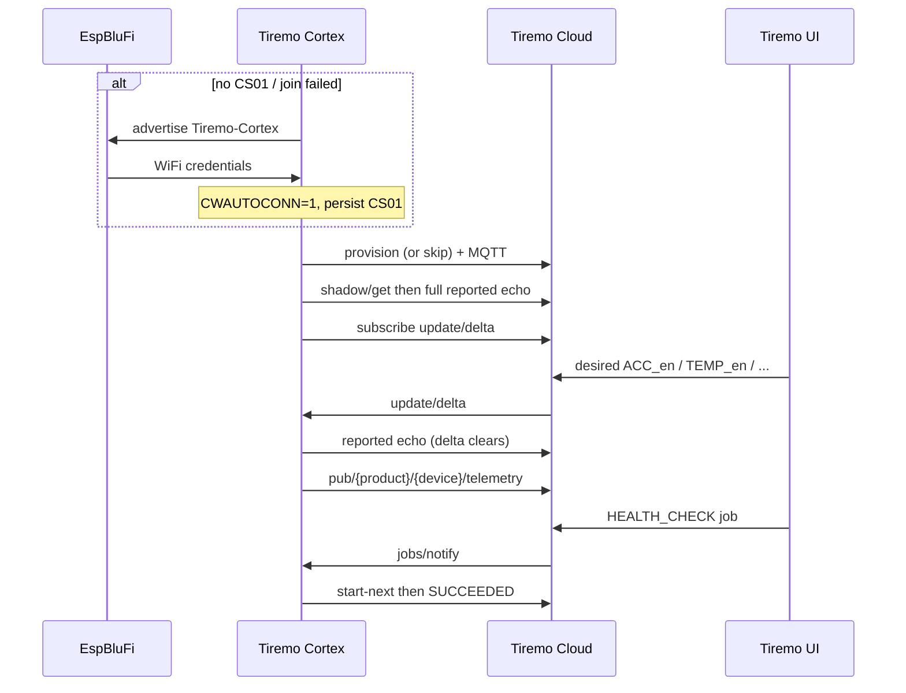

<p class="sphinxhide" align="right"><a>English</a> | <a href="../../../docs-tr/Tiremo_Cloud/Design_Tutorials/01-Sensor_Telemetry_And_Shadow_Control/README.md">Türkçe</a></p>
<table class="sphinxhide" width="100%">
  <tr>
    <td align="center">
      <picture>
        <source media="(prefers-color-scheme: dark)" srcset="../../../images/tiremo_sub_brand_1_mono_white.png">
        
      </picture>
      <br>
      
      <h1>Sensor Telemetry and Shadow Control</h1>
      <sub>Tiremo Cortex Tutorials — ESP32 + Tiremo Cloud firmware, from first blink to a fleet-ready device</sub>
    </td>
  </tr>
</table>


# Sensor Telemetry and Shadow Control

***Board: Tiremo Cortex (ESP32) · Section: Tiremo Cloud / Design Tutorials · Difficulty: Hard***

## Introduction

This is the first Tiremo Cloud **demo** that looks like a product: BluFi
(with module auto-connect) brings WiFi up, fleet provisioning joins
Tiremo Cloud, boot GET / apply / report plus live `update/delta` keep
classic shadow in sync, a **HEALTH_CHECK** job completes, and onboard
sensors publish on the data plane — gated by four flags (`true`/`false`
in the Tiremo UI, or integer `0`/`1`):

```json
{"ACC_en":true,"GYRO_en":false,"TEMP_en":true,"HUM_en":true}
```

Each flag is JSON `true`/`false` (Tiremo UI) or integer `0`/`1`. Telemetry
includes only the enabled keys. Cortex has LIS2DE12 (accel) and SHT40
(temperature / humidity). There is no gyro: `GYRO_en=true` is still
echoed as reported so delta clears, but no gyro fields are published.

No `wifi_secrets.h`. WiFi is the [boot cascade](../../../ESP32_Connectivity/Design_Tutorials/01-Boot_Cascade_Saved_WiFi_Then_BluFi/): saved CS01, else NVS SSID-only auto-rejoin (`CWAUTOCONN=1`), else BluFi.

## The Exchange, at a Glance



## You Will Learn

- Combining the BluFi cascade with Tiremo Cloud (no hardcoded SSID)
- Boot shadow GET plus standing live delta in the same ready loop
- Gating `pub/{product}/{device}/telemetry` with `ACC_en` / `GYRO_en` / `TEMP_en` / `HUM_en`
- Completing a **HEALTH_CHECK** job (`1_<uuid>` → `SUCCEEDED`)
- Building a Tiremo UI dashboard: On/Off shadow widgets plus telemetry charts

## Prerequisites

- [ESP32 Connectivity design: Boot Cascade](../../../ESP32_Connectivity/Design_Tutorials/01-Boot_Cascade_Saved_WiFi_Then_BluFi/) (EspBluFi on a phone)
- Feature tutorials [01](../../Feature_Tutorials/01-Device_Identity_From_MAC/)–
  [07](../../Feature_Tutorials/07-Tiremo_Jobs/)
- SHT40 + LIS2DE12 bring-up from [Sensors & Local Storage](../../../Sensors_And_Storage/)
- Claim PEMs, product identifier, and product secret from the Tiremo UI as in [tutorial 03](../../Feature_Tutorials/03-Fleet_Provisioning_By_Claim/#getting-credentials-from-the-tiremo-ui)
- Toolchain per [Getting Started](../../../Getting_Started/)

## Platform documentation

- [Phase 1](https://docs.tiremo.ai/device-provisioning/first-phase) / [Phase 3](https://docs.tiremo.ai/device-provisioning/third-phase) (telemetry topic)
- [Device State Controller](https://docs.tiremo.ai/device-state-controller/introduction)
- [Jobs](https://docs.tiremo.ai/developer-guide/jobs/jobs-introduction)

## Shadow and telemetry

Classic shadow **desired**:

```json
{"ACC_en":true,"GYRO_en":false,"TEMP_en":true,"HUM_en":true}
```

Integer `0`/`1` is also accepted. Optional sibling `reporting.intervalS`
still sets the publish period (default 60). Samples stay on the telemetry
topic — they are not stuffed into `state.reported`.

Example payload with accel + temperature + humidity enabled:

```json
{"uptimeS":12,"accX_mg":20,"accY_mg":-16,"accZ_mg":1000,"tempC":22,"humPct":45}
```

Send those flags from [Device State Controller](../../Feature_Tutorials/05-Live_Shadow_Delta_Handling/#sending-a-shadow-update-in-the-tiremo-ui), or from On/Off widgets on a [dashboard](#building-a-dashboard-in-the-tiremo-ui). Confirm **Device Shadow State** `desired` / `reported` / `delta` on the device page. Confirm samples under [Last 5 Telemetry Data](../../Feature_Tutorials/06-Publishing_Alarms_And_Telemetry/#seeing-telemetry-and-alarms-in-the-tiremo-ui) or on the same dashboard. Queue **HEALTH_CHECK** as in [tutorial 07](../../Feature_Tutorials/07-Tiremo_Jobs/#creating-a-job-in-the-tiremo-ui).

## Solution

[`Sw/`](./Sw/) is a real, buildable implementation (`.text` 55012). Copy
gitignored claim files from tutorial 07 (or 03):

```sh
cd Sw
cp ../../Feature_Tutorials/07-Tiremo_Jobs/Sw/aws_iot_config.h .
cp ../../Feature_Tutorials/07-Tiremo_Jobs/Sw/certs/claim_cert.pem certs/
cp ../../Feature_Tutorials/07-Tiremo_Jobs/Sw/certs/claim_key.pem certs/
tdf.py build
tdf.py flash
tdf.py monitor
```

There is no `wifi_secrets.h`. Factory-fresh boot advertises **Tiremo-Cortex**;
next reset uses saved CS01 or NVS auto-rejoin.

UART after Cloud is up (flags default `ACC_en=1`, `GYRO_en=0`, `TEMP_en=1`, `HUM_en=1`):

```text
[INFO] shadow: subscribed update/delta
[INFO] telemetry: topic pub/<product>/<id>/telemetry
[INFO] jobs: subscribed jobs/notify
[INFO] telemetry: pub pub/<product>/<id>/telemetry (... bytes) {"uptimeS":...,"accX_mg":...,"accY_mg":...,"accZ_mg":...,"tempC":...,"humPct":...}
```

A live delta that sets `"ACC_en":false` drops accel keys on the next sample.
A **HEALTH_CHECK** job logs `SUCCEEDED` (`firmware_version=cortex-d01`).

Hold USER 10 s to erase CS01 **and** the issued identity, then reboot
into BluFi + claim again.

## Building a dashboard in the Tiremo UI

State Controller and the device page prove the wire protocol. A
**Dashboard** is the operator view: one screen to toggle shadow flags
and watch the telemetry those flags gate.

Open **Dashboards** from the sidebar (grid icon). Create a dashboard
and name it (this one is **Cortex_dashboard**). Bind widgets to the
same product and 12-hex device identifier as tutorials 03 and 01.

**On/Off Control** (shows as **Generic Controller**) writes classic
shadow `desired` `true` / `false` on a power button. Add one per flag
you care about: `ACC_en`, `TEMP_en`, `HUM_en` (and `GYRO_en` if you
want the echo — Cortex still publishes no gyro keys).

**Telemetry Chart** plots keys from `pub/{product}/{device}/telemetry`.
Bind `accX_mg` / `accY_mg` / `accZ_mg` for the accelerometer line
chart. **Environment Sensor** (**Climate Monitor**) shows `tempC` and
`humPct`.


*Figure: Tiremo UI — **Cortex_dashboard**. Generic Controller power
buttons for Acc / Temp / Humidity Enable; **Accelerometer** line chart
(`accX_mg` / `accY_mg` / `accZ_mg`); **Temp&Hum Value** climate
(`humPct` / `tempC`).*

Toggling a power button is the same desired update as State Controller.
UART logs `shadow: delta` then `telemetry: pub` with only the enabled
keys. Turning **Acc Enable** off drops the accel series on the next
sample; the climate widget keeps updating if `TEMP_en` / `HUM_en` stay
on.

**Add more.** Use **Add Widget** on the dashboard. This firmware has
no lighting, energy, camera, or map payload — pick widgets that bind
to the keys you actually publish (`uptimeS`, `acc*_mg`, `tempC`,
`humPct`) or to shadow flags. Gauges, value cards, sparklines, and an
alarm list are the usual extras.


*Figure: Tiremo UI — **Add Widget**. **On/Off Control** for a shadow
property; **Telemetry Chart** for a line or bar of one or more
metrics; **Environment Sensor** under Climate; plus gauges, value
cards, alarm list, and other catalog entries.*

## Walkthrough

1. [`prv_user_code.c`](./Sw/Src/prv_user_code.c) — cascade, provision, boot
   shadow, jobs, sensor telemetry in one loop.
2. [`tiremo_shadow.c`](./Sw/Common/Src/tiremo_shadow.c) — apply the four
   flags; echo full desired so delta clears.
3. [`tiremo_telemetry.c`](./Sw/Common/Src/tiremo_telemetry.c) — LIS2DE12 /
   SHT40 keys selected by those flags.
4. [`tiremo_jobs.c`](./Sw/Common/Src/tiremo_jobs.c) — same health-check path
   as tutorial 07.

## Done When

The board joins WiFi without `wifi_secrets.h`, finishes boot GET / live
delta, publishes only the enabled sensor keys, and a Tiremo UI
HEALTH_CHECK execution shows **Succeeded**. Toggling `ACC_en` (or
`TEMP_en` / `HUM_en`) from State Controller or a dashboard On/Off
widget changes the next telemetry object with no reboot. The dashboard
chart and climate widgets show those samples.

<p align="center"></p>

<p class="sphinxhide" align="center"><sub>Tiremo Cortex Tutorials — Empa Electronics</sub></p>
