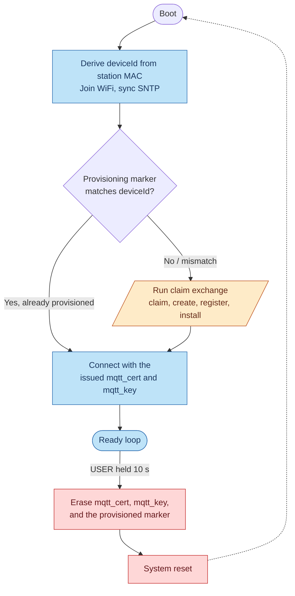
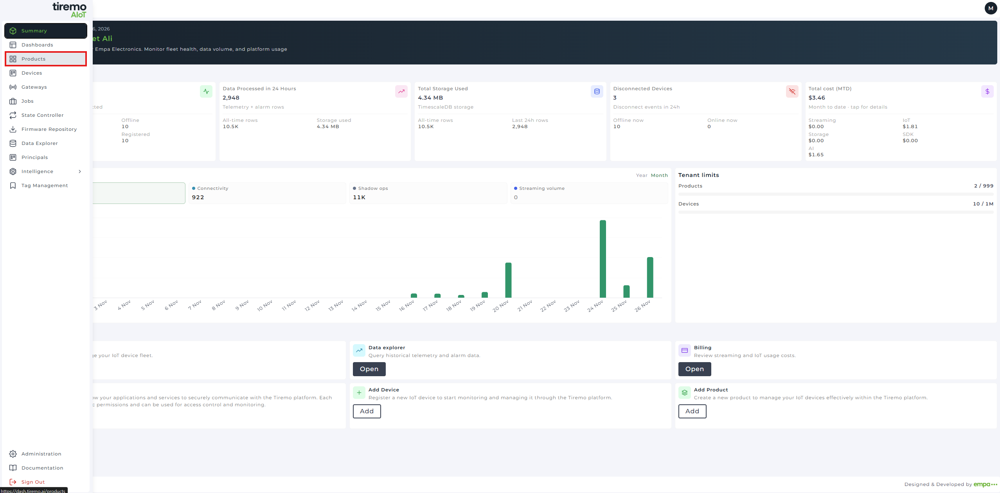
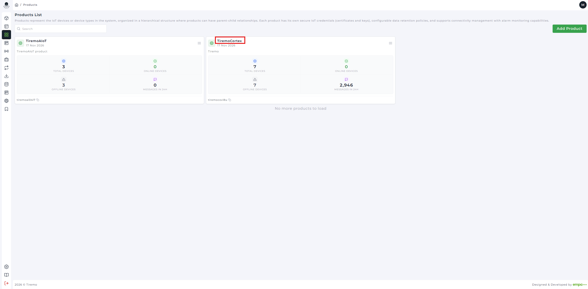
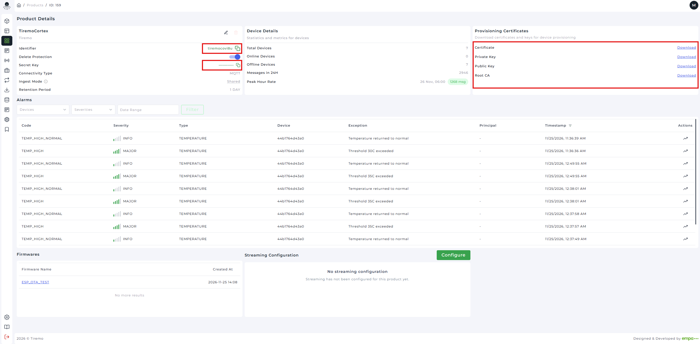
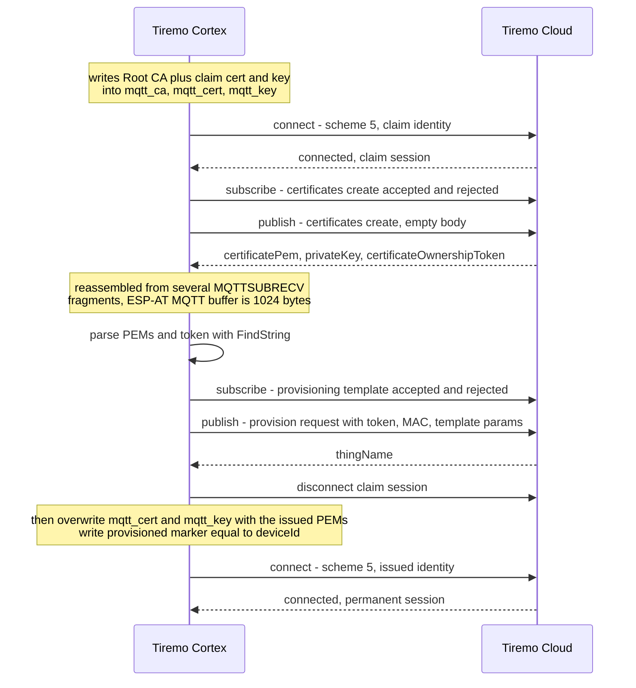

<p class="sphinxhide" align="right"><a>English</a> | <a href="../../../docs-tr/Tiremo_Cloud/Feature_Tutorials/03-Fleet_Provisioning_By_Claim/README.md">Türkçe</a></p>
<table class="sphinxhide" width="100%">
  <tr>
    <td align="center">
      <picture>
        <source media="(prefers-color-scheme: dark)" srcset="../../../images/tiremo_sub_brand_1_mono_white.png">
        
      </picture>
      <br>
      
    <h1>Fleet Provisioning by Claim Certificate</h1>
      <sub>Tiremo Cortex Tutorials — ESP32 + Tiremo Cloud firmware, from first blink to a fleet-ready device</sub>
    </td>
  </tr>
</table>


# Fleet Provisioning by Claim Certificate

***Board: Tiremo Cortex (ABOV A34G43A, Cortex-M4) · Section: Tiremo Cloud / Feature Tutorials · Difficulty: Hard***

## Introduction

[Cloud Messaging 03](../../../Cloud_Messaging/Feature_Tutorials/03-MQTT_mTLS_To_AWS_IoT/)
opened a scheme-5 mutual-TLS session with Tiremo Cloud using the
**Provisioning Certificates** from your product page. That certificate is
shared by every device of the product, and its policy only allows fleet
provisioning — it is not an identity a device should keep. This tutorial
uses it the way it is meant to be used: the board connects once with that
shared **claim** certificate, asks Tiremo Cloud to issue a unique device
certificate over MQTT, registers a Thing whose name is derived from the
station MAC, stores the issued credentials in the ESP32's own NVS, and
reconnects as itself.

A second boot must skip the exchange. The firmware writes a provisioning
marker (`tiremo` / `provisioned`) equal to this board's `deviceId`;
`TIREMO_Provision_IsDone()` reads it back and takes the permanent path.

## The Whole Lifecycle, at a Glance



One board, three journeys through this graph: the **first boot** (orange —
runs the claim exchange once), **every boot after** (blue — reads the
issued credentials straight from NVS, no network calls to Tiremo Cloud's
provisioning endpoint at all), and a **factory reset** (red — a 10 s USER
hold erases the issued identity and loops back to a first boot).

## You Will Learn

- How the shared claim certificate (the Provisioning Certificates) differs from the per-device certificate Tiremo Cloud issues
- Tiremo Cloud's provisioning-by-claim MQTT topics: `CreateKeysAndCertificate` then `RegisterThing`
- Why `deviceIdentifier` is the bare 12-hex MAC from [Tutorial 01](../01-Device_Identity_From_MAC/), not the MQTT client ID
- Parsing PEM-in-JSON with [Tutorial 02](../02-Minimal_JSON_Helpers/)'s `FindString` (newlines arrive escaped)
- Writing the issued cert/key into `mqtt_cert` / `mqtt_key` and a one-shot marker so provisioning runs once
- A 10-second USER-button factory reset (Getting Started 04's hold, no debounce) that erases those slots so the board can claim again

## Prerequisites

- [01-Device_Identity_From_MAC](../01-Device_Identity_From_MAC/) and [02-Minimal_JSON_Helpers](../02-Minimal_JSON_Helpers/)
- [Cloud Messaging 03](../../../Cloud_Messaging/Feature_Tutorials/03-MQTT_mTLS_To_AWS_IoT/) — scheme 5, SNTP-before-connect, `MQTTUSERCFG` → `MQTTSNI` → `MQTTCONN`, and the `certs/` gitignore pattern this tutorial copies
- From your product page in the **Tiremo UI**: the **Identifier**, the **Secret Key**, and the **Provisioning Certificates** — see [Getting credentials from the Tiremo UI](#getting-credentials-from-the-tiremo-ui)
- A 2.4 GHz WiFi network with internet access, and this `Sw/`'s own `wifi_secrets.h` (gitignored) — same as [Cloud Messaging tutorial 01](../../../Cloud_Messaging/Feature_Tutorials/01-MQTT_To_Public_Broker/#credentials-do-not-commit-a-password)
- The setup scripts from [Getting Started](../../../Getting_Started/) already run, so `tdf` is available
- To watch the log: `tdf monitor` or any serial terminal (Tera Term, PuTTY, screen, minicom, …) at 115200 8N1 on the board's USB serial port
- A Tiremo Cortex board (ABOV A34G43A MCU — see [Hardware Overview](../../../Hardware.md)) connected to your PC with a USB cable

## Platform documentation

This firmware implements the device side of
[Device provisioning](https://docs.tiremo.ai/device-provisioning/getting-started):

- [Phase 1](https://docs.tiremo.ai/device-provisioning/first-phase) — bootstrap (claim) certificate, product identifier, product secret
- [Phase 2](https://docs.tiremo.ai/device-provisioning/second-phase) — fleet provisioning MQTT (`CreateKeysAndCertificate` / `RegisterThing`)
- [TLS SNI](https://docs.tiremo.ai/device-provisioning/tls-sni) — `AT+MQTTSNI` for `iot.tiremo.ai`
- [Phase 3](https://docs.tiremo.ai/device-provisioning/third-phase) — reconnect with the issued permanent certificate
- Optional: [device tags](https://docs.tiremo.ai/device-provisioning/device-tags)

## Understanding the `certs/` Folder (Real vs. Gitignored)

Same three-file idea as Cloud Messaging 03:

| File | Committed? | What it is |
|---|---|---|
| [`certs/root_ca.pem`](./Sw/certs/root_ca.pem) | Yes | **Amazon Root CA 1** — public, the same for every Tiremo Cloud device, from `https://www.amazontrust.com/repository/AmazonRootCA1.pem`. Verifies Tiremo Cloud's server certificate. |
| `certs/claim_cert.pem.example` / `claim_key.pem.example` | Yes | Placeholders showing the format. |
| `certs/claim_cert.pem` | **No** (gitignored) | The claim certificate from **Provisioning Certificates** on your product page. Its policy only allows fleet provisioning (`CreateKeysAndCertificate` / `RegisterThing`), not ordinary application topics. |
| `certs/claim_key.pem` | **No** (gitignored) | The claim certificate's private key. Anyone who has it can request new device certificates for your product. |

The Provisioning Certificates download gives you two files named after
your product's identifier. Put them into `Sw/certs/` and rename them:

| Downloaded file | Rename to |
|---|---|
| `<identifier>.certificate.pem` | `claim_cert.pem` |
| `<identifier>.private.key` | `claim_key.pem` |

If you already put them into Cloud Messaging 03 as `device_cert.pem` /
`device_key.pem`, copy those two files here under the new names — they
are the same certificate and key. The build stops with
`Missing claim credentials` if either file is missing; it never embeds
the `.example` placeholders. See [`certs/README.md`](./Sw/certs/README.md).

The issued per-device certificate never lives in `certs/`. Tiremo Cloud returns it
in the CreateKeysAndCertificate JSON, and the firmware writes it straight
into the module's `mqtt_cert` / `mqtt_key` SYSMFG slots.

## Getting credentials from the Tiremo UI

The claim certificate and key, the product identifier, and the product
secret are issued in the **Tiremo UI** for your product. Template name
defaults to `tiremo-default`; the broker is `iot.tiremo.ai`.

**1. Open Products** from the left sidebar.



*Figure: Tiremo UI — click **Products** in the main menu.*

**2. Open the product** you will provision. If you are already on that
product's page, skip this step.



*Figure: Tiremo UI — click the product name to open it.*

**3. Copy the identifier and secret, and download the provisioning
certificates** from the product page.



*Figure: Tiremo UI — **Identifier** and **Secret Key** on the left,
**Provisioning Certificates** on the right.*

On that page:

- **Identifier** → `TIREMO_AWS_PRODUCT_IDENTIFIER` in gitignored `aws_iot_config.h`
- **Secret Key** → `TIREMO_AWS_PRODUCT_SECRET`. Never commit this file or paste the secret into a public issue or chat.
- **Provisioning Certificates** → download **Certificate** and **Private Key** and rename them to `certs/claim_cert.pem` and `certs/claim_key.pem` (table above). This firmware already ships Amazon Root CA 1 as `certs/root_ca.pem`; you do not need the UI **Public Key** for this tutorial.

The same bootstrap certificate, identifier, and secret are described in
[Phase 1: Prerequisites & Manufacturing Setup](https://docs.tiremo.ai/device-provisioning/first-phase).

Deployment values that are not PEMs live in gitignored
`aws_iot_config.h` (copy `aws_iot_config.h.example`): endpoint
(`iot.tiremo.ai`), template name (`tiremo-default` unless you use
another), product identifier, product secret, `isGateway`. Only the
identifier and the secret need to be filled in.

## Understanding the Provisioning Sequence

Identity first, network second, claim session third, issued session last.



```c
TIREMO_ESP32_GetHwEui(eui);
TIREMO_Identity_FromEui(eui, deviceId, sizeof(deviceId));
/* clientId = "<product>_<deviceId>" */

TIREMO_ESP32_JoinAP(...);
TIREMO_ESP32_EnableSntp();
TIREMO_ESP32_WaitSntpEpoch(&epoch, ...);   /* scheme 5 needs a real clock */

if (TIREMO_Provision_IsDone(deviceId)) {
    /* mqtt_cert/mqtt_key already hold the issued identity */
    ConnectPermanent(clientId);
} else {
    TIREMO_Provision_Run(deviceId, clientId);
}
```

`TIREMO_Provision_Run()` is the whole claim exchange:

1. Write Amazon Root CA 1, the claim cert, and the claim key into
   `mqtt_ca` / `mqtt_cert` / `mqtt_key` (`AT+SYSMFG=2`).
2. Connect with scheme 5: `MQTTUSERCFG` → `MQTTSNI` → `MQTTCONN`. Same
   order and the same SNTP requirement as Cloud Messaging 03.
3. Subscribe to `$aws/certificates/create/json/accepted` and
   `.../rejected`, publish `{}` to `$aws/certificates/create/json`.
4. Parse `certificateOwnershipToken`, `certificatePem`, and `privateKey`
   with Tutorial 02's `FindString` (PEM newlines arrive as `\n`).
5. Build the RegisterThing body with `JsonWriter`. `deviceIdentifier` is
   the bare MAC (`<deviceId>`), not `clientId`.
6. Subscribe to
   `$aws/provisioning-templates/<name>/provision/json/accepted|rejected`,
   publish the body, wait for `thingName`.
7. Disconnect, overwrite `mqtt_cert` / `mqtt_key` with the issued PEM,
   write the marker (`namespace tiremo`, key `provisioned` = `deviceId`).
8. Reconnect with the same `clientId`, now presenting the issued cert.

The RX ring and MQTT hold buffer are 8192 bytes. That is enough for
the *reassembled* CreateKeysAndCertificate JSON. ESP-AT's own MQTT
client buffer is 1024 bytes, so the module emits that payload as
several `+MQTTSUBRECV` URCs on the same topic (first fragment ~979
bytes starting with `{`, then 1024-byte PEM slices — the `frag=` /
`accum=` lines in the log below). `prvWaitAccepted()` appends those
fragments until the JSON object is complete. Treating each URC as a
full MQTT message leaves `certificateOwnershipToken` in the last slice
and the cert/key in the earlier ones — parse then fails.

## Factory Reset: 10 s USER Hold

The marker and issued cert live in the ESP32's NVS, so they survive an
MCU reflash — which is why a board that was already provisioned (by
this tutorial or a later one with the same product) skips the exchange
on its next boot. Hold USER for 10 s — same raw-press check as
[Getting Started 04](../../../Getting_Started/04-Button_Read_And_Debounce/),
no debounce, fire at the threshold without waiting for release. That
erases `mqtt_cert`, `mqtt_key`, and `tiremo`/`provisioned`, then
`NVIC_SystemReset()`. The next boot runs the claim exchange again and
registers the same Thing name with a newly issued certificate.

Works in the ready loop and in the hang path after a failed provision.

## Solution

### Credentials

This `Sw/` needs four gitignored files:

- **`wifi_secrets.h`**: copy `wifi_secrets.h.example` to `wifi_secrets.h` and set your WiFi SSID and password.
- **`aws_iot_config.h`**: copy `aws_iot_config.h.example` to `aws_iot_config.h`, then set `TIREMO_AWS_PRODUCT_IDENTIFIER` to your **Identifier** and `TIREMO_AWS_PRODUCT_SECRET` to your **Secret Key**. The endpoint and template are already filled in.
- **`certs/claim_cert.pem`** and **`certs/claim_key.pem`**: the renamed **Provisioning Certificates** — see [the `certs/` folder](#understanding-the-certs-folder-real-vs-gitignored).

All four names are gitignored; check `git status` before you commit anyway. If one of them is missing, the build stops with a message that says what to do.

### Build, flash, watch

From the repo root:

```sh
cd Tiremo_Cloud/Feature_Tutorials/03-Fleet_Provisioning_By_Claim/Sw
tdf build
tdf flash
tdf monitor
```

(See [Getting_Started/01-Hello_Blink's Solution](../../../Getting_Started/01-Hello_Blink/#solution) for what `tdf` is. On macOS/Linux, `tdf.py` also works as an alias; on Windows, use `tdf`. Close any other terminal on the board's serial port before running `tdf monitor` — only one program can open it at a time.)

Base: Cloud Messaging 03's WiFi + scheme-5 MQTT + SYSMFG driver, plus
Tutorial 01's `GetHwEui` / `Identity_FromEui` and Tutorial 02's JSON
helpers. New in this `Sw/`: `tiremo_provision.c` and the
`TIREMO_ESP32_CREDSLOT_PROV_MARKER` slot.

**Confirmed on real hardware:** `tdf build` compiles and links without errors on macOS and Windows 11 (`.text` about 30 KB; the exact size varies slightly with the toolchain version, and the linker prints the same expected, harmless `_close` / `_lseek` / `_read` / `_write is not implemented` warnings explained in [01-Hello_Blink's Solution](../../../Getting_Started/01-Hello_Blink/#solution)). `tdf flash` completed a full program-and-verify cycle over SWD on a real, connected Tiremo Cortex board (`** Verified OK **`), and the board provisioned itself into Tiremo Cloud, skipped the exchange on the next boot, and provisioned again after a 10 s USER hold. The product identifier and the board's MAC are replaced below.

### A board that is already provisioned

```text
[INFO] Fleet_Provisioning_By_Claim: boot
[INFO] hold USER 10000 ms to factory-reset (erase issued cert + marker)
[INFO] ESP32: power cycling module...
[INFO] ESP32: power-on boot delay elapsed
[INFO] TIREMO_ESP32_Init: UART2 ready
[INFO] ESP32: command echo disabled (ATE0)
[INFO] identity: deviceId=<deviceId> clientId=<product>_<deviceId>
[INFO] ESP32: online, SNTP epoch=...
[INFO] provision: marker matches <deviceId>
[INFO] provision: already done; using permanent credentials
[INFO] provision: ready deviceId=<deviceId>
```

### Factory reset, then the claim exchange

Holding USER for 10 s from the ready loop:

```text
[WARN] USER button: hold 10000 ms to factory-reset
[WARN] USER button: factory-reset hold reached
[WARN] factory reset: erase mqtt_cert, mqtt_key, provisioned marker
[INFO] factory reset: rebooting
[INFO] Fleet_Provisioning_By_Claim: boot
...
[INFO] identity: deviceId=<deviceId> clientId=<product>_<deviceId>
[INFO] ESP32: online, SNTP epoch=...
[WARN] ESP32: SYSMFG read "tiremo"/"provisioned": ERROR (empty slot?)
[INFO] provision: no matching marker
[INFO] provision: write root CA (1206 bytes)
[INFO] provision: write claim certificate (1220 bytes)
[INFO] provision: write claim private key (1679 bytes)
[INFO] provision: claim MQTT connected
[INFO] provision: CreateKeysAndCertificate
[INFO] provision: MQTT RX topic=$aws/certificates/create/json/accepted frag=979 accum=979
[INFO] provision: MQTT RX topic=$aws/certificates/create/json/accepted frag=1024 accum=2003
[INFO] provision: MQTT RX topic=$aws/certificates/create/json/accepted frag=1024 accum=3027
[INFO] provision: MQTT RX topic=$aws/certificates/create/json/accepted frag=530 accum=3557
[INFO] provision: RegisterThing deviceIdentifier=<deviceId>
[INFO] provision: MQTT RX topic=$aws/provisioning-templates/tiremo-default/provision/json/accepted frag=66 accum=66
[INFO] provision: registered Thing <product>_<deviceId>
[INFO] provision: complete; permanent MQTT connected
[INFO] provision: ready deviceId=<deviceId>
```

The `[WARN] SYSMFG read ... (empty slot?)` line is expected here: the
reset erased the marker, so there is nothing to read. The board then
shows up in the Tiremo UI under your product, named
`<product>_<deviceId>` (`<deviceId>` is the board's 12-hex MAC).

## Walkthrough

1. [`certs/`](./Sw/certs/) — Amazon Root CA 1 committed; claim PEM
   templates committed; real claim files gitignored, same as Cloud
   Messaging 03's `device_*.pem`.
2. [`prv_user_code.c`](./Sw/Src/prv_user_code.c) — MAC → `deviceId` /
   `clientId`, WiFi, SNTP, then `IsDone` vs `Run`. 10 s USER hold
   factory-resets the issued identity.
3. [`tiremo_provision.c`](./Sw/Common/Src/tiremo_provision.c) —
   claim connect, create, parse, register, install, marker, reconnect,
   `FactoryReset` erase.
4. [`tiremo_esp32.c`](./Sw/Drivers/esp32/Src/tiremo_esp32.c) — marker
   slot `tiremo`/`provisioned`; MQTT RX buffer sized for the PEM JSON;
   the WiFi password is hidden in the DEBUG dump
   (`AT+CWJAP=<credentials hidden>`).

## Done When

- A board with no issued identity provisions itself into a Thing named `<product>_<deviceId>`, with no manual certificate step, and logs `provision: complete; permanent MQTT connected`.
- The next boot logs `provision: already done; using permanent credentials` and skips the exchange.
- Holding USER for 10 s erases that identity, and the board provisions again on the following boot.

<p align="center"></p>

<p class="sphinxhide" align="center"><sub>Tiremo Cortex Tutorials — Empa Electronics</sub></p>
