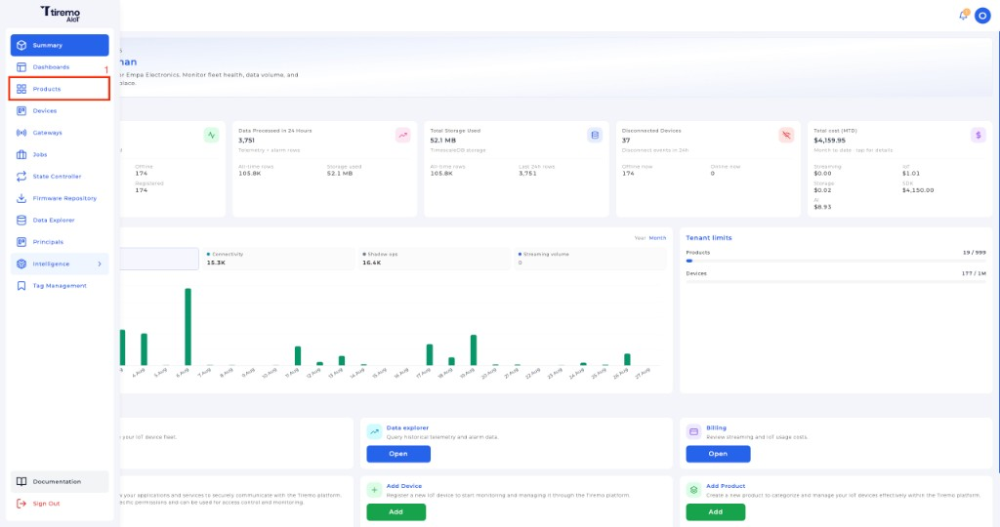
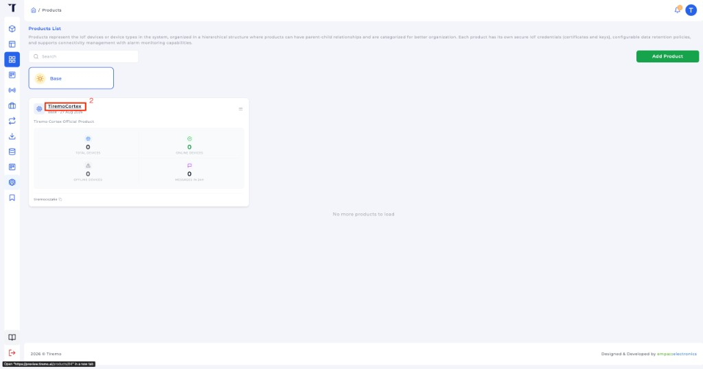
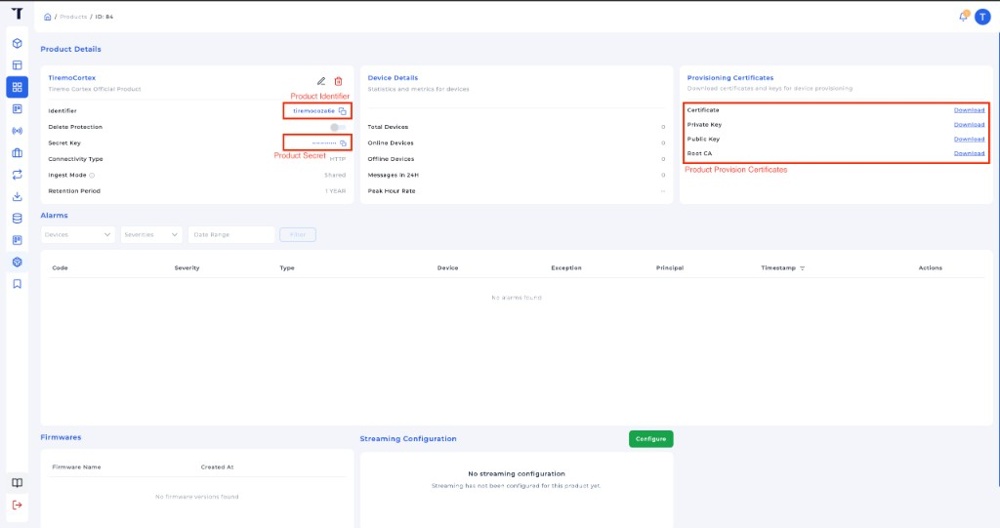
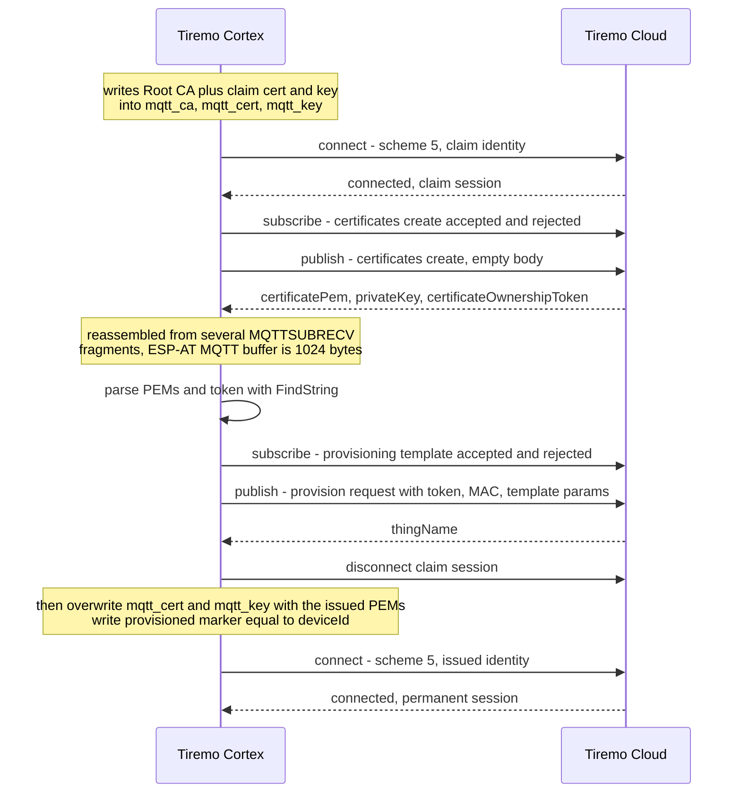

<p class="sphinxhide" align="right"><a>English</a> | <a href="../../../docs-tr/Tiremo_Cloud/Feature_Tutorials/03-Fleet_Provisioning_By_Claim/README.md">Türkçe</a></p>
<table class="sphinxhide" width="100%">
  <tr>
    <td align="center">
      <picture>
        <source media="(prefers-color-scheme: dark)" srcset="../../../images/tiremo_sub_brand_1_mono_white.png">
        
      </picture>
      <br>
      
    <h1>Fleet Provisioning by Claim Certificate</h1>
      <sub>Tiremo Cortex Tutorials — ESP32 + Tiremo Cloud firmware, from first blink to a fleet-ready device</sub>
    </td>
  </tr>
</table>


# Fleet Provisioning by Claim Certificate

***Board: Tiremo Cortex (ESP32) · Section: Tiremo Cloud / Feature Tutorials · Difficulty: Hard***

## Introduction

[Cloud Messaging 03](../../../Cloud_Messaging/Feature_Tutorials/03-MQTT_mTLS_To_AWS_IoT/)
proved a genuine scheme-5 mutual-TLS session against Tiremo Cloud — with a
certificate you created by hand for one Thing. That does not scale. This
tutorial replaces that hand-made identity with fleet provisioning
by Claim: the board connects once with a shared, tightly-scoped **claim**
certificate, asks Tiremo Cloud to issue a unique device certificate over MQTT,
registers a Thing whose name is derived from the station MAC, stores the
issued credentials in the ESP32's own NVS, and reconnects as itself.

A second boot must skip the exchange. The firmware writes a provisioning
marker (`tiremo` / `provisioned`) equal to this board's `deviceId`;
`TIREMO_Provision_IsDone()` reads it back and takes the permanent path.

## The Whole Lifecycle, at a Glance

```mermaid
flowchart TD
    A([Boot]) --> B[Derive deviceId from station MAC<br/>Join WiFi, sync SNTP]
    B --> C{Provisioning marker<br/>matches deviceId?}
    C -->|No / mismatch| D[/Run claim exchange<br/>claim, create, register, install/]
    C -->|Yes, already provisioned| E[Connect with the<br/>issued mqtt_cert and mqtt_key]
    D --> E
    E --> F([Ready loop])
    F -->|USER held 10 s| G[Erase mqtt_cert, mqtt_key,<br/>and the provisioned marker]
    G --> H[System reset]
    H -.-> A

    classDef normal fill:#bee3f8,stroke:#2b6cb0,color:#1a365d,stroke-width:1px
    classDef claim fill:#feebc8,stroke:#c05621,color:#652b19,stroke-width:1px
    classDef reset fill:#fed7d7,stroke:#c53030,color:#63171b,stroke-width:1px
    class B,E,F normal
    class D claim
    class G,H reset
```



One board, three journeys through this graph: the **first boot** (orange —
runs the claim exchange once), **every boot after** (blue — reads the
issued credentials straight from NVS, no network calls to Tiremo Cloud's
provisioning endpoint at all), and a **factory reset** (red — a 10 s USER
hold erases the issued identity and loops back to a first boot).

## You Will Learn

- How the claim certificate differs from Cloud Messaging 03's per-Thing device certificate — same `certs/` layout, different platform object
- Tiremo Cloud's provisioning-by-claim MQTT topics: `CreateKeysAndCertificate` then `RegisterThing`
- Why `deviceIdentifier` is the bare 12-hex MAC from [Tutorial 01](../01-Device_Identity_From_MAC/), not the MQTT client ID
- Parsing PEM-in-JSON with [Tutorial 02](../02-Minimal_JSON_Helpers/)'s `FindString` (newlines arrive escaped)
- Writing the issued cert/key into `mqtt_cert` / `mqtt_key` and a one-shot marker so provisioning runs once
- A 10-second USER-button factory reset (Getting Started 04's hold, no debounce) that erases those slots so the board can claim again

## Prerequisites

- [01-Device_Identity_From_MAC](../01-Device_Identity_From_MAC/) and [02-Minimal_JSON_Helpers](../02-Minimal_JSON_Helpers/)
- [Cloud Messaging 03](../../../Cloud_Messaging/Feature_Tutorials/03-MQTT_mTLS_To_AWS_IoT/) — scheme 5, SNTP-before-connect, `MQTTUSERCFG` → `MQTTSNI` → `MQTTCONN`, and the `certs/` gitignore pattern this tutorial copies
- Credentials from the **Tiremo UI** for your product: claim certificate
  and key, product identifier, and product secret — see
  [Getting credentials from the Tiremo UI](#getting-credentials-from-the-tiremo-ui)
- `wifi_secrets.h` in this `Sw/` (gitignored), same pattern as every other Cloud Messaging / ESP32 Connectivity tutorial
- Toolchain and flashing set up per [Getting Started](../../../Getting_Started/)

## Platform documentation

This firmware implements the device side of
[Device provisioning](https://docs.tiremo.ai/device-provisioning/getting-started):

- [Phase 1](https://docs.tiremo.ai/device-provisioning/first-phase) — bootstrap (claim) certificate, product identifier, product secret
- [Phase 2](https://docs.tiremo.ai/device-provisioning/second-phase) — fleet provisioning MQTT (`CreateKeysAndCertificate` / `RegisterThing`)
- [TLS SNI](https://docs.tiremo.ai/device-provisioning/tls-sni) — `AT+MQTTSNI` for `iot.tiremo.ai`
- [Phase 3](https://docs.tiremo.ai/device-provisioning/third-phase) — reconnect with the issued permanent certificate
- Optional: [device tags](https://docs.tiremo.ai/device-provisioning/device-tags)

## Understanding the `certs/` Folder (Real vs. Gitignored)

Same three-file idea as Cloud Messaging 03. The gitignored pair is the
shared **claim** identity, not a per-device Thing cert:

| File | Committed? | What it is |
|---|---|---|
| [`certs/root_ca.pem`](./Sw/certs/root_ca.pem) | Yes | **Amazon Root CA 1** — genuinely public, identical for every Tiremo Cloud tenant, fetched from `https://www.amazontrust.com/repository/AmazonRootCA1.pem`. Verifies Tiremo Cloud's server certificate. |
| `certs/claim_cert.pem.example` / `claim_key.pem.example` | Yes | Placeholders showing the format. |
| `certs/claim_cert.pem` | **No** (gitignored) | The shared claim certificate attached to the restricted fleet-provisioning policy. |
| `certs/claim_key.pem` | **No** (gitignored) | The claim certificate's private key. Anyone who has it can request new device certificates from your template. |

This mirrors `wifi_secrets.h`: a gitignored real file, a committed
`.example` template. Copy the two `.example` files to `claim_cert.pem` and `claim_key.pem`
in this same folder and paste the real claim certificate and key from
the Tiremo UI before building — see [`certs/README.md`](./Sw/certs/README.md)
and [Getting credentials from the Tiremo UI](#getting-credentials-from-the-tiremo-ui).
CMake refuses to configure if those two files are missing; it does not
silently embed the examples.

Do **not** copy Cloud Messaging 03's `device_cert.pem` / `device_key.pem`
into this folder. That pair is a hand-made Thing identity. The claim
certificate is a different platform object: its policy should only allow
`iot:Connect`, `iot:Publish`/`Subscribe` on the `$aws/certificates/create/*`
and `$aws/provisioning-templates/<template>/provision/*` topics — not
ordinary application topics.

The issued per-device certificate never lives in `certs/`. Tiremo Cloud returns it
in the CreateKeysAndCertificate JSON, and the firmware writes it straight
into the module's `mqtt_cert` / `mqtt_key` SYSMFG slots.

## Getting credentials from the Tiremo UI

The claim PEMs, product identifier, and product secret are issued in the
**Tiremo UI** for your product. Download them there — do not invent
placeholder values. Template name defaults to `tiremo-default`; the
broker is `iot.tiremo.ai`.

**1. Open Products** from the left sidebar.



*Figure: Tiremo UI — click **Products** in the main menu.*

**2. Open the product** you will provision. If you are already on that
product's page, skip this step.



*Figure: Tiremo UI — click the product name to open it.*

**3. Copy identifier, secret, and provisioning certificates** from the
product page.



*Figure: Tiremo UI — **Identifier** and **Secret Key** on the left,
**Provisioning Certificates** on the right.*

On that page:

- **Identifier** → `TIREMO_AWS_PRODUCT_IDENTIFIER` in gitignored `aws_iot_config.h`
- **Secret Key** → `TIREMO_AWS_PRODUCT_SECRET`. Never commit this file or paste the secret into a public issue or chat.
- **Provisioning Certificates** → download **Certificate** and **Private Key** into gitignored `certs/claim_cert.pem` and `certs/claim_key.pem`. This firmware already ships Amazon Root CA 1 as `certs/root_ca.pem`; you do not need the UI **Public Key** for this tutorial.

The same bootstrap certificate, identifier, and secret are described in
[Phase 1: Prerequisites & Manufacturing Setup](https://docs.tiremo.ai/device-provisioning/first-phase).

Deployment values that are not PEMs live in gitignored
`aws_iot_config.h` (copy `aws_iot_config.h.example`): endpoint
(`iot.tiremo.ai`), template name (`tiremo-default` unless you use
another), product identifier, product secret, `isGateway`. Copy the
identifier and secret from the product page above.

## Understanding the Provisioning Sequence

Identity first, network second, claim session third, issued session last.



```c
TIREMO_ESP32_GetHwEui(eui);
TIREMO_Identity_FromEui(eui, deviceId, sizeof(deviceId));
/* clientId = "<product>_<deviceId>" */

TIREMO_ESP32_JoinAP(...);
TIREMO_ESP32_EnableSntp();
TIREMO_ESP32_WaitSntpEpoch(&epoch, ...);   /* scheme 5 needs a real clock */

if (TIREMO_Provision_IsDone(deviceId)) {
    /* mqtt_cert/mqtt_key already hold the issued identity */
    ConnectPermanent(clientId);
} else {
    TIREMO_Provision_Run(deviceId, clientId);
}
```

`TIREMO_Provision_Run()` is the whole claim exchange:

1. Write Amazon Root CA 1, the claim cert, and the claim key into
   `mqtt_ca` / `mqtt_cert` / `mqtt_key` (`AT+SYSMFG=2`).
2. Connect with scheme 5: `MQTTUSERCFG` → `MQTTSNI` → `MQTTCONN`. Same
   order and the same SNTP requirement as Cloud Messaging 03.
3. Subscribe to `$aws/certificates/create/json/accepted` and
   `.../rejected`, publish `{}` to `$aws/certificates/create/json`.
4. Parse `certificateOwnershipToken`, `certificatePem`, and `privateKey`
   with Tutorial 02's `FindString` (PEM newlines arrive as `\n`).
5. Build the RegisterThing body with `JsonWriter`. `deviceIdentifier` is
   the bare MAC (`30eda0806324`), not `clientId`.
6. Subscribe to
   `$aws/provisioning-templates/<name>/provision/json/accepted|rejected`,
   publish the body, wait for `thingName`.
7. Disconnect, overwrite `mqtt_cert` / `mqtt_key` with the issued PEM,
   write the marker (`namespace tiremo`, key `provisioned` = `deviceId`).
8. Reconnect with the same `clientId`, now presenting the issued cert.

The RX ring and MQTT hold buffer are 8192 bytes. That is enough for
the *reassembled* CreateKeysAndCertificate JSON. ESP-AT's own MQTT
client buffer is 1024 bytes, so the module emits that payload as
several `+MQTTSUBRECV` URCs on the same topic (first fragment ~979
bytes starting with `{`, then 1024-byte PEM slices). `prvWaitAccepted()`
appends those fragments until the JSON object is complete. Treating
each URC as a full MQTT message leaves `certificateOwnershipToken` in
the last slice and the cert/key in the earlier ones — parse then fails.

## Factory Reset: 10 s USER Hold

The marker and issued cert live in the ESP32's NVS, so they survive MCU
reflash. A leftover `PROV1` (or a successful `deviceId` marker) is why
the next boot may skip or warn. Hold USER for 10 s — same raw-press
check as [Getting Started 04](../../../Getting_Started/04-Button_Read_And_Debounce/),
no debounce, fire at the threshold without waiting for release. That
erases `mqtt_cert`, `mqtt_key`, and `tiremo`/`provisioned`, then
`NVIC_SystemReset()`. The next boot runs the claim exchange again.

Works in the ready loop and in the hang path after a failed provision.

## Solution

[`Sw/`](./Sw/) has a real, buildable implementation. With stand-in PEMs in
place it links (`.text` 27944, `.bss` 31036). The create/register
round-trip itself is not claimed as hardware-verified until real claim
credentials are in `certs/`.

```sh
cd Sw
cp wifi_secrets.h.example wifi_secrets.h
cp aws_iot_config.h.example aws_iot_config.h          # then edit endpoint / template / product
cp certs/claim_cert.pem.example certs/claim_cert.pem  # then paste the real claim cert
cp certs/claim_key.pem.example certs/claim_key.pem    # then paste the real claim key
tdf.py build
tdf.py flash
tdf.py monitor
```

`tdf.py build` links clean (`.text` 27944 bytes) once the two claim PEM
files exist. CMake will not configure without them.

Base: Cloud Messaging 03's WiFi + scheme-5 MQTT + SYSMFG driver, plus
Tutorial 01's `GetHwEui` / `Identity_FromEui` and Tutorial 02's JSON
helpers. New in this `Sw/`: `tiremo_provision.c` and the
`TIREMO_ESP32_CREDSLOT_PROV_MARKER` slot.

First boot, with real claim credentials and a live template, should log
the claim connect, the create/register exchange, then a permanent
reconnect:

```text
[INFO] Fleet_Provisioning_By_Claim: boot
[INFO] identity: deviceId=30eda0806324 clientId=<product>_30eda0806324
[INFO] ESP32: online, SNTP epoch=...
[INFO] provision: no matching marker
[INFO] provision: write claim certificate (...)
[INFO] provision: claim MQTT connected
[INFO] provision: CreateKeysAndCertificate
[INFO] provision: RegisterThing deviceIdentifier=30eda0806324
[INFO] provision: registered Thing ...
[INFO] provision: complete; permanent MQTT connected
[INFO] provision: ready deviceId=30eda0806324
```

A reset after that should skip the MQTT exchange:

```text
[INFO] provision: marker matches 30eda0806324
[INFO] provision: already done; using permanent credentials
```

Hardware verification of the create/register round-trip needs a real
claim certificate and template in `certs/` and `aws_iot_config.h` — those
files are gitignored and are not shipped with this repo. CMake will not
configure until `claim_cert.pem` and `claim_key.pem` exist.

## Walkthrough

1. [`certs/`](./Sw/certs/) — Amazon Root CA 1 committed; claim PEM
   templates committed; real claim files gitignored, same as Cloud
   Messaging 03's `device_*.pem`.
2. [`prv_user_code.c`](./Sw/Src/prv_user_code.c) — MAC → `deviceId` /
   `clientId`, WiFi, SNTP, then `IsDone` vs `Run`. 10 s USER hold
   factory-resets the issued identity.
3. [`tiremo_provision.c`](./Sw/Common/Src/tiremo_provision.c) —
   claim connect, create, parse, register, install, marker, reconnect,
   `FactoryReset` erase.
4. [`tiremo_esp32.c`](./Sw/Drivers/esp32/Src/tiremo_esp32.c) — marker
   slot `tiremo`/`provisioned`; MQTT RX buffer sized for the PEM JSON.

## Done When

A factory-fresh board provisions itself into a uniquely-named Tiremo Cloud
Thing with no manual console certificate step, stores the issued
credentials in module NVS, and skips provisioning on the next boot.
Holding USER for 10 s wipes that identity so the next boot claims again.

<p align="center"></p>

<p class="sphinxhide" align="center"><sub>Tiremo Cortex Tutorials — Empa Electronics</sub></p>
