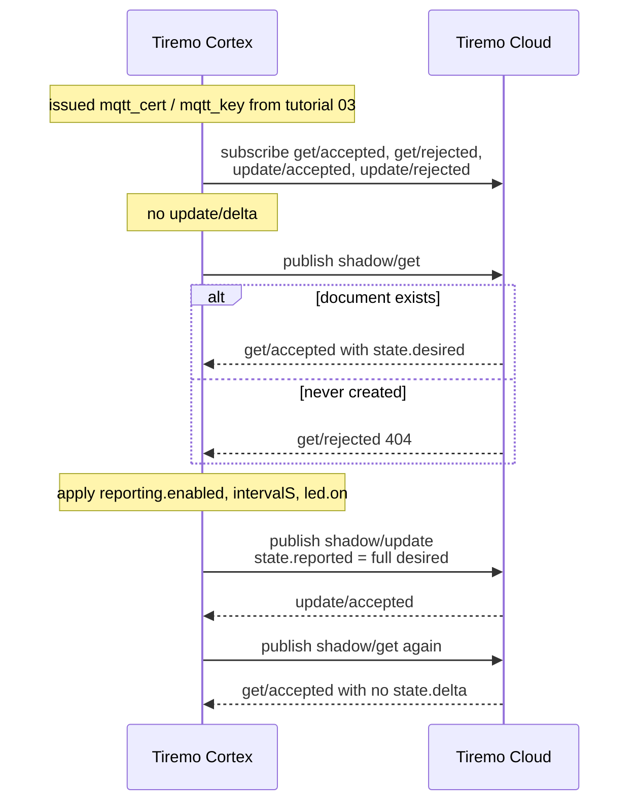
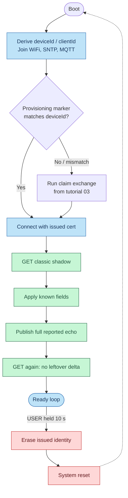

<p class="sphinxhide" align="right"><a>English</a> | <a href="../../../docs-tr/Tiremo_Cloud/Feature_Tutorials/04-Shadow_Get_Apply_Report/README.md">Türkçe</a></p>
<table class="sphinxhide" width="100%">
  <tr>
    <td align="center">
      <picture>
        <source media="(prefers-color-scheme: dark)" srcset="../../../images/tiremo_sub_brand_1_mono_white.png">
        
      </picture>
      <br>
      
      <h1>Shadow Get + Apply + Report</h1>
      <sub>Tiremo Cortex Tutorials — ESP32 + Tiremo Cloud firmware, from first blink to a fleet-ready device</sub>
    </td>
  </tr>
</table>


# Shadow Get + Apply + Report

***Board: Tiremo Cortex (ABOV A34G43A, Cortex-M4) · Section: Tiremo Cloud / Feature Tutorials · Difficulty: Hard***

## Introduction

[Tutorial 03](../03-Fleet_Provisioning_By_Claim/) left the board with a
unique issued identity in the ESP32's NVS. In this tutorial the board
uses that identity for its first application MQTT traffic. On boot it
fetches the classic Device Shadow, applies the fields it knows, and
publishes `state.reported` so Tiremo Cloud can clear the delta.

A common mistake is to report only the key that changed. Tiremo Cloud
computes the delta as *desired minus reported*. If desired is a nested
object (`reporting`, `led`, `note`) and reported is just
`{"reporting":{"enabled":true}}`, the other keys stay in the delta
forever. This firmware echoes the **full** desired object, nested fields
included, with `TIREMO_JsonWriter_Raw`.

This tutorial does **not** subscribe to `shadow/update/delta`; that
standing subscription is [tutorial 05](../05-Live_Shadow_Delta_Handling/).
Here the exchange runs once per boot: get, apply, report, confirm, then
idle.

## The Exchange, at a Glance





## You Will Learn

- The classic shadow request/response: `shadow/get` → `get/accepted` (or `get/rejected`)
- Why reported must echo the *full* desired object, not just the changed keys
- `TIREMO_JsonWriter_Raw` as the cheap way to copy a `FindObject` slice into the writer
- Reassembling a fragmented `get/accepted` the same way tutorial 03 reassembled CreateKeysAndCertificate (the ESP-AT MQTT buffer is 1024 bytes)
- Confirming the delta is gone with a second get, without opening `update/delta`

## Prerequisites

- [03-Fleet_Provisioning_By_Claim](../03-Fleet_Provisioning_By_Claim/) — a unique issued identity, not the shared claim cert. After 03 the `tiremo` / `provisioned` marker already matches this board, so this firmware skips the claim exchange.
- [02-Minimal_JSON_Helpers](../02-Minimal_JSON_Helpers/) — `FindObject` / `FindBool` / `FindUint` and the writer
- The same four gitignored files as tutorial 03, in this `Sw/` — see [Credentials](#credentials)
- The setup scripts from [Getting Started](../../../Getting_Started/) already run, so `tdf` is available
- To watch the log: `tdf monitor` or any serial terminal (Tera Term, PuTTY, screen, minicom, …) at 115200 8N1 on the board's USB serial port
- A Tiremo Cortex board (ABOV A34G43A MCU — see [Hardware Overview](../../../Hardware.md)) connected to your PC with a USB cable

## Platform documentation

The classic Device Shadow (get / apply / report, leftover delta) is
described in
[Device State Controller](https://docs.tiremo.ai/device-state-controller/introduction)
and [device firmware integration](https://docs.tiremo.ai/device-state-controller/device-integration).
The issued identity this boot path uses comes from
[fleet provisioning](https://docs.tiremo.ai/device-provisioning/getting-started).

## Understanding Thing Name vs Client ID

Shadow topics are named after the **Thing**, not the MQTT client ID:

```text
$aws/things/<thingName>/shadow/get
$aws/things/<thingName>/shadow/get/accepted
$aws/things/<thingName>/shadow/get/rejected
$aws/things/<thingName>/shadow/update
```

Tutorial 03 does not store the `thingName` that RegisterThing returns.
This firmware uses the MQTT client ID (`<product>_<deviceId>`) as the
`thingName`. That is the name the default `tiremo-default` template
registers (tutorial 03's log shows `registered Thing <product>_<deviceId>`).

If your template names the Thing differently, for example with the bare
12-hex MAC, set `TIREMO_AWS_THING_NAME` in `aws_iot_config.h` to that
name. A get that comes back `404` for the wrong Thing, or an MQTT
`not authorized` on the shadow topics, usually means the name does not
match.

## Understanding Full-Echo Reported

A realistic desired document (the same shape tutorial 02 already parsed):

```json
{
  "reporting": { "enabled": true, "intervalS": 60 },
  "led": { "on": false },
  "note": "colon:not-a-key"
}
```

Apply reads `reporting.enabled`, `reporting.intervalS`, and `led.on`. In
this tutorial "apply" only logs the values it read
(`shadow: applied ...`); it does not drive an LED. Driving outputs from
the shadow is [Design 01](../../Design_Tutorials/01-Sensor_Telemetry_And_Shadow_Control/).

Report does **not** rebuild those three keys. It copies the entire
desired object, `note` included, into `state.reported` with
`TIREMO_JsonWriter_Raw`. Tiremo Cloud then sees desired == reported and
leaves `state.delta` out of the next get.

If there is no desired (an empty shadow, or a 404 on the first get), the
firmware reports a default
`{reporting:{enabled:true,intervalS:60},led:{on:false}}` so the
document has a reported state.

Keep the demo document small. ESP-AT splits anything over 1024 bytes
into several messages, the same way it split the create-certificate
PEM; the reassembly buffer here is 8 KB.

## Solution

### Credentials

This `Sw/` needs the same four gitignored files as tutorial 03. The
easiest way is to copy them from tutorial 03's `Sw/`:

- **`wifi_secrets.h`**: your WiFi SSID and password (from `wifi_secrets.h.example`).
- **`aws_iot_config.h`**: your product's **Identifier** and **Secret Key** (from `aws_iot_config.h.example`). This tutorial's example adds an optional `TIREMO_AWS_THING_NAME`; leave it out or empty to use the client ID.
- **`certs/claim_cert.pem`** and **`certs/claim_key.pem`**: the renamed **Provisioning Certificates** — see [`certs/README.md`](./Sw/certs/README.md). The board uses them only when it has no issued identity yet (factory-fresh, or after a 10 s USER hold), but the build needs them either way.

All four names are gitignored; check `git status` before you commit anyway. If one is missing, the build stops with a message that says what to do. Where to find the values in the Tiremo UI: [tutorial 03](../03-Fleet_Provisioning_By_Claim/#getting-credentials-from-the-tiremo-ui).

### Build, flash, monitor

From the repository root:

```sh
cd Tiremo_Cloud/Feature_Tutorials/04-Shadow_Get_Apply_Report/Sw
tdf build
tdf flash
tdf monitor
```

(See [Getting_Started/01-Hello_Blink's Solution](../../../Getting_Started/01-Hello_Blink/README.md#solution) for what `tdf` is. On macOS/Linux `tdf.py` also works as an alias; on Windows use `tdf`. Close any other terminal on the board's serial port before `tdf monitor` — only one program can open the port at a time.)

**Confirmed on real hardware:** `tdf build` compiles and links without errors on macOS and Windows 11 (`.text` about 34 KB; the exact size varies slightly with toolchain version, and the linker prints the same expected, harmless `_close` / `_lseek` / `_read` / `_write is not implemented` warnings explained in [01-Hello_Blink's Solution](../../../Getting_Started/01-Hello_Blink/README.md#solution)). `tdf flash` completed a full program-and-verify cycle over SWD on a real, connected Tiremo Cortex board (`** Verified OK **`). The board had been provisioned by tutorial 03, so it skipped the claim exchange and went straight to the shadow. Below, the product identifier and the board's MAC address are replaced with placeholders:

```text
[INFO] Shadow_Get_Apply_Report: boot
[INFO] hold USER 10000 ms to factory-reset (erase issued cert + marker)
[INFO] ESP32: power cycling module...
[INFO] ESP32: power-on boot delay elapsed
[INFO] TIREMO_ESP32_Init: UART2 ready
[INFO] ESP32: command echo disabled (ATE0)
[INFO] identity: deviceId=<deviceId> clientId=<product>_<deviceId> thingName=<product>_<deviceId>
[INFO] ESP32: online, SNTP epoch=...
[INFO] provision: marker matches <deviceId>
[INFO] provision: already done; using permanent credentials
[INFO] shadow: thingName=<product>_<deviceId>
[INFO] shadow: subscribe get/accepted get/rejected (no update/delta)
[INFO] shadow: get
[INFO] shadow: MQTT RX topic=$aws/things/<product>_<deviceId>/shadow/get/accepted frag=696 accum=696
[INFO] shadow: desired 88 bytes
[INFO] shadow: applied reporting.enabled=true intervalS=1 led.on=false
[INFO] shadow: update reported (146 bytes, full desired echo)
[INFO] shadow: MQTT RX topic=$aws/things/<product>_<deviceId>/shadow/update/accepted frag=398 accum=398
[INFO] shadow: update accepted
[INFO] shadow: get again to confirm delta is gone
[INFO] shadow: MQTT RX topic=$aws/things/<product>_<deviceId>/shadow/get/accepted frag=696 accum=696
[INFO] shadow: no leftover delta
[INFO] shadow: ready thingName=<product>_<deviceId> (no live delta; that is tutorial 05)
```

The `ready` line repeats every 10 s. The byte counts depend on what is
in your shadow. If the Thing has no shadow document yet, the first get
logs `shadow: no document yet (404); will report defaults` instead of
`desired N bytes`, and the next boot sees `get/accepted`.

To try a richer desired document: in the Tiremo UI, set the Thing's
classic shadow desired to the sample object above, reset the board, and
check for `desired N bytes` followed by `no leftover delta`. The delta
in the console should be empty after the report.

## Walkthrough

1. [`prv_user_code.c`](./Sw/Src/prv_user_code.c) — the same identity /
   WiFi / SNTP / provision-or-skip path as 03, then
   `TIREMO_Shadow_GetApplyReport(thingName)`. Holding USER for 10 s still
   erases the issued identity (factory reset).
2. [`tiremo_shadow.c`](./Sw/Common/Src/tiremo_shadow.c) — topics, get,
   apply, full-echo report, confirming get. No `update/delta` subscription.
3. [`tiremo_json.c`](./Sw/Common/Src/tiremo_json.c) — `JsonWriter_Raw`,
   the one new helper this tutorial adds on top of 02.
4. [`aws_iot_config.h.example`](./Sw/aws_iot_config.h.example) — the
   optional `TIREMO_AWS_THING_NAME` for when the template's Thing name is
   not the client ID.
5. [`tiremo_esp32.c`](./Sw/Drivers/esp32/Src/tiremo_esp32.c) — the same
   driver as 03; the DEBUG dump hides the WiFi password
   (`AT+CWJAP=<credentials hidden>`).

## Done When

- A boot GET applies at least `reporting.enabled` and logs `shadow: applied ...`.
- The published `reported` echoes the full desired object, nested fields included, and the log shows `shadow: update accepted`.
- The second GET has no `state.delta` and the log shows `shadow: no leftover delta`.

Changing desired while the board is in the ready loop does nothing until
the next reset; reacting to it live is tutorial 05.

<p align="center"></p>

<p class="sphinxhide" align="center"><sub>Tiremo Cortex Tutorials — Empa Electronics</sub></p>
