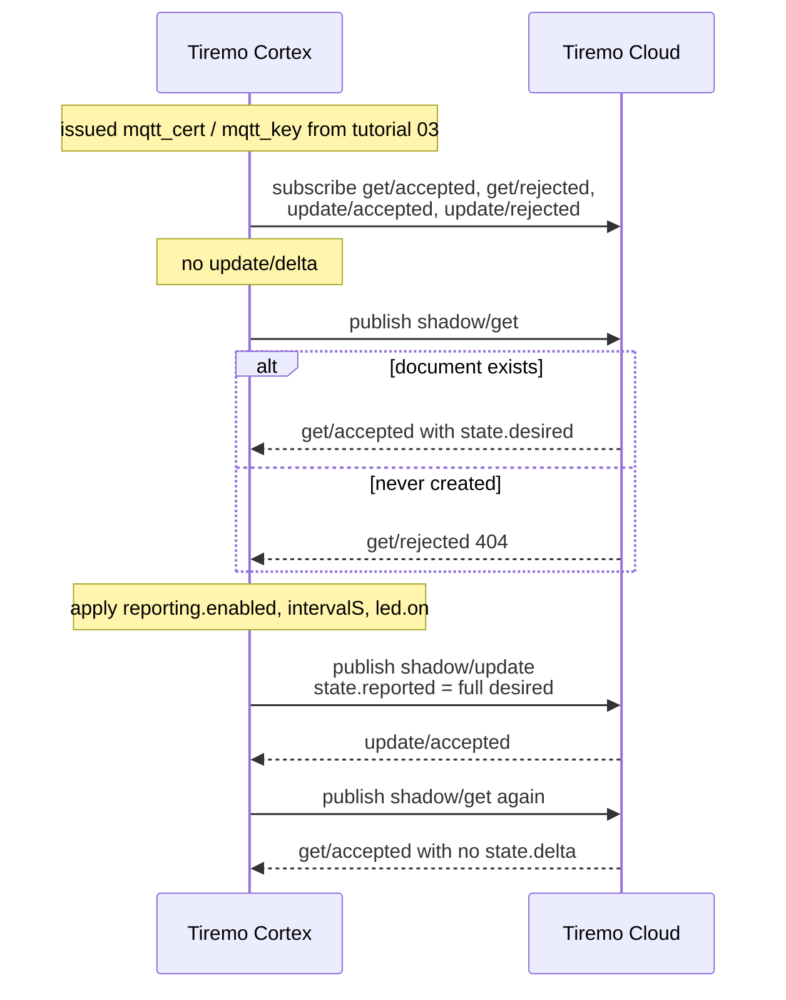
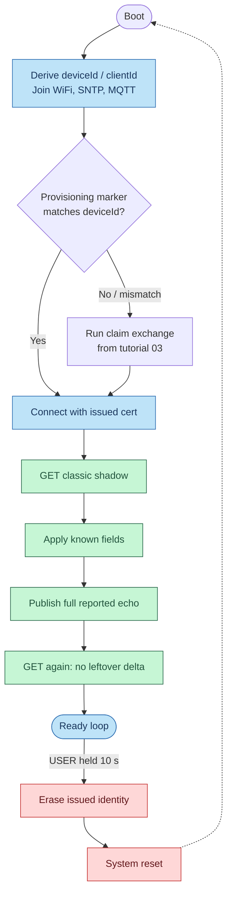

<p class="sphinxhide" align="right"><a>English</a> | <a href="../../../docs-tr/Tiremo_Cloud/Feature_Tutorials/04-Shadow_Get_Apply_Report/README.md">Türkçe</a></p>
<table class="sphinxhide" width="100%">
  <tr>
    <td align="center">
      <picture>
        <source media="(prefers-color-scheme: dark)" srcset="../../../images/tiremo_sub_brand_1_mono_white.png">
        
      </picture>
      <br>
      
      <h1>Shadow Get + Apply + Report</h1>
      <sub>Tiremo Cortex Tutorials — ESP32 + Tiremo Cloud firmware, from first blink to a fleet-ready device</sub>
    </td>
  </tr>
</table>


# Shadow Get + Apply + Report

***Board: Tiremo Cortex (ESP32) · Section: Tiremo Cloud / Feature Tutorials · Difficulty: Hard***

## Introduction

[Tutorial 03](../03-Fleet_Provisioning_By_Claim/) left the board with a
unique issued identity in the ESP32's NVS. This tutorial is the first
time that identity talks application MQTT: on boot it fetches the classic
Device Shadow, applies known fields locally, and publishes
`state.reported` so Tiremo Cloud can drop the delta.

The trap is reporting only the key that changed. Tiremo Cloud computes delta as
*desired minus reported*. If desired is a nested object
(`reporting`, `led`, `note`) and reported is just `{"reporting":{"enabled":true}}`,
the leftover siblings stay in delta forever. The firmware echoes the
**full** applied desired object — nested fields included — with
`TIREMO_JsonWriter_Raw`.

This tutorial does **not** subscribe to `shadow/update/delta`. That
standing subscription is [tutorial 05](../05-Live_Shadow_Delta_Handling/).
Here the loop is one-shot: get, apply, report, confirm, then idle.

## The Exchange, at a Glance





## You Will Learn

- Classic shadow request/response: `shadow/get` → `get/accepted` (or `get/rejected`)
- Why reported must echo the *full* applied desired object, not just the changed keys — a real production bug
- `TIREMO_JsonWriter_Raw` as the cheap way to copy a `FindObject` slice into the writer
- Reassembling a fragmented `get/accepted` the same way tutorial 03 reassembled CreateKeysAndCertificate (ESP-AT MQTT buffer is 1024 bytes)
- Confirming the delta is gone with a second get, without opening `update/delta`

## Prerequisites

- [03-Fleet_Provisioning_By_Claim](../03-Fleet_Provisioning_By_Claim/) — a unique issued identity, not the shared claim cert. After 03 the marker `tiremo` / `provisioned` already matches this board; this firmware skips the claim exchange.
- [02-Minimal_JSON_Helpers](../02-Minimal_JSON_Helpers/) — `FindObject` / `FindBool` / `FindUint` plus the writer
- The same gitignored files as 03 in this `Sw/`: `wifi_secrets.h`, `aws_iot_config.h`, `certs/claim_cert.pem`, `certs/claim_key.pem` (needed only if the board is factory-fresh or you factory-reset). Copy claim PEMs, product identifier, and product secret from the Tiremo UI as in [tutorial 03](../03-Fleet_Provisioning_By_Claim/#getting-credentials-from-the-tiremo-ui).
- Toolchain and flashing set up per [Getting Started](../../../Getting_Started/)

## Platform documentation

Classic Device Shadow (get / apply / report, leftover delta) is
[Device State Controller](https://docs.tiremo.ai/device-state-controller/introduction)
and [device firmware integration](https://docs.tiremo.ai/device-state-controller/device-integration).
The issued identity this boot path uses comes from
[fleet provisioning](https://docs.tiremo.ai/device-provisioning/getting-started).

## Understanding Thing Name vs Client ID

Shadow topics are named after the **Thing**, not the MQTT client ID:

```text
$aws/things/<thingName>/shadow/get
$aws/things/<thingName>/shadow/get/accepted
$aws/things/<thingName>/shadow/get/rejected
$aws/things/<thingName>/shadow/update
```

Tutorial 03 does not persist `thingName` from RegisterThing. This
firmware defaults `thingName` to the MQTT client ID
(`<product>_<deviceId>`, e.g. `<product>_30eda0806324`). That matches
a template that names the Thing from `productIdentifier` +
`deviceIdentifier`.

If your template uses the bare 12-hex MAC instead, set
`TIREMO_AWS_THING_NAME` in `aws_iot_config.h` to that MAC. A get that
comes back `404` with a wrong Thing, or an MQTT `not authorized` on the
shadow topics, is usually this mismatch.

## Understanding Full-Echo Reported

A realistic desired document (same shape tutorial 02 already parsed):

```json
{
  "reporting": { "enabled": true, "intervalS": 60 },
  "led": { "on": false },
  "note": "colon:not-a-key"
}
```

Apply reads `reporting.enabled`, `reporting.intervalS`, and `led.on`.
Report does **not** rebuild those three keys. It copies the entire
desired object — `note` included — into `state.reported` with
`TIREMO_JsonWriter_Raw`. Tiremo Cloud then sees desired == reported and omits
`state.delta` on the next get.

If there is no desired (empty shadow or first-ever 404), the firmware
reports a default `{reporting:{enabled:true,intervalS:60},led:{on:false}}`
so a documented reported state exists.

Keep the demo document small. ESP-AT fragments anything over 1024 bytes
the same way it fragmented the create-cert PEM; the hold buffer here is
8 KB.

## Solution

[`Sw/`](./Sw/) has a real, buildable implementation. Copy the same
gitignored files you already used in tutorial 03:

```sh
cd Sw
cp ../03-Fleet_Provisioning_By_Claim/Sw/wifi_secrets.h .
cp ../03-Fleet_Provisioning_By_Claim/Sw/aws_iot_config.h .
cp ../03-Fleet_Provisioning_By_Claim/Sw/certs/claim_cert.pem certs/
cp ../03-Fleet_Provisioning_By_Claim/Sw/certs/claim_key.pem certs/
tdf.py build
tdf.py flash
tdf.py monitor
```

Or start from the examples if this `Sw/` is a fresh clone. CMake will
not configure without the two claim PEM files.

**Verified on the connected board:** `.text` 33764 bytes, flash
**Verified OK**. After a successful tutorial 03 the UART skipped the
claim exchange and ran the shadow loop. A first get against a Thing
with no document yet is `get/rejected` 404; the firmware reports
defaults and the next boot sees `get/accepted`. Live UART after that:

```text
[INFO] Shadow_Get_Apply_Report: boot
[INFO] identity: deviceId=30eda0806324 clientId=<product>_30eda0806324 thingName=<product>_30eda0806324
[INFO] ESP32: online, SNTP epoch=...
[INFO] provision: marker matches 30eda0806324
[INFO] shadow: get
[INFO] shadow: MQTT RX topic=$aws/things/<product>_30eda0806324/shadow/get/accepted frag=201 accum=201
[INFO] shadow: desired 20 bytes
[INFO] shadow: applied reporting.enabled=true intervalS=60 led.on=false
[INFO] shadow: update reported (78 bytes, full desired echo)
[INFO] shadow: update accepted
[INFO] shadow: get again to confirm delta is gone
[INFO] shadow: MQTT RX topic=$aws/things/<product>_30eda0806324/shadow/get/accepted frag=255 accum=255
[INFO] shadow: no leftover delta
[INFO] shadow: ready thingName=<product>_30eda0806324 (no live delta; that is tutorial 05)
```

To force a richer desired path: in the Tiremo UI, edit the Thing's
classic shadow desired to the sample object above, reset the board, and
confirm `desired N bytes` then `no leftover delta`. The console delta
should be empty after the report.

## Walkthrough

1. [`prv_user_code.c`](./Sw/Src/prv_user_code.c) — same identity / WiFi /
   SNTP / provision-or-skip path as 03, then
   `TIREMO_Shadow_GetApplyReport(thingName)`. 10 s USER hold still
   factory-resets the issued identity.
2. [`tiremo_shadow.c`](./Sw/Common/Src/tiremo_shadow.c) — topics, get,
   apply, full-echo report, confirm get. No `update/delta` subscribe.
3. [`tiremo_json.c`](./Sw/Common/Src/tiremo_json.c) — `JsonWriter_Raw`,
   the one new helper this tutorial adds on top of 02.
4. [`aws_iot_config.h.example`](./Sw/aws_iot_config.h.example) —
   optional `TIREMO_AWS_THING_NAME` when the template Thing name is not
   the client ID.

## Done When

A boot GET applies at least `reporting.enabled` locally, the published
`reported` echoes the full desired object (nested fields included), and
a second GET has no `state.delta`. Confirmed on hardware as above.
Changing desired while the board sits in the ready loop does nothing
until the next reset — that is tutorial 05.

<p align="center"></p>

<p class="sphinxhide" align="center"><sub>Tiremo Cortex Tutorials — Empa Electronics</sub></p>
