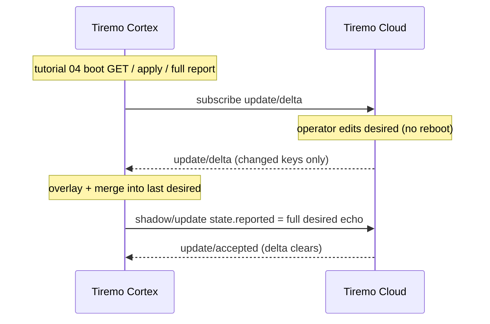
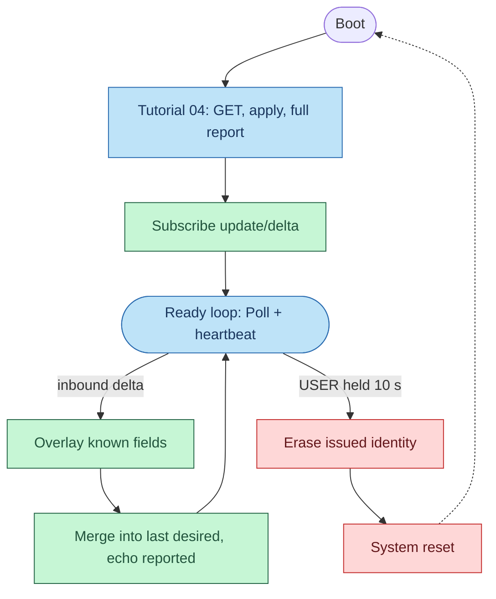
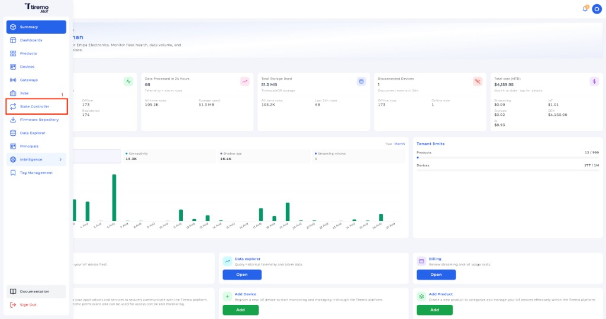
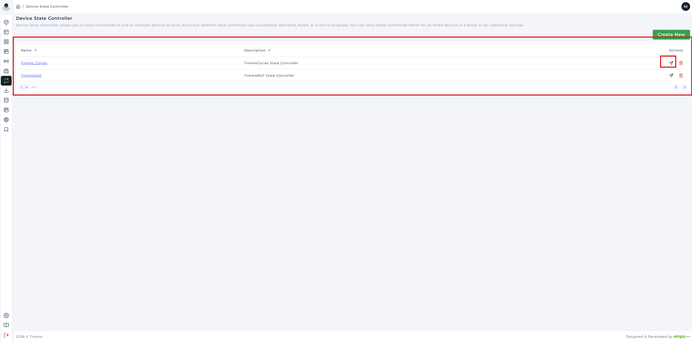
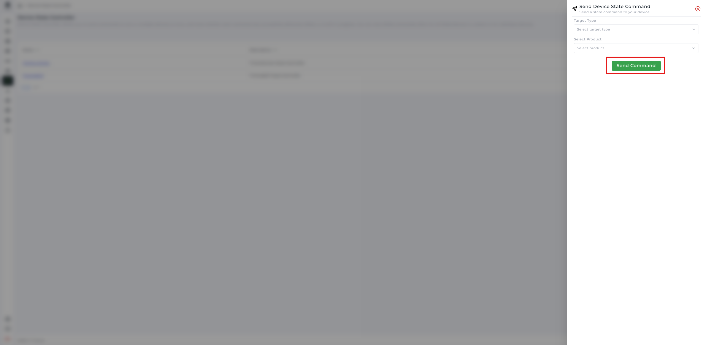
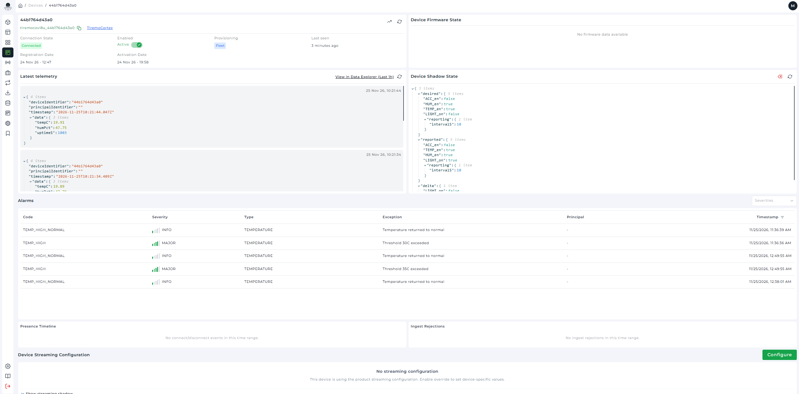
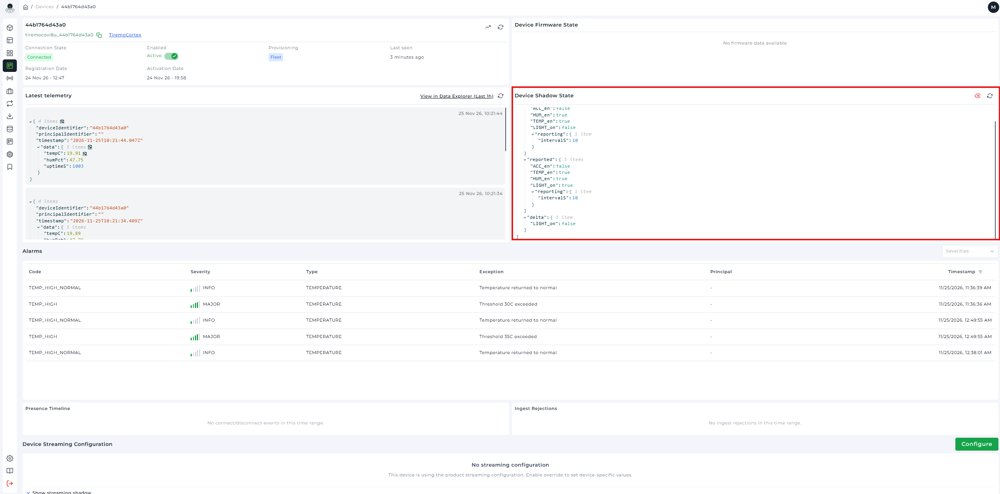

<p class="sphinxhide" align="right"><a>English</a> | <a href="../../../docs-tr/Tiremo_Cloud/Feature_Tutorials/05-Live_Shadow_Delta_Handling/README.md">Türkçe</a></p>
<table class="sphinxhide" width="100%">
  <tr>
    <td align="center">
      <picture>
        <source media="(prefers-color-scheme: dark)" srcset="../../../images/tiremo_sub_brand_1_mono_white.png">
        
      </picture>
      <br>
      
      <h1>Live Shadow Delta Handling</h1>
      <sub>Tiremo Cortex Tutorials — ESP32 + Tiremo Cloud firmware, from first blink to a fleet-ready device</sub>
    </td>
  </tr>
</table>


# Live Shadow Delta Handling

***Board: Tiremo Cortex (ABOV A34G43A, Cortex-M4) · Section: Tiremo Cloud / Feature Tutorials · Difficulty: Hard***

## Introduction

[Tutorial 04](../04-Shadow_Get_Apply_Report/) applies desired state once,
at boot. A real control plane changes `desired` while the device is
already running. Tiremo Cloud then publishes the difference on
`$aws/things/<thingName>/shadow/update/delta`. This tutorial keeps 04's
boot GET / apply / report, then adds that standing subscription and
applies each incoming delta without a reboot.

The lesson from 04 still holds. A delta document only contains the keys
that differ. Reporting just those keys, or rebuilding only `reporting`
and `led`, leaves every other desired key (`note`, nested extras, …) in
the delta forever. Tiremo Cloud then publishes `update/delta` again
after every report, and the log fills with deltas that never clear. The
live path applies the fields it knows, merges the delta into the last
full desired object, and echoes that whole object as `reported`.

## The Exchange, at a Glance





## You Will Learn

- `shadow/update/delta` as a standing subscription, distinct from the one-shot `shadow/get`
- Why the delta payload's `state` *is* the partial desired diff, not `{desired, reported, delta}`
- Reusing 04's apply and full desired echo so a live change does not leave a delta behind
- Polling MQTT in the ready loop so the 10 s USER factory reset still works

## Prerequisites

- [04-Shadow_Get_Apply_Report](../04-Shadow_Get_Apply_Report/) — boot GET / apply / full report, the Thing name, and the issued identity from 03
- The same four gitignored files as 04, in this `Sw/` — see [Credentials](#credentials)
- The setup scripts from [Getting Started](../../../Getting_Started/) already run, so `tdf` is available
- To watch the log: `tdf monitor` or any serial terminal (Tera Term, PuTTY, screen, minicom, …) at 115200 8N1 on the board's USB serial port
- A Tiremo Cortex board (ABOV A34G43A MCU — see [Hardware Overview](../../../Hardware.md)) connected to your PC with a USB cable

## Platform documentation

Live `update/delta` is the firmware side of
[Device State Controller](https://docs.tiremo.ai/device-state-controller/introduction)
(see also [device integration](https://docs.tiremo.ai/device-state-controller/device-integration)).
Operators change desired in the Tiremo UI; this tutorial applies it
without a reboot.

## Understanding `update/delta`

A classic-shadow delta looks like this when only the LED changed:

```json
{
  "version": 12,
  "timestamp": 1787785000,
  "state": {
    "led": { "on": true }
  }
}
```

`state` here is **not** the get/accepted envelope; there is no nested
`desired`. Passing that slice to `JsonWriter_Raw` as `reported` would
publish `{"led":{"on":true}}`, and Tiremo Cloud would keep `reporting`
(and every other desired key) in the delta.

Rebuilding only the three known keys has the same problem: any other
key in desired never matches, so `update/delta` never clears.

This firmware keeps the last full desired object from the boot GET.
Each delta:

1. updates `reporting.*` / `led.on` if the delta contains them, and logs
   the applied values,
2. deep-merges the delta into the cached desired object (a `null` value
   removes the key),
3. echoes the merged object as `reported` with `JsonWriter_Raw`.

If the merged desired is byte-for-byte what was last published, the
report is skipped, so a leftover delta cannot loop.

`update/delta` is subscribed **after** the boot echo. Subscribing earlier
would let the boot path, while it waits for get/accepted or
update/accepted, read a delta message and drop it.

The Thing name follows the same rule as 04: the MQTT client ID
(`<product>_<deviceId>`) unless `TIREMO_AWS_THING_NAME` is set.

## Solution

### Credentials

This `Sw/` needs the same four gitignored files as tutorial 04. The
easiest way is to copy them from tutorial 04's `Sw/`:

- **`wifi_secrets.h`**: your WiFi SSID and password (from `wifi_secrets.h.example`).
- **`aws_iot_config.h`**: your product's **Identifier** and **Secret Key** (from `aws_iot_config.h.example`), plus the optional `TIREMO_AWS_THING_NAME`.
- **`certs/claim_cert.pem`** and **`certs/claim_key.pem`**: the renamed **Provisioning Certificates** — see [`certs/README.md`](./Sw/certs/README.md).

All four names are gitignored; check `git status` before you commit anyway. If one is missing, the build stops with a message that says what to do. Where to find the values in the Tiremo UI: [tutorial 03](../03-Fleet_Provisioning_By_Claim/#getting-credentials-from-the-tiremo-ui).

### Build, flash, monitor

From the repository root:

```sh
cd Tiremo_Cloud/Feature_Tutorials/05-Live_Shadow_Delta_Handling/Sw
tdf build
tdf flash
tdf monitor
```

(See [Getting_Started/01-Hello_Blink's Solution](../../../Getting_Started/01-Hello_Blink/README.md#solution) for what `tdf` is. On macOS/Linux `tdf.py` also works as an alias; on Windows use `tdf`. Close any other terminal on the board's serial port before `tdf monitor` — only one program can open the port at a time.)

**Confirmed on real hardware:** `tdf build` compiles and links without errors on macOS and Windows 11 (`.text` about 36 KB; the exact size varies slightly with toolchain version, and the linker prints the same expected, harmless `_close` / `_lseek` / `_read` / `_write is not implemented` warnings explained in [01-Hello_Blink's Solution](../../../Getting_Started/01-Hello_Blink/README.md#solution)). `tdf flash` completed a full program-and-verify cycle over SWD on a real, connected Tiremo Cortex board (`** Verified OK **`). The board had been provisioned by tutorial 03, so it skipped the claim exchange, ran the boot GET / full report from 04, and then subscribed to `update/delta`. Below, the product identifier and the board's MAC address are replaced with placeholders:

```text
[INFO] Live_Shadow_Delta: boot
[INFO] hold USER 10000 ms to factory-reset (erase issued cert + marker)
[INFO] ESP32: power cycling module...
[INFO] ESP32: power-on boot delay elapsed
[INFO] TIREMO_ESP32_Init: UART2 ready
[INFO] ESP32: command echo disabled (ATE0)
[INFO] identity: deviceId=<deviceId> clientId=<product>_<deviceId> thingName=<product>_<deviceId>
[INFO] ESP32: online, SNTP epoch=...
[INFO] provision: marker matches <deviceId>
[INFO] provision: already done; using permanent credentials
[INFO] shadow: thingName=<product>_<deviceId>
[INFO] shadow: subscribe get/accepted get/rejected (delta after boot report)
[INFO] shadow: get
[INFO] shadow: MQTT RX topic=$aws/things/<product>_<deviceId>/shadow/get/accepted frag=696 accum=696
[INFO] shadow: desired 88 bytes
[INFO] shadow: applied reporting.enabled=true intervalS=1 led.on=false
[INFO] shadow: update reported (146 bytes, full desired echo)
[INFO] shadow: MQTT RX topic=$aws/things/<product>_<deviceId>/shadow/update/accepted frag=398 accum=398
[INFO] shadow: update accepted
[INFO] shadow: get again to confirm delta is gone
[INFO] shadow: MQTT RX topic=$aws/things/<product>_<deviceId>/shadow/get/accepted frag=696 accum=696
[INFO] shadow: no leftover delta
[INFO] shadow: subscribed update/delta
[INFO] shadow: ready thingName=<product>_<deviceId> (live update/delta)
```

The `ready` line repeats every 10 s. The board now waits for a change
to `desired`, which you send from the Tiremo UI as below.

## Sending a shadow update in the Tiremo UI

Send a command from **Device State Controller** while the board is in
the ready loop. Then open the device page and check `desired` /
`reported` / `delta` on **Device Shadow State**.

**1. Open State Controller** from the main menu.



*Figure: Tiremo UI — click **State Controller** in the main menu.*

**2. Send a command.** Click the paper-plane icon on a row (for example
**LightOn**).



*Figure: Tiremo UI — send icon on a Device State Controller command.*

**3. Target this device, then Send Command.** Set the target type to
**Device**, pick the product and this board's device identifier (its
12-hex MAC), then click **Send Command**.



*Figure: Tiremo UI — **Send Command** queues the desired update.*

The command must change a value. If desired already holds the value
the command sends, desired and reported still match, Tiremo Cloud
publishes no delta, and the UART shows only `ready` lines. In that case
send the opposite command (for example **LightOff** after **LightOn**).

When a delta arrives, the UART shows (placeholders as above):

```text
[INFO] shadow: MQTT RX topic=$aws/things/<product>_<deviceId>/shadow/update/delta frag=113 accum=113
[INFO] shadow: delta 113 bytes
[INFO] shadow: applied reporting.enabled=true intervalS=1 led.on=false
[INFO] shadow: desired now 89 bytes (merged)
[INFO] shadow: update reported (148 bytes, full desired echo)
[INFO] shadow: ready thingName=<product>_<deviceId> (live update/delta)
```

In this run the command changed a key that this firmware does not
apply, so the `applied` line stays the same. The key is still merged
into desired (88 → 89 bytes) and echoed as reported, so it does not stay
in the delta. No second delta follows the report.

**4. Open the device page.** Use the same identifier as in tutorials 01 and 06.



*Figure: Tiremo UI — device details, **Device Shadow State** in the
middle.*

**5. Check the delta.** When `desired` and `reported` disagree, the card
shows a `delta` object with the keys that do not match. After this
firmware echoes the full desired document as `reported`, that `delta`
clears.



*Figure: Tiremo UI — **Device Shadow State** with `desired`, `reported`,
and `delta` visible.*

Send another command without resetting the board. Each one that changes
a value logs another delta / apply / full report, and the delta in the
console clears after each report.

## Walkthrough

1. [`prv_user_code.c`](./Sw/Src/prv_user_code.c) — 04's identity / WiFi /
   SNTP / provision-or-skip / boot GET, then `TIREMO_Shadow_Poll()` in
   the ready loop.
2. [`tiremo_shadow.c`](./Sw/Common/Src/tiremo_shadow.c) — the boot
   exchange from 04; subscribes to `update/delta` only after that
   succeeds; `Poll` merges each delta into the last desired object and
   echoes it.
3. [`tiremo_shadow.h`](./Sw/Common/Include/tiremo_shadow.h) —
   `GetApplyReport` plus `Poll`.
4. [`tiremo_json.c`](./Sw/Common/Src/tiremo_json.c) — `FindRaw` and
   `ForEachKey`, the two helpers the merge adds on top of 04.
5. [`tiremo_esp32.c`](./Sw/Drivers/esp32/Src/tiremo_esp32.c) — the
   driver from 04. An MQTT wait that times out is not logged here,
   because the ready-loop poll times out every 200 ms; the boot shadow
   and provisioning code log their own timeouts. The DEBUG dump hides the
   WiFi password (`AT+CWJAP=<credentials hidden>`).

## Done When

- The board logs `shadow: subscribed update/delta` and enters the ready loop.
- A command from the Tiremo UI that changes desired logs `shadow: delta ... bytes`, `desired now ... bytes (merged)` and `update reported`, with no reboot.
- The reported object is a full echo of desired (extra keys included), the console delta clears, and no second delta follows.

<p align="center"></p>

<p class="sphinxhide" align="center"><sub>Tiremo Cortex Tutorials — Empa Electronics</sub></p>
