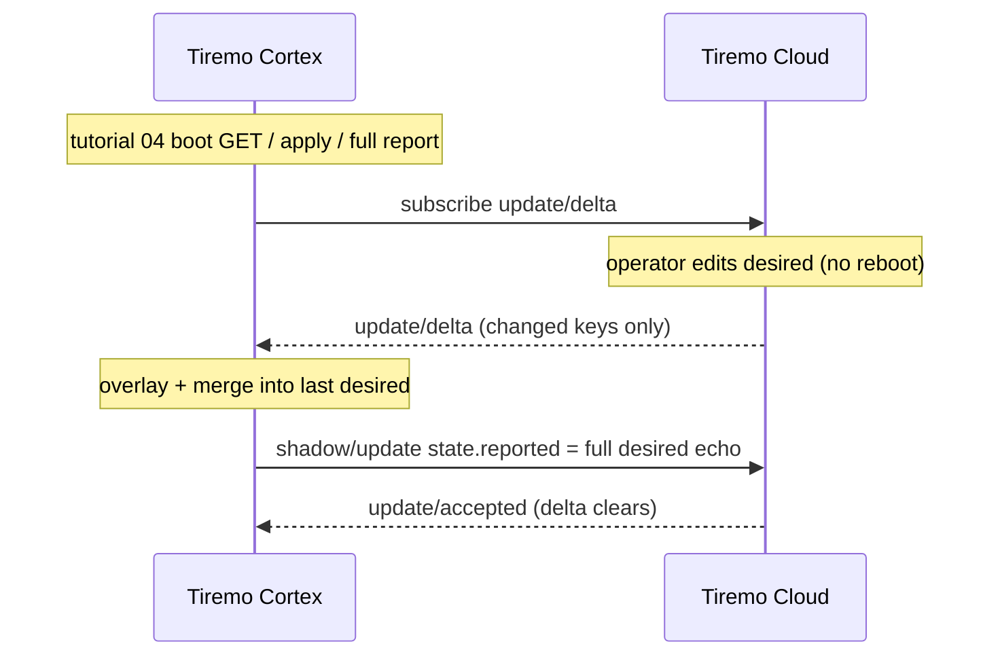
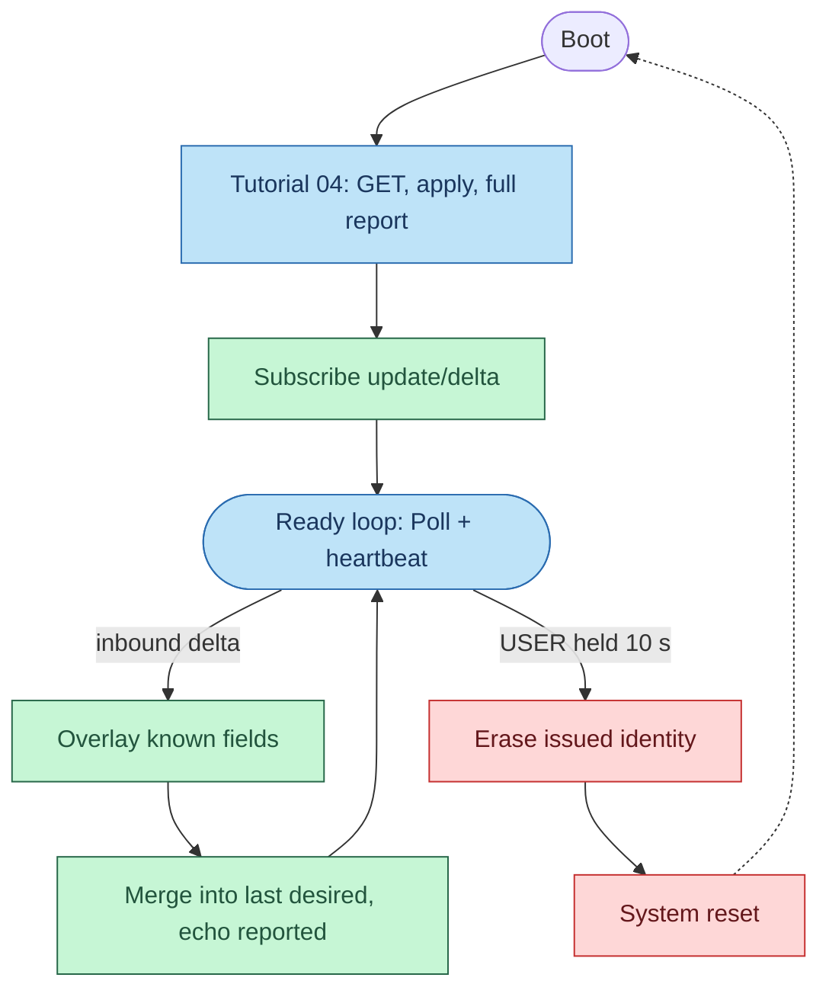
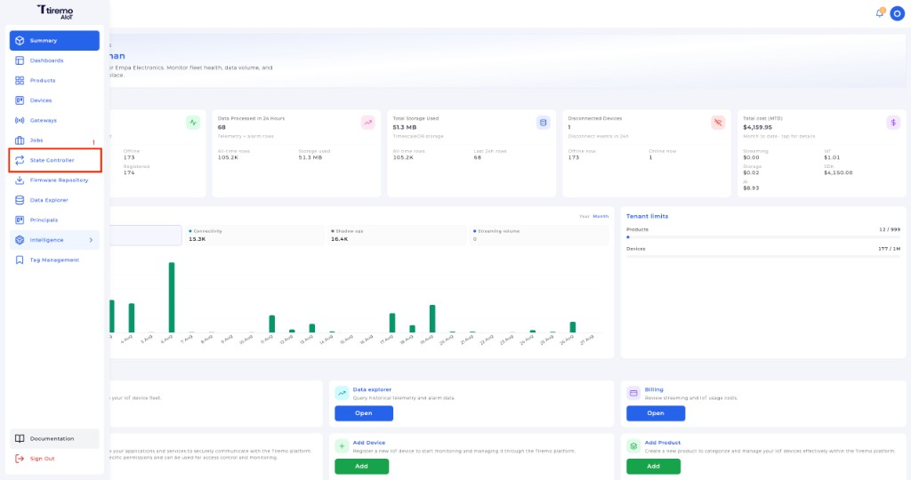
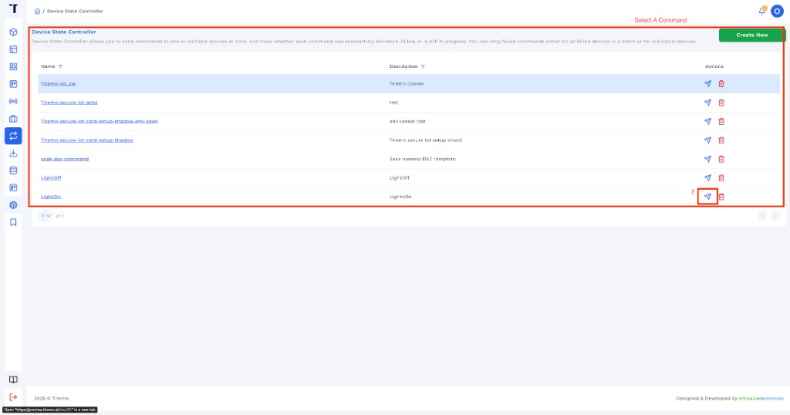
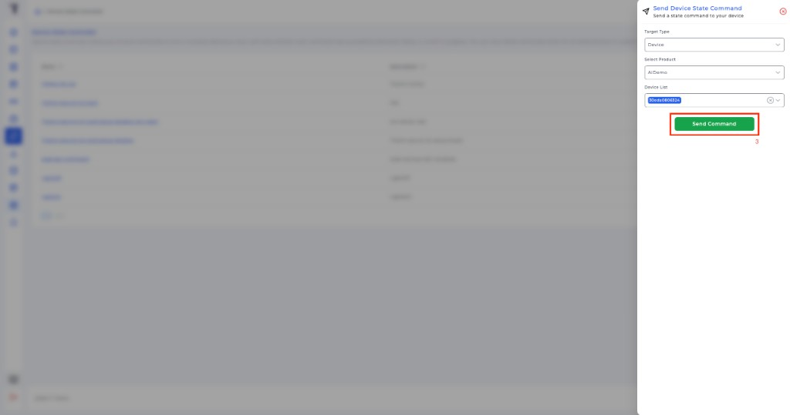
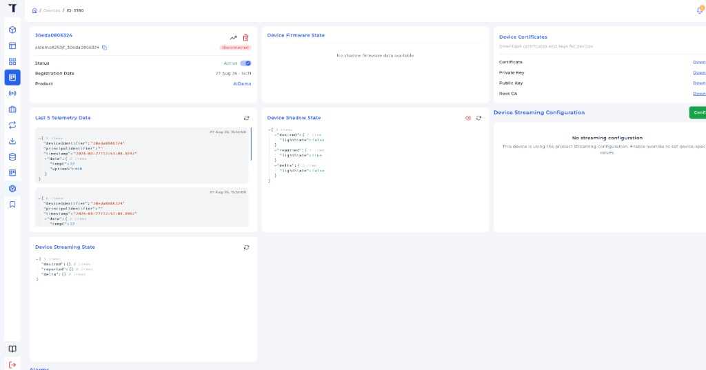
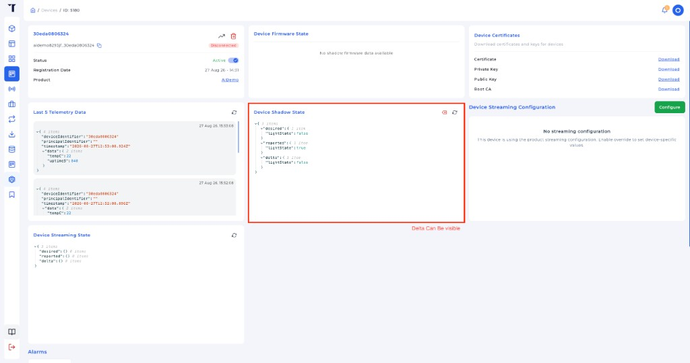

<p class="sphinxhide" align="right"><a>English</a> | <a href="../../../docs-tr/Tiremo_Cloud/Feature_Tutorials/05-Live_Shadow_Delta_Handling/README.md">Türkçe</a></p>
<table class="sphinxhide" width="100%">
  <tr>
    <td align="center">
      <picture>
        <source media="(prefers-color-scheme: dark)" srcset="../../../images/tiremo_sub_brand_1_mono_white.png">
        
      </picture>
      <br>
      
      <h1>Live Shadow Delta Handling</h1>
      <sub>Tiremo Cortex Tutorials — ESP32 + Tiremo Cloud firmware, from first blink to a fleet-ready device</sub>
    </td>
  </tr>
</table>


# Live Shadow Delta Handling

***Board: Tiremo Cortex (ESP32) · Section: Tiremo Cloud / Feature Tutorials · Difficulty: Hard***

## Introduction

[Tutorial 04](../04-Shadow_Get_Apply_Report/) applies desired state once,
at boot. A real control plane changes `desired` while the device is
already running. Tiremo Cloud then publishes the difference on
`$aws/things/<thingName>/shadow/update/delta`. This tutorial keeps 04's
boot GET / apply / report, then adds that standing subscription and
applies each inbound delta with no reboot.

The 04 lesson still holds. A delta document only contains the keys that
differ. Reporting just those keys — or rebuilding only `reporting` and
`led` — leaves every other desired sibling (`note`, nested extras, …)
in delta forever. Tiremo Cloud then republishes `update/delta` on every report
and the UART storms. The live path overlays known fields for the log,
merges the slice into the last full desired object, and echoes that
whole object as `reported`.

## The Exchange, at a Glance





## You Will Learn

- `shadow/update/delta` as a standing subscription, distinct from the one-shot `shadow/get`
- Why the delta payload's `state` *is* the partial desired diff — not `{desired, reported, delta}`
- Reusing 04's apply + full desired echo so a live change does not recreate a leftover delta
- Polling MQTT in the ready loop so the 10 s USER factory-reset still runs

## Prerequisites

- [04-Shadow_Get_Apply_Report](../04-Shadow_Get_Apply_Report/) — boot GET / apply / full report, Thing name, claim/issued identity
- The same gitignored files as 04 in this `Sw/`: `wifi_secrets.h`, `aws_iot_config.h`, `certs/claim_cert.pem`, `certs/claim_key.pem`. Copy claim PEMs, product identifier, and product secret from the Tiremo UI as in [tutorial 03](../03-Fleet_Provisioning_By_Claim/#getting-credentials-from-the-tiremo-ui).
- Toolchain and flashing set up per [Getting Started](../../../Getting_Started/)

## Platform documentation

Live `update/delta` is the firmware path in
[Device State Controller](https://docs.tiremo.ai/device-state-controller/introduction)
([why delta matters](https://docs.tiremo.ai/device-state-controller/introduction),
[device integration](https://docs.tiremo.ai/device-state-controller/device-integration)).
Operators change desired in the Tiremo UI; this tutorial applies it without reboot.

## Understanding `update/delta`

A classic-shadow delta looks like this when only the LED changed:

```json
{
  "version": 12,
  "timestamp": 1787785000,
  "state": {
    "led": { "on": true }
  }
}
```

`state` here is **not** the get/accepted envelope. There is no nested
`desired`. Feeding that slice to `JsonWriter_Raw` as `reported` would
publish `{"led":{"on":true}}` and Tiremo Cloud would keep `reporting` in delta.

Rebuilding only the three known keys is the same bug. Boot desired in
the storm log was 19 bytes (`{"led":{"on":false}}`); the live path then
reported `{reporting, led}` and left every extra desired key unmatched,
so `update/delta` never cleared.

This firmware keeps the last full desired object from the boot GET.
Each delta overlays `reporting.*` / `led.on` for the UART log, deep-
merges the slice into that cached object (`null` deletes a key), and
echoes the result with `JsonWriter_Raw`. If the merged desired is
byte-for-byte what was last published, the report is skipped so a
leftover delta cannot loop.

`update/delta` is subscribed **after** the boot echo. Subscribing earlier
would let `MqttWaitMessage` consume (and drop) a delta while the boot
path is blocked waiting for get/accepted or update/accepted.

Thing name is the same rule as 04: MQTT client ID
(`<product>_<deviceId>`) unless `TIREMO_AWS_THING_NAME` is set.

## Solution

[`Sw/`](./Sw/) has a real, buildable implementation. Copy the same
gitignored files you already used in tutorial 04:

```sh
cd Sw
cp ../04-Shadow_Get_Apply_Report/Sw/wifi_secrets.h .
cp ../04-Shadow_Get_Apply_Report/Sw/aws_iot_config.h .
cp ../04-Shadow_Get_Apply_Report/Sw/certs/claim_cert.pem certs/
cp ../04-Shadow_Get_Apply_Report/Sw/certs/claim_key.pem certs/
tdf.py build
tdf.py flash
tdf.py monitor
```

**Verified on the connected board:** `.text` 34928 bytes, flash
**Verified OK**. After a successful tutorial 04 the UART skipped the
claim exchange, repeated the boot GET / full report, then subscribed
`update/delta`:

```text
[INFO] Live_Shadow_Delta: boot
[INFO] identity: deviceId=30eda0806324 clientId=<product>_30eda0806324 thingName=<product>_30eda0806324
[INFO] provision: marker matches 30eda0806324
[INFO] shadow: get
[INFO] shadow: applied reporting.enabled=true intervalS=60 led.on=false
[INFO] shadow: update reported (77 bytes, full desired echo)
[INFO] shadow: update accepted
[INFO] shadow: no leftover delta
[INFO] shadow: subscribed update/delta
[INFO] shadow: ready thingName=<product>_30eda0806324 (live update/delta)
```

UART proves the board subscribed. The Tiremo UI is where an operator
writes classic-shadow `desired` and checks the resulting `delta`.

## Sending a shadow update in the Tiremo UI

Send a command from **Device State Controller** (board must already be
in the ready loop). Then open the device page and confirm `desired` /
`reported` / `delta` on **Device Shadow State**.

**1. Open State Controller** from the main menu.



*Figure: Tiremo UI — click **State Controller** in the main menu.*

**2. Send a command.** Click the paper-plane icon on a row (for example
**LightOn**).



*Figure: Tiremo UI — send icon on a Device State Controller command.*

**3. Target this device, then Send Command.** Target type **Device**,
pick the product and this board's device identifier (12-hex MAC), then
**Send Command**.



*Figure: Tiremo UI — **Send Command** queues the desired update.*

UART:

```text
[INFO] shadow: delta ... bytes
[INFO] shadow: applied reporting.enabled=... intervalS=... led.on=...
[INFO] shadow: desired now ... bytes (merged)
[INFO] shadow: update reported (... bytes, full desired echo)
```

**4. Open the device page.** Same identifier as tutorial 01 / 06.



*Figure: Tiremo UI — device details, **Device Shadow State** in the
middle.*

**5. Confirm the delta.** When `desired` and `reported` disagree, the
card shows a `delta` object with the unmatched keys. After this
firmware echoes the full desired document as `reported`, that `delta`
clears.



*Figure: Tiremo UI — **Device Shadow State** with `desired`, `reported`,
and `delta` visible.*

Send a second command without resetting the board. Each send should log
another delta / apply / full report, and the console delta should clear
after each report. This firmware applies `led.on` and `reporting.*`;
other keys in the command document are merged and echoed so they do not
stick in `delta`.

## Walkthrough

1. [`prv_user_code.c`](./Sw/Src/prv_user_code.c) — 04's identity / WiFi /
   SNTP / provision-or-skip / boot GET, then `TIREMO_Shadow_Poll()` in
   the ready loop.
2. [`tiremo_shadow.c`](./Sw/Common/Src/tiremo_shadow.c) — boot exchange
   from 04; `Subscribe` to `update/delta` only after that succeeds;
   `Poll` merges each delta into the last desired object and echoes it.
3. [`tiremo_shadow.h`](./Sw/Common/Include/tiremo_shadow.h) —
   `GetApplyReport` plus `Poll`.

## Done When

Toggling a desired field in the Tiremo UI while the board is sitting
in the ready loop changes the applied log within one MQTT poll cycle,
with no reboot. The published reported object is a full echo of desired
(extra keys included) so the console delta clears and does not storm.

<p align="center"></p>

<p class="sphinxhide" align="center"><sub>Tiremo Cortex Tutorials — Empa Electronics</sub></p>
