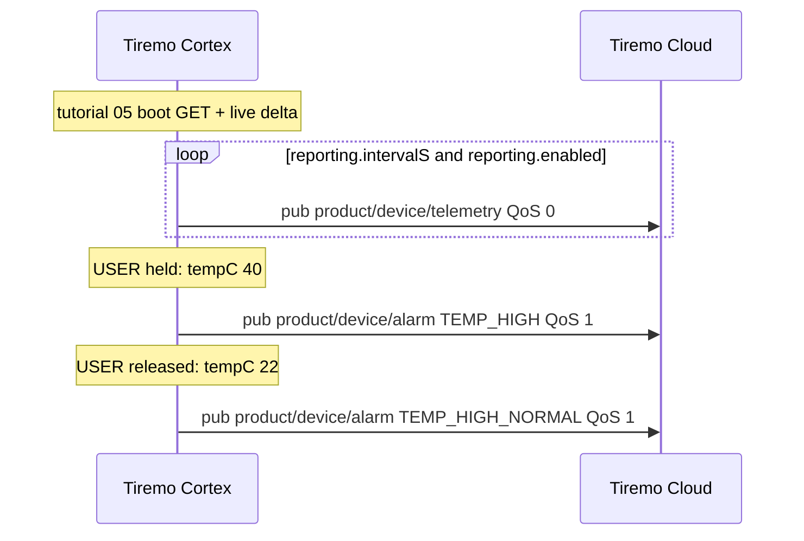
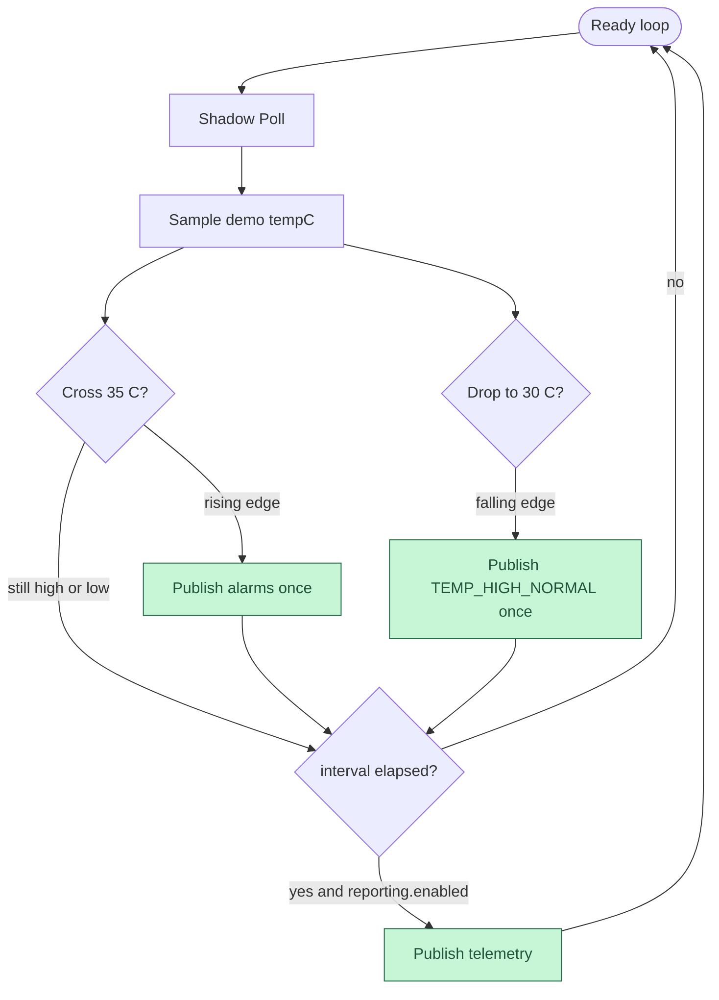
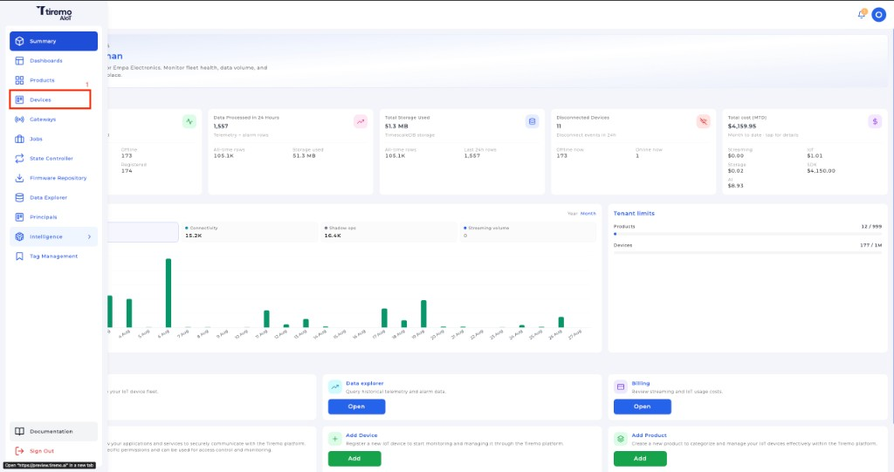
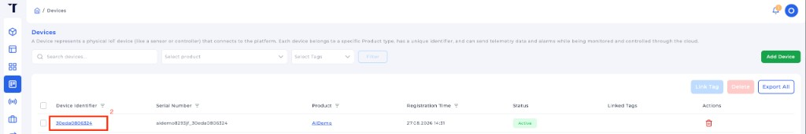
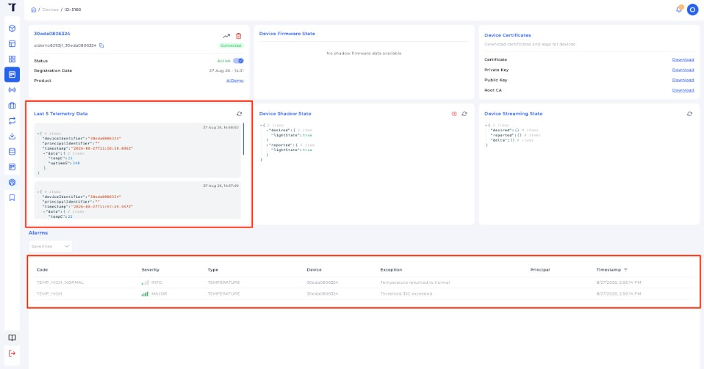

<p class="sphinxhide" align="right"><a>English</a> | <a href="../../../docs-tr/Tiremo_Cloud/Feature_Tutorials/06-Publishing_Alarms_And_Telemetry/README.md">Türkçe</a></p>
<table class="sphinxhide" width="100%">
  <tr>
    <td align="center">
      <picture>
        <source media="(prefers-color-scheme: dark)" srcset="../../../images/tiremo_sub_brand_1_mono_white.png">
        
      </picture>
      <br>
      
      <h1>Publishing Alarms and Telemetry</h1>
      <sub>Tiremo Cortex Tutorials — ESP32 + Tiremo Cloud firmware, from first blink to a fleet-ready device</sub>
    </td>
  </tr>
</table>


# Publishing Alarms and Telemetry

***Board: Tiremo Cortex (ESP32) · Section: Tiremo Cloud / Feature Tutorials · Difficulty: Hard***

## Introduction

[Tutorial 05](../05-Live_Shadow_Delta_Handling/) is the **control plane**:
classic Device Shadow desired / delta / reported. This tutorial adds the
**data plane**. Sensor samples and edge-raised events go on their own MQTT
topics so Tiremo Cloud can store or alert on them without stuffing that
stream into the shadow document.

Putting `tempC` into `state.reported` on every sample would grow the
shadow, republish `update/delta` when it never matches desired, and
storm the UART. Telemetry is a periodic JSON publish. An alarm is a
**latch**: one publish when a threshold is crossed, one publish when it
returns — not a repeat while sitting above the line.

This `Sw/` does **not** bring up SHT40. A short USER press is the demo
sensor (40 °C while held, 22 °C released) so the MQTT lesson is isolated
from I2C. Real sensors wait for
[Design tutorial 01](../../Design_Tutorials/01-Sensor_Telemetry_And_Shadow_Control/).

## The Exchange, at a Glance





## You Will Learn

- Topics `pub/{product}/{device}/telemetry` (QoS 0) and `pub/{product}/{device}/alarm` (QoS 1) — not under `$aws/`, not `{thingName}/...`
- Why periodic telemetry is JSON on a data topic, not a shadow `reported` rewrite
- An alarm as a hysteresis latch (`TEMP_HIGH` / `TEMP_HIGH_NORMAL`), not a level that republishes
- Reusing 05's `reporting.enabled` / `reporting.intervalS` without adding those values to reported as sensor data

## Prerequisites

- [05-Live_Shadow_Delta_Handling](../05-Live_Shadow_Delta_Handling/) — MQTT
  session, Thing name, standing `update/delta`
- [02-Minimal_JSON_Helpers](../02-Minimal_JSON_Helpers/) — bounded JSON write
- The same gitignored files as 05 in this `Sw/`: `wifi_secrets.h`, `aws_iot_config.h`, `certs/claim_cert.pem`, `certs/claim_key.pem`. Copy claim PEMs, product identifier, and product secret from the Tiremo UI as in [tutorial 03](../03-Fleet_Provisioning_By_Claim/#getting-credentials-from-the-tiremo-ui).
- Toolchain and flashing set up per [Getting Started](../../../Getting_Started/)

## Platform documentation

Publish topics after the permanent certificate is installed:
[Phase 3 — first connection](https://docs.tiremo.ai/device-provisioning/third-phase).
Telemetry is the data plane, not the shadow control loop. See also
[architecture & data flow](https://docs.tiremo.ai/introduction/phase-1)
and the [low-rate telemetry](https://docs.tiremo.ai/use-cases/scenario-low-rate-telemetry)
use case. Shadow remains
[Device State Controller](https://docs.tiremo.ai/device-state-controller/introduction).

## Understanding the topics

`$aws/things/<thingName>/shadow/...` is reserved for Device Shadow.
Application telemetry must not live there. Tiremo ingest listens on
`pub/...` ([Phase 3](https://docs.tiremo.ai/device-provisioning/third-phase)),
not on `{thingName}/telemetry`.

This firmware uses the **legacy path** (no end-user principal):

```text
pub/{productIdentifier}/{deviceIdentifier}/telemetry     QoS 0   periodic sample
pub/{productIdentifier}/{deviceIdentifier}/alarm         QoS 1   edge raise / clear
```

`productIdentifier` is `TIREMO_AWS_PRODUCT_IDENTIFIER`.
`deviceIdentifier` is the 12-hex MAC from tutorial 01. Those are the
two halves of the MQTT client ID (`{product}_{device}`), not the
underscore-joined Thing name.

When the device is registered under an end-user principal, Phase 3
inserts `{principalIdentifier}` between product and device. This
tutorial does not.

Telemetry payload (integers only — this MCU firmware does not emit floats):

```json
{"uptimeS":12,"tempC":22}
```

Alarm payloads are exactly four string fields. Tiremo ingest rejects
extra keys (`tempC`, a boolean `exception`, `severity` values other
than `MAJOR` / `MINOR` / `WARNING` / `INFO`):

```json
{"alarmType":"TEMPERATURE","severity":"MAJOR","code":"TEMP_HIGH","exception":"Threshold 35C exceeded"}
{"alarmType":"TEMPERATURE","severity":"INFO","code":"TEMP_HIGH_NORMAL","exception":"Temperature returned to normal"}
```

Hysteresis: raise at **≥ 35 °C**, clear at **≤ 30 °C**. Sitting at 40 °C
does not republish `TEMP_HIGH`. Sitting at 22 °C does not republish the
clear. Production Firmware 02 extends this latch to more sensors.

`reporting.enabled=false` (live delta from tutorial 05) pauses telemetry
publishes. Alarms still evaluate so a USER tap remains visible.

A 10 s USER **hold** is still factory-reset. A **tap** (press and
release before 10 s) is the demo temperature step.

For a faster bench, set classic shadow `desired.reporting.intervalS` to
`10` in the Tiremo UI; the live delta path from 05 applies it with no reboot.

## Solution

[`Sw/`](./Sw/) has a real, buildable implementation (`.text` 37528). Copy the same
gitignored files you already used in tutorial 05:

```sh
cd Sw
cp ../05-Live_Shadow_Delta_Handling/Sw/wifi_secrets.h .
cp ../05-Live_Shadow_Delta_Handling/Sw/aws_iot_config.h .
cp ../05-Live_Shadow_Delta_Handling/Sw/certs/claim_cert.pem certs/
cp ../05-Live_Shadow_Delta_Handling/Sw/certs/claim_key.pem certs/
tdf.py build
tdf.py flash
tdf.py monitor
```

After the tutorial 05 boot GET / `subscribed update/delta` lines you
should see:

```text
[INFO] Alarms_And_Telemetry: boot
[INFO] telemetry: topics pub/<product>/<id>/telemetry  pub/<product>/<id>/alarm
[INFO] telemetry: pub pub/<product>/<id>/telemetry (... bytes) {"uptimeS":...,"tempC":22}
[INFO] ready thingName=<product>_<id> telemetry=on intervalS=60
```

Tap USER (do not hold 10 s):

```text
[INFO] telemetry: demo tempC=40 (USER held)
[WARN] alarm: RAISE TEMP_HIGH tempC=40
[INFO] telemetry: pub pub/<product>/<id>/alarm (... bytes) {"alarmType":"TEMPERATURE","severity":"MAJOR","code":"TEMP_HIGH","exception":"Threshold 35C exceeded"}
```

Release:

```text
[INFO] telemetry: demo tempC=22 (released)
[INFO] alarm: CLEAR TEMP_HIGH_NORMAL tempC=22
[INFO] telemetry: pub pub/<product>/<id>/alarm (... bytes) {"alarmType":"TEMPERATURE","severity":"INFO","code":"TEMP_HIGH_NORMAL","exception":"Temperature returned to normal"}
```

Exactly one raise and one clear per tap. The console shadow delta must
stay empty — samples did not go into `reported`.

## Seeing telemetry and alarms in the Tiremo UI

UART proves the board published. The Tiremo UI is where those messages
show up for an operator. Open the same product you provisioned in
[tutorial 03](../03-Fleet_Provisioning_By_Claim/#getting-credentials-from-the-tiremo-ui),
then the device whose identifier is the 12-hex MAC from tutorial 01.

**1. Open Devices** from the main menu.



*Figure: Tiremo UI — click **Devices** in the main menu.*

**2. Open the device.** Click its **Device Identifier** (the 12-hex MAC,
not the `{product}_{device}` Thing name in Serial Number).



*Figure: Tiremo UI — click the device identifier to open it.*

**3. Confirm telemetry and alarms** on that device page.



*Figure: Tiremo UI — **Last 5 Telemetry Data** (`tempC` / `uptimeS`) and
the **Alarms** table (`TEMP_HIGH` MAJOR, then `TEMP_HIGH_NORMAL` INFO).*

**Last 5 Telemetry Data** is the ingest of
`pub/{product}/{device}/telemetry`. **Alarms** is the ingest of
`pub/{product}/{device}/alarm`: one `TEMP_HIGH` row when USER is held,
one `TEMP_HIGH_NORMAL` when released. Shadow on the same page is still
the tutorial 05 control plane — samples do not appear there.

## Walkthrough

1. [`prv_user_code.c`](./Sw/Src/prv_user_code.c) — 05's identity / WiFi /
   SNTP / provision-or-skip / boot GET / `Shadow_Poll`, then
   `TIREMO_Telemetry_Poll` in the same ready loop.
2. [`tiremo_telemetry.c`](./Sw/Common/Src/tiremo_telemetry.c) — Phase 3
   `pub/{product}/{device}/...` topics, demo sample, hysteresis latch,
   QoS 0 telemetry / QoS 1 alarm.
3. [`tiremo_shadow.h`](./Sw/Common/Include/tiremo_shadow.h) —
   `ReportingEnabled()` / `IntervalS()` so the data plane can read the
   last applied control fields without rebuilding reported.

## Done When

UART shows a periodic `pub/{product}/{device}/telemetry` publish, and a
USER tap produces exactly one `TEMP_HIGH` and one `TEMP_HIGH_NORMAL` on
`pub/{product}/{device}/alarm`. The Tiremo UI shows the same samples on
the telemetry view and the raise/clear pair on the alarms table.
Toggling `reporting.enabled` pauses and resumes telemetry without a
leftover shadow delta storm.

<p align="center"></p>

<p class="sphinxhide" align="center"><sub>Tiremo Cortex Tutorials — Empa Electronics</sub></p>
