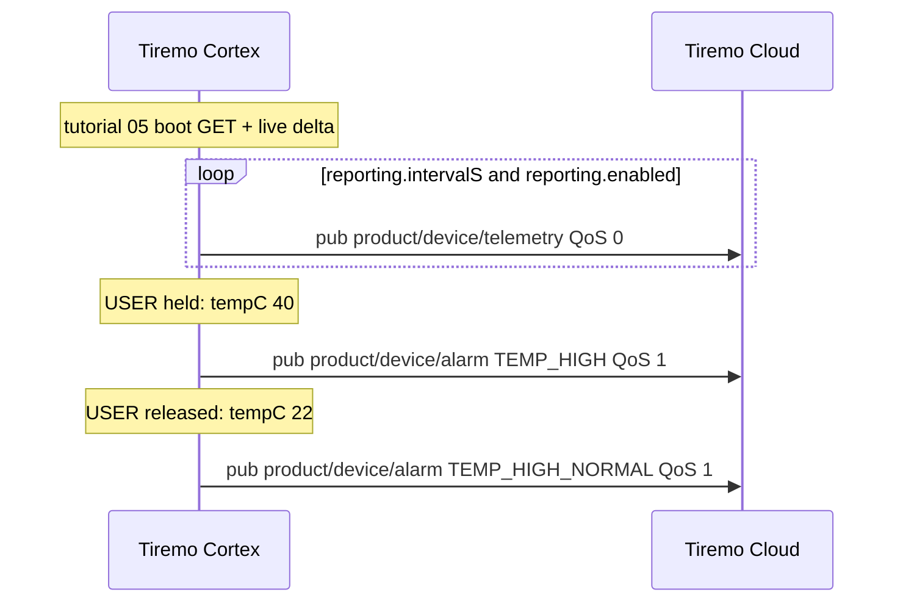
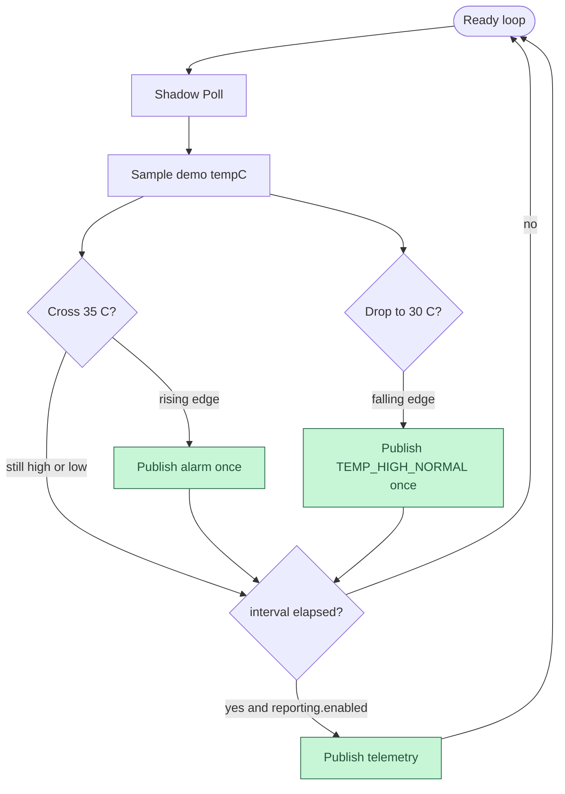
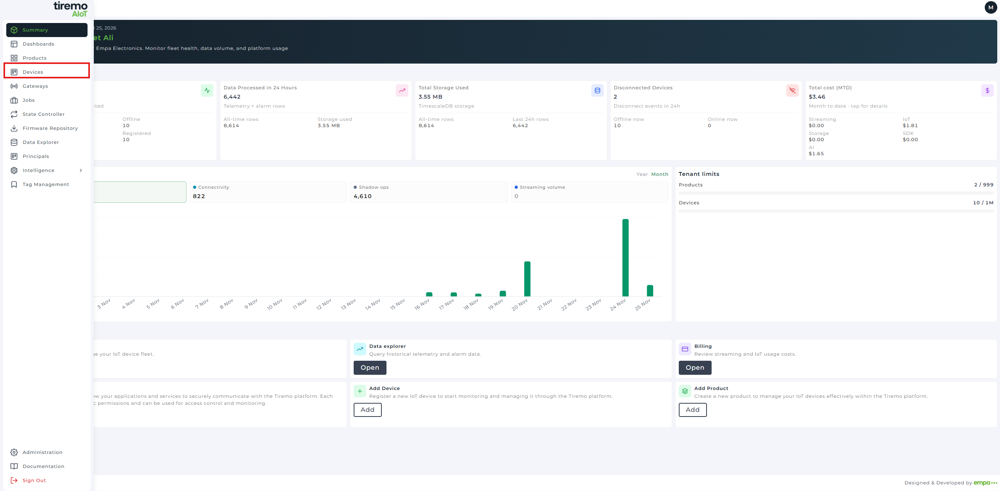
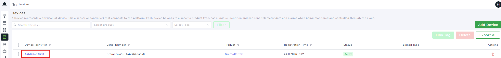
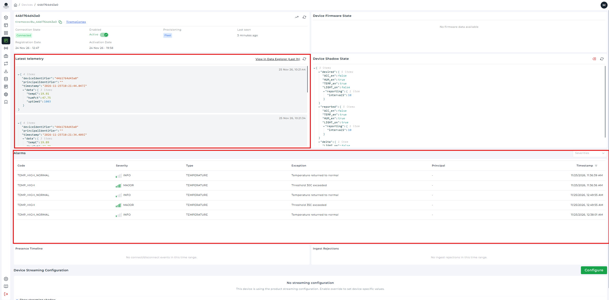

<p class="sphinxhide" align="right"><a>English</a> | <a href="../../../docs-tr/Tiremo_Cloud/Feature_Tutorials/06-Publishing_Alarms_And_Telemetry/README.md">Türkçe</a></p>
<table class="sphinxhide" width="100%">
  <tr>
    <td align="center">
      <picture>
        <source media="(prefers-color-scheme: dark)" srcset="../../../images/tiremo_sub_brand_1_mono_white.png">
        
      </picture>
      <br>
      
      <h1>Publishing Alarms and Telemetry</h1>
      <sub>Tiremo Cortex Tutorials — ESP32 + Tiremo Cloud firmware, from first blink to a fleet-ready device</sub>
    </td>
  </tr>
</table>


# Publishing Alarms and Telemetry

***Board: Tiremo Cortex (ABOV A34G43A, Cortex-M4) · Section: Tiremo Cloud / Feature Tutorials · Difficulty: Hard***

## Introduction

[Tutorial 05](../05-Live_Shadow_Delta_Handling/) is the **control plane**:
the classic Device Shadow's desired / delta / reported. This tutorial
adds the **data plane**. Sensor samples and events raised on the device
go on their own MQTT topics, so Tiremo Cloud can store them or alert on
them without putting that stream into the shadow document.

Putting `tempC` into `state.reported` on every sample would grow the
shadow, and every sample would trigger another shadow update.
Telemetry is a periodic JSON publish instead. An alarm is a **latch**:
one publish when a threshold is crossed and one when the value returns,
not a repeat while it stays above the line.

This `Sw/` does **not** read a real sensor. `tempC` is a demo value:
**22 °C** normally and **40 °C** while USER is pressed. Warming the board
does not change it. That keeps the MQTT lesson separate from I2C. A real
SHT40 reading, with decimals, is in
[Design tutorial 01](../../Design_Tutorials/01-Sensor_Telemetry_And_Shadow_Control/).

## The Exchange, at a Glance





## You Will Learn

- The topics `pub/{product}/{device}/telemetry` (QoS 0) and `pub/{product}/{device}/alarm` (QoS 1) — not under `$aws/`, not `{thingName}/...`
- Why periodic telemetry is JSON on a data topic, not a shadow `reported` rewrite
- An alarm as a hysteresis latch (`TEMP_HIGH` / `TEMP_HIGH_NORMAL`), not a level that republishes
- Using 05's `reporting.enabled` / `reporting.intervalS` to control the data plane, live
- Keeping inbound shadow deltas when the firmware publishes often

## Prerequisites

- [05-Live_Shadow_Delta_Handling](../05-Live_Shadow_Delta_Handling/) — the MQTT session, Thing name, and standing `update/delta`
- [02-Minimal_JSON_Helpers](../02-Minimal_JSON_Helpers/) — bounded JSON writer
- The same four gitignored files as 05, in this `Sw/` — see [Credentials](#credentials)
- The setup scripts from [Getting Started](../../../Getting_Started/) already run, so `tdf` is available
- To watch the log: `tdf monitor` or any serial terminal (Tera Term, PuTTY, screen, minicom, …) at 115200 8N1 on the board's USB serial port
- A Tiremo Cortex board (ABOV A34G43A MCU — see [Hardware Overview](../../../Hardware.md)) connected to your PC with a USB cable

## Platform documentation

The publish topics are described in
[Phase 3 — first connection](https://docs.tiremo.ai/device-provisioning/third-phase).
Telemetry is the data plane, not the shadow control loop. See also
[architecture & data flow](https://docs.tiremo.ai/introduction/phase-1)
and the [low-rate telemetry](https://docs.tiremo.ai/use-cases/scenario-low-rate-telemetry)
use case. The shadow is still
[Device State Controller](https://docs.tiremo.ai/device-state-controller/introduction).

## Understanding the Topics

`$aws/things/<thingName>/shadow/...` is reserved for the Device Shadow;
application telemetry does not belong there. Tiremo ingest listens on
`pub/...` ([Phase 3](https://docs.tiremo.ai/device-provisioning/third-phase)),
not on `{thingName}/telemetry`.

This firmware uses the **legacy path** (no end-user principal):

```text
pub/{productIdentifier}/{deviceIdentifier}/telemetry     QoS 0   periodic sample
pub/{productIdentifier}/{deviceIdentifier}/alarm         QoS 1   raise / clear
```

`productIdentifier` is `TIREMO_AWS_PRODUCT_IDENTIFIER`.
`deviceIdentifier` is the 12-hex MAC from tutorial 01. These are the two
parts of the MQTT client ID (`{product}_{device}`), separated by `/`
here, not the underscore-joined Thing name.

When the device is registered under an end-user principal, Phase 3
inserts `{principalIdentifier}` between product and device. This
tutorial does not.

The telemetry payload uses integers only:

```json
{"uptimeS":12,"tempC":22}
```

Alarm payloads are exactly four string fields. Tiremo ingest rejects
extra keys (for example `tempC`), a boolean `exception`, and `severity`
values other than `MAJOR` / `MINOR` / `WARNING` / `INFO`:

```json
{"alarmType":"TEMPERATURE","severity":"MAJOR","code":"TEMP_HIGH","exception":"Threshold 35C exceeded"}
{"alarmType":"TEMPERATURE","severity":"INFO","code":"TEMP_HIGH_NORMAL","exception":"Temperature returned to normal"}
```

Hysteresis: raise at **≥ 35 °C**, clear at **≤ 30 °C**. Staying at 40 °C
does not publish `TEMP_HIGH` again, and staying at 22 °C does not publish
the clear again.

`reporting.intervalS` sets how often telemetry is published, and
`reporting.enabled=false` pauses it. Both apply live through tutorial
05's delta path, with no reboot. Alarms are evaluated either way, so a
USER tap still produces a raise / clear pair.

Holding USER for 10 s is still the factory reset. A **tap** (press and
release well before 10 s) is the demo temperature step.

## Keeping Deltas While Publishing

The firmware now publishes on its own, as often as every second. The
ESP32 can deliver a shadow delta (`+MQTTSUBRECV`) at any moment,
including while a publish is in progress. Before this tutorial, the
driver threw away unread module output before every command and cleared
the MQTT hold buffer at the start of every publish. With frequent
telemetry, a delta that arrived around a publish was lost. Tiremo Cloud
does not send it again, so `desired` and `reported` stayed apart until
the next reboot.

`TIREMO_ESP32_MqttPublishRaw()` now:

1. moves unread bytes into the MQTT hold buffer instead of discarding them,
2. moves a message that arrives while waiting for the `>` prompt into the hold buffer too,
3. looks for `+MQTTPUB:OK` only in bytes that arrived after its own command,
4. keeps only inbound messages in the hold buffer, so command results cannot fill it.

The next `TIREMO_Shadow_Poll()` then reads the delta from the hold
buffer as usual.

## Solution

### Credentials

This `Sw/` needs the same four gitignored files as tutorial 05. The
easiest way is to copy them from tutorial 05's `Sw/`:

- **`wifi_secrets.h`**: your WiFi SSID and password (from `wifi_secrets.h.example`).
- **`aws_iot_config.h`**: your product's **Identifier** and **Secret Key** (from `aws_iot_config.h.example`), plus the optional `TIREMO_AWS_THING_NAME`.
- **`certs/claim_cert.pem`** and **`certs/claim_key.pem`**: the renamed **Provisioning Certificates** — see [`certs/README.md`](./Sw/certs/README.md).

All four names are gitignored; check `git status` before you commit anyway. If one is missing, the build stops with a message that says what to do. Where to find the values in the Tiremo UI: [tutorial 03](../03-Fleet_Provisioning_By_Claim/#getting-credentials-from-the-tiremo-ui).

### Build, flash, monitor

From the repository root:

```sh
cd Tiremo_Cloud/Feature_Tutorials/06-Publishing_Alarms_And_Telemetry/Sw
tdf build
tdf flash
tdf monitor
```

(See [Getting_Started/01-Hello_Blink's Solution](../../../Getting_Started/01-Hello_Blink/README.md#solution) for what `tdf` is. On macOS/Linux `tdf.py` also works as an alias; on Windows use `tdf`. Close any other terminal on the board's serial port before `tdf monitor` — only one program can open the port at a time.)

**Confirmed on real hardware:** `tdf build` compiles and links without errors on macOS and Windows 11 (`.text` about 38 KB; the exact size varies slightly with toolchain version, and the linker prints the same expected, harmless `_close` / `_lseek` / `_read` / `_write is not implemented` warnings explained in [01-Hello_Blink's Solution](../../../Getting_Started/01-Hello_Blink/README.md#solution)). `tdf flash` completed a full program-and-verify cycle over SWD on a real, connected Tiremo Cortex board (`** Verified OK **`). Below, the product identifier and the board's MAC address are replaced with placeholders.

The boot repeats tutorial 05 (here the shadow held `intervalS=10`), then
telemetry starts:

```text
[INFO] Alarms_And_Telemetry: boot
[INFO] hold USER 10000 ms to factory-reset; tap USER to raise TEMP_HIGH
...
[INFO] shadow: desired 89 bytes
[INFO] shadow: applied reporting.enabled=true intervalS=10 led.on=false
[INFO] shadow: update reported (147 bytes, full desired echo)
[INFO] shadow: update accepted
[INFO] shadow: get again to confirm delta is gone
[INFO] shadow: no leftover delta
[INFO] shadow: subscribed update/delta
[INFO] telemetry: topics pub/<product>/<deviceId>/telemetry  pub/<product>/<deviceId>/alarm
[INFO] telemetry: pub pub/<product>/<deviceId>/telemetry (24 bytes) {"uptimeS":0,"tempC":22}
[INFO] telemetry: pub pub/<product>/<deviceId>/telemetry (25 bytes) {"uptimeS":10,"tempC":22}
[INFO] ready thingName=<product>_<deviceId> telemetry=on intervalS=10
```

The `ready` line repeats every 10 s, whatever the telemetry interval.

**Changing the interval live.** With the board running, set desired
`{"reporting":{"intervalS":1}}` in the Tiremo UI, then
`{"reporting":{"intervalS":5}}` while the board publishes every second:

```text
[INFO] shadow: MQTT RX topic=$aws/things/<product>_<deviceId>/shadow/update/delta frag=139 accum=139
[INFO] shadow: delta 139 bytes
[INFO] shadow: applied reporting.enabled=true intervalS=1 led.on=false
[INFO] shadow: desired now 88 bytes (merged)
[INFO] shadow: update reported (147 bytes, full desired echo)
[INFO] telemetry: pub pub/<product>/<deviceId>/telemetry (26 bytes) {"uptimeS":240,"tempC":22}
[INFO] ready thingName=<product>_<deviceId> telemetry=on intervalS=1
[INFO] telemetry: pub pub/<product>/<deviceId>/telemetry (26 bytes) {"uptimeS":241,"tempC":22}
[INFO] telemetry: pub pub/<product>/<deviceId>/telemetry (26 bytes) {"uptimeS":242,"tempC":22}
...
[INFO] telemetry: pub pub/<product>/<deviceId>/telemetry (26 bytes) {"uptimeS":268,"tempC":22}
[INFO] shadow: MQTT RX topic=$aws/things/<product>_<deviceId>/shadow/update/delta frag=139 accum=139
[INFO] shadow: delta 139 bytes
[INFO] shadow: applied reporting.enabled=true intervalS=5 led.on=false
[INFO] shadow: desired now 88 bytes (merged)
[INFO] shadow: update reported (147 bytes, full desired echo)
[INFO] ready thingName=<product>_<deviceId> telemetry=on intervalS=5
[INFO] telemetry: pub pub/<product>/<deviceId>/telemetry (26 bytes) {"uptimeS":273,"tempC":22}
```

The second delta arrived while the board was publishing every second;
that is the case [Keeping Deltas While Publishing](#keeping-deltas-while-publishing)
fixes. A desired document that matches reported produces no delta, so
send a value that differs from the current one.

**Tap USER** (press and release; do not hold 10 s):

```text
[INFO] telemetry: demo tempC=40 (USER held)
[WARN] alarm: RAISE TEMP_HIGH tempC=40
[INFO] telemetry: pub pub/<product>/<deviceId>/alarm (102 bytes) {"alarmType":"TEMPERATURE","severity":"MAJOR","code":"TEMP_HIGH","exception":"Threshold 35C exceeded"}
[INFO] telemetry: demo tempC=22 (released)
[INFO] alarm: CLEAR TEMP_HIGH_NORMAL tempC=22
[INFO] telemetry: pub pub/<product>/<deviceId>/alarm (116 bytes) {"alarmType":"TEMPERATURE","severity":"INFO","code":"TEMP_HIGH_NORMAL","exception":"Temperature returned to normal"}
```

Exactly one raise and one clear per tap. A longer press can also log
`[WARN] USER button: hold 10000 ms to factory-reset`; release before
10 s and nothing is erased. The shadow delta in the console stays empty,
because samples are not written to `reported`.

## Seeing telemetry and alarms in the Tiremo UI

The UART log shows that the board published. The Tiremo UI is where an
operator sees those messages. Open the product you provisioned in
[tutorial 03](../03-Fleet_Provisioning_By_Claim/#getting-credentials-from-the-tiremo-ui),
then the device whose identifier is the 12-hex MAC from tutorial 01.

**1. Open Devices** from the main menu.



*Figure: Tiremo UI — click **Devices** in the main menu.*

**2. Open the device.** Click its **Device Identifier** (the 12-hex MAC,
not the `{product}_{device}` Thing name in Serial Number).



*Figure: Tiremo UI — click the device identifier to open it.*

**3. Check telemetry and alarms** on that device page.



*Figure: Tiremo UI — **Last 5 Telemetry Data** (`tempC` / `uptimeS`) and
the **Alarms** table (`TEMP_HIGH` MAJOR, then `TEMP_HIGH_NORMAL` INFO).*

**Last 5 Telemetry Data** shows what arrived on
`pub/{product}/{device}/telemetry`. **Alarms** shows what arrived on
`pub/{product}/{device}/alarm`: one `TEMP_HIGH` row when USER is
pressed, one `TEMP_HIGH_NORMAL` row when it is released. The shadow on
the same page is still tutorial 05's control plane; samples do not
appear there.

## Walkthrough

1. [`prv_user_code.c`](./Sw/Src/prv_user_code.c) — 05's identity / WiFi /
   SNTP / provision-or-skip / boot GET / `Shadow_Poll`, then
   `TIREMO_Telemetry_Poll` in the same ready loop.
2. [`tiremo_telemetry.c`](./Sw/Common/Src/tiremo_telemetry.c) — the
   Phase 3 `pub/{product}/{device}/...` topics, the demo sample, the
   hysteresis latch, QoS 0 telemetry / QoS 1 alarm.
3. [`tiremo_shadow.h`](./Sw/Common/Include/tiremo_shadow.h) —
   `ReportingEnabled()` / `IntervalS()`, so the data plane can read the
   last applied control fields.
4. [`tiremo_esp32.c`](./Sw/Drivers/esp32/Src/tiremo_esp32.c) —
   `MqttPublishRaw` keeps inbound messages that arrive around a publish
   (see [Keeping Deltas While Publishing](#keeping-deltas-while-publishing));
   the DEBUG dump hides the WiFi password (`AT+CWJAP=<credentials hidden>`).
5. [`tiremo_debug.c`](./Sw/Common/Src/tiremo_debug.c) — the log line
   buffer holds a full alarm publish line, and a line that is still too
   long is cut but always ends with a line break.

## Done When

- The UART shows periodic `pub/{product}/{device}/telemetry` publishes at the shadow's `reporting.intervalS`.
- Changing `reporting.intervalS` or `reporting.enabled` in the Tiremo UI takes effect without a reboot, even while telemetry is published every second.
- A USER tap produces exactly one `TEMP_HIGH` and one `TEMP_HIGH_NORMAL` on `pub/{product}/{device}/alarm`.
- The Tiremo UI shows the samples under **Last 5 Telemetry Data** and the raise / clear pair under **Alarms**.

<p align="center"></p>

<p class="sphinxhide" align="center"><sub>Tiremo Cortex Tutorials — Empa Electronics</sub></p>
