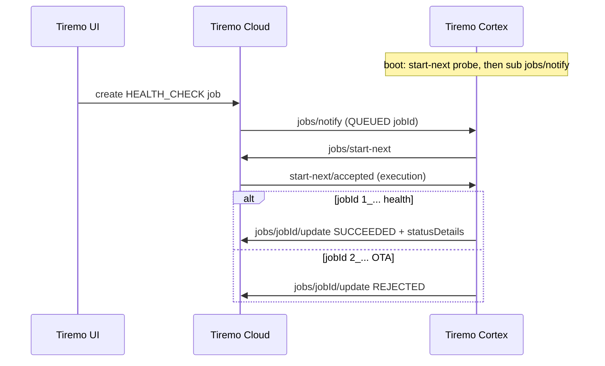
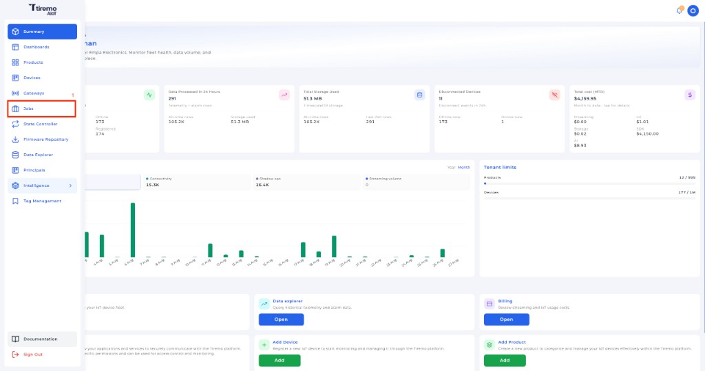
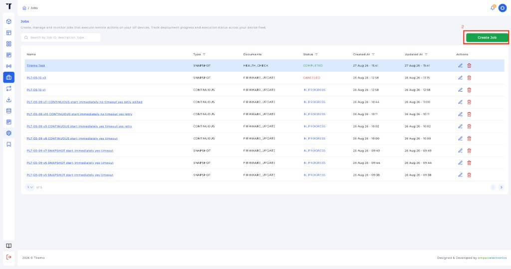
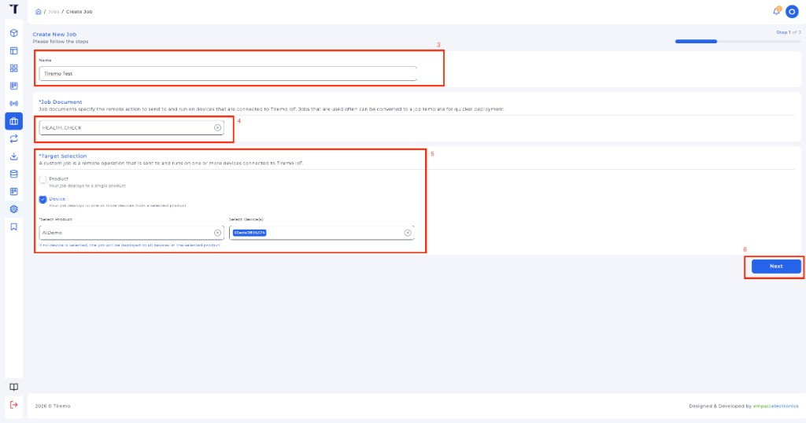
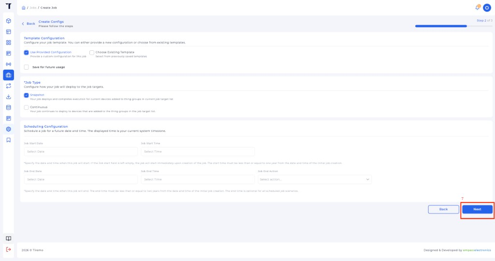
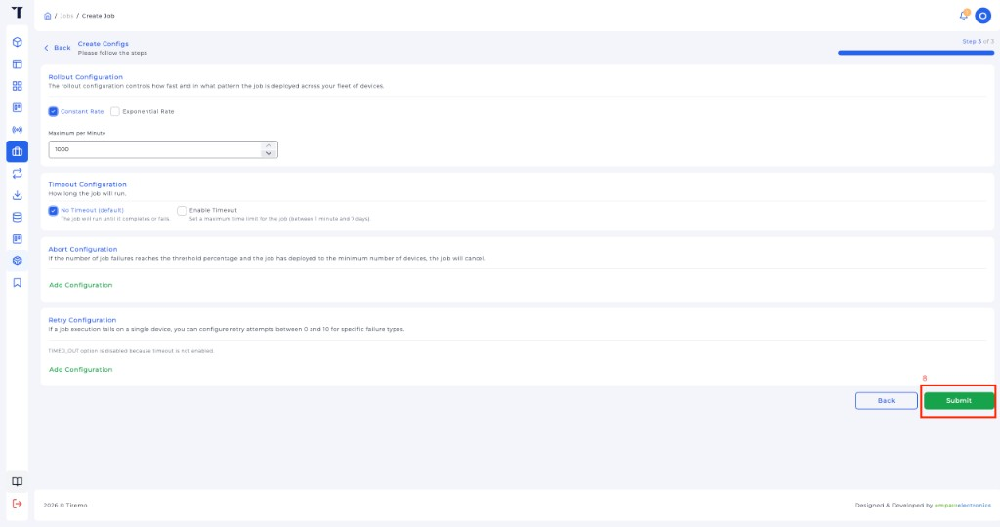
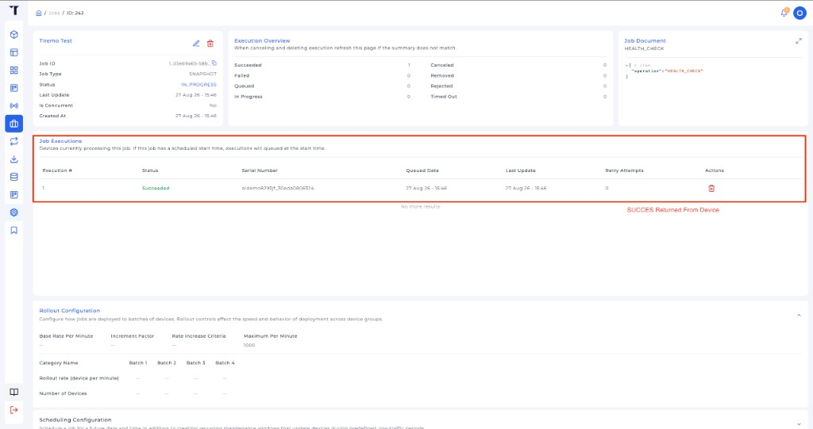

<p class="sphinxhide" align="right"><a>English</a> | <a href="../../../docs-tr/Tiremo_Cloud/Feature_Tutorials/07-Tiremo_Jobs/README.md">Türkçe</a></p>
<table class="sphinxhide" width="100%">
  <tr>
    <td align="center">
      <picture>
        <source media="(prefers-color-scheme: dark)" srcset="../../../images/tiremo_sub_brand_1_mono_white.png">
        
      </picture>
      <br>
      
      <h1>Tiremo Jobs</h1>
      <sub>Tiremo Cortex Tutorials — ESP32 + Tiremo Cloud firmware, from first blink to a fleet-ready device</sub>
    </td>
  </tr>
</table>


# Tiremo Jobs

***Board: Tiremo Cortex (ESP32) · Section: Tiremo Cloud / Feature Tutorials · Difficulty: Hard***

## Introduction

[Tutorial 06](../06-Publishing_Alarms_And_Telemetry/) is the **data plane**.
This tutorial is **queued work**. Tiremo Jobs puts a JSON execution on the
Thing; the board claims it, runs a bounded local action, and reports
`SUCCEEDED` or `REJECTED`. Unlike shadow, a job is not a standing
desired/reported loop — it has a status and then it is done.

The production firmware's jobs path is the reference: `jobs/notify` may
be a **summary** (QUEUED `jobId` only) or a **full execution** document.
A summary is claimed with `jobs/start-next`. Health-check job IDs are
`1_<uuid>` and complete `SUCCEEDED` with `statusDetails`. OTA-shaped
IDs (`2_<uuid>`) are `REJECTED` here — download/flash is not this
lesson.

## The Exchange, at a Glance



## You Will Learn

- The Jobs MQTT family: `jobs/notify`, `jobs/start-next`, `jobs/<id>/update`
- Why a summary notify is not enough — `start-next` claims the execution
- Completing a health check with `statusDetails` (`result`, `firmware_version`, `connectivity`, `mqtt`, `uptime_s`)
- Rejecting an OTA-shaped job so it does not sit `IN_PROGRESS`

## Prerequisites

- [06-Publishing_Alarms_And_Telemetry](../06-Publishing_Alarms_And_Telemetry/) — ready loop, Thing name, standing delta
- [05-Live_Shadow_Delta_Handling](../05-Live_Shadow_Delta_Handling/)
- The same gitignored files as 06 in this `Sw/`
- Toolchain and flashing set up per [Getting Started](../../../Getting_Started/)

## Platform documentation

- [Introduction to Tiremo Jobs](https://docs.tiremo.ai/developer-guide/jobs/jobs-introduction)
- [Job templates](https://docs.tiremo.ai/developer-guide/jobs/jobs-phase-1-definition) (`HEALTH_CHECK`)
- [Job creation](https://docs.tiremo.ai/developer-guide/jobs/jobs-phase-2-creation)
- [Execution monitoring](https://docs.tiremo.ai/developer-guide/jobs/jobs-phase-3-monitoring)

Do not mix Jobs MQTT with classic shadow topics — see
[device firmware integration](https://docs.tiremo.ai/device-state-controller/device-integration).

## Understanding the topics

Wire topics stay under `$aws/things/<thingName>/jobs/...` (AWS Jobs
protocol on Tiremo Cloud). That is not the `pub/{product}/{device}/...`
data plane from [Phase 3](https://docs.tiremo.ai/device-provisioning/third-phase).

```text
$aws/things/<thing>/jobs/notify                 inbound summary (or list)
$aws/things/<thing>/jobs/start-next             claim next QUEUED execution
$aws/things/<thing>/jobs/start-next/accepted    execution document
$aws/things/<thing>/jobs/<jobId>/update         IN_PROGRESS / SUCCEEDED / REJECTED
```

Health-check completion payload:

```json
{"status":"SUCCEEDED","statusDetails":{"result":"ok","firmware_version":"cortex-07","connectivity":"wifi","mqtt":"connected","uptime_s":12}}
```

OTA stub:

```json
{"status":"REJECTED","statusDetails":{"reason":"ota_not_implemented"}}
```

## Solution

[`Sw/`](./Sw/) has a real, buildable implementation. Copy the same
gitignored files you already used in tutorial 06:

```sh
cd Sw
cp ../06-Publishing_Alarms_And_Telemetry/Sw/wifi_secrets.h .
cp ../06-Publishing_Alarms_And_Telemetry/Sw/aws_iot_config.h .
cp ../06-Publishing_Alarms_And_Telemetry/Sw/certs/claim_cert.pem certs/
cp ../06-Publishing_Alarms_And_Telemetry/Sw/certs/claim_key.pem certs/
tdf.py build
tdf.py flash
tdf.py monitor
```

After the tutorial 06 boot lines you should see:

```text
[INFO] jobs: subscribe notify-next start-next/accepted
[INFO] jobs: start-next
[INFO] jobs: start-next empty/timeout (no queued job)
[INFO] jobs: subscribed jobs/notify
```

UART proves the board subscribed. The Tiremo UI is where an operator
queues the job and confirms **Succeeded**.

## Creating a job in the Tiremo UI

Create a **HEALTH_CHECK** job against this device (board must already
be in the ready loop). Then confirm **Succeeded** on the job page.

**1. Open Jobs** from the main menu.



*Figure: Tiremo UI — click **Jobs** in the main menu.*

**2. Click Create Job.**



*Figure: Tiremo UI — **Create Job** on the Jobs list.*

**3. Step 1 of 3 — name, document, target.** Name the job, set **Job
Document** to **HEALTH_CHECK**, target **Device** (pick your product and
this board's device identifier), then **Next**.



*Figure: Tiremo UI — **HEALTH_CHECK**, Device target, then **Next**.*

**4. Step 2 of 3 — leave the defaults.** **Use Provided Configuration**,
**Snapshot**, empty schedule (starts immediately), then **Next**.



*Figure: Tiremo UI — Snapshot job, then **Next**.*

**5. Step 3 of 3 — Submit.** Constant rate / no timeout is enough for
one device.



*Figure: Tiremo UI — **Submit** to queue the job.*

UART:

```text
[INFO] jobs: MQTT RX topic=$aws/things/<thing>/jobs/notify ...
[INFO] jobs: notify jobId='1_<uuid>'
[INFO] jobs: start-next
[INFO] jobs: health-check '1_<uuid>' -- SUCCEEDED (type 1_)
[INFO] jobs: update 1_<uuid> status=SUCCEEDED
```

**6. Open the job and confirm Succeeded.** Execution Overview
**Succeeded: 1**. **Job Executions** row **Status** is green
**Succeeded** for this Thing's serial number. The Job Document is
`{"operation": "HEALTH_CHECK"}`.



*Figure: Tiremo UI — **Job Executions** shows **Succeeded** after the
board's `jobs/<id>/update`.*

If start-next returns no execution but notify had a `jobId`, the board
claims that id directly (same fallback as production).

## Walkthrough

1. [`prv_user_code.c`](./Sw/Src/prv_user_code.c) — 06's loop, then
   `TIREMO_Jobs_Init` after telemetry, `TIREMO_Jobs_Poll` after
   `Shadow_Poll` (so start-next is not nested inside an inbound URC).
2. [`tiremo_jobs.c`](./Sw/Common/Src/tiremo_jobs.c) — boot probe,
   notify handling, health vs OTA, `jobs/<id>/update`.
3. [`tiremo_shadow.c`](./Sw/Common/Src/tiremo_shadow.c) — `Shadow_Poll`
   forwards `/jobs/` topics to `TIREMO_Jobs_OnMessage` so a notify is
   not dropped as "not delta".

## Done When

A health-check job created in the Tiremo UI is accepted once, marked
`SUCCEEDED` with `firmware_version` / `mqtt` / `uptime_s` in
`statusDetails`, and the UART matches. An OTA-shaped job (`2_...`) is
`REJECTED` instead of hanging `IN_PROGRESS`. Shadow delta and telemetry
keep running in the same loop.

<p align="center"></p>

<p class="sphinxhide" align="center"><sub>Tiremo Cortex Tutorials — Empa Electronics</sub></p>
