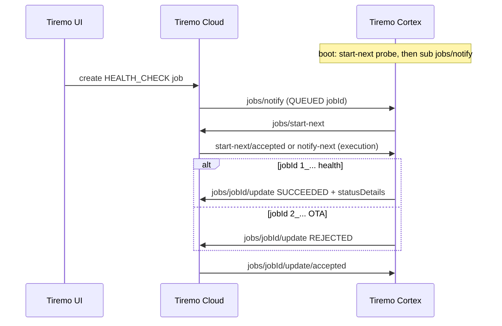
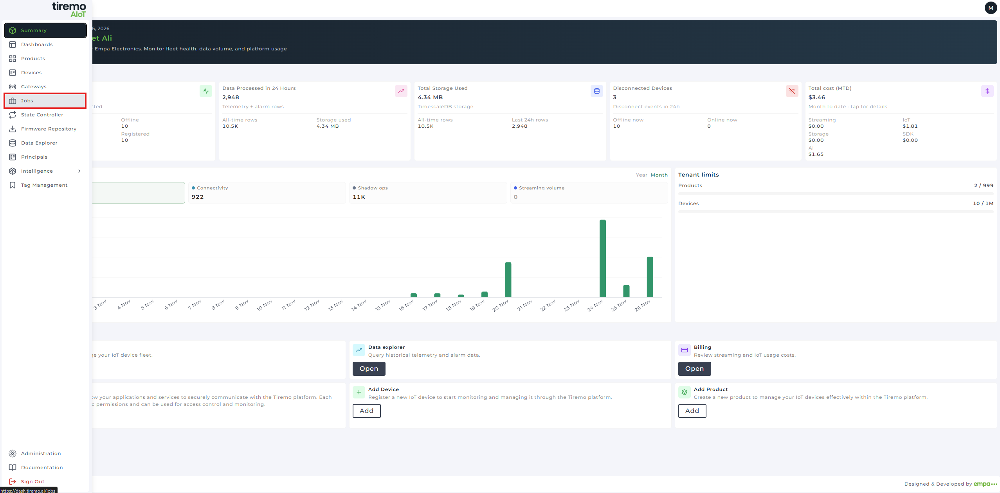
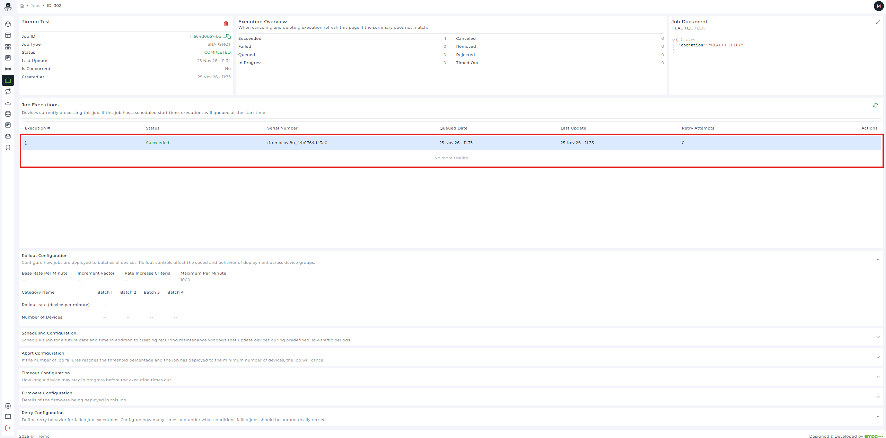
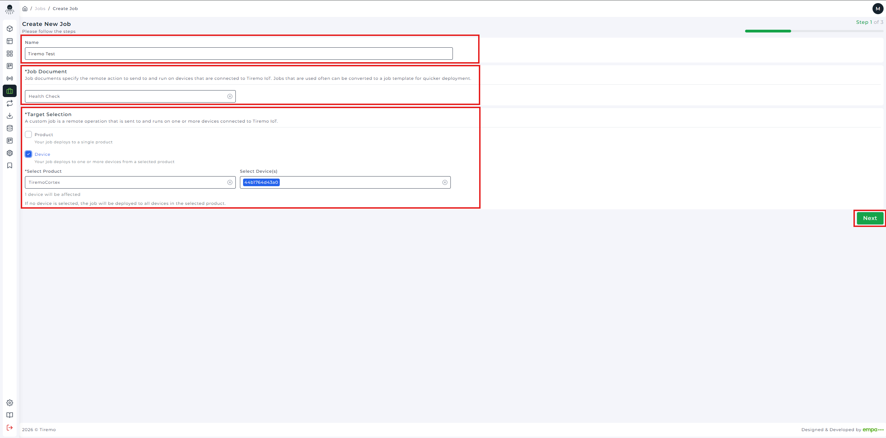
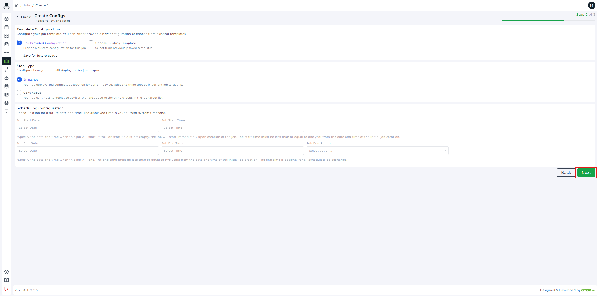
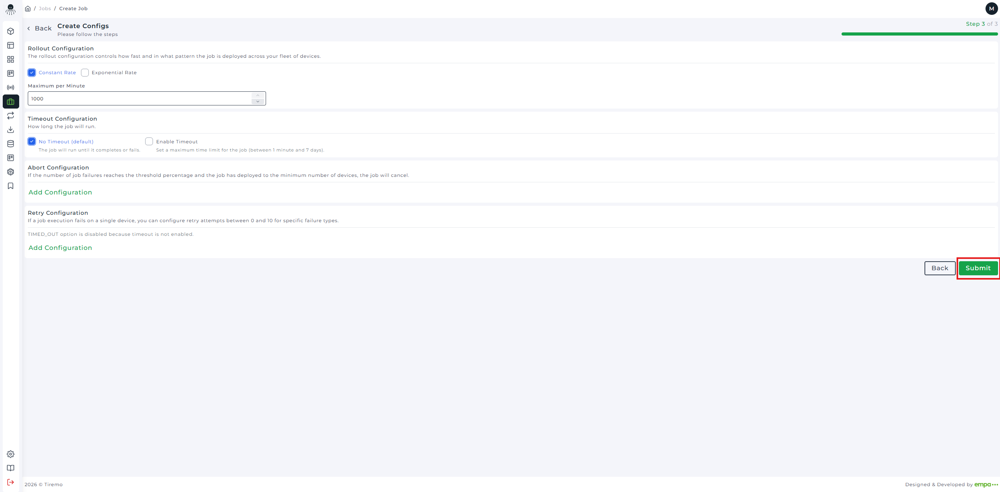
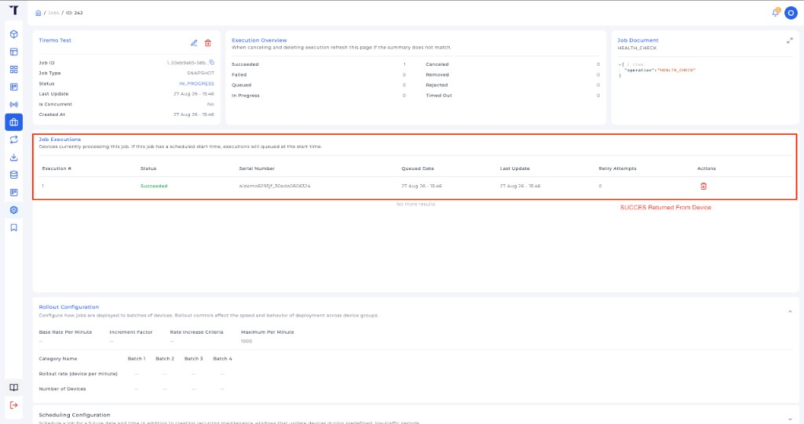

<p class="sphinxhide" align="right"><a>English</a> | <a href="../../../docs-tr/Tiremo_Cloud/Feature_Tutorials/07-Tiremo_Jobs/README.md">Türkçe</a></p>
<table class="sphinxhide" width="100%">
  <tr>
    <td align="center">
      <picture>
        <source media="(prefers-color-scheme: dark)" srcset="../../../images/tiremo_sub_brand_1_mono_white.png">
        
      </picture>
      <br>
      
      <h1>Tiremo Jobs</h1>
      <sub>Tiremo Cortex Tutorials — ESP32 + Tiremo Cloud firmware, from first blink to a fleet-ready device</sub>
    </td>
  </tr>
</table>


# Tiremo Jobs

***Board: Tiremo Cortex (ABOV A34G43A, Cortex-M4) · Section: Tiremo Cloud / Feature Tutorials · Difficulty: Hard***

## Introduction

[Tutorial 06](../06-Publishing_Alarms_And_Telemetry/) is the **data plane**.
This tutorial adds **queued work**. A Tiremo Job puts a JSON execution on
the Thing; the board claims it, runs a short local action, and reports
`SUCCEEDED` or `REJECTED`. Unlike the shadow, a job is not a standing
desired/reported loop: it has a status, and then it is done.

The production firmware's jobs path is the reference. A `jobs/notify`
message may be a **summary** (only the QUEUED `jobId`) or a **full
execution** document. The board claims a summary with `jobs/start-next`.
Health-check job IDs look like `1_<uuid>` and complete `SUCCEEDED` with
`statusDetails`. OTA-shaped IDs (`2_<uuid>`) are `REJECTED` here;
downloading and flashing firmware is
[tutorial 08](../08-OTA_Firmware_Update/).

## The Exchange, at a Glance



## You Will Learn

- The Jobs MQTT family: `jobs/notify`, `jobs/notify-next`, `jobs/start-next`, `jobs/<jobId>/update`
- Why a summary notify is not enough: `start-next` claims the execution
- Completing a health check with `statusDetails` (`result`, `firmware_version`, `connectivity`, `mqtt`, `uptime_s`)
- Rejecting an OTA-shaped job so it does not sit `IN_PROGRESS`
- Telling the cloud's reply to your own update apart from a new job

## Prerequisites

- [06-Publishing_Alarms_And_Telemetry](../06-Publishing_Alarms_And_Telemetry/) — the ready loop, Thing name, standing `update/delta`, and telemetry
- [05-Live_Shadow_Delta_Handling](../05-Live_Shadow_Delta_Handling/)
- The same four gitignored files as 06, in this `Sw/` — see [Credentials](#credentials)
- The setup scripts from [Getting Started](../../../Getting_Started/) already run, so `tdf` is available
- To watch the log: `tdf monitor` or any serial terminal (Tera Term, PuTTY, screen, minicom, …) at 115200 8N1 on the board's USB serial port
- A Tiremo Cortex board (ABOV A34G43A MCU — see [Hardware Overview](../../../Hardware.md)) connected to your PC with a USB cable

## Platform documentation

- [Introduction to Tiremo Jobs](https://docs.tiremo.ai/developer-guide/jobs/jobs-introduction)
- [Job templates](https://docs.tiremo.ai/developer-guide/jobs/jobs-phase-1-definition) (`HEALTH_CHECK`)
- [Job creation](https://docs.tiremo.ai/developer-guide/jobs/jobs-phase-2-creation)
- [Execution monitoring](https://docs.tiremo.ai/developer-guide/jobs/jobs-phase-3-monitoring)

Do not mix Jobs MQTT with classic shadow topics — see
[device firmware integration](https://docs.tiremo.ai/device-state-controller/device-integration).

## Understanding the topics

The Jobs topics stay under `$aws/things/<thingName>/jobs/...` (the AWS
Jobs protocol on Tiremo Cloud). They are not the
`pub/{product}/{device}/...` data plane from
[Phase 3](https://docs.tiremo.ai/device-provisioning/third-phase).

```text
$aws/things/<thing>/jobs/notify                    inbound: a job was queued, or the queue changed
$aws/things/<thing>/jobs/notify-next               inbound: the next pending execution
$aws/things/<thing>/jobs/start-next                outbound: claim the next QUEUED execution
$aws/things/<thing>/jobs/start-next/accepted       inbound: that execution (or {} if none)
$aws/things/<thing>/jobs/<jobId>/update            outbound: IN_PROGRESS / SUCCEEDED / REJECTED
$aws/things/<thing>/jobs/<jobId>/update/accepted   inbound: the cloud accepted the update
```

The board subscribes to `notify-next` and `start-next/accepted` at boot,
sends one `start-next` probe (a job queued while the board was off is
picked up here), then subscribes to `notify`. The execution can come
back on either `start-next/accepted` or `notify-next`; the board accepts
whichever arrives first.

Health-check completion payload (`uptime_s` counts from the moment the
jobs module started, a few seconds after boot):

```json
{"status":"SUCCEEDED","statusDetails":{"result":"ok","firmware_version":"cortex-07","connectivity":"wifi","mqtt":"connected","uptime_s":12}}
```

OTA stub:

```json
{"status":"REJECTED","statusDetails":{"reason":"ota_not_implemented"}}
```

If `start-next` returns no execution but the notify carried a `jobId`,
the board claims that ID directly: it sends `IN_PROGRESS`, then
`SUCCEEDED` (or `REJECTED`), the same fallback as production.

While the board waits for the `start-next` reply (up to 12 s), it only
looks at Jobs topics; a shadow delta that arrives in that window is not
applied. The reply usually comes in well under a second.

## Solution

### Credentials

This `Sw/` needs the same four gitignored files as tutorial 06. The
easiest way is to copy them from tutorial 06's `Sw/`:

- **`wifi_secrets.h`**: your WiFi SSID and password (from `wifi_secrets.h.example`).
- **`aws_iot_config.h`**: your product's **Identifier** and **Secret Key** (from `aws_iot_config.h.example`), plus the optional `TIREMO_AWS_THING_NAME`.
- **`certs/claim_cert.pem`** and **`certs/claim_key.pem`**: the renamed **Provisioning Certificates** — see [`certs/README.md`](./Sw/certs/README.md).

All four names are gitignored; check `git status` before you commit anyway. If one is missing, the build stops with a message that says what to do. Where to find the values in the Tiremo UI: [tutorial 03](../03-Fleet_Provisioning_By_Claim/#getting-credentials-from-the-tiremo-ui).

### Build, flash, monitor

From the repository root:

```sh
cd Tiremo_Cloud/Feature_Tutorials/07-Tiremo_Jobs/Sw
tdf build
tdf flash
tdf monitor
```

(See [Getting_Started/01-Hello_Blink's Solution](../../../Getting_Started/01-Hello_Blink/README.md#solution) for what `tdf` is. On macOS/Linux `tdf.py` also works as an alias; on Windows use `tdf`. Close any other terminal on the board's serial port before `tdf monitor` — only one program can open the port at a time.)

**Confirmed on real hardware:** `tdf build` compiles and links without errors on macOS and Windows 11 (`.text` about 42 KB; the exact size varies slightly with toolchain version, and the linker prints the same expected, harmless `_close` / `_lseek` / `_read` / `_write is not implemented` warnings explained in [01-Hello_Blink's Solution](../../../Getting_Started/01-Hello_Blink/README.md#solution)). `tdf flash` completed a full program-and-verify cycle over SWD on a real, connected Tiremo Cortex board (`** Verified OK **`). Below, the product identifier, the board's MAC address and the job's UUID are replaced with placeholders.

The boot repeats tutorial 06 (here the shadow held `intervalS=1`), then
the jobs module starts. With no job queued, the boot probe gets an empty
reply:

```text
[INFO] Tiremo_Jobs: boot
[INFO] hold USER 10000 ms to factory-reset; tap USER to raise TEMP_HIGH; queue a health-check job in the Tiremo UI
...
[INFO] shadow: applied reporting.enabled=true intervalS=1 led.on=false
...
[INFO] shadow: subscribed update/delta
[INFO] telemetry: topics pub/<product>/<deviceId>/telemetry  pub/<product>/<deviceId>/alarm
[INFO] jobs: subscribe notify-next start-next/accepted
[INFO] jobs: start-next
[INFO] jobs: MQTT RX topic=$aws/things/<product>_<deviceId>/jobs/start-next/accepted accum=24
[INFO] jobs: start-next accepted with no execution
[INFO] jobs: subscribed jobs/notify
[INFO] telemetry: pub pub/<product>/<deviceId>/telemetry (24 bytes) {"uptimeS":0,"tempC":22}
[INFO] telemetry: pub pub/<product>/<deviceId>/telemetry (24 bytes) {"uptimeS":1,"tempC":22}
...
[INFO] ready thingName=<product>_<deviceId> telemetry=on intervalS=1
```

If the cloud does not reply within 12 s, the line is
`jobs: start-next empty/timeout (no queued job)` instead; the board
carries on either way.

## Creating a job in the Tiremo UI

Create a **HEALTH_CHECK** job against this device (the board must already
be in the ready loop). Then confirm **Succeeded** on the job page.

**1. Open Jobs** from the main menu.



*Figure: Tiremo UI — click **Jobs** in the main menu.*

**2. Click Create Job.**



*Figure: Tiremo UI — **Create Job** on the Jobs list.*

**3. Step 1 of 3 — name, document, target.** Name the job, set **Job
Document** to **HEALTH_CHECK**, target **Device** (pick your product and
this board's device identifier), then **Next**.



*Figure: Tiremo UI — **HEALTH_CHECK**, Device target, then **Next**.*

**4. Step 2 of 3 — leave the defaults.** **Use Provided Configuration**,
**Snapshot**, empty schedule (starts immediately), then **Next**.



*Figure: Tiremo UI — Snapshot job, then **Next**.*

**5. Step 3 of 3 — Submit.** Constant rate / no timeout is enough for
one device.



*Figure: Tiremo UI — **Submit** to queue the job.*

Within a few seconds the UART shows the whole exchange. This run had
telemetry going out every second; the notify arrived between two
publishes and was not lost:

```text
[INFO] telemetry: pub pub/<product>/<deviceId>/telemetry (25 bytes) {"uptimeS":15,"tempC":22}
[INFO] jobs: MQTT RX topic=$aws/things/<product>_<deviceId>/jobs/notify len=182
[INFO] jobs: notify jobId='1_<uuid>'
[INFO] jobs: start-next
[INFO] jobs: MQTT RX topic=$aws/things/<product>_<deviceId>/jobs/start-next/accepted accum=303
[INFO] jobs: health-check '1_<uuid>' -- SUCCEEDED (type 1_)
[INFO] jobs: update 1_<uuid> status=SUCCEEDED (140 bytes)
[INFO] jobs: update accepted
[INFO] telemetry: pub pub/<product>/<deviceId>/telemetry (25 bytes) {"uptimeS":16,"tempC":22}
[INFO] jobs: MQTT RX topic=$aws/things/<product>_<deviceId>/jobs/notify len=34
[INFO] jobs: notify (no jobId at this depth)
[INFO] jobs: start-next
[INFO] jobs: MQTT RX topic=$aws/things/<product>_<deviceId>/jobs/start-next/accepted accum=24
[INFO] jobs: start-next accepted with no execution
```

- `notify len=182` is the summary with the QUEUED `jobId`.
- The execution can also arrive as `.../jobs/notify-next accum=...`
  instead of `start-next/accepted`; the result is the same.
- `update accepted` is the cloud's reply on
  `jobs/<jobId>/update/accepted`. It is not a new job, so the board does
  not send another `start-next` for it.
- `notify len=34` is the cloud saying the queue is now empty. The board
  checks once with `start-next` and gets an empty reply.

**6. Open the job and confirm Succeeded.** Execution Overview shows
**Succeeded: 1**. In **Job Executions**, the row for this Thing's serial
number has a green **Succeeded** status. The Job Document is
`{"operation": "HEALTH_CHECK"}`.



*Figure: Tiremo UI — **Job Executions** shows **Succeeded** after the
board's `jobs/<id>/update`.*

## Walkthrough

1. [`prv_user_code.c`](./Sw/Src/prv_user_code.c) — 06's loop, then
   `TIREMO_Jobs_Init` after telemetry, and `TIREMO_Jobs_Poll` after
   `Shadow_Poll` (so `start-next` is not sent from inside the handler of
   an inbound message).
2. [`tiremo_jobs.c`](./Sw/Common/Src/tiremo_jobs.c) — the boot probe,
   notify handling, health vs OTA, `jobs/<jobId>/update`, and the
   `update/accepted` / `update/rejected` replies (a rejected update is
   logged as a WARN with the cloud's reason).
3. [`tiremo_shadow.c`](./Sw/Common/Src/tiremo_shadow.c) — `Shadow_Poll`
   forwards `/jobs/` topics to `TIREMO_Jobs_OnMessage`, so a notify is
   not dropped as "not a delta".
4. [`tiremo_esp32.c`](./Sw/Drivers/esp32/Src/tiremo_esp32.c) —
   `MqttPublishRaw` keeps inbound messages that arrive around a publish
   (see tutorial 06's
   [Keeping Deltas While Publishing](../06-Publishing_Alarms_And_Telemetry/#keeping-deltas-while-publishing));
   here that is what keeps a job notify from being lost while telemetry
   goes out every second.
5. [`tiremo_debug.c`](./Sw/Common/Src/tiremo_debug.c) — a log line that
   is too long is cut but always ends with a line break.

## Done When

- At boot the UART shows the `start-next` probe and `jobs: subscribed jobs/notify`.
- A HEALTH_CHECK job created in the Tiremo UI is claimed once, marked `SUCCEEDED` with `firmware_version` / `mqtt` / `uptime_s` in `statusDetails`, and the UART shows `jobs: update accepted`.
- The job page shows **Succeeded** for this device.
- Telemetry and shadow deltas keep running in the same loop, even with `intervalS=1`.
- If you queue an OTA-shaped job (`2_...`), it ends `REJECTED` with `ota_not_implemented` instead of hanging `IN_PROGRESS`.

<p align="center"></p>

<p class="sphinxhide" align="center"><sub>Tiremo Cortex Tutorials — Empa Electronics</sub></p>
