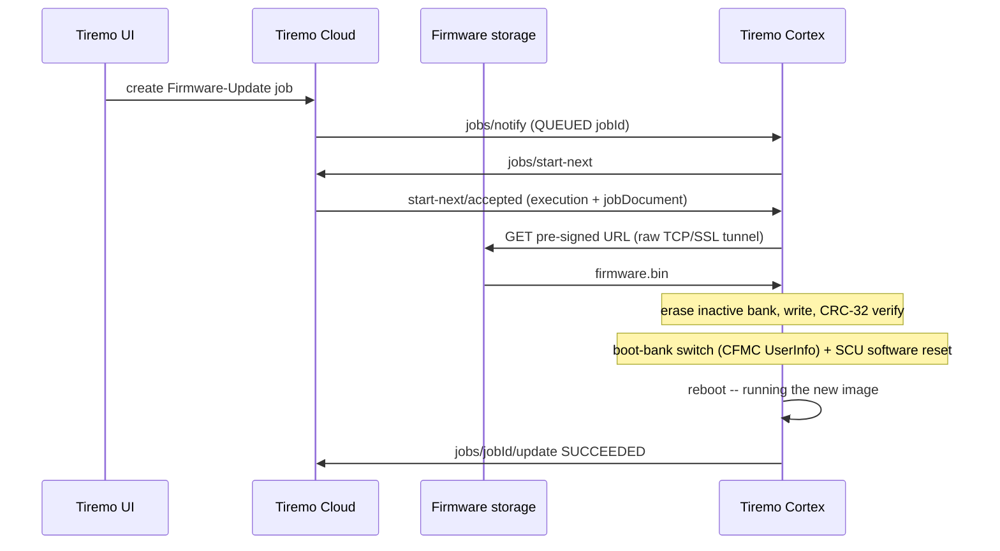
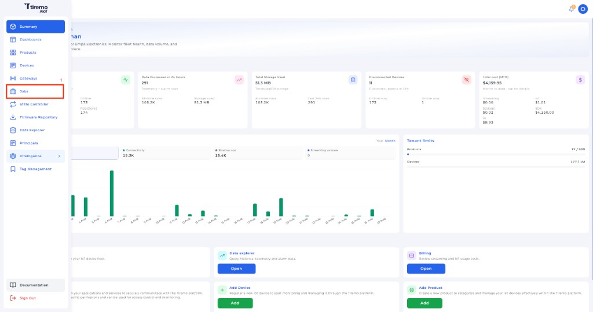
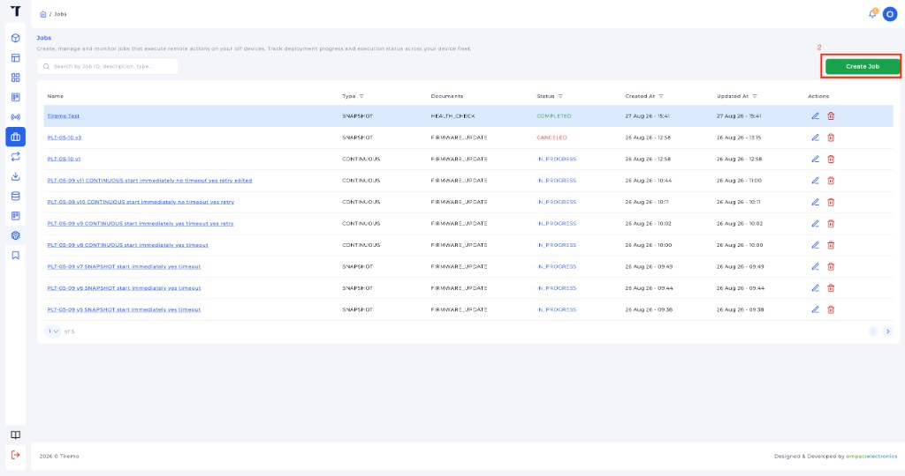
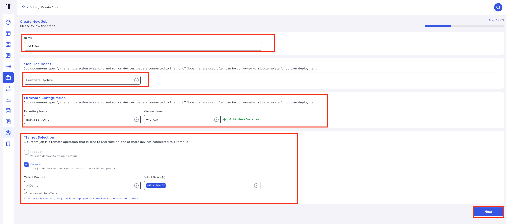
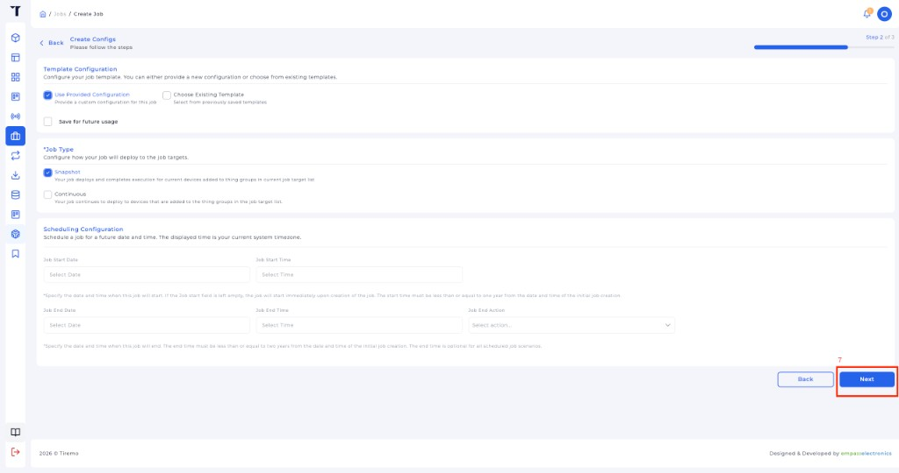
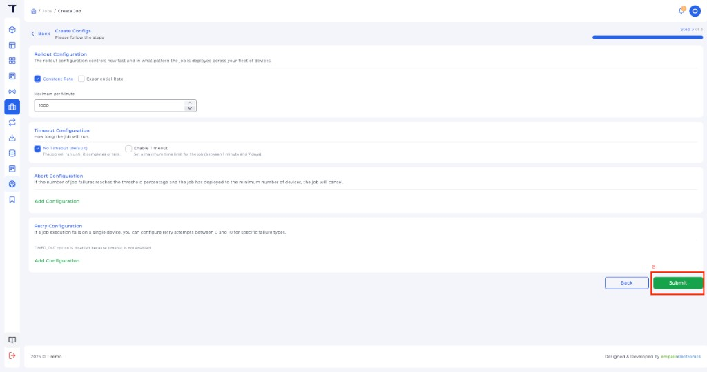
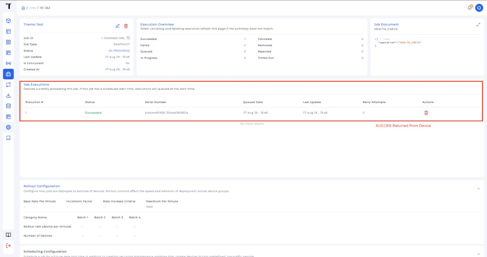

<p class="sphinxhide" align="right"><a>English</a> | <a href="../../../docs-tr/Tiremo_Cloud/Feature_Tutorials/08-OTA_Firmware_Update/README.md">Türkçe</a></p>
<table class="sphinxhide" width="100%">
  <tr>
    <td align="center">
      <picture>
        <source media="(prefers-color-scheme: dark)" srcset="../../../images/tiremo_sub_brand_1_mono_white.png">
        
      </picture>
      <br>
      
      <h1>OTA Firmware Update</h1>
      <sub>Tiremo Cortex Tutorials — ESP32 + Tiremo Cloud firmware, from first blink to a fleet-ready device</sub>
    </td>
  </tr>
</table>


# OTA Firmware Update

***Board: Tiremo Cortex (ESP32) · Section: Tiremo Cloud / Feature Tutorials · Difficulty: Hard***

## Introduction

[Tutorial 07](../07-Tiremo_Jobs/) stubs out a firmware-update job with
`REJECTED "ota_not_implemented"`. This tutorial makes it real: the board
downloads a new image over the network, verifies it, and switches to it
on its own — a genuine over-the-air update on the A34G43x's hardware
A/B code-flash banks.

The A34G43x's CFMC controller can run code flash as two equal banks.
Whichever bank booted is mapped at `0x0`; the other bank is always
visible at a fixed offset from the running image's point of view. An
update writes the *other* bank, verifies it, points the boot-bank
selection at it, and resets — the image is identical for either bank
(the hardware remaps whichever one is active to `0x0`), so there is no
second linker script and no position-independent code.

## The Exchange, at a Glance



## You Will Learn

- The A34G43x's hardware A/B code-flash banks (CFMC multi-bank): erase + program the inactive bank, then switch the boot bank in CFMC UserInfo
- Why that switch needs an SCU software reset, not a CMSIS system reset
- Parsing a real Tiremo Cloud firmware-update job document — a nested `fileInfo` / `operationInfo` shape, a base64-encoded CRC-32 checksum, a KB-rounded size
- Fetching a multi-kilobyte pre-signed URL the ESP32 module's own AT HTTP client cannot take, over a raw TCP/SSL passthrough tunnel
- A 1-boot confirm/rollback state machine, so a new image that never checks in reverts on its own
- Reporting a job's result *before* the ready loop's own boot probe gets a chance to re-claim it

## Prerequisites

- [07-Tiremo_Jobs](../07-Tiremo_Jobs/) — ready loop, Thing name, `jobs/notify` + `start-next`
- The same gitignored files as 06/07 in this `Sw/`
- Toolchain and flashing set up per [Getting Started](../../../Getting_Started/)

## Platform documentation

- [Introduction to Tiremo Jobs](https://docs.tiremo.ai/developer-guide/jobs/jobs-introduction)
- [Job templates](https://docs.tiremo.ai/developer-guide/jobs/jobs-phase-1-definition)
- [Job creation](https://docs.tiremo.ai/developer-guide/jobs/jobs-phase-2-creation)
- [Execution monitoring](https://docs.tiremo.ai/developer-guide/jobs/jobs-phase-3-monitoring)

## The job document

A real Tiremo Cloud firmware-update job carries the image behind a
pre-signed URL, not a bare filename:

```json
{
  "operation": "Firmware-Update",
  "operationInfo": {
    "firmwareType": "MCU",
    "firmwareUpdateType": "FOTA",
    "firmwareVersion": "v2.0.0"
  },
  "fileInfo": {
    "s3Path": "https://.../mcu/fota/v2.0.0/firmware.bin?X-Amz-Security-Token=...&X-Amz-Signature=...",
    "checksum": {"function": "CRC32", "value": "5CAmFw=="},
    "fileSizeKB": "53"
  }
}
```

`s3Path` is the download URL, `checksum.value` is the CRC-32 base64-encoded
big-endian (the same encoding AWS uses for its own object checksums),
and `fileSizeKB` is a KB-rounded size — not exact, so the board treats it
as an upper bound rather than an equality check. `operationInfo.firmwareName`
is the firmware **repository**'s id and `firmwareVersion` the specific
**version** within it — the same two names as the **Repository Name** /
**Version Name** fields you pick when creating the job (below); a
repository's **+ Add New Version** is where a new `OtaFirmwareUpdate.bin`
build gets uploaded and named before it can be targeted at a device.

For bench testing against a local server instead, a flat job document
works too — both shapes are accepted by the same parser:

```json
{
  "operation": "FIRMWARE_UPDATE",
  "url": "http://<your-ip>:8000/OtaFirmwareUpdate.bin",
  "crc32": 3827312151,
  "size": 53948
}
```

A job document with no checksum at all still applies — the download is
still authenticated by arriving over the mTLS-secured Jobs channel, and
the board still runs a flash-write self-verify (the downloaded bytes'
CRC-32 must match what reading the freshly-written bank back reports) —
but that content-integrity gate is a WARN, not a hard requirement.

## Solution

[`Sw/`](./Sw/) has a real, buildable implementation. Copy the same
gitignored files you already used in tutorial 07:

```sh
cd Sw
cp ../07-Tiremo_Jobs/Sw/wifi_secrets.h .
cp ../07-Tiremo_Jobs/Sw/aws_iot_config.h .
cp ../07-Tiremo_Jobs/Sw/certs/claim_cert.pem certs/
cp ../07-Tiremo_Jobs/Sw/certs/claim_key.pem certs/
tdf.py build
tdf.py flash
tdf.py monitor
```

**Confirmed, on a real ABOV A34G43A Starter Kit, against a real Tiremo
Cloud tenant:** a Firmware-Update job queued in the Tiremo UI was
claimed, its ~53 KB image downloaded over the raw TCP/SSL tunnel from
the job's actual pre-signed S3 URL, verified byte-for-byte against the
job's CRC-32, written into the inactive bank, and the board rebooted
running it:

```text
[INFO] jobs: FIRMWARE_UPDATE '1_e803e942-...' -- applying
[INFO] ota: job crc32=E4202617 size~54272
[INFO] ota: downloading v2.0.0 -> bank B
[INFO] flash_ab: inactive bank erased (52 KB)
[INFO] http: SSL tiremo-app-....s3.eu-west-1.amazonaws.com:443  path 1180 bytes
[WARN] http: dropping MQTT to free the TLS context for SSL
[INFO] http: 2xx, Content-Length=53948
[INFO] http: got 53948 bytes
[INFO] ota: bank B verified -- 53948 bytes, crc E4202617
[INFO] flash_ab: user-info boot=2 active=1 done=1 (want boot=2)
[INFO] ota: boot bank -> B, resetting into the new image
[INFO] OTA_Firmware_Update: boot fw=cortex-08b
[INFO] ota: running cortex-08b from bank B
[INFO] ota: this is the new image for job 1_e803e942-... -- will confirm
[INFO] ota: reporting job 1_e803e942-... SUCCEEDED (now fw=cortex-08b)
[INFO] jobs: update 1_e803e942-... status=SUCCEEDED (140 bytes)
[INFO] ota: confirmed running cortex-08b (bank marked good)
[INFO] jobs: start-next
[INFO] jobs: start-next accepted with no execution
```

The Tiremo UI's job page showed **Succeeded** immediately after, and the
board's next `start-next` came back empty — the job stays closed, it
does not get re-claimed on the next boot.

The negative paths were exercised on the same hardware during
development, not just written and hoped for: a download that came back
short of the job's declared size reported `FAILED size_mismatch` and
left the running bank untouched; a boot-bank switch that did not stick
was detected and reported `FAILED rollback_switch_failed` with the
board still running its original image. Neither path ever left the
board unbootable.

## Creating a job in the Tiremo UI

Create a **firmware-update** job against this device (board must
already be in the ready loop, provisioned per
[tutorial 03](../03-Fleet_Provisioning_By_Claim/)).

**1. Open Jobs** from the main menu.



*Figure: Tiremo UI — click **Jobs** in the main menu.*

**2. Click Create Job.**



*Figure: Tiremo UI — **Create Job** on the Jobs list.*

**3. Step 1 of 3 — name, document, firmware, target.** Name the job.
Set **Job Document** to **Firmware Update** — a **Firmware
Configuration** panel appears: pick the **Repository Name** (the
firmware artifact repository to ship from) and the **Version Name**
within it (**+ Add New Version** is where a new
`OtaFirmwareUpdate.bin` build gets uploaded and named). Under **Target
Selection**, choose **Device** — *"Your job deploys to one or more
devices from a selected product"* — over **Product** — *"Your job
deploys to a single product"*, its stated meaning is really "every
device on that product." Pick **Select Product**, then this board's
device identifier under **Select Device(s)**. Then **Next**.

> Leaving **Select Device(s)** empty deploys to *every* device on the
> selected product, not just this board — the UI names the count right
> there ("N devices will be affected"). Worth reading before clicking
> Next on a shared product.



*Figure: Tiremo UI — **Firmware Update** job document, **Firmware
Configuration** (Repository Name / Version Name), **Target Selection**
(Device, Select Product, Select Device(s)), then **Next**.*

**4. Step 2 of 3 — leave the defaults.** **Use Provided Configuration**,
**Snapshot**, empty schedule (starts immediately), then **Next**.



*Figure: Tiremo UI — Snapshot job, then **Next**.*

**5. Step 3 of 3 — Submit.** Constant rate / no timeout is enough for
one device.



*Figure: Tiremo UI — **Submit** to queue the job.*

**6. Open the job and confirm Succeeded.**



*Figure: Tiremo UI — **Job Executions** shows **Succeeded** once the
board's post-reboot `jobs/<id>/update` lands.*

## Walkthrough

1. [`prv_user_code.c`](./Sw/Src/prv_user_code.c) — `TIREMO_OTA_Init()`
   runs first, before the radio: it forces CFMC multi-bank mode (one
   reset on a factory-fresh board) and reads the DFMC hand-off record
   left by a prior swap. `NetworkBringUp()` (retried with backoff — the
   ESP32 AT link is not always clean on the first try) reports a pending
   job's result right after the network/cloud session is up, *before*
   `TIREMO_Jobs_Init()`'s own boot probe runs — otherwise that probe
   would find the same still-`IN_PROGRESS` job and re-apply it forever.

2. [`tiremo_ota.c`](./Sw/Common/Src/tiremo_ota.c) — the orchestrator.
   `TIREMO_OTA_Apply()` parses the job document (Tiremo Cloud's nested
   shape or a hand-written flat one), streams the download into the
   inactive bank a 4 KB sector at a time, verifies it, records the
   hand-off in [`tiremo_ota_state.c`](./Sw/Common/Src/tiremo_ota_state.c)
   (a magic+CRC record in data flash — a different flash controller than
   the code-flash bank being swapped, so it survives the swap
   untouched), sets the boot bank, and resets. `TIREMO_OTA_Init()`'s
   state machine on the far side: `CONFIRM_PENDING` for the freshly
   booted new image (one boot's grace to report in before an automatic
   rollback), `ROLLED_BACK` for a switch that failed to take or an
   image that never confirmed.

3. [`tiremo_flash_ab.c`](./Sw/Common/Src/tiremo_flash_ab.c) — the CFMC
   A/B primitives: `OtaBegin()` erases the whole target region in one
   burst before any bytes stream in (so each per-sector write during
   the download is just a program, not an erase+program, which keeps
   the UART RX ring from backing up while flash is busy),
   `OtaWriteSector()` programs one pre-erased sector,
   `SetNextBoot()` sets the boot-bank command in CFMC UserInfo and reads
   it straight back so the log shows exactly what the boot ROM will see.
   The reset that makes a switch take effect is
   `HAL_SCU_SetReset(SCU_RST_SW, true)` + `HAL_SCU_SetSWReset()` — the
   CFMC boot ROM only re-reads the UserInfo bank-switch command on that
   SCU software-reset path, not on a CMSIS `NVIC_SystemReset()`.

4. [`tiremo_esp32.c`](./Sw/Drivers/esp32/Src/tiremo_esp32.c) —
   `TIREMO_ESP32_HttpGetToSink()`. A pre-signed S3 URL runs well past
   what the ESP-AT command line can hold, and the AT HTTP client's own
   HTTPS session would collide with the single TLS context an
   already-connected MQTT session holds. Instead: `AT+CIPMODE=1` puts
   the module in raw socket passthrough, `AT+CIPSTART` opens the
   connection, `AT+CIPSEND` hands the UART itself to the socket, a
   hand-built `GET <path> HTTP/1.1` request goes straight down that
   tunnel (the long path/query string never touches a command line),
   and the response is read back the same way — past the header
   terminator, then `Content-Length` body bytes straight to the OTA
   sink, then `+++` to leave passthrough. For `https://`, MQTT is
   disconnected first to free the TLS context; the ready loop
   reconnects it.

5. [`tiremo_jobs.c`](./Sw/Common/Src/tiremo_jobs.c) — `prvIsOtaJob()`
   recognizes a firmware-update execution from its jobDocument content
   (`firmwareUpdateType`, `s3Path`, `fileInfo`, and the generic
   `FIRMWARE_UPDATE` markers a hand-written job might use) rather than
   the job-id prefix tutorial 07 used — a real Tiremo Cloud FOTA job's
   id has the same `1_` prefix as a health check.
   `TIREMO_Jobs_ReportResultDirect()` is the piece that lets
   `prv_user_code.c` close out a job before `Init()`'s own probe can
   touch it.

## Done When

A Firmware-Update job created in the Tiremo UI is claimed, its image
downloaded and verified, the board reboots running it, and the job
shows **Succeeded** — with no further re-application on subsequent
boots. A job whose declared size or checksum does not match what
actually downloads is rejected before any bank switch; a boot-bank
switch that does not take effect is detected and reported without
leaving the board unbootable.

<p align="center"></p>

<p class="sphinxhide" align="center"><sub>Tiremo Cortex Tutorials — Empa Electronics</sub></p>
