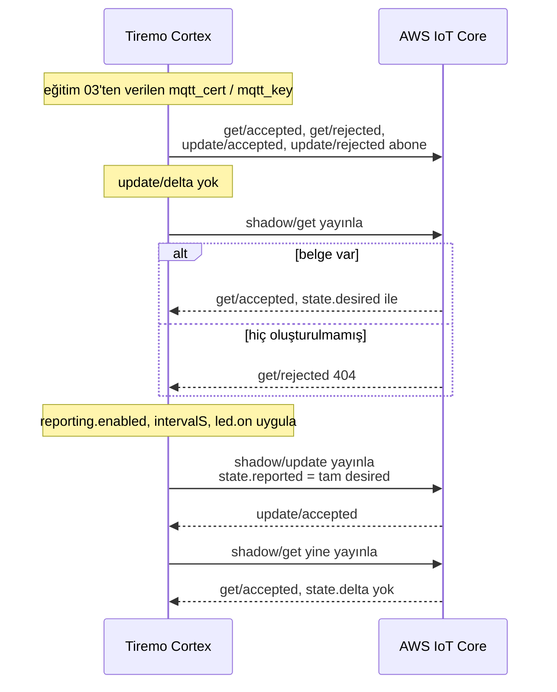
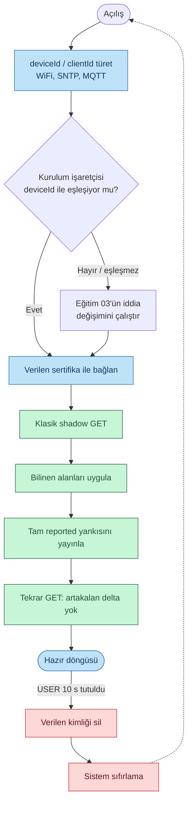

<p class="sphinxhide" align="right"><a href="../../../../AWS_IoT_Core/Feature_Tutorials/04-Shadow_Get_Apply_Report/README.md">English</a> | <a>Türkçe</a></p>
<table class="sphinxhide" width="100%">
  <tr>
    <td align="center">
      <picture>
        <source media="(prefers-color-scheme: dark)" srcset="../../../../images/tiremo_sub_brand_1_mono_white.png">
        
      </picture>
      <br>
      
      <h1>Shadow Get + Apply + Report</h1>
      <sub>Tiremo Cortex Eğitimleri — ESP32 + AWS IoT üretici yazılımı, ilk LED yanıp sönmesinden filoya hazır bir cihaza</sub>
    </td>
  </tr>
</table>


# Shadow Get + Apply + Report

***Kart: Tiremo Cortex (ESP32) · Bölüm: AWS IoT Core / Feature Tutorials · Zorluk: Zor***

> Bu sayfa [İngilizce orijinalinin](../../../../AWS_IoT_Core/Feature_Tutorials/04-Shadow_Get_Apply_Report/README.md)
> Türkçe çevirisidir. Kod ve dosya yolları İngilizce kalır; içerik farklılaşırsa
> İngilizce sürüm esas alınır.

## Giriş

[Eğitim 03](../../../../AWS_IoT_Core/Feature_Tutorials/03-Fleet_Provisioning_By_Claim/)
karta ESP32 NVS'sinde benzersiz verilmiş bir kimlik bıraktı. Bu eğitim o
kimliğin ilk uygulama MQTT konuşması: açılışta klasik Device Shadow'u
alır, bilinen alanları yerelde uygular ve AWS'nin delta'yı düşürebilmesi
için `state.reported` yayınlar.

Tuzak, yalnızca değişen anahtarı raporlamaktır. AWS delta'yı *desired
eksi reported* olarak hesaplar. Desired iç içe bir nesneyse (`reporting`,
`led`, `note`) ve reported yalnızca `{"reporting":{"enabled":true}}`
ise, kalan kardeşler delta'da sonsuza kadar kalır. Üretici yazılımı
uygulanan **tüm** desired nesnesini — iç içe alanlar dahil —
`TIREMO_JsonWriter_Raw` ile yankılar.

Bu eğitim `shadow/update/delta`'ya abone **olmaz**. O duran abonelik
[eğitim 05](../../../../AWS_IoT_Core/Feature_Tutorials/05-Live_Shadow_Delta_Handling/)'tir.
Buradaki döngü tek seferliktir: get, apply, report, doğrula, sonra bekle.

## Değişim, Tek Bakışta





## Neler Öğreneceksiniz

- Klasik shadow istek/yanıt: `shadow/get` → `get/accepted` (veya `get/rejected`)
- Reported'ın yalnızca değişen anahtarları değil, uygulanan *tüm* desired nesnesini yankılaması gerektiği — gerçek bir üretim hatası
- Bir `FindObject` dilimini yazıcıya kopyalamanın ucuz yolu olarak `TIREMO_JsonWriter_Raw`
- Parçalanmış bir `get/accepted`'i eğitim 03'ün CreateKeysAndCertificate'i birleştirdiği gibi birleştirmek (ESP-AT MQTT tamponu 1024 bayt)
- `update/delta` açmadan, ikinci bir get ile delta'nın gittiğini doğrulamak

## Önkoşullar

- [03-Fleet_Provisioning_By_Claim](../../../../AWS_IoT_Core/Feature_Tutorials/03-Fleet_Provisioning_By_Claim/) — paylaşılan iddia sertifikası değil, benzersiz verilmiş kimlik. 03'ten sonra `tiremo` / `provisioned` işaretçisi bu kartla eşleşir; bu üretici yazılımı iddia değişimini atlar.
- [02-Minimal_JSON_Helpers](../../../../AWS_IoT_Core/Feature_Tutorials/02-Minimal_JSON_Helpers/) — `FindObject` / `FindBool` / `FindUint` ve yazıcı
- 03 ile aynı gitignore'lu dosyalar bu `Sw/` içinde: `wifi_secrets.h`, `aws_iot_config.h`, `certs/claim_cert.pem`, `certs/claim_key.pem` (yalnızca kart fabrika taze ise veya fabrika sıfırlarsanız gerekir)
- [Getting Started](../../../../Getting_Started/) ile kurulu araç zinciri ve flaş

## Thing Adı ile İstemci Kimliği

Shadow konuları MQTT istemci kimliğine değil **Thing** adına göredir:

```text
$aws/things/<thingName>/shadow/get
$aws/things/<thingName>/shadow/get/accepted
$aws/things/<thingName>/shadow/get/rejected
$aws/things/<thingName>/shadow/update
```

Eğitim 03, RegisterThing'den gelen `thingName`'i saklamaz. Bu üretici
yazılımı `thingName`'i varsayılan olarak MQTT istemci kimliğine
(`<product>_<deviceId>`, örn. `<product>_30eda0806324`) eşitler. Bu,
Thing'i `productIdentifier` + `deviceIdentifier`'dan adlandıran bir
şablonla örtüşür.

Şablonunuz çıplak 12 hex MAC kullanıyorsa `aws_iot_config.h` içinde
`TIREMO_AWS_THING_NAME`'i o MAC'e ayarlayın. Yanlış Thing ile gelen bir
`404`, veya shadow konularında MQTT `not authorized`, genellikle bu
uyumsuzluktur.

## Tam Yankı Reported

Gerçekçi bir desired belgesi (eğitim 02'nin zaten ayrıştırdığı şekil):

```json
{
  "reporting": { "enabled": true, "intervalS": 60 },
  "led": { "on": false },
  "note": "colon:not-a-key"
}
```

Uygulama `reporting.enabled`, `reporting.intervalS` ve `led.on`'u okur.
Rapor bu üç anahtarı yeniden kurmaz. Desired nesnesinin tamamını —
`note` dahil — `TIREMO_JsonWriter_Raw` ile `state.reported`'a kopyalar.
AWS o zaman desired == reported görür ve sonraki get'te `state.delta`'yı
atlar.

Desired yoksa (boş shadow veya ilk 404) üretici yazılımı varsayılan
`{reporting:{enabled:true,intervalS:60},led:{on:false}}` raporlar ki
belgelenmiş bir reported durumu olsun.

Demo belgesini küçük tutun. ESP-AT 1024 baytın üstünü, create-cert
PEM'ini parçaladığı gibi parçalar; buradaki tutma tamponu 8 KB'dir.

## Çözüm

[`Sw/`](../../../../AWS_IoT_Core/Feature_Tutorials/04-Shadow_Get_Apply_Report/Sw/)
gerçek, derlenebilir bir uygulamaya sahip. Eğitim 03'te zaten
kullandığınız gitignore'lu dosyaları kopyalayın:

```sh
cd Sw
cp ../03-Fleet_Provisioning_By_Claim/Sw/wifi_secrets.h .
cp ../03-Fleet_Provisioning_By_Claim/Sw/aws_iot_config.h .
cp ../03-Fleet_Provisioning_By_Claim/Sw/certs/claim_cert.pem certs/
cp ../03-Fleet_Provisioning_By_Claim/Sw/certs/claim_key.pem certs/
tdf.py build
tdf.py flash
tdf.py monitor
```

Veya bu `Sw/` taze bir klonsa örneklerden başlayın. CMake iki iddia PEM
dosyası olmadan yapılandırmaz.

**Bağlı kartta doğrulandı:** `.text` 33764 bayt, flaş **Verified OK**.
Başarılı bir eğitim 03'ten sonra UART iddia değişimini atladı ve shadow
döngüsünü çalıştırdı. Belgesi henüz olmayan bir Thing'e ilk get
`get/rejected` 404'tür; üretici yazılımı varsayılanları raporlar ve
sonraki açılış `get/accepted` görür. Ondan sonraki canlı UART:

```text
[INFO] Shadow_Get_Apply_Report: boot
[INFO] identity: deviceId=30eda0806324 clientId=<product>_30eda0806324 thingName=<product>_30eda0806324
[INFO] ESP32: online, SNTP epoch=...
[INFO] provision: marker matches 30eda0806324
[INFO] shadow: get
[INFO] shadow: MQTT RX topic=$aws/things/<product>_30eda0806324/shadow/get/accepted frag=201 accum=201
[INFO] shadow: desired 20 bytes
[INFO] shadow: applied reporting.enabled=true intervalS=60 led.on=false
[INFO] shadow: update reported (78 bytes, full desired echo)
[INFO] shadow: update accepted
[INFO] shadow: get again to confirm delta is gone
[INFO] shadow: MQTT RX topic=$aws/things/<product>_30eda0806324/shadow/get/accepted frag=255 accum=255
[INFO] shadow: no leftover delta
[INFO] shadow: ready thingName=<product>_30eda0806324 (no live delta; that is tutorial 05)
```

Daha zengin bir desired yolu için: AWS konsolunda Thing'in klasik
shadow desired'ını yukarıdaki örnek nesneye düzenleyin, kartı sıfırlayın
ve `desired N bytes` sonra `no leftover delta` olduğunu doğrulayın.
Rapordan sonra konsol delta'sı boş olmalıdır.

## Adım Adım

1. [`prv_user_code.c`](../../../../AWS_IoT_Core/Feature_Tutorials/04-Shadow_Get_Apply_Report/Sw/Src/prv_user_code.c) — 03 ile aynı kimlik / WiFi / SNTP / kurulum-veya-atla yolu, sonra `TIREMO_Shadow_GetApplyReport(thingName)`. 10 s USER tutuşu verilen kimliği hâlâ sıfırlar.
2. [`tiremo_shadow.c`](../../../../AWS_IoT_Core/Feature_Tutorials/04-Shadow_Get_Apply_Report/Sw/Common/Src/tiremo_shadow.c) — konular, get, apply, tam yankı report, doğrulama get. `update/delta` aboneliği yok.
3. [`tiremo_json.c`](../../../../AWS_IoT_Core/Feature_Tutorials/04-Shadow_Get_Apply_Report/Sw/Common/Src/tiremo_json.c) — `JsonWriter_Raw`, bu eğitimin 02'nin üstüne eklediği tek yeni yardımcı.
4. [`aws_iot_config.h.example`](../../../../AWS_IoT_Core/Feature_Tutorials/04-Shadow_Get_Apply_Report/Sw/aws_iot_config.h.example) — şablon Thing adı istemci kimliği değilse isteğe bağlı `TIREMO_AWS_THING_NAME`.

## Bitti Sayılınca

Bir açılış GET'i yerelde en az `reporting.enabled`'ı uygular, yayınlanan
`reported` tüm desired nesnesini (iç içe alanlar dahil) yankılar ve
ikinci GET'te `state.delta` yoktur. Yukarıdaki gibi donanımda doğrulandı.
Kart hazır döngüsünde otururken desired'ı değiştirmek sonraki sıfırlamaya
kadar bir şey yapmaz — o eğitim 05'tir.

<p align="center"></p>

<p class="sphinxhide" align="center"><sub>Tiremo Cortex Eğitimleri — Empa Electronics</sub></p>
