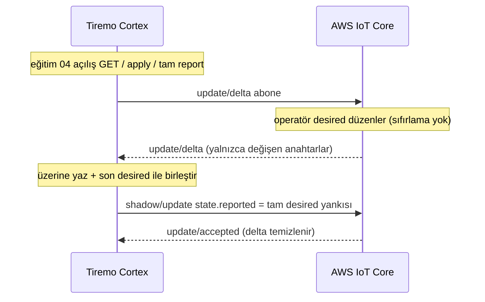
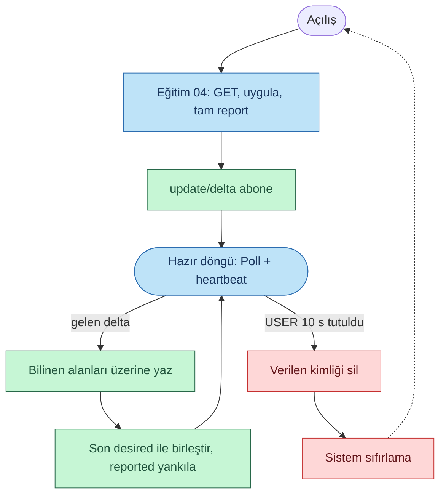

<p class="sphinxhide" align="right"><a href="../../../../AWS_IoT_Core/Feature_Tutorials/05-Live_Shadow_Delta_Handling/README.md">English</a> | <a>Türkçe</a></p>
<table class="sphinxhide" width="100%">
  <tr>
    <td align="center">
      <picture>
        <source media="(prefers-color-scheme: dark)" srcset="../../../../images/tiremo_sub_brand_1_mono_white.png">
        
      </picture>
      <br>
      
      <h1>Live Shadow Delta Handling</h1>
      <sub>Tiremo Cortex Eğitimleri — ESP32 + AWS IoT üretici yazılımı, ilk LED yanıp sönmesinden filoya hazır bir cihaza</sub>
    </td>
  </tr>
</table>


# Live Shadow Delta Handling

***Kart: Tiremo Cortex (ESP32) · Bölüm: AWS IoT Core / Feature Tutorials · Zorluk: Zor***

> Bu sayfa [İngilizce orijinalinin](../../../../AWS_IoT_Core/Feature_Tutorials/05-Live_Shadow_Delta_Handling/README.md)
> Türkçe çevirisidir. Kod ve dosya yolları İngilizce kalır; içerik farklılaşırsa
> İngilizce sürüm esas alınır.

## Giriş

[Eğitim 04](../../../../AWS_IoT_Core/Feature_Tutorials/04-Shadow_Get_Apply_Report/)
desired durumu bir kez, açılışta uygular. Gerçek bir kontrol düzlemi
cihaz zaten çalışırken `desired`'ı değiştirir. AWS o zaman farkı
`$aws/things/<thingName>/shadow/update/delta` üzerinde yayınlar. Bu
eğitim 04'ün açılış GET / apply / report'unu korur, sonra o duran
aboneliği ekler ve her gelen delta'yı sıfırlama olmadan uygular.

04'ün dersi hâlâ geçerlidir. Bir delta belgesi yalnızca farklı olan
anahtarları içerir. Yalnızca onları raporlamak — veya yalnızca
`reporting` ve `led` yeniden kurmak — diğer desired kardeşlerini
(`note`, iç içe ekstralar, …) delta'da sonsuza kadar bırakır. AWS her
raporda `update/delta`'yı yeniden yayınlar ve UART fırtına yapar. Canlı
yol bilinen alanları günlük için üzerine yazar, dilimi son tam desired
nesnesine birleştirir ve o nesnenin tamamını `reported` olarak yankılar.

## Değişim, Tek Bakışta





## Neler Öğreneceksiniz

- Tek seferlik `shadow/get`'ten ayrı, duran bir abonelik olarak `shadow/update/delta`
- Delta yükünün `state`'inin *kısmi* desired farkı olduğu — `{desired, reported, delta}` değil
- Canlı bir değişikliğin artakalan delta yaratmaması için 04'ün apply + tam yankı report'unu yeniden kullanmak
- 10 s USER fabrika sıfırlamasının hâlâ çalışması için hazır döngüde MQTT yoklamak

## Önkoşullar

- [04-Shadow_Get_Apply_Report](../../../../AWS_IoT_Core/Feature_Tutorials/04-Shadow_Get_Apply_Report/) — açılış GET / apply / tam report, Thing adı, iddia/verilen kimlik
- 04 ile aynı gitignore'lu dosyalar bu `Sw/` içinde: `wifi_secrets.h`, `aws_iot_config.h`, `certs/claim_cert.pem`, `certs/claim_key.pem`
- [Getting Started](../../../../Getting_Started/) ile kurulu araç zinciri ve flaş

## `update/delta`'yı Anlamak

Yalnızca LED değiştiğinde klasik shadow delta'sı şöyle görünür:

```json
{
  "version": 12,
  "timestamp": 1787785000,
  "state": {
    "led": { "on": true }
  }
}
```

Buradaki `state` get/accepted zarfı **değildir**. İç içe `desired` yoktur.
O dilimi `reported` olarak `JsonWriter_Raw`'a vermek
`{"led":{"on":true}}` yayınlar ve AWS `reporting`'i delta'da tutar.

Yalnızca üç bilinen anahtarı yeniden kurmak aynı hatadır. Fırtına
günlüğündeki açılış desired'ı 19 bayttı (`{"led":{"on":false}}`); canlı
yol sonra `{reporting, led}` raporladı ve ekstra desired anahtarlarını
eşleşmeden bıraktı, bu yüzden `update/delta` hiç temizlenmedi.

Bu üretici yazılımı açılış GET'inden son tam desired nesnesini tutar.
Her delta UART günlüğü için `reporting.*` / `led.on` üzerine yazar,
dilimi o önbelleğe derin birleştirir (`null` bir anahtarı siler) ve
sonucu `JsonWriter_Raw` ile yankılar. Birleşmiş desired son yayınlananla
bayt bayt aynıysa rapor atlanır, böylece artakalan bir delta döngüye
giremez.

`update/delta` açılış yankısından **sonra** abone olunur. Daha erken
abonelik, açılış yolu get/accepted veya update/accepted beklerken
`MqttWaitMessage`'ın bir delta'yı tüketip (ve düşürüp) atmasına yol açardı.

Thing adı 04 ile aynı kuraldır: `TIREMO_AWS_THING_NAME` ayarlı değilse
MQTT istemci kimliği (`<product>_<deviceId>`).

## Çözüm

[`Sw/`](../../../../AWS_IoT_Core/Feature_Tutorials/05-Live_Shadow_Delta_Handling/Sw/)
gerçek, derlenebilir bir uygulamaya sahip. Eğitim 04'te kullandığınız
gitignore'lu dosyaları kopyalayın:

```sh
cd Sw
cp ../04-Shadow_Get_Apply_Report/Sw/wifi_secrets.h .
cp ../04-Shadow_Get_Apply_Report/Sw/aws_iot_config.h .
cp ../04-Shadow_Get_Apply_Report/Sw/certs/claim_cert.pem certs/
cp ../04-Shadow_Get_Apply_Report/Sw/certs/claim_key.pem certs/
tdf.py build
tdf.py flash
tdf.py monitor
```

**Bağlı kartta doğrulandı:** `.text` 34928 bayt, flaş **Verified OK**.
Başarılı bir eğitim 04'ten sonra UART iddia değişimini atladı, açılış
GET / tam report'unu tekrarladı, sonra `update/delta`'ya abone oldu:

```text
[INFO] Live_Shadow_Delta: boot
[INFO] identity: deviceId=30eda0806324 clientId=<product>_30eda0806324 thingName=<product>_30eda0806324
[INFO] provision: marker matches 30eda0806324
[INFO] shadow: get
[INFO] shadow: applied reporting.enabled=true intervalS=60 led.on=false
[INFO] shadow: update reported (77 bytes, full desired echo)
[INFO] shadow: update accepted
[INFO] shadow: no leftover delta
[INFO] shadow: subscribed update/delta
[INFO] shadow: ready thingName=<product>_30eda0806324 (live update/delta)
```

AWS konsolunda Thing'in klasik shadow `desired`'ını (örneğin `led.on`
veya `reporting.enabled`) kartı sıfırlamadan **iki kez** düzenleyin.
Her düzenleme şunu yazmalıdır:

```text
[INFO] shadow: delta ... bytes
[INFO] shadow: applied reporting.enabled=... intervalS=... led.on=...
[INFO] shadow: desired now ... bytes (merged)
[INFO] shadow: update reported (... bytes, full desired echo)
```

Her rapordan sonra konsol delta'sı temizlenmelidir.

## Adım Adım

1. [`prv_user_code.c`](../../../../AWS_IoT_Core/Feature_Tutorials/05-Live_Shadow_Delta_Handling/Sw/Src/prv_user_code.c) — 04'ün kimlik / WiFi / SNTP / kurulum-veya-atla / açılış GET'i, sonra hazır döngüde `TIREMO_Shadow_Poll()`.
2. [`tiremo_shadow.c`](../../../../AWS_IoT_Core/Feature_Tutorials/05-Live_Shadow_Delta_Handling/Sw/Common/Src/tiremo_shadow.c) — 04'ten açılış değişimi; `update/delta`'ya yalnızca o başarılı olduktan sonra abone; `Poll` her delta'yı son desired nesnesine birleştirir ve yankılar.
3. [`tiremo_shadow.h`](../../../../AWS_IoT_Core/Feature_Tutorials/05-Live_Shadow_Delta_Handling/Sw/Common/Include/tiremo_shadow.h) — `GetApplyReport` ve `Poll`.

## Bitti Sayılınca

Kart hazır döngüsünde otururken AWS konsolunda bir desired alanını
açıp kapatmak, sıfırlama olmadan, bir MQTT yoklama döngüsü içinde
uygulanan günlüğü değiştirir ve yayınlanan reported nesnesi değişmeyen
kardeşleri hâlâ içerir, böylece konsol delta'sı temizlenir. Açılış
aboneliği yukarıdaki gibi donanımda doğrulandı; iki canlı geçiş konsol
adımıdır.

<p align="center"></p>

<p class="sphinxhide" align="center"><sub>Tiremo Cortex Eğitimleri — Empa Electronics</sub></p>
