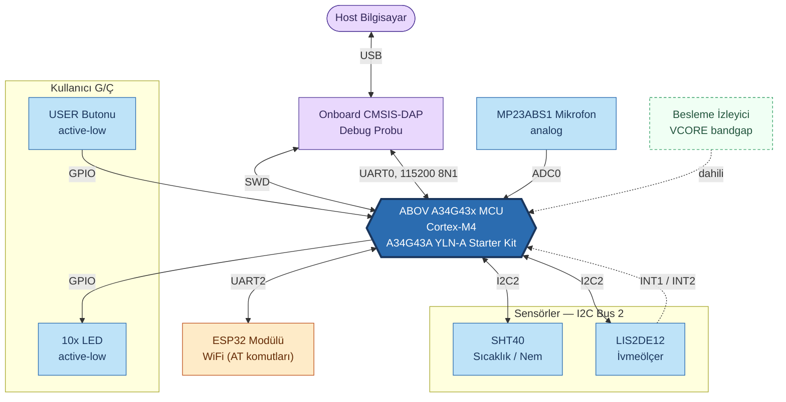
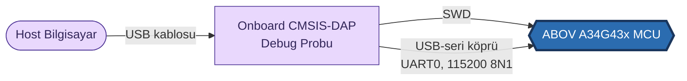

<a href="../Hardware.md">English</a> | <a>Türkçe</a>

<table class="sphinxhide" width="100%">
  <tr>
    <td align="center">
      <picture>
        <source media="(prefers-color-scheme: dark)" srcset="../images/tiremo_sub_brand_1_mono_white.png">
        
      </picture>
       
      
      <h1>Donanım Genel Bakış</h1>
      Tiremo Cortex Eğitimleri — ESP32 + AWS IoT üretici yazılımı, ilk LED yanıp sönmesinden filoya hazır bir cihaza
    </td>
  </tr>
</table>

# Donanım Genel Bakış

> Bu sayfa [İngilizce orijinalinin](../Hardware.md) Türkçe çevirisidir;
> içerik farklılaşırsa İngilizce sürüm esas alınır.

Kart seviyesinde referans: Tiremo Cortex kartında neler olduğu, MCU'ya
nasıl kablolandığı, ve bir host bilgisayarın kartla nasıl konuştuğu.
Burada üretici yazılımı yok — bu donanım üzerine kod yazmaya başlamak
için [Getting Started](../Getting_Started/README.md)'a bakın.

## Kart Blok Diyagramı

Altıgen = MCU · yuvarlatılmış stadyum = kart dışı host · kesikli
kenarlık = yalnızca dahili, harici pin yok · tam port/pin numaraları
yukarıda tekrar edilmez, aşağıdaki **Pin Haritası Referansı**
tablosundadır.

## Host Bağlantısı

Bir geliştiricinin bilgisayarının MCU'ya gerçekte nasıl ulaştığı — ayrı
bir programlayıcıya gerek yok, debug probu kartın üzerinde. Tek bir USB
kablosu aynı anda iki yolu taşır: flaşlama/hata ayıklama için SWD, ve
UART0 log konsolu için sanal bir seri port.

Tek bir USB kablosu aynı anda iki yolu taşır: flaşlama/hata ayıklama
için SWD, ve UART0 log konsolu için sanal bir seri port.

## Pin Haritası Referansı

| Port · Pin | İşlev | Notlar |
|---|---|---|
| PA0 | Mikrofon analog girişi (AN0) | ADC0 kanal 0, Timer1 tetiklemeli burst yakalama |
| PA4 | LIS2DE12 INT1 | İvmeölçer kesmesi |
| PA5 | LIS2DE12 INT2 | İvmeölçer kesmesi |
| PA8 | ESP32 UART2 RX | ESP32 TX → MCU RX |
| PA9 | ESP32 UART2 TX | MCU TX → ESP32 RX |
| PA12 | ESP32 güç kapısı | Active-high (HIGH = güçlü) |
| PB4 | LED1 | Active-low |
| PB5 | LED4 | Active-low |
| PB6 | I2C Bus 2 SCL | Paylaşılan: SHT40 + LIS2DE12 |
| PB7 | I2C Bus 2 SDA | Paylaşılan: SHT40 + LIS2DE12 |
| PB9 | LED2 | Active-low |
| PB10 | LED5 | Active-low |
| PB11 | LED6 | Active-low |
| PB12 | LED7 | Active-low |
| PB13 | LED8 | Active-low |
| PB14 | LED9 | Active-low |
| PB15 | LED10 | Active-low |
| PC9 | USER butonu | Active-low |
| PF7 | LED3 | Active-low |
| — | Besleme voltajı izleyici | Dahili ADC1 kanal 23 (VCORE bandgap); harici pin yok |
| — | Debug UART (UART0) | Starter kit'in onboard USB-seri köprüsü tarafından sabitlenmiş, kart üzerinden yapılandırılamaz |

Doğruluk kaynağı: referans üretici yazılımının `board_config.h`'i.
Kendi kart revizyonunuz farklıysa, bu sayfa değil o dosya kodunuzun
takip etmesi gereken şeydir.

Tiremo Cortex Tutorials — Empa Electronics

