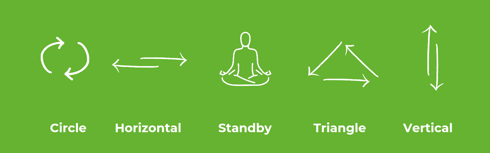
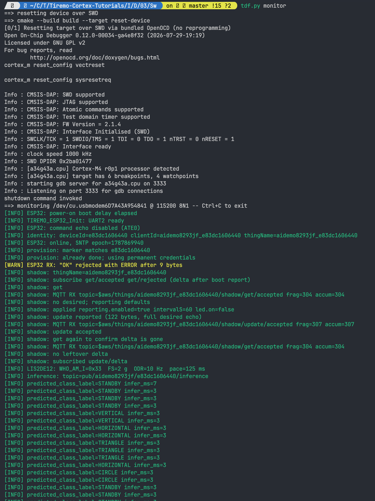
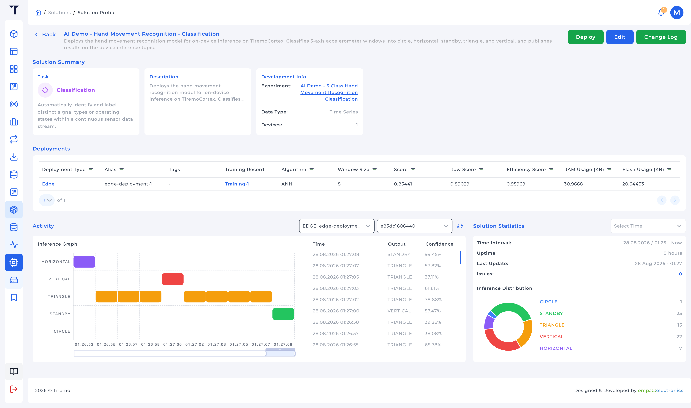

<p class="sphinxhide" align="right"><a href="../../../../Intelligence/Design_Tutorials/03-HMR_Edge_Deployment/README.md">English</a> | <a>Türkçe</a></p>
<table class="sphinxhide" width="100%">
  <tr>
    <td align="center">
      <picture>
        <source media="(prefers-color-scheme: dark)" srcset="../../../../images/tiremo_sub_brand_1_mono_white.png">
        
      </picture>
      <br>
      
      <h1>HMR Gesture Classifier on the Edge</h1>
      <sub>Tiremo Cortex Eğitimleri: ESP32 + Tiremo Cloud üretici yazılımı, ilk LED yanıp sönmesinden filoya hazır bir cihaza</sub>
    </td>
  </tr>
</table>

# HMR Gesture Classifier on the Edge

***Kart: Tiremo Cortex (ESP32) · Bölüm: Intelligence / Design Tutorials · Zorluk: Zor***

> Bu sayfa [İngilizce orijinalinin](../../../../Intelligence/Design_Tutorials/03-HMR_Edge_Deployment/README.md)
> Türkçe çevirisidir. `Datasets/` ve `Tiremo_AI/` yalnızca İngilizce
> eğitim klasöründe yaşar; burada kopyalanmaz; içerik farklılaşırsa
> İngilizce sürüm esas alınır.

## Giriş

Özellik eğitimleri 01–04 her biri genel olarak tek bir Intelligence nesnesini öğretir (dışa aktarma, Data Source, Experiment, Solution). Bu tasarım eğitimi o zinciri gerçekten göndereceğiniz bir şeye uygular: Tiremo Cortex LIS2DE12 üzerinde **Human Motion Recognition**: beş jest, üç eksen, MCU'ya sığan bir model, çıkarım olarak yayınlanan sonuçlar.

Yakalama **128 Hz**'de başladı. O dosya 8 örnekli bir TinyML penceresi için çok yoğundur, bu yüzden aynı kayıt **8 Hz** ve **4 Hz**'e indirgenmiştir. Üç CSV [`Datasets/`](../../../../Intelligence/Design_Tutorials/03-HMR_Edge_Deployment/Datasets/) içindedir. Intelligence'ın bu vaka için ürettiği Edge paketi [`Tiremo_AI/`](../../../../Intelligence/Design_Tutorials/03-HMR_Edge_Deployment/Tiremo_AI/) içindedir; `Tiremo-Secure-Iot-Sw-Cloud-Collect-Infer/Tiremo_Lib/Tiremo_AI` klasörünün olduğu gibi kopyası, elle yazılmış bir sürücü değil.

Burada ekstra bir Feature-Tutorial `Sw/` ağacı yoktur. Eğitim ve dağıtım Tiremo UI'dır. Bu tasarım eğitiminin Cortex ikilisi [`Sw/`](../../../../Intelligence/Design_Tutorials/03-HMR_Edge_Deployment/Sw/) içindedir (`tiremo_ai_run` + `…/inference` MQTT). `Tiremo_AI/` `Sw/` kardeşidir.

## Neler Öğreneceksiniz

- 128 Hz'in neden yakalandığı ve 8 Hz ile 4 Hz'in neden var olduğu
- Intelligence'ı açmadan *önce* hız, pencere, etiketler ve sınıf dengesini nasıl düşüneceğiniz
- Bu vakanın kullandığı platform nesneleri (Data Explorer, Data Source, Data Studio, Experiment, Solution, Edge indirme)
- Tam UI yapılandırması (Classification + Time Series, F1 Macro, pencere 8, Edge, …) ve her düğmenin neden öyle ayarlandığı
- 24-float pencereli `tiremo_ai_run` / `tiremo_ai_format_mqtt_json` nasıl çağrılır

## Ön Koşullar

- Dört [Intelligence Feature Tutorial](../../../../Intelligence/Feature_Tutorials/)
- Data Sources / Experiments / Solutions oluşturabilen bir Tiremo UI oturumu
- İsteğe bağlı: `Datasets/` yerine yeniden yakalıyorsanız `acc_x` / `acc_y` / `acc_z` yayınlayan provizyonlanmış bir Cortex
- İsteğe bağlı: `Tiremo_AI/`'yi kartta derliyorsanız [Getting Started](../../../../Getting_Started/) + bir Cortex `Sw/`

## Üç dosya: aynı hareket, üç saat

Üçünün başlığı:

```text
acc_x,acc_y,acc_z,class
```

Birimler milli-g'dir ([LIS2DE12](../../../../Sensors_And_Storage/Feature_Tutorials/03-LIS2DE12_Accelerometer/) ile aynı dönüşüm). Sınıflar: `CIRCLE`, `HORIZONTAL`, `STANDBY`, `TRIANGLE`, `VERTICAL`.



| Dosya | Satır | Boyut | Hız | Sınıf başına örnek (CIRCLE … VERTICAL) |
|---|---:|---:|---|---|
| 128 Hz CSV | 450 048 | ~9,7 MB | 128 Hz | 105216, 91648, 57216, 105344, 90624 |
| 8 Hz CSV | 28 128 | ~0,61 MB | 8 Hz | 6576, 5728, 3576, 6584, 5664 |
| 4 Hz CSV | 14 064 | ~0,30 MB | 4 Hz | 3288, 2864, 1788, 3292, 2832 |

8 Hz'deki her sınıf sayısı, 128 Hz sayısının **÷ 16**'sıdır. Her 4 Hz sayısı **÷ 32**'dir. Duvar saati uzunluğu aynı **~58,6 dakika** (`450048 / 128 = 14064 / 4 = 3516 s`). Bunlar üç farklı kayıt oturumu değil; bir yakalama, her N'inciyi tut.

### Neden hiç 128 Hz yakalansın

Bir jest **zamanda bir şekildir**. Yalnızca 4 Hz örnekleseydiniz, hızlı bir fırçalamanın `STANDBY` gibi görünecek şekilde katlanıp katlanmadığını asla bilemezdiniz. İnsan kartı tutarken yüksek hızlı yakalama ucuz sigortadır: sonra örnek atabilirsiniz; hiç almadığınızı uyduramazsınız.

Sensors eğitimi LIS2DE12'yi varsayılan **100 Hz** programlar. 128 Hz, **bu HMR kümesinin adlandırılıp saklandığı** hızdır; eğitim 03 `Configure()`'ının 100 Hz'de bırakıldığı iddiası değil. Yeniden yakalıyorsanız bir ODR seçin, yazın, oturum boyunca tutun.

### Neden 8 Hz ve 4 Hz denendi

Bu boru hattındaki Edge çıkarımı **sabit 8 örnekli bir pencere** kullanır (`tiremo_config.h`: `TIREMO_WINDOW_SIZE 8`, 3 öznitelik, girdi 24). O pencerenin **süresi** `8 / f_s`'dir:

| Hız | 8 örneğin süresi | Elle çizilmiş CIRCLE / TRIANGLE sığar mı? |
|---|---|---|
| 128 Hz | 62,5 ms | Hayır; bu bir jest değil, bir seğirmedir |
| 8 Hz | 1,0 s | Sınırda / kısa jestler |
| 4 Hz | 2,0 s | Evet; bir pencerede tam bir şekil |

128 Hz'i tutup pencereyi 2 s'ye uzatmak `128 × 2 × 3 = 768` öznitelik olur. Bu RAM/flash'ı ve TFLM arenasını patlatır (anlık görüntüde `TIREMO_ARENA_SIZE` **6144 bayt**). İndirgeme bir jestin *zaman* aralığını korur ve pürüzsüz bir yörünge boyunca gereksiz örnekleri atar.

8 Hz ara kontroldü: 1 s bağlam zaten sınıflandırıyor mu, yoksa model 2 s mi istiyor? Karşılaştırma istiyorsanız ikisini de **iki Data Source sürümü** (veya iki Training Record) olarak eğitin. Paketlenmiş `Tiremo_AI` Intelligence'ın bu vaka için ürettiği 8 örnekli ANN'dir; 2 s jest için **4 Hz + pencere 8**, 1 s için **8 Hz + pencere 8**. 4 Hz dosyayı verinin hâlâ 128 Hz'miş gibi boyutlandırılmış bir pencerle karıştırmayın.

Anlık görüntüde `TIREMO_SAMPLING_FREQUENCY_HZ` `0.0`'dır çünkü eğitim **Window Size**'ı açıkça ayarladı (eğitim 03: pencere ayarlıyken örnekleme frekansı yok sayılır). Hz yine de *fiziksel* dünyada önemlidir: üretici yazılım `tiremo_ai_run`'a CSV'nin eğitildiği hızda beslemelidir.

## Toplamayı nasıl düşünmeli (`Datasets/` kullansanız bile)

İlk jestten önce bunları yazın:

1. **Soru.** "Kart beş adlı hareketten hangisini yapıyor?" → Classification, anomali değil, regresyon değil.
2. **Eksenler ve birimler.** Üç eksen mg, anahtarlar `acc_x,acc_y,acc_z`. Telemetri, CSV ve `features[]`'te aynı adlar.
3. **Hız vs pencere vs MCU.** İhtiyacınız olan *zamanı* seçin (burada ~1–2 s), sonra `pencere = hız × saniye`, sonra `pencere × n_eksen` RAM'e sığıyor mu bakın. Sığmıyorsa fiziği değil hızı düşürün.
4. **Etiketler.** Beş ad, Data Studio'nun satır sayısında başarısız olmayacağı kadar uzun. Bu kümede bile `STANDBY`, `CIRCLE`'ın ~%54'ü; F1 Macro bunun içindir.
5. **Train/serve kayması.** Üretimde yayınladığınız her şey (ODR, milli-g vs g, eksen sırası) eğitimle eşleşmelidir. Data Explorer dışa aktarması yeniden adlandırmadan `data.acc_x`'tir.

Yeniden yakalama yolu: Feature Tutorial 01 → etiket → 02. Atlama yolu: `Dataset_HMR_3Axis_TiremoCortex_4Hz.csv`'yi 02'deki gibi içe aktarın.

## Tiremo AIoT platformu burada ne yapıyor

| Nesne | Bu vakadaki rolü |
|---|---|
| **Data Explorer** | Telemetrinin (veya sonra çıkarımın) var olduğunu kanıtla; ham günlükleri dışa aktar. Intelligence menüsünde değil. |
| **Data Source** | HMR dosyalarını sahiplenir. Görev Classification, tür Time Series. |
| **Data Studio** | Etiket sütunu `class`, sorunları analiz et, kaydet. |
| **Experiment** | O görev için modeller üzerinde arama. |
| **Training Record** | Bir arama koşusu: pencere 8, F1 Macro, Balanced, Medium derinlik. |
| **Solution** | Experiment'i Cortex **Product**'ına bağlar. |
| **Edge dağıtımı** | Seçilen modeli derler; Download `Tiremo_AI/` verir. |
| **Bu klasörün `Tiremo_AI/`** | Eğitimin çevrimdışı tamamlanması için işlenmiş indirme. |

## Kullanılan yapılandırma (ve neden)

### Data Source

| Alan | Değer | Neden |
|---|---|---|
| Data Source Task | **Classification** | Beş karşılıklı dışlayan jest adı. Anomaly Detection normal-arıza olurdu. Regression'ın sınıf adı yoktur. Forecasting gelecek mg tahmin eder, "bu bir üçgen" değil. |
| Data Source Type | **Time Series** | Jest sıralı örneklerdir. Tabular her satırı bağımsız sayar ve yörüngeyi hiç görmez. |
| Etiket | sütun `class` | Dosya zaten etiket içerir. |
| Zaman damgası | paketlenmiş CSV'de yok | Satır sırası zamandır. |

### Experiment / Training Record

| Alan | Değer | Neden |
|---|---|---|
| Task | **Classification** | Data Source ile eşleşmelidir. |
| Optimization Objective | **F1 Macro** | Sınıflar eşit boyutta değil (`STANDBY` en küçük). Accuracy `STANDBY` başarısızken iyi görünebilir. |
| Inference Objective | **Balanced** | Edge yalnızca F1 değil RAM/flash'a da sığmalıdır. |
| Window Size | **8** | Açık pencere; `TIREMO_WINDOW_SIZE` ile eşleşir. |
| Search Depth | **Medium** | Varsayılan. |
| Max RAM / Flash | varsayılanlar veya MCU bütçesi | Anlık görüntü arenası 6 KB; varsayılanlar (2048 / 1024 KB) Edge işaretlemek için yeter. |

### Solution / Edge

| Alan | Değer | Neden |
|---|---|---|
| Dağıtım hedefi | **Edge** | Cortex'te çıkarım, telemetri üzerinde bulut penceresi değil. |
| Core Type | CMSIS-NN istiyorsanız **ARM Cortex-M4**; emin değilseniz **Generic / Reference Kernels**; ABOV tamsayı çekirdeği için **ARM Cortex-M3** | İlk Edge'den sonra kilitlenir. Bu anlık görüntünün makefile'ı `CMSIS_NN` tanımlar. |
| Alias | kısa benzersiz slug | `TIREMO_DEPLOYMENT_ALIAS` olarak pişer (anlık görüntü: `deneme1`; sizin UI indirmeniz farklı olacaktır). |

Anlık görüntünün UUID'lerini yeni bir Solution'a kopyalamayın. Onlar *bu* üretilmiş paketi tanımlar.

## Çözüm

UI yolu (Feature 02–04 ile aynı, 4 Hz dosyasıyla):

1. Data Source oluşturun: Classification + Time Series
2. [`Dataset_HMR_3Axis_TiremoCortex_4Hz.csv`](../../../../Intelligence/Design_Tutorials/03-HMR_Edge_Deployment/Datasets/Dataset_HMR_3Axis_TiremoCortex_4Hz.csv) içe aktarın (karşılaştırma için 8 Hz'i ikinci küme/sürüm olarak yineleyin)
3. Data Studio: etiket sütunu `class` → Analyze → Save
4. Sürüm oluşturun örn. `4Hz-v1`
5. Experiment: Classification; o sürümü bağlayın
6. Start Training: F1 Macro, Balanced, gelişmiş **Window Size** `8`
7. **Completed** olunca Edge-yetenekli bir model seçin (anlık görüntü ANN)
8. Solution → Edge → Create Edge → Download

Veya beklemeyi atlayın ve o indirme olarak [`Tiremo_AI/`](../../../../Intelligence/Design_Tutorials/03-HMR_Edge_Deployment/Tiremo_AI/) kullanın.

**Anlık görüntünün doğrulanmış içeriği** (üretilme 2026-08-24, config hash `a7ad8992e5fc917e`): Classification, pencere 8, 3 öznitelik, girdi 24, 5 sınıf, ANN, konu soneki `inference`. Ayrıntı: [`Tiremo_AI/API.md`](../../../../Intelligence/Design_Tutorials/03-HMR_Edge_Deployment/Tiremo_AI/API.md).

## Adım Adım

### 1. Bir hız seçin ve içe aktarın

Kendi indirgemenizi yapmayı düşünüyorsanız 128 Hz dosyadan başlayın. Edge penceresi 8 için **4 Hz** (2 s bağlam) veya **8 Hz** (1 s) içe aktarın. Feature 02'nin içe aktarma/Data Studio/sürüm adımları aynıdır.

### 2. Pencere 8 ile eğitin

Feature 03. Training Record'a hızı açık eden bir ad verin (`HMR-4Hz-w8`). 128 Hz'i yanlışlıkla pencere 8 ile eğitirseniz matris gürültü gibi görünür; bu 62,5 ms pencerenin başarısızlığıdır, "ANN kötü" değil.

### 3. Edge dağıtın ve paketi açın

Feature 04. İndirin veya [`Tiremo_AI/`](../../../../Intelligence/Design_Tutorials/03-HMR_Edge_Deployment/Tiremo_AI/) üzerinde kalın.

Üretilen dosyalar `GENERATED FILE. Do not edit.` işaretlidir. Bir üretici yazılım `Makefile`'ından makefile'ı dahil edin:

```make
-include $(TIREMO_DIR)/Tiremo_AI/tiremo_makefile.mk
```

Bu eğitimde ağaç `Intelligence/Design_Tutorials/03-HMR_Edge_Deployment/Tiremo_AI/` konumundadır. ELF'i `$(CXX)` ile bağlayın; C++17 TFLM'dir. Çekirdek türü FPU bekliyorsa FPU'yu açın (`tiremo_makefile.mk` notu).

### 4. Pencereleri LIS2DE12'den besleyin

8 örnek tamponlayın. Yerleşim düz `float[24]`:

```c
float features[TIREMO_INPUT_SIZE];
TiremoInferenceResult result;
int rc = tiremo_ai_run(features, &result);
```

İlk kullanımda `tiremo_ai_run` `tiremo_init()` çağırır. Çağrıyı zamanlayın; geçen ms ile pencere başlangıç/bitiş Unix ms'ini `tiremo_ai_format_mqtt_json`'a verin ve `pub/<product_id>/<device_id>/inference` üzerinde yayınlayın.

Örnekleri o tampona **eğittiğiniz CSV ile eşleşen 4 Hz veya 8 Hz**'de itin, 128 Hz yakalama hızında değil; 128 Hz'i *çok* daha büyük bir pencereyle eğitmediyseniz. [`Sw/`](../../../../Intelligence/Design_Tutorials/03-HMR_Edge_Deployment/Sw/) UART'ta `predicted_class_label` yazar ve MQTT gövdesini yayınlar.



### 5. Döngüyü UI'da kapatın

Data Explorer → Data Type **Inference** → o Solution. Jestleri tekrarladığınızda Solution **Activity** grafiği beş etiket arasında hareket etmelidir.



## Bittiğinde

- 128 → 8 → 4'ü **aynı yakalama, 8 örnekli bir pencerenin bir jesti kapsaması için indirgenmiş** diye açıklayabilirsiniz
- CSV'lerden biri üzerinde **Classification + Time Series** bir Data Source ve dondurulmuş bir sürüm vardır
- **Pencere 8** ile tamamlanmış bir Training Record ve Edge-seçili bir model vardır
- Ya bir UI Edge **Download** ya da bu klasörün `Tiremo_AI/`'si 24 float üzerinde `tiremo_ai_run` çalıştırır ve beş sınıftan birini adlandırır

Bu klasörün [`Sw/`](../../../../Intelligence/Design_Tutorials/03-HMR_Edge_Deployment/Sw/) pencereyi besleyen ve çıkarımı yayınlayan Cortex ikilisidir.

<p align="center"></p>

<p class="sphinxhide" align="center"><sub>Tiremo Cortex Eğitimleri, Empa Electronics</sub></p>
