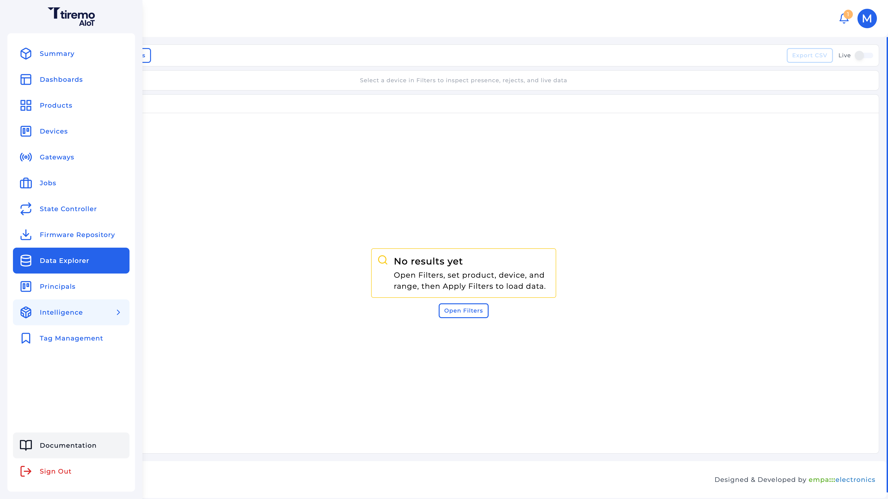
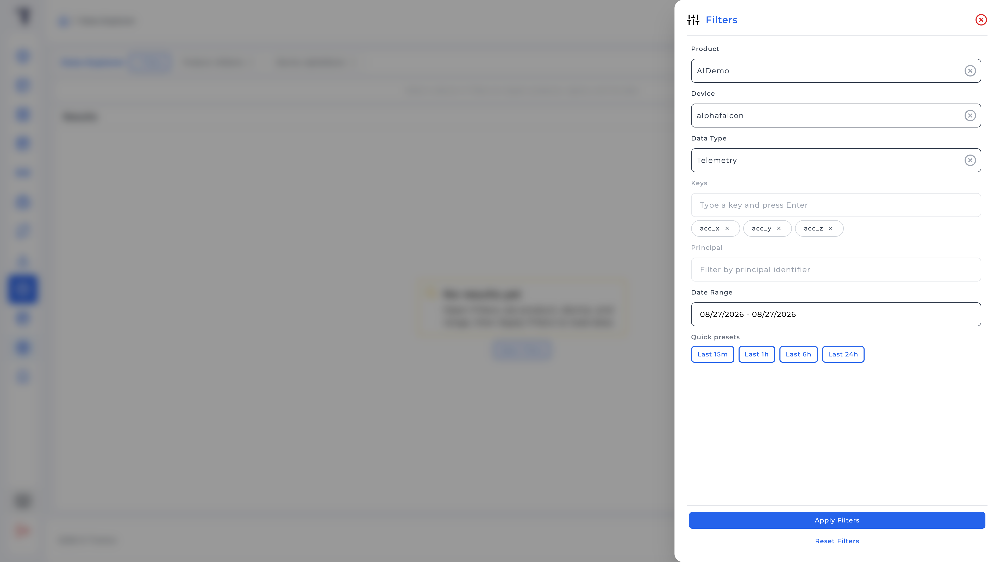
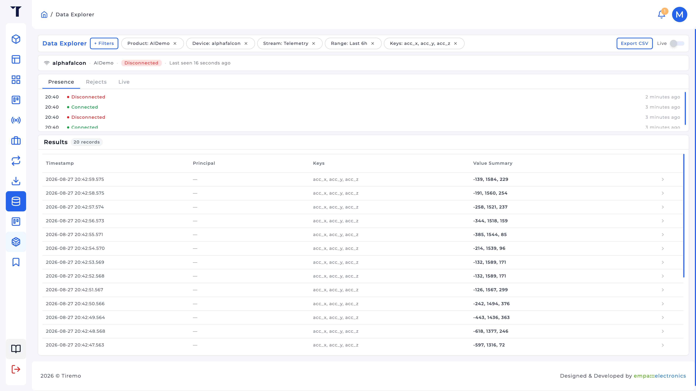

<a href="../../../../Intelligence/Feature_Tutorials/01-Data_Collection/README.md">English</a> | <a>Türkçe</a>

<table class="sphinxhide" width="100%">
  <tr>
    <td align="center">
      <picture>
        <source media="(prefers-color-scheme: dark)" srcset="../../../../images/tiremo_sub_brand_1_mono_white.png">
        
      </picture>
       
      
      <h1>Data Collection</h1>
      Tiremo Cortex Eğitimleri: ESP32 + Tiremo Cloud üretici yazılımı, ilk LED yanıp sönmesinden filoya hazır bir cihaza
    </td>
  </tr>
</table>

# Data Collection

***Kart: Tiremo Cortex (ESP32) · Bölüm: Intelligence / Feature Tutorials · Zorluk: Kolay***

> Bu sayfa [İngilizce orijinalinin](../../../../Intelligence/Feature_Tutorials/01-Data_Collection/README.md)
> Türkçe çevirisidir. Kod ve dosya yolları İngilizce kalır; içerik
> farklılaşırsa İngilizce sürüm esas alınır.

## Giriş

Intelligence bir eğitim kümesi uyduramaz. [02-Data_Sources](../../../../Intelligence/Feature_Tutorials/02-Data_Sources/) öncesinde etiketli (veya etiketlenebilir) bir öznitelik CSV'sine ihtiyacınız vardır. Bu dosyayı nasıl topladığınız size kalmıştır: Tiremo UI'daki **Data Explorer**, yerel bir UART/SD günlüğü, çevrimdışı bir araç veya tercih ettiğiniz başka herhangi bir yol. Önemli olan, eğitim için etiketlenebilecek sayısal öznitelik sütunlarıyla bitirmektir.

Bu eğitim **Data Explorer** yolunu yürür çünkü Tiremo Cloud'a gömülüdür: ürüne bağlı bir Thing örnekleri **telemetry** olarak yayınlar; Data Explorer bu örneklerin geldiğini kanıtladığınız, öznitelik anahtarlarına indirdiğiniz ve CSV dışa aktardığınız yerdir. Data Explorer ana kenar çubuğundadır, **Intelligence** altında değil. Tek bir ürün/cihaz için en fazla 30 günlük aralıkta geçmiş telemetri, alarm ve çıkarımı, artı canlı bir MQTT kuyruğu, sorgular.

Aşağıdaki yürüyüş somut örnek olarak bir hareket sınıflandırma yakalaması kullanır (`acc_x`, `acc_y`, `acc_z`). Aynı süzgeçler ve dışa aktarma, bir Cortex'in (veya başka bir Thing'in) yayınladığı herhangi bir telemetri anahtarına uygulanır. Başka bir yöntemle uygun bir CSV'niz zaten varsa [02-Data_Sources](../../../../Intelligence/Feature_Tutorials/02-Data_Sources/) ile devam edin.

## Neler Öğreneceksiniz

- Data Explorer süzgeçlerinin bir toplama oturumuna nasıl oturduğu (ürün, cihaz, veri türü, anahtarlar, aralık)
- Eğitim özniteliklerinin neden Alarm veya Inference değil **Telemetry** olarak dışa aktarılması gerektiği
- Dışa aktarılan CSV'nin şekli (`timestamp`, `deviceIdentifier`, düzleştirilmiş `data.<key>` sütunları) ve bunun henüz bir Data Source dosyası olmadığı
- Etiketlerin dosyaya nasıl girdiği: dışa aktarma başına bir sınıf (**One class file**) veya dışa aktarmadan sonra bir etiket sütunu

## Ön Koşullar

- Tiremo Cloud hesabı ve eğitmek istediğiniz telemetri anahtarlarını yayınlayan provizyonlanmış bir Cortex (veya aynı üründe herhangi bir Thing). Bir hareket sınıflandırma örneği için bunlar milli-g cinsinden `acc_x`, `acc_y`, `acc_z`'dir; Design Tutorial'daki HMR CSV'leriyle aynı eksen adları. [Tiremo Cloud / 06](../../../../Tiremo_Cloud/Feature_Tutorials/06-Publishing_Alarms_And_Telemetry/) o yayın yolunun üretici yazılımı eğitimidir; hâlâ iskelet, bu yüzden bu UI yürüyüşü için o anahtarları zaten gönderen bir cihaz, veya Device Simulator, yeterlidir
- İsteğe bağlı, hareket örneği için: örneklerin ne anlama geldiği için [Sensors & Local Storage / 03 LIS2DE12](../../../../Sensors_And_Storage/Feature_Tutorials/03-LIS2DE12_Accelerometer/)
- [`iot.tiremo.ai`](https://iot.tiremo.ai) adresindeki Tiremo UI

Canlı yeniden yakalayamıyorsanız fiziksel oturumu atlayın ve [Design Tutorial 03](../../../../Intelligence/Design_Tutorials/03-Edge_Deployment_HMR/) ile gelen etiketli dosyaları kullanın; cihaz yayınlamaya başlayınca buraya dönün.

## Bir Toplama Oturumunu Anlamak

İşe yarar bir yakalama "kartı masada bırakıp ne geldiyse dışa aktarmak" değildir. Bilinen bir hızda **öznitelikler** ve, sınıflandırma için, modelin öğreneceği **sınıflar** topluyorsunuz.

Bir hareket sınıflandırma uygulamasında bu sınıflar `CIRCLE`, `HORIZONTAL`, `STANDBY`, `TRIANGLE`, `VERTICAL` olabilir. Her sınıf, **bilinen bir hızda** bitişik örnekler ve o hareketi gerçekten yapan (veya `STANDBY` için duran) bir kart ister. Aynı fikir diğer Cortex akışlarına da uygulanır: işletme durumları, titreşim rejimleri ve benzeri.

Intelligence bir dosya görmeden önce üç karar burada verilir:

1. **Anahtarlar.** Yalnızca eğiteceğiniz alanları yayınlayın; tek bir paketlenmiş dize değil, mümkünse aynı nesneye karışmış ekstra sensörler de değil. Data Explorer **Keys** süzgeci bu JSON alanlarında bir izin listesidir. Ekstra anahtarlar sonra atmanız gereken ekstra sütunlardır. Hareket sınıflandırması için bunlar genelde `acc_x`, `acc_y`, `acc_z`'dir.
2. **Hız.** Zaman serisi eğitimi örnekleme frekansını zaman damgalarından çıkarır. Seçtiğiniz hız oturum boyunca **kararlı** olmalıdır; titrek bir hız Data Studio uyarısı olur. LIS2DE12 eğitiminin varsayılan ODR'si 100 Hz'dir; HMR yakalaması, sonraki alt örneklemenin payı kalsın diye **128 Hz** kullandı (Design Tutorial).
3. **Etiketlerin dosyaya nasıl girdiği.** Data Explorer hangi sınıfı kastettiğinizi bilmez. İki işe yarar yol:

   - **Dışa aktarma başına bir sınıf.** N dakika yalnızca bir sınıf gerçekleştirin, dışa aktarın, Data Studio **One class file** olarak o Class Name ile içe aktarın (örneğin `CIRCLE`). Her sınıf için tekrarlayın.
   - **Dışa aktarmadan sonra etiket sütunu.** Tüm sınıfları kapsayan uzun bir yakalama, sonra içe aktarmadan önce (zaman damgası aralıklarıyla) bir `class` sütunu ekleyin ve Data Studio'ya **File contains label column** deyin.

Design Tutorial'daki HMR dosyaları zaten `acc_x,acc_y,acc_z,class` biçimindedir; bu *etiketlemeden sonraki* şekildir, ham Explorer dışa aktarması değil.

## Çözüm

Bu eğitim için `Sw/` yoktur. İşlenen yol UI'dır.

1. Kenar çubuğu **Data Explorer**
2. **+ Filters** → Product, Device, **Data Type** = Telemetry, **Keys** = her öznitelik anahtarından sonra Enter (örneğin 3 eksenli bir hareket kümesi için `acc_x`, `acc_y`, `acc_z`), oturumu kapsayan tarih aralığı, **Apply Filters** / **View Data**
3. Tablonun örnek gösterdiğini doğrulayın; cihaz önemsediğiniz davranışı üretirken isteğe bağlı **Live**
4. **Export CSV**
5. [02-Data_Sources](../../../../Intelligence/Feature_Tutorials/02-Data_Sources/) öncesi düzleştirilmiş sütunları yeniden adlandırın ve etiket ekleyin

## Adım Adım

### 1. Data Explorer'ı açın

Öğe üst düzey kenar çubuğu girdisidir (`/data-explorer`), Intelligence içinde değil. Süzgeç uygulamadan sayfa **No results yet** kalır.

### 2. Tek cihaza ve telemetriye süzün

Zorunlu: **Product**, **Device**, **Data Type**, **Date Range** (en fazla 30 gün). Hızlı önayarlar: Last 15m / 1h / 6h / 24h.

Öznitelik toplamak için **Data Type** **Telemetry**'dir. **Alarm** eşik olaylarıdır. **Inference** zaten dağıtılmış bir Solution'ın *çıktılarıdır*; Edge paketini sonra hata ayıklamak için, eğitim kümesi olarak değil. Inference ayrıca bir **Solution** süzgeci ister.

**Keys:** her öznitelik anahtarını yazıp Enter'a basın. Boş Keys "o cihazdaki tüm anahtarlar" demektir; Thing nem de yayınlıyorsa ve siz yalnızca örneğin ivmeölçer eksenlerini istiyorsanız bu bir karmaşadır.

### 3. Tabloyu okuyun, sonra dışa aktarın

**View Data** genel bakışı yükler. **Export CSV** süzülmüş aralığı indirir. Telemetri satırları JSON yükünü düzleştirir: mesajdaki `acc_x` gibi bir anahtar `data.acc_x` sütunu olur. Bu bir bulut içe aktarma günlüğüdür, eğitim tablosu değil.

İçe aktarmadan önce `data.<key>` → `<key>` yapın (hareket örneği için `data.acc_x` → `acc_x`, y/z için de aynı). Kimlik sütunlarını gerekmedikçe atın. `class` ekleyin *veya* dosyayı sınıf-saf tutun.

**Live** seçilen ürün/cihaz için MQTT kuyruğudur. Davranışı üretirken (örneğin bir jest) bulutun gördüğünü bilin, sonra o aralığı dışa aktarın.

### 4. "Yeterli veri" ne demek

Data Studio sonra ince kümelerde uyarır veya reddeder. Ne kadarının yeterli olduğu göreve bağlıdır. Jest ölçeğinde, 4–128 Hz'de sınıf başına dakikalar, birkaç saniyelik gürültülü sallamayı yener. Paketlenmiş 128 Hz HMR dosyası beş sınıf boyunca ~58,6 dakikalık duvar saati yakalamasıdır (~450 bin satır); bu *ciddi* bir toplamanın boyutudur, bir minimum değil.

Kartın örnekleme hızı ile yayın hızını hizalı tutun. Design Tutorial o HMR vakasında bu hızların neden denendiğini anlatır.

## Bittiğinde

Öznitelik sütunları sayısal olan, zaman damgaları yalnızca kaydetmek istediğiniz aralığı kapsayan bir CSV'niz vardır ve sonraki içe aktarmanın **One class file** mi yoksa `class` sütunlu mu olacağını bilirsiniz. Henüz hiçbir şey eğitilmez; bu 02 ve 03'tür.

Tiremo Cortex Eğitimleri, Empa Electronics

