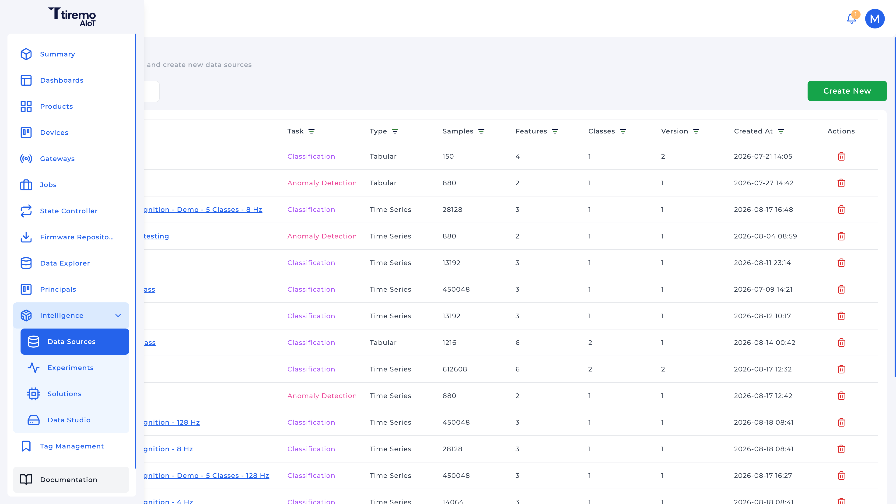
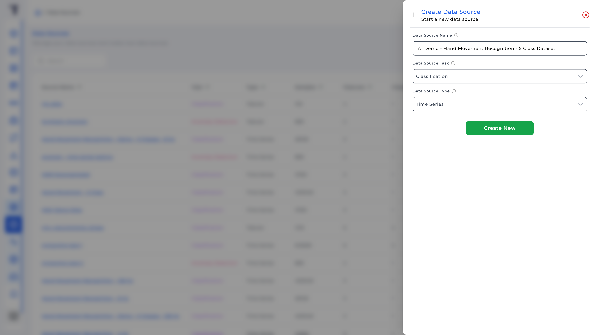
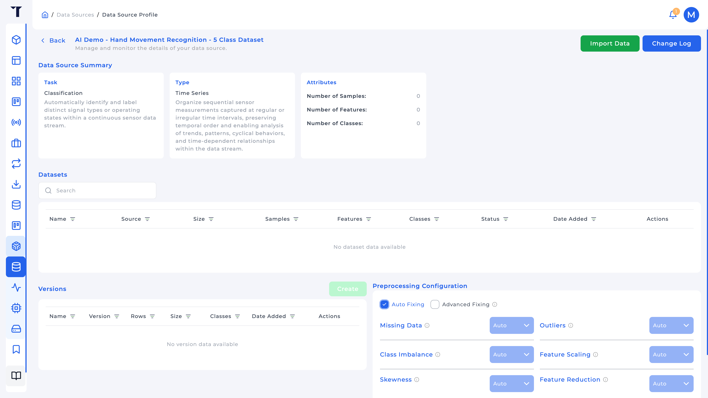
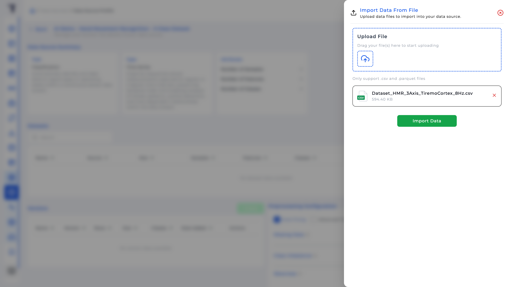
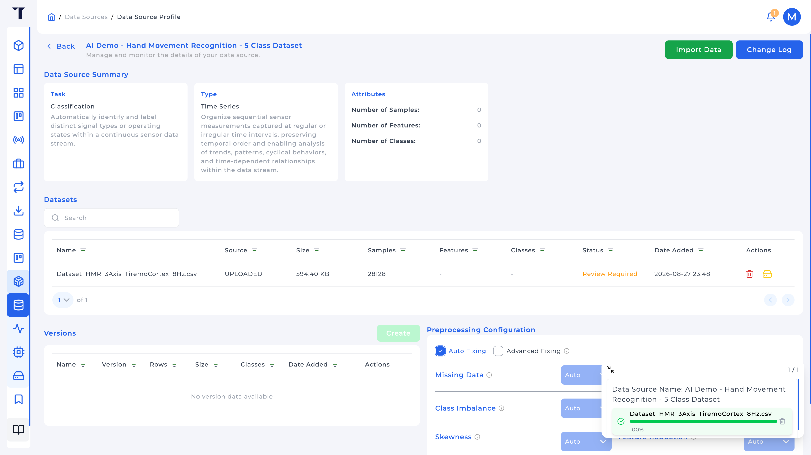
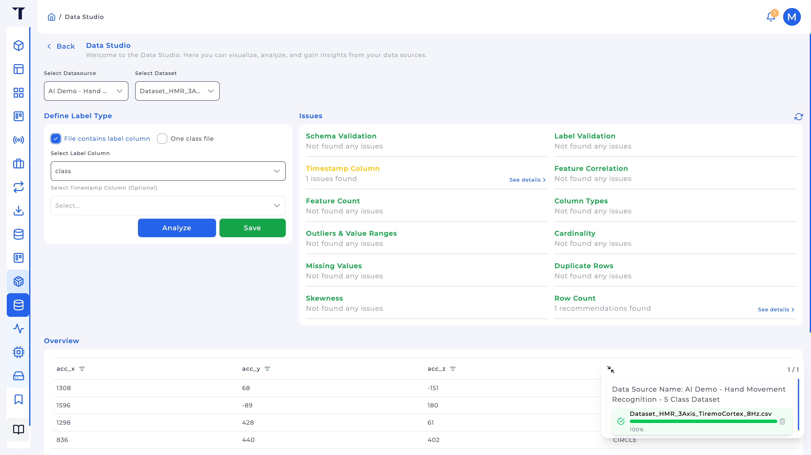
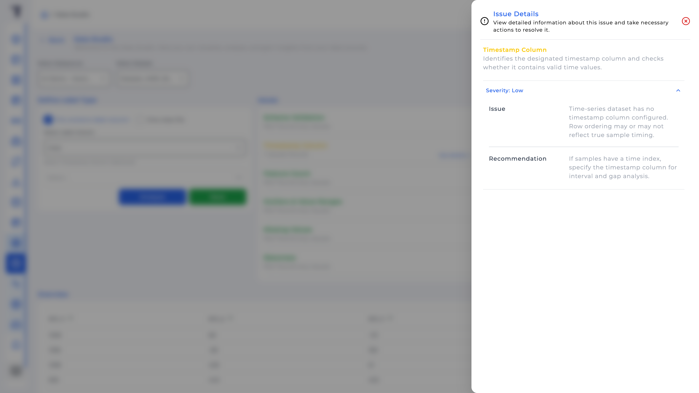
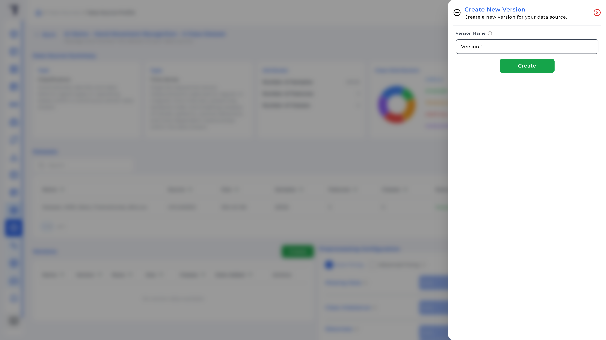

<p class="sphinxhide" align="right"><a href="../../../../Intelligence/Feature_Tutorials/02-Data_Sources/README.md">English</a> | <a>Türkçe</a></p>
<table class="sphinxhide" width="100%">
  <tr>
    <td align="center">
      <picture>
        <source media="(prefers-color-scheme: dark)" srcset="../../../../images/tiremo_sub_brand_1_mono_white.png">
        
      </picture>
      <br>
      
      <h1>Data Sources</h1>
      <sub>Tiremo Cortex Eğitimleri: ESP32 + Tiremo Cloud üretici yazılımı, ilk LED yanıp sönmesinden filoya hazır bir cihaza</sub>
    </td>
  </tr>
</table>

# Data Sources

***Kart: Tiremo Cortex (ESP32) · Bölüm: Intelligence / Feature Tutorials · Zorluk: Kolay***

> Bu sayfa [İngilizce orijinalinin](../../../../Intelligence/Feature_Tutorials/02-Data_Sources/README.md)
> Türkçe çevirisidir. Kod ve dosya yolları İngilizce kalır; içerik
> farklılaşırsa İngilizce sürüm esas alınır.

## Giriş

**Data Source**, veri kümelerini, analizlerini ve bir Experiment'in eğitmesine izin verilen dondurulmuş **sürümleri** sahiplenen Intelligence nesnesidir. Bir tane oluşturmak **görev** ve **tür** için tek yönlü bir seçimdir; bunlar sonra değiştirilemez, bu yüzden bu eğitim çekmeceyi geçiştirmek değil, onları bilinçli seçmek üzerinedir.

[01](../../../../Intelligence/Feature_Tutorials/01-Data_Collection/) CSV'sini (veya elinizdeki herhangi bir etiketli dosyayı) içe aktaracak, **Data Studio**'dan geçirecek ve bir sürüm oluşturacaksınız. Aşağıdaki ekranlar ve örnek başlık işlenmiş örnek olarak HMR hareket kümesini kullanır; aynı ekranlar diğer öznitelik sütunlarına ve sınıf adlarına uygulanır.

## Neler Öğreneceksiniz

- **Data Source Task:** Classification, Anomaly Detection, Regression, Forecasting; ve elinizdeki sorun için hangisini seçeceğiniz
- **Data Source Type:** Time Series'e karşı Tabular; ve *zaman içinde şekil* olan sensör akışlarının neden Time Series olduğu
- `.csv` / `.parquet` içe aktarma, Data Studio'da etiketleme, Issues panelini okuma
- Eğitimin neden canlı yüklemeyi değil bir **Version** kullandığı

## Ön Koşullar

- [01-Data_Collection](../../../../Intelligence/Feature_Tutorials/01-Data_Collection/) *veya* [`Dataset_HMR_3Axis_TiremoCortex_4Hz.csv`](../../../../Intelligence/Design_Tutorials/03-Edge_Deployment_HMR/Datasets/Dataset_HMR_3Axis_TiremoCortex_4Hz.csv) gibi hazır bir dosya (HMR örneği)
- Data Source oluşturma izni olan Tiremo UI

## Görev ve Türü Anlamak

Bu iki alan tüm sözleşmedir. Bir Experiment yalnızca **görevi** eşleşen bir Data Source bağlayabilir. Yanlış seçmek silip yeniden başlamak demektir.

### Görev

| Görev | Modelin yanıtladığı | Cortex verisinde ne zaman |
|---|---|---|
| **Classification** | Bu pencere hangi adlı durum? | Etiketli işletme durumları veya jestler. Örnek: HMR sınıfları `CIRCLE`, `STANDBY`, … |
| **Anomaly Detection** | Bu pencere "normale" göre alışılmadık mı? | Büyük bir *normal* sınıf ve seyrek arızalar; adlandırılmış şekiller değil. Sürüm dondururken tam iki sınıf. |
| **Regression** | Hangi sürekli sayı? | Sınıf adı değil, örneğin kalan ömür. |
| **Forecasting** | Seride *sırada* ne var? | Gelecek örnekleri tahmin; "şu an hangi durum" değil. |

Adlandırılmış jest HMR Classification'dır çünkü her pencere birkaç **bilinen** etiketten birine gitmelidir. Anomaly Detection bunu normal-değil'e indirir ve `TRIANGLE` ile `CIRCLE` ayrımını atar. Bu adlandırılmış durumlarınız yoksa Anomaly Detection seçin.

### Tür

| Tür | Anlam | Ne zaman |
|---|---|---|
| **Time Series** | Satır sırası (ve zamanlama) önemlidir. Modeller ardışık örnekleri pencereler. | Sensör akışları: ivmeölçer, titreşim, olayın *zaman içinde bir şekil* olduğu her şey. Örnek: HMR. |
| **Tabular** | Her satır bağımsız bir örnektir. Pencereleme yok. | Elektronik tablolar, iris tarzı tablolar. |

Bir CIRCLE tek bir `(x,y,z)` üçlüsü değildir; bir dizidir. Tabular her millig okumasını kendi örneği sayar ve yörüngeyi hiç görmez. Time Series, eğitim 03'te bir **Window Size** ayarlamayı mümkün kılar (HMR Edge anlık görüntüsü için 8 örnek, 24 float: 8 × 3 eksen).

Classification + Time Series, sürüm oluşturmadan önce en az 2 en fazla 50 sınıf ister. Anomaly Detection sürümleri tam 2 ister.

## Çözüm

`Sw/` yok. Tiremo UI'da:

1. **Intelligence → Data Sources → Create New**
2. Ad (3+ karakter), *sizin* sorununuz için **Data Source Task** ve **Data Source Type** (HMR gibi adlandırılmış jest zaman serisi için: Classification + Time Series) → **Create New**
3. Kaynağı açın → **Import Data** → CSV/Parquet yükleyin
4. **Intelligence → Data Studio**: kaynağı ve kümeyi seçin, etiketleri tanımlayın, **Analyze**, Issues'ı düzeltin, **Save**
5. Data Source profilinde küme **Dataset Ready** olunca **Versions → Create**



## Adım Adım

### 1. Data Source oluşturun

Kenar çubuğu **Intelligence** Data Sources, Experiments, Solutions, Data Studio'ya açılır.



HMR örneği için önerilen ad: `HMR 3-axis Cortex`. Görev ve tür oluşturma anında kilitlenir. **Create New** sonrası profil, içe aktarmadan önce boştur (veri kümesi yok, sürüm yok).



### 2. Dosya içe aktarın

Profilde **Import Data**. Yalnızca `.csv` ve `.parquet`. Öznitelik sütunları sayısal olmalıdır. Sınıflandırma için ya bir etiket sütunu ekleyin ya da dosya başına bir sınıf içe aktarın.

HMR örneği başlığı:

```text
acc_x,acc_y,acc_z,class
```

Değerler milli-g tamsayıları, etiketler beş jest adıdır. Data Explorer'dan geldiyseniz önce `data.<key>` → `<key>` yapın (bu örnekte `data.acc_x` → `acc_x`) ve ya bir `class` sütunu ya da tek örtük sınıf olduğundan emin olun.



Durum yükleme / çıkarma / analizden geçer, sonra **Dataset Ready** veya **Review Required** / **Dataset Improper**. İncelemeyi temizlemek Data Studio'dadır. İçe aktarmadan sonra profilde veri kümesi satırı görünür; **Review Required** etiketlerin ve Issues'ın henüz kaydedilmediği anlamına gelir.



### 3. Data Studio: etiketler ve sorunlar

**Intelligence → Data Studio**. Data Source ve yüklenen kümeyi seçin.

**Define Label Type:**

- **File contains label column**: **Select Label Column**'u etiket alanına ayarlayın. HMR CSV'leri için bu `class`'tır. İsteğe bağlı zaman damgası sütunu (Explorer dışa aktarmalarında vardır; paketlenmiş HMR dosyalarında yoktur; satır sırası zaman eksenidir).
- **One class file**: tüm dosya bir sınıftır; Class Name yazın. Anomali için UI Normal / Anomaly sunar.

**Analyze**, sonra **Issues**: şema, satır sayısı, öznitelik sayısı, sütun türleri (öznitelikler sayısal olmalı), eksik değerler, yineler, aykırılar, korelasyon, çarpıklık, **Label Validation**, zaman damgası. Classification sınıf dağılımını gösterir; paketlenmiş 4 Hz HMR dosyada `STANDBY` en küçük sınıftır. Bu düşünülecek bir uyarıdır, otomatik başarısızlık değil.





Etiketlemeyi kabul edince **Save**. Kayıtlı kümelerde etiket türü değiştirilemez.

Data Source profilinde **Preprocessing Configuration** elle strateji seçmek için bir nedeniniz yoksa **Auto Fixing** kalabilir.

### 4. Bir sürüm dondurun

**Versions → Create**, sonra tanıyacağınız bir ad (`4Hz-labeled`, …). Experiment'ler *bu* sürümü bağlar, "son yüklenen her neyse" değil.



## Bittiğinde

Data Source özeti seçtiğiniz görev ve türü, bir örnek sayısını, dosyayla eşleşen öznitelik ve sınıf sayılarını ve bir Experiment'ten seçebileceğiniz en az bir sürümü gösterir. Eğitim 03 o sürümü bağlar ve eğitir.

<p align="center"></p>

<p class="sphinxhide" align="center"><sub>Tiremo Cortex Eğitimleri, Empa Electronics</sub></p>
