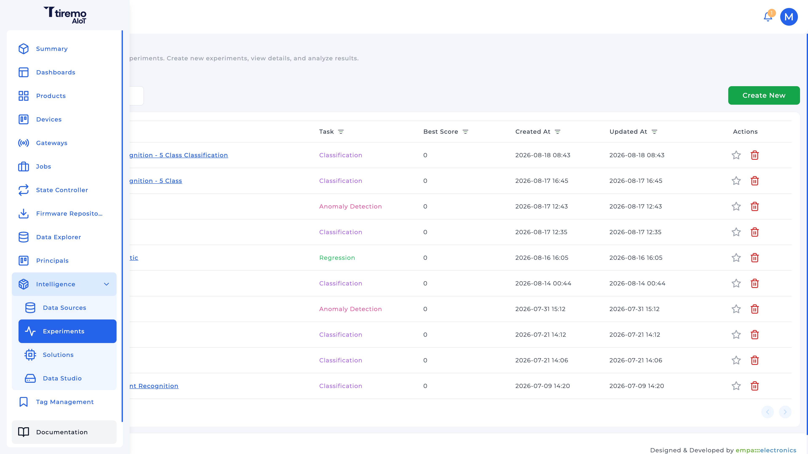
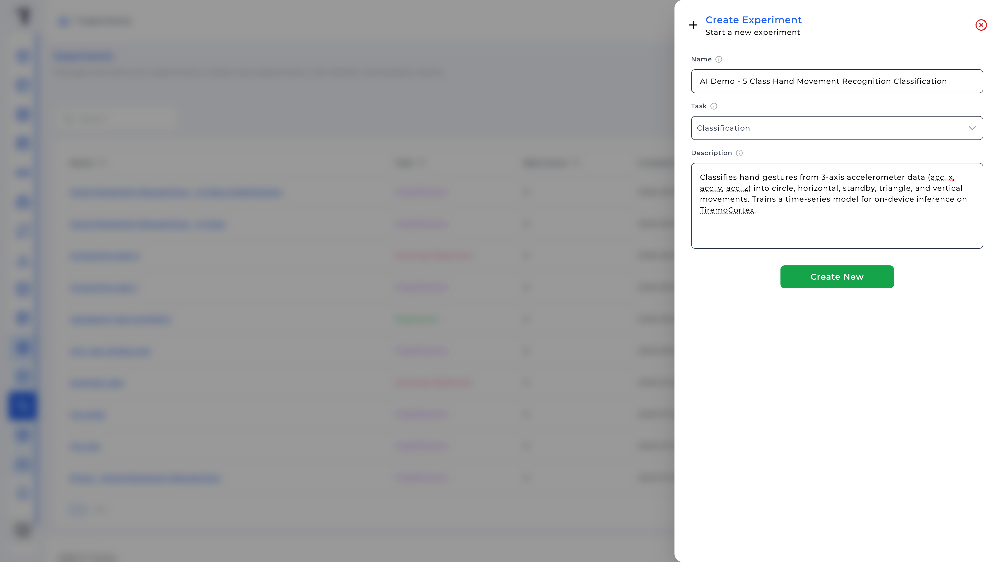
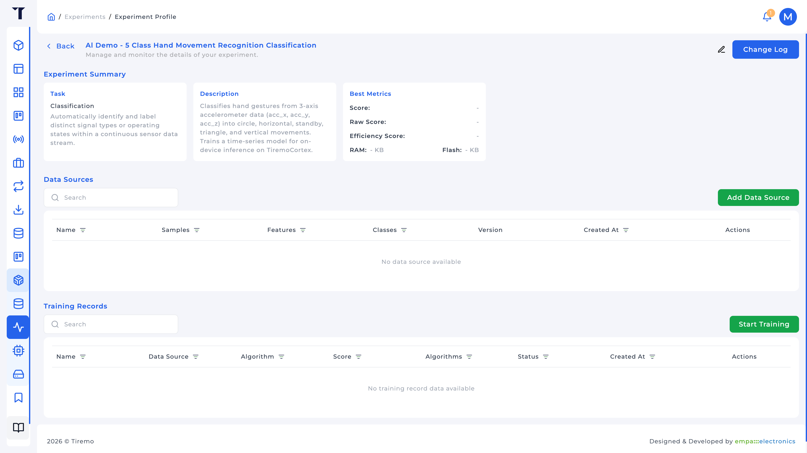
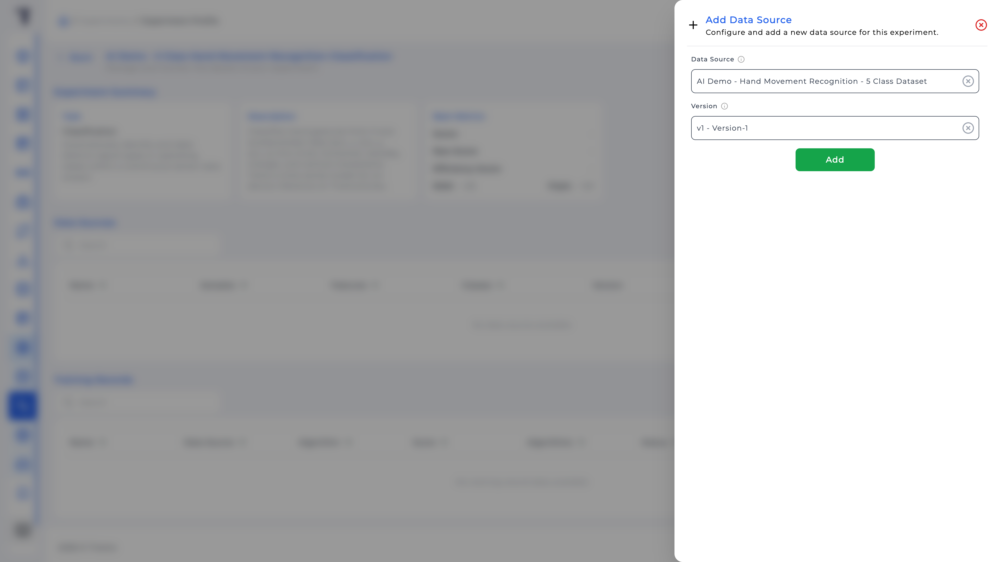
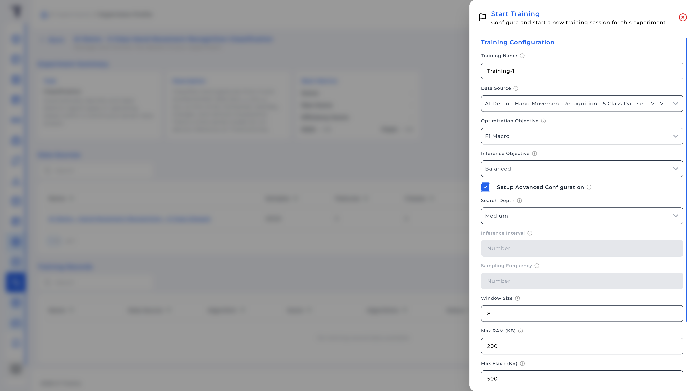
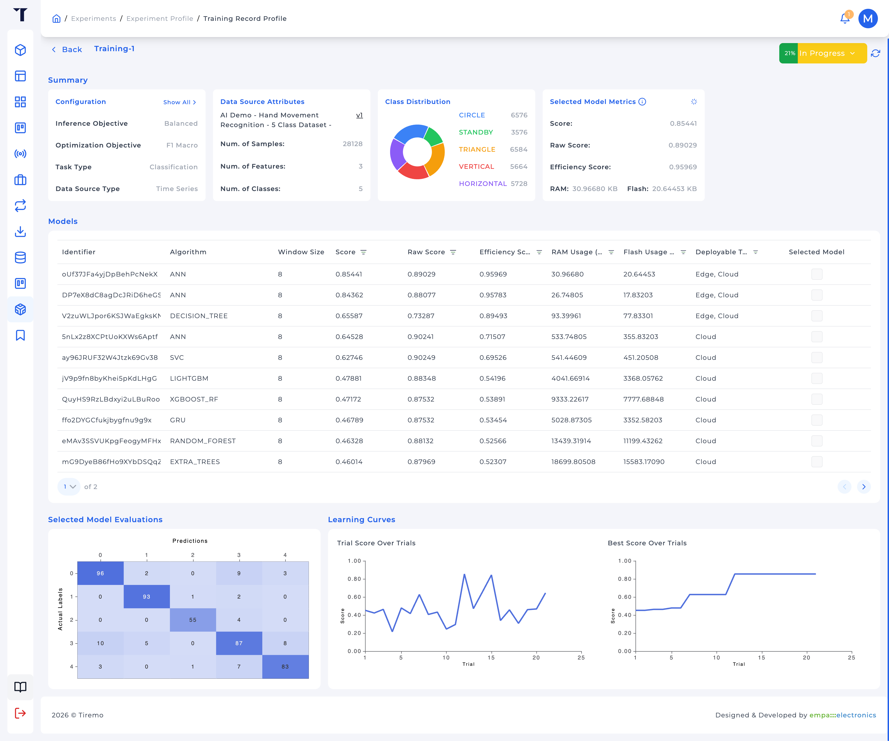

<a href="../../../../Intelligence/Feature_Tutorials/03-Experiments/README.md">English</a> | <a>Türkçe</a>

<table class="sphinxhide" width="100%">
  <tr>
    <td align="center">
      <picture>
        <source media="(prefers-color-scheme: dark)" srcset="../../../../images/tiremo_sub_brand_1_mono_white.png">
        
      </picture>
       
      
      <h1>Experiments</h1>
      Tiremo Cortex Eğitimleri: ESP32 + Tiremo Cloud üretici yazılımı, ilk LED yanıp sönmesinden filoya hazır bir cihaza
    </td>
  </tr>
</table>

# Experiments

***Kart: Tiremo Cortex (ESP32) · Bölüm: Intelligence / Feature Tutorials · Zorluk: Orta***

> Bu sayfa [İngilizce orijinalinin](../../../../Intelligence/Feature_Tutorials/03-Experiments/README.md)
> Türkçe çevirisidir. Kod ve dosya yolları İngilizce kalır; içerik
> farklılaşırsa İngilizce sürüm esas alınır.

## Giriş

Bir **Experiment** aramadır: Data Source ile aynı görev, bağlı bir veya daha fazla kaynak sürümü, sonra bir RAM/flash bütçesi altında algoritmaları deneyen **Training Records**. "ANN"i baştan elle seçmezsiniz; hedefleri, isteğe bağlı bir pencereyi ayarlarsınız ve platform arar. Bir Solution için **Selected** bitmiş modeli *siz* seçersiniz.

Aşağıdaki eğitim düğmeleri tablosu işlenmiş bir HMR Edge örneği içerir. O vakayı izliyorsanız bu değerleri kullanın; sorun, sınıf dengesi veya MCU bütçesi farklıysa değiştirin.

## Neler Öğreneceksiniz

- Bir Experiment oluşturmak (ad, görev, açıklama); görev kilitlenir
- Uyumlu bir Data Source sürümü bağlamak
- **Start Training**: eniyileme ve çıkarım hedefleri, arama derinliği, pencere boyutu ve örnekleme frekansı
- Score / Raw Score / Efficiency Score, RAM, flash ve **Deployable Targets** okumak
- Bir Solution'ın dağıtacağı modeli seçmek

## Ön Koşullar

- [02-Data_Sources](../../../../Intelligence/Feature_Tutorials/02-Data_Sources/) ile görevi oluşturacağınız Experiment ile eşleşen **Dataset Ready** bir sürüm (HMR örneği için Classification + Time Series)
- Tiremo UI

## Eğitim Yapılandırmasını Anlamak

**Create Experiment** yalnızca Name, **Task**, Description ister. Görev Data Source ile eşleşmelidir (HMR örneği için `CLASSIFICATION`). Sonra düzenlenemez.

**Start Training** aramanın belirtildiği yerdir.

| Alan | Ne yapar | Örnek: HMR Edge |
|---|---|---|
| **Training Name** | Listedeki etiket, model kimliği değil | örn. `HMR 4Hz window8 balanced` |
| **Data Source** | Öğrenilecek bağlı sürüm | Eğitim 02'deki sürüm |
| **Optimization Objective** | Ençoklanacak doğruluk metriği | Sınıflar dengesizken **F1 Macro** (`STANDBY`, `CIRCLE`/`TRIANGLE`'dan küçük). Sınıflar dengeliyse ve kastettiğiniz buysa Accuracy. |
| **Inference Objective** | Cihaz maliyeti ne kadar cezalandırılsın | Edge için **Balanced**. **Raw** RAM/flash'ı yok sayar |
| **Search Depth** | Kaç deneme | **Medium** platform varsayılanı |
| **Window Size** | Girdi başına ardışık Time Series örneği | Paketlenmiş `Tiremo_AI` için **8** (`TIREMO_WINDOW_SIZE`). Ayarlanınca örnekleme frekansı ve çıkarım aralığı yok sayılır. Olay süreniz farklıysa boş bırakın veya başka bir boyut seçin. |
| **Sampling Frequency** (Hz) | Sensör hızı, pencereyi boyutlamak için çıkarım aralığıyla | Pencere *veya* bu, ikisi birden değil |
| **Inference Interval** (s) | Pencereler arası boşluk | Window Size ayarlıyken yok sayılır |
| **Max RAM / Max Flash (KB)** | Bir denemeyi Edge-dağıtılabilir işaretleme tavanı | Boş bırakınca platform varsayılanları (2048 KB RAM, 1024 KB flash) |
| **Minimum Score Threshold** | Zayıf denemeleri at | Boşsa varsayılan 0,40 |

3 eksenli HMR verisinde pencere 8, 24-float vektördür. MCU için yeterince küçüktür; Design Tutorial'ın 128 Hz'i alt örneklemesinin nedeni de budur: 128 Hz'de sekiz örnek 62,5 ms'dir, jest değildir. Farklı bir akış (tek öznitelik, daha yavaş bir olay, Tabular Data Source) o pencereyi kullanmaz.

Time Series Classification klasik modellerin yanı sıra ANN / CNN / LSTM / GRU dener. Tabular evrişimli/yinelemeli olanları düşürür.

## Çözüm

`Sw/` yok.

1. **Intelligence → Experiments → Create New**: Data Source ile aynı **Task** (HMR örneği için Classification)
2. Experiment'i açın → **Add Data Source** → kaynak + sürüm
3. Soruna uyan düğmelerle **Start Training** (Window Size / RAM / flash için **Setup Advanced Configuration**; HMR Edge örneği yukarıdaki tabloda)
4. Durum **Completed** olana kadar bekleyin
5. Training Record'u açın → **Models** → dağıtacağınız yere uyan **Deployable Targets** satırında **Selected Model** (üretici yazılım indirecekseniz Edge)

## Adım Adım

### 1. Experiment oluşturun

Ad ve açıklama yalnızca arama/görüntüleme içindir. Eşleşmesi gereken görevdir. Oluşturmadan sonra profil, bir sürüm bağlayıp arama başlatana kadar boş Data Sources ve Training Records gösterir.

### 2. Bir Data Source bağlayın

Profilde **Data Sources → Add Data Source**. Yalnızca görevi bu Experiment ile eşleşen kaynaklar listelenir. Bir **Version** seçin; liste boşsa eğitim 02'ye dönüp bir tane oluşturun.

### 3. Eğitimi başlatın

**Start Training**. Training Configuration'ı doldurun, sonra isteğe bağlı **Setup Advanced Configuration**.

Durum: Pending → In Progress → Completed (veya Failed / Stopped). Çalışırken **Stop Training** yapılabilir.

### 4. Kaydı okuyun ve bir model seçin

Özet, çıkarım/eniyileme hedeflerini, görevi, veri türünü, örnek/öznitelik/sınıf sayılarını, sınıf dağılımını ve **seçilen** modelin Score / Raw / Efficiency / RAM / Flash değerlerini yineler.

**Models** deneme tablosudur: algoritma, pencere, skorlar, RAM, flash, **Deployable Targets** (örn. Edge), **Selected Model** onay kutusu. **Completed** veya **Stopped** sonrası seçim değiştirilebilir.

**Selected Model Evaluations** (aynı sayfada, tablonun altında) Classification için bir karışıklık matrisidir. Kaydı bir Solution'a yükseltmeden önce sessiz bir sınıfın bir hareket sınıfı tarafından yenilip yenilmediğine bakın (HMR için `STANDBY`'nin kaybolup kaybolmadığı). Arama hâlâ **In Progress** olabilir; tablo ve matris denemeler bitince güncellenir.

Design Tutorial'daki Edge anlık görüntüsü pencere 8, 3 öznitelik, 5 sınıflı bir **ANN**'dir; o HMR aramasının olası bir kazananı, bölünüzde başka bir deneme daha iyiyse ANN seçme zorunluluğu değil.

## Bittiğinde

Bir Training Record **Completed**, ihtiyacınız olan **Deployable Target** olan bir model **Selected** (üretici yazılım indirecekseniz Edge), ve eniyileme, çıkarım ve pencere seçimlerini açıklayabilirsiniz. Eğitim 04 o kaydı bir Solution'a sarar.

Tiremo Cortex Eğitimleri, Empa Electronics

