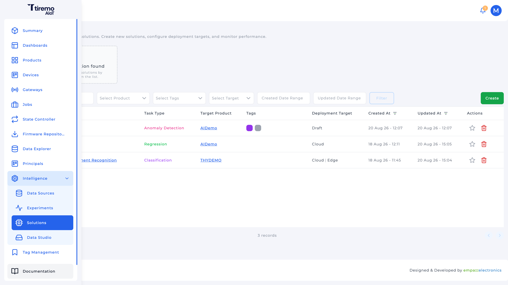
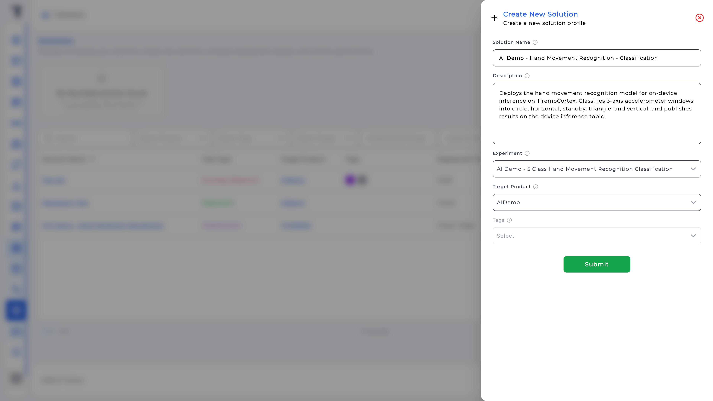
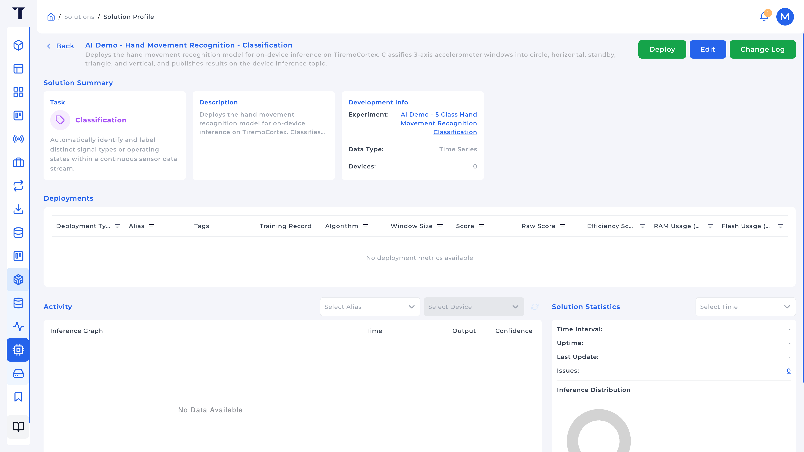
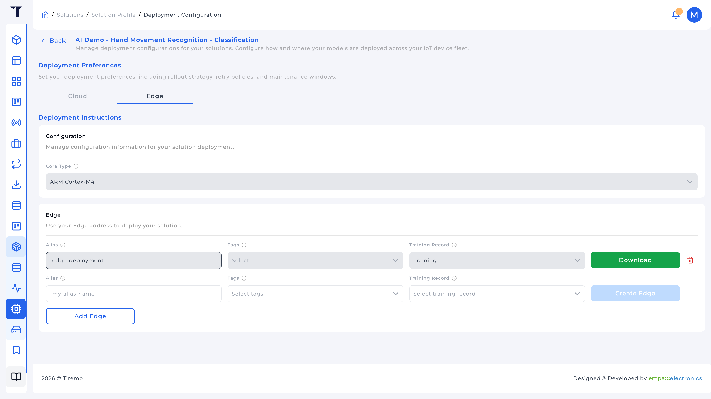
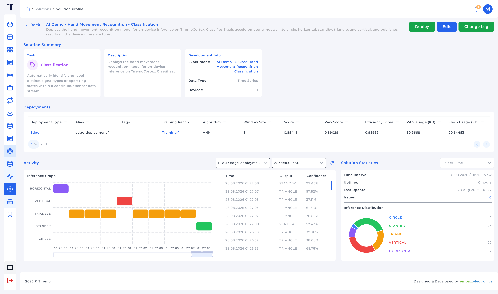

<a href="../../../../Intelligence/Feature_Tutorials/04-Solutions/README.md">English</a> | <a>Türkçe</a>

<table class="sphinxhide" width="100%">
  <tr>
    <td align="center">
      <picture>
        <source media="(prefers-color-scheme: dark)" srcset="../../../../images/tiremo_sub_brand_1_mono_white.png">
        
      </picture>
       
      
      <h1>Solutions</h1>
      Tiremo Cortex Eğitimleri: ESP32 + Tiremo Cloud üretici yazılımı, ilk LED yanıp sönmesinden filoya hazır bir cihaza
    </td>
  </tr>
</table>

# Solutions

***Kart: Tiremo Cortex (ESP32) · Bölüm: Intelligence / Feature Tutorials · Zorluk: Orta***

> Bu sayfa [İngilizce orijinalinin](../../../../Intelligence/Feature_Tutorials/04-Solutions/README.md)
> Türkçe çevirisidir. Kod ve dosya yolları İngilizce kalır; içerik
> farklılaşırsa İngilizce sürüm esas alınır.

## Giriş

Bir **Solution** dağıttığınız şeydir: bir Experiment'e (oluşturma sonrası kilitli), bir hedef **Product**'a ve sonra seçilen Training Record'u cihazın veya platformun çalıştırabileceği bir şeye derleyen bir veya daha fazla **Edge** veya **Cloud** dağıtımına işaret eder.

Bu eğitim **Edge** yolunu yürür: üretilmiş bir `Tiremo_AI` ağacını indirin. Cloud, aynı Solution'daki diğer hedeftir; platform MCU yerine içeri alınan telemetriyi skorlar. Çıkarım cihazda kalmalıysa Edge seçin, örneğin bir Tiremo Cortex üzerindeki bir hareket sınıflandırıcısı; sonuçlar `pub/<product_id>/<device_id>/inference` üzerinde yayınlanır.

## Neler Öğreneceksiniz

- Bir Experiment + hedef üründen Solution oluşturmak
- **Deploy → Edge** ile Cloud: çekirdek türü, alias, training record, etiketler
- İlk Edge'den sonra çekirdek türünün neden kilitlendiği
- Paketi indirmek ve `tiremo_config.h`'nin neyi pişirdiği
- Canlı sonuçları görmek için Data Explorer **Inference** (ve Solution **Activity** grafiği)

## Ön Koşullar

- [03-Experiments](../../../../Intelligence/Feature_Tutorials/03-Experiments/) ile **Completed** bir Training Record ve, üretici yazılım indirecekseniz, **Deployable Targets** içinde Edge olan bir **Selected Model**
- Modeli çalıştırması gereken cihazların Product'ı ([Tiremo Cloud](../../../../Tiremo_Cloud/) içinde provizyonladığınız Cortex ürünü)
- Tiremo UI

## Edge'e karşı Cloud

| Hedef | Çıkarımın çalıştığı yer | İndirdiğiniz |
|---|---|---|
| **Edge** | Cihazda, `tiremo_ai_run()` ile TensorFlow Lite Micro | C/C++ paketi (`Tiremo_AI/`): model, API, TFLM |
| **Cloud** | İçeri alınan telemetri üzerinde platform boru hattı | Bir uç nokta; **Prediction Sleep Interval** pencereleri temposu |

**Core Type** derleyiciye hangi çekirdekleri üreteceğini söyler. UI'da seçeneklerin üzerine gelin. Cortex sınıfı bir kart için dürüst seçimler:

- **ARM Cortex-M4**: CMSIS-NN, FPU. Design Tutorial'daki HMR anlık görüntüsü `-DCMSIS_NN` ile derlendi.
- **ARM Cortex-M3**: yalnızca tamsayı; FPU'suz ABOV A34G43A'ya daha yakın.
- **Generic / Reference Kernels**: MCU belirsizken taşınabilir varsayılan (`host-reference`).

Çekirdek türü o Solution'daki **ilk Edge'den sonra kilitlenir**.

**Alias** üretici yazılıma pişirilen kısa addır (`TIREMO_DEPLOYMENT_ALIAS`): küçük harf, sayılar, tireler, Solution'da benzersiz. Inference JSON'u onu taşır ki Data Explorer dağıtımları ayırabilsin.

**Tags** isteğe bağlı olarak hedef ürünün hangi cihazlarının dağıtımı alacağını kapsamlar. Aynı etiket kümesi aynı Training Record ile iki kez eşleştirilemez.

Üretilen başlıktaki kimlik makroları `TIREMO_SOLUTION_IDENTIFIER` ve `TIREMO_DEPLOYMENT_IDENTIFIER`'ı da içerir. Üretilen dosyaları düzenlemeyin; yeni bir indirme ağacı değiştirir.

## Çözüm

*Bu* eğitimde `Sw/` yok; yalnızca indirme. Paketi üretici yazılıma bağlamak Design Tutorial'dır (Cortex üzerinde HMR işlenen vakadır).

1. **Intelligence → Solutions → Create New**
2. Ad, açıklama, **Experiment**, **Target Product**, isteğe bağlı etiketler
3. Solution'ı açın → **Deploy** → **Edge** (çıkarım platformda kalacaksa **Cloud**)
4. Edge için: **Core Type**, bir satır ekleyin: **Alias**, **Training Record**, isteğe bağlı cihaz etiketleri → **Create Edge**
5. Durum **Ready** (veya **In Service**) olana kadar bekleyin → **Download**
6. Zip'i açın; `tiremo_api.h`, `tiremo_config.h`, `tiremo_makefile.mk`, `API.md` ve `tflm/` görmelisiniz

Design Tutorial zaten böyle bir zip açmasını içerir (`Tiremo-Secure-Iot-Sw-Cloud-Collect-Infer/Tiremo_Lib/Tiremo_AI` kopyası), böylece bir derlemeyi beklemeden API'yi okuyabilirsiniz.

## Adım Adım

### 1. Solution oluşturun

**Experiment**'in tamamlanmış bir Training Record'u olmalıdır. **Target Product** çıkarımı yayınlayacak cihazların ürünüdür. Gönderimden sonra profil özet kartlarını, boş bir Deployments tablosunu ve, Edge oluşturup cihaz çıkarım yayınlayana kadar boş bir Activity bölmesini gösterir.

### 2. Bir Edge oluşturun

**Deploy** → sekme **Edge** (Cloud değil), platform tarafı skorlama istemiyorsanız.

Göreceğiniz durumlar: Pending, Creating, Ready, In Service, Failed, …. **Ready** (veya **In Service**) satırı aynı sayfada **Download** gösterir.

### 3. Az önce indirdiğiniz

Zip'te (veya Design Tutorial altındaki anlık görüntüde) `API.md` ve `tiremo_config.h` açın. Üretilen başlık *sizin* aramanızı kaydeder: görev, pencere, öznitelik sayısı, sınıf adları. HMR anlık görüntüsü için:

- Görev `CLASSIFICATION`, pencere 8, 3 öznitelik, girdi 24, 5 sınıf
- Etiketler `CIRCLE`, `HORIZONTAL`, `STANDBY`, `TRIANGLE`, `VERTICAL`
- `tiremo_ai_run(features, &result)` sonra EDGE JSON gövdesi için `tiremo_ai_format_mqtt_json(...)`
- Konu soneki `inference`

Girdi tamponunu eğittiğiniz sırada ve birimlerde ardışık örnekler olarak doldurun (HMR için `features[24]`, milli-g cinsinden 8 örnek `acc_x, acc_y, acc_z`).

### 4. Sonuçları UI'da doğrulayın

Üretici yazılım çıkarım yayınlayınca:

- Solution profili **Activity**: cihaz + alias, tahmin edilen sınıfı (veya diğer çıktıyı) zaman içinde izleyin
- **Data Explorer**, Data Type **Inference**, aynı cihaz, **Solution** zorunlu; sütunlar tahmin edilen sınıf, çıkarım süresi, dağıtım alias'ı

## Bittiğinde

Bir Edge satırı **Ready**, bir zip'iniz var (veya paketlenmiş `Tiremo_AI/`'yi incelediniz) ve Data Explorer o Solution için **Inference**'a yöneltilebilir. HMR vakası için `tiremo_ai_run`'ı Cortex döngüsüne koymak [Design Tutorial 03](../../../../Intelligence/Design_Tutorials/03-Edge_Deployment_HMR/)'dir.

Tiremo Cortex Eğitimleri, Empa Electronics

