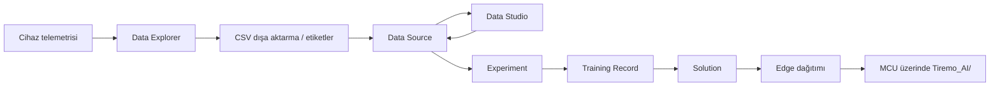

<a href="../../Intelligence/README.md">English</a> | <a>Türkçe</a>

<table class="sphinxhide" width="100%">
  <tr>
    <td align="center">
      <picture>
        <source media="(prefers-color-scheme: dark)" srcset="../../images/tiremo_sub_brand_1_mono_white.png">
        
      </picture>
       
      
      <h1>Intelligence</h1>
      Tiremo Cortex Eğitimleri: ESP32 + Tiremo Cloud üretici yazılımı, ilk LED yanıp sönmesinden filoya hazır bir cihaza
    </td>
  </tr>
</table>

> Bu sayfa [İngilizce orijinalinin](../../Intelligence/README.md)
> Türkçe çevirisidir. Klasör adları, CSV'ler ve `Tiremo_AI/` İngilizce
> eğitim ağacında yaşar; burada kopyalanmaz; içerik farklılaşırsa
> İngilizce sürüm esas alınır.

# Intelligence

Canlı bir Tiremo Cortex'ten (veya üründeki herhangi bir Thing'den) telemetri toplayın, bunu eğitilebilir bir Data Source'a dönüştürün, bir Experiment'te modelleri arayın ve bir Solution'ı, cihaz üzerindeki bir Edge paketi dahil, **Tiremo UI** üzerinden [`iot.tiremo.ai`](https://iot.tiremo.ai) adresinde dağıtın. Feature Tutorials bu Intelligence nesnelerini yeni bir `Sw/` üretici yazılımı olmadan öğretir. Design Tutorials ardından aynı zinciri tek bir Human Motion Recognition (HMR) vakasına uygular: 128 Hz yakalamadan üretilmiş bir `Tiremo_AI/` Edge kütüphanesine ve üç Cortex ikilisine (telemetri, pencereleme, cihaz üzeri çıkarım).

Platform nesneleri bir zincirdedir. Data Explorer **Intelligence** menüsünün altında değildir , cihazın zaten yayınladığını inceleme ve dışa aktarma yoludur , ama bir Data Source'a giden olağan ilk adımdır:

- [**Feature Tutorials**](./Feature_Tutorials/) her biri tek bir Intelligence nesnesini ele alır: Data Explorer, Data Sources, Experiments, Solutions. İşlenmiş örnekler (örneğin hareket sınıflandırması için ivmeölçer anahtarları) ayrıntılarda yer alır; nesnenin tek amacı değildir.
- [**Design Tutorials**](./Design_Tutorials/) bu nesneleri gönderilen bir HMR vakasında birleştirir ve üç LIS2DE12 üretici yazılımı yükler.

UI ekran görüntüleri [`Intelligence/figures/`](../../Intelligence/figures/) içindedir. Tasarım eğitimi yakalamaları (jestler, UART çıkarımı) [`03-Edge_Deployment_HMR/figures/`](../../Intelligence/Design_Tutorials/03-Edge_Deployment_HMR/figures/) yanındadır.

Tiremo Cortex Eğitimleri, Empa Electronics

