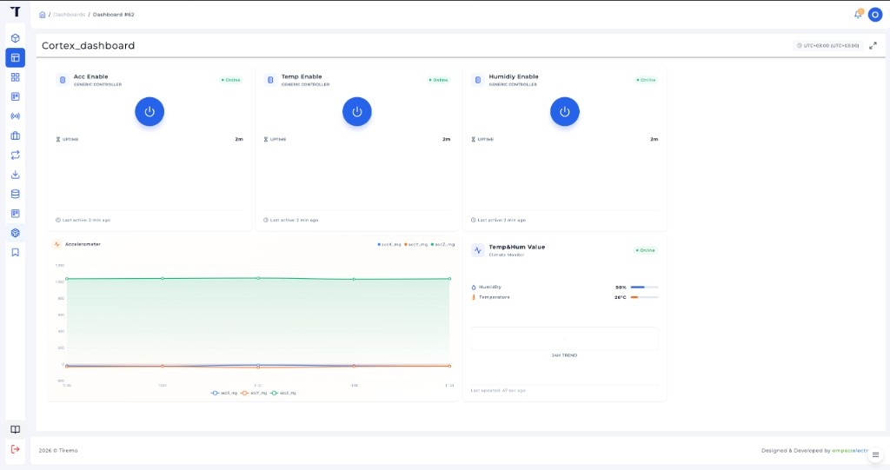
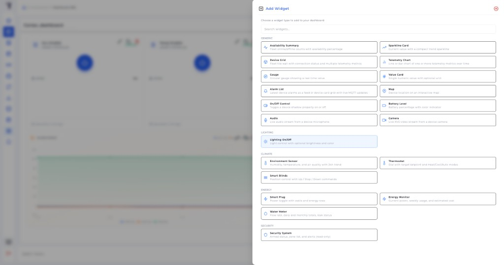

<p class="sphinxhide" align="right"><a href="../../../../Tiremo_Cloud/Design_Tutorials/01-Sensor_Telemetry_And_Shadow_Control/README.md">English</a> | <a>Türkçe</a></p>
<table class="sphinxhide" width="100%">
  <tr>
    <td align="center">
      <picture>
        <source media="(prefers-color-scheme: dark)" srcset="../../../../images/tiremo_sub_brand_1_mono_white.png">
        
      </picture>
      <br>
      
      <h1>Sensor Telemetry and Shadow Control</h1>
      <sub>Tiremo Cortex Eğitimleri — ESP32 + Tiremo Cloud üretici yazılımı, ilk LED yanıp sönmesinden filoya hazır bir cihaza</sub>
    </td>
  </tr>
</table>


# Sensor Telemetry and Shadow Control

***Kart: Tiremo Cortex (ESP32) · Bölüm: Tiremo Cloud / Design Tutorials · Zorluk: Zor***

> Bu sayfa [İngilizce orijinalinin](../../../../Tiremo_Cloud/Design_Tutorials/01-Sensor_Telemetry_And_Shadow_Control/README.md)
> Türkçe çevirisidir. Kod ve dosya yolları İngilizce kalır; içerik farklılaşırsa
> İngilizce sürüm esas alınır.

## Giriş

Ürüne benzeyen ilk Tiremo Cloud **demosu**: BluFi (modül otomatik
bağlantısı ile) WiFi'yi kaldırır, filoya kurulum Tiremo Cloud'a girer,
açılış GET / apply / report ve canlı `update/delta` klasik shadow'u
eşler, bir **HEALTH_CHECK** işi biter, kart üzerindeki sensörler veri
düzleminde yayınlanır — dört bayrakla kapılı (`true`/`false` Tiremo UI,
veya `0`/`1`):

```json
{"ACC_en":true,"GYRO_en":false,"TEMP_en":true,"HUM_en":true}
```

Her bayrak JSON bool veya tamsayı olabilir. Telemetri yalnızca açık
anahtarları içerir.
Cortex'te LIS2DE12 (ivme) ve SHT40 (sıcaklık / nem) vardır, jiroskop
yoktur: `GYRO_en=true` reported olarak yankılanır (delta temizlensin diye)
ama jiroskop alanı yayınlanmaz.

`wifi_secrets.h` yoktur. WiFi [boot cascade](../../../../ESP32_Connectivity/Design_Tutorials/01-Boot_Cascade_Saved_WiFi_Then_BluFi/)'dir.

## Neler Öğreneceksiniz

- BluFi zincirini Tiremo Cloud ile birleştirmek (sabit SSID yok)
- Aynı hazır döngüde açılış shadow GET ve duran canlı delta
- `ACC_en` / `GYRO_en` / `TEMP_en` / `HUM_en` ile telemetri kapısı
- **HEALTH_CHECK** işini `SUCCEEDED` bitirmek
- Tiremo UI panosu: On/Off shadow widget'ları ve telemetri grafikleri

## Önkoşullar

- [ESP32 Connectivity tasarım: Boot Cascade](../../../../ESP32_Connectivity/Design_Tutorials/01-Boot_Cascade_Saved_WiFi_Then_BluFi/)
- Özellik eğitimleri [01](../../../../Tiremo_Cloud/Feature_Tutorials/01-Device_Identity_From_MAC/)–
  [07](../../../../Tiremo_Cloud/Feature_Tutorials/07-Tiremo_Jobs/)
- [Sensors & Local Storage](../../../../Sensors_And_Storage/) SHT40 + LIS2DE12
- Tiremo UI kimlik bilgileri — [03 eğitimi](../../../../Tiremo_Cloud/Feature_Tutorials/03-Fleet_Provisioning_By_Claim/#tiremo-uidan-kimlik-bilgileri)
- [Getting Started](../../../../Getting_Started/)

## Çözüm

[`Sw/`](../../../../Tiremo_Cloud/Design_Tutorials/01-Sensor_Telemetry_And_Shadow_Control/Sw/)
derlenebilir (`.text` 55012). Eğitim 07'den gitignore'lu dosyaları kopyalayın:

```sh
cd Sw
cp ../../Feature_Tutorials/07-Tiremo_Jobs/Sw/aws_iot_config.h .
cp ../../Feature_Tutorials/07-Tiremo_Jobs/Sw/certs/claim_cert.pem certs/
cp ../../Feature_Tutorials/07-Tiremo_Jobs/Sw/certs/claim_key.pem certs/
tdf.py build
tdf.py flash
tdf.py monitor
```

`wifi_secrets.h` yok. Fabrika taze açılış **Tiremo-Cortex** reklamı yapar.

Canlı delta `"ACC_en":false` bir sonraki örnekte ivme anahtarlarını düşürür.
**HEALTH_CHECK** `SUCCEEDED` yazar (`firmware_version=cortex-d01`).

USER 10 s: CS01 **ve** verilen kimlik silinir, BluFi + claim yeniden başlar.

Bayrakları [Device State Controller](../../../../Tiremo_Cloud/Feature_Tutorials/05-Live_Shadow_Delta_Handling/#sending-a-shadow-update-in-the-tiremo-ui)
ile veya bir [panodaki](#tiremo-uida-pano-olusturma) On/Off widget'ları
ile gönderin. Telemetriyi [cihaz sayfasında](../../../../Tiremo_Cloud/Feature_Tutorials/06-Publishing_Alarms_And_Telemetry/#seeing-telemetry-and-alarms-in-the-tiremo-ui)
veya aynı panoda doğrulayın. HEALTH_CHECK [eğitim 07](../../../../Tiremo_Cloud/Feature_Tutorials/07-Tiremo_Jobs/#creating-a-job-in-the-tiremo-ui) gibidir.

## Tiremo UI'da pano oluşturma

State Controller ve cihaz sayfası MQTT alışverişini doğrular. **Dashboard**
operatör görünümüdür: shadow bayraklarını aynı ekrandan aç/kapa, o
bayrakların kaptığı telemetriyi izle.

Kenar çubuğundan **Dashboards** (ızgara simgesi) açın. Bir pano oluşturun
(buradaki ad **Cortex_dashboard**). Widget'ları eğitim 03 ürününe ve
eğitim 01'deki 12-hex cihaz tanımlayıcısına bağlayın.

**On/Off Control** (**Generic Controller**) güç düğmesiyle klasik
shadow `desired` `true` / `false` yazar. İlgilendiğiniz her bayrak için
bir tane ekleyin: `ACC_en`, `TEMP_en`, `HUM_en` (`GYRO_en` yankı için
olabilir; Cortex yine jiroskop anahtarı yayınlamaz).

**Telemetry Chart** `pub/{product}/{device}/telemetry` anahtarlarını
çizer. İvme çizgisi için `accX_mg` / `accY_mg` / `accZ_mg`.
**Environment Sensor** (**Climate Monitor**) `tempC` ve `humPct` gösterir.



*Şekil: Tiremo UI — **Cortex_dashboard**. Acc / Temp / Humidity Enable
için Generic Controller güç düğmeleri; **Accelerometer** çizgi grafiği
(`accX_mg` / `accY_mg` / `accZ_mg`); **Temp&Hum Value** iklim
(`humPct` / `tempC`).*

Güç düğmesi State Controller ile aynı desired güncellemesidir. UART
`shadow: delta` sonra yalnızca açık anahtarlarla `telemetry: pub` yazar.
**Acc Enable** kapanınca bir sonraki örnekte ivme serisi düşer; iklim
widget'ı `TEMP_en` / `HUM_en` açıksa güncellenmeye devam eder.

**Daha fazla ekleyin.** Panoda **Add Widget**. Bu üretici yazılımının
aydınlatma, enerji, kamera veya harita yükü yoktur — yayınladığınız
anahtarlara (`uptimeS`, `acc*_mg`, `tempC`, `humPct`) veya shadow
bayraklarına bağlanan widget'ları seçin. Gösterge, değer kartı,
sparkline ve alarm listesi olağan eklerdir.



*Şekil: Tiremo UI — **Add Widget**. Shadow özelliği için **On/Off
Control**; bir veya daha fazla metriğin çizgi veya çubuk grafiği için
**Telemetry Chart**; Climate altında **Environment Sensor**; ayrıca
gösterge, değer kartı, alarm listesi ve diğer katalog girdileri.*

## Bitti Sayılınca

Kart `wifi_secrets.h` olmadan WiFi'ye girer, açılış GET / canlı delta
biter, yalnızca açık sensör anahtarlarını yayınlar ve Tiremo UI
HEALTH_CHECK yürütmesi **Succeeded** gösterir. `ACC_en` (`TEMP_en` /
`HUM_en`) State Controller veya pano On/Off widget'ından değişince
sonraki telemetri nesnesi reboot olmadan değişir. Pano grafik ve iklim
widget'ları o örnekleri gösterir.

<p align="center"></p>

<p class="sphinxhide" align="center"><sub>Tiremo Cortex Eğitimleri — Empa Electronics</sub></p>
