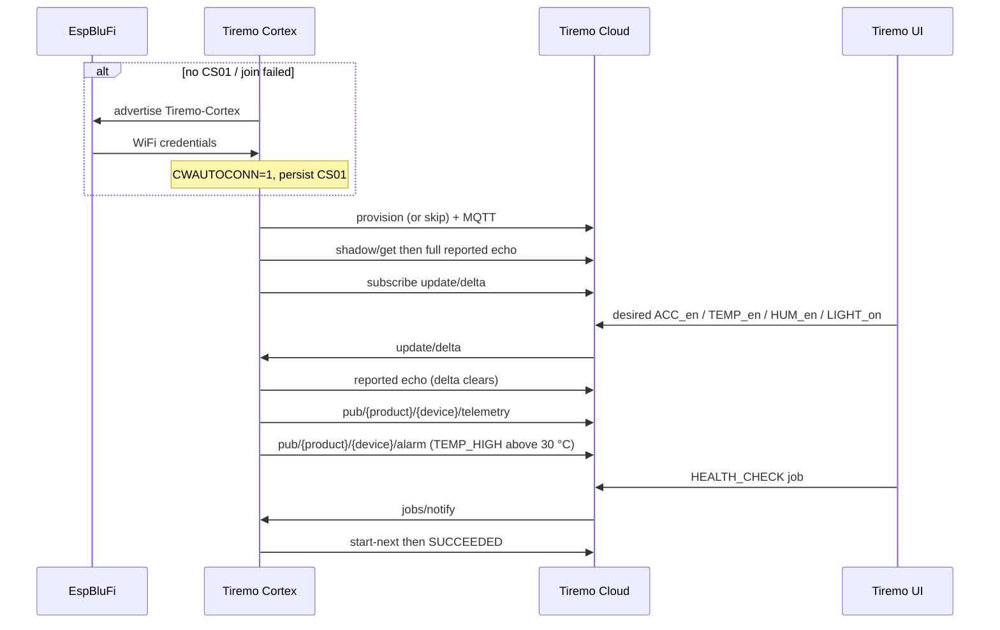
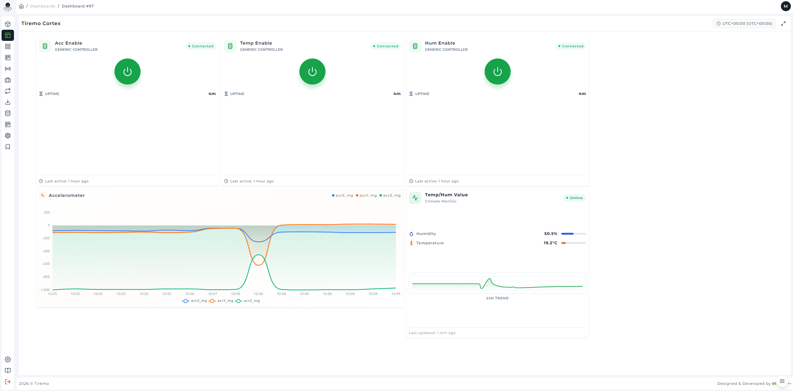
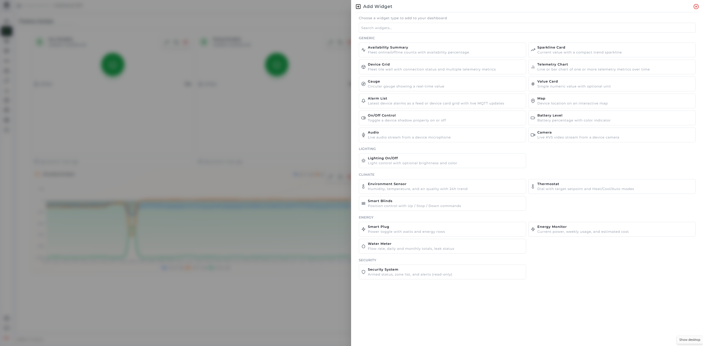

<p class="sphinxhide" align="right"><a href="../../../../Tiremo_Cloud/Design_Tutorials/01-Sensor_Telemetry_And_Shadow_Control/README.md">English</a> | <a>Türkçe</a></p>
<table class="sphinxhide" width="100%">
  <tr>
    <td align="center">
      <picture>
        <source media="(prefers-color-scheme: dark)" srcset="../../../../images/tiremo_sub_brand_1_mono_white.png">
        
      </picture>
      <br>
      
      <h1>Sensor Telemetry and Shadow Control</h1>
      <sub>Tiremo Cortex Eğitimleri — ESP32 + Tiremo Cloud üretici yazılımı, ilk LED yanıp sönmesinden filoya hazır bir cihaza</sub>
    </td>
  </tr>
</table>


# Sensor Telemetry and Shadow Control

***Kart: Tiremo Cortex (ABOV A34G43A, Cortex-M4) · Bölüm: Tiremo Cloud / Design Tutorials · Zorluk: Zor***

> Bu sayfa [İngilizce orijinalinin](../../../../Tiremo_Cloud/Design_Tutorials/01-Sensor_Telemetry_And_Shadow_Control/README.md)
> Türkçe çevirisidir. Kod ve dosya yolları İngilizce kalır; içerik farklılaşırsa
> İngilizce sürüm esas alınır.

## Giriş

Bu, ürüne benzeyen ilk Tiremo Cloud **demosu**: BluFi (modülün otomatik bağlanmasıyla birlikte) WiFi'yi açar, fleet provisioning cihazı Tiremo Cloud'a katar, açılıştaki GET / uygula / raporla adımları ve canlı `update/delta` klasik shadow'u senkron tutar, bir **HEALTH_CHECK** işi tamamlanır, karttaki sensörler veri düzlemine yayın yapar — üç shadow bayrağıyla kontrol edilerek —, dördüncü bir bayrak kartın on LED'ini açıp kapatır ve sıcaklık 30 °C'yi geçtiğinde bir **TEMP_HIGH** alarmı gönderilir:

```json
{"ACC_en":true,"TEMP_en":true,"HUM_en":true,"LIGHT_on":false}
```

Her bayrak JSON `true`/`false` (Tiremo UI) veya tamsayı `0`/`1` olabilir. Telemetri yalnızca etkin sensör anahtarlarını içerir. Tiremo Cortex kartında bir LIS2DE12 ivmeölçer ve bir SHT40 sıcaklık / nem sensörü vardır (jiroskop yoktur).

`wifi_secrets.h` yoktur. WiFi [boot cascade](../../../ESP32_Connectivity/Design_Tutorials/01-Boot_Cascade_Saved_WiFi_Then_BluFi/README.md) sırasını izler: kayıtlı CS01 kaydı; yoksa modülün kendi NVS'inden yeniden bağlanma (yalnızca SSID, MCU'da şifre yok); o da olmazsa BluFi.

## Bir Bakışta Veri Alışverişi



## Neler Öğreneceksiniz

- BluFi cascade'ini Tiremo Cloud ile birleştirmek (koda gömülü SSID yok)
- Açılış shadow GET'i ile sürekli açık canlı delta'yı aynı hazır döngüsünde çalıştırmak
- `pub/{product}/{device}/telemetry` yayınını `ACC_en` / `TEMP_en` / `HUM_en` ile kontrol etmek
- Kartın LED'lerini shadow'dan `LIGHT_on` ile açıp kapatmak
- Gerçek bir sensörden `pub/{product}/{device}/alarm` üzerinde sıcaklık alarmı oluşturmak ve temizlemek
- Bir **HEALTH_CHECK** işini tamamlamak (`1_<uuid>` → `SUCCEEDED`)
- Bir Tiremo UI panosu kurmak: On/Off shadow widget'ları ve telemetri grafikleri

## Ön Koşullar

- [ESP32 Connectivity tasarım eğitimi: Boot Cascade](../../../ESP32_Connectivity/Design_Tutorials/01-Boot_Cascade_Saved_WiFi_Then_BluFi/README.md) (telefonda EspBluFi)
- Özellik eğitimleri [01](../../Feature_Tutorials/01-Device_Identity_From_MAC/README.md)–[07](../../Feature_Tutorials/07-Tiremo_Jobs/README.md) — alarm formatı için [06](../../Feature_Tutorials/06-Publishing_Alarms_And_Telemetry/README.md)
- [Sensors & Local Storage](../../../Sensors_And_Storage/) bölümündeki SHT40 + LIS2DE12 başlatma adımları, [tasarım eğitiminin](../../../Sensors_And_Storage/Design_Tutorials/01-Standalone_Environmental_Logger/README.md#aynı-i2c-veri-yolunda-iki-sensör) I2C ayrıntıları dahil
- Tiremo UI'daki ürün sayfanızdan: **Identifier**, **Secret Key** ve **Provisioning Certificates** — bkz. [eğitim 03](../../Feature_Tutorials/03-Fleet_Provisioning_By_Claim/README.md#tiremo-uidan-kimlik-bilgileri)
- [Getting Started](../../../Getting_Started/) bölümündeki kurulum betikleri çalıştırılmış olmalı, böylece `tdf` kullanılabilir
- Logu izlemek için: `tdf monitor` veya herhangi bir seri terminal (Tera Term, PuTTY, screen, minicom, …), kartın USB seri portunda 115200 8N1, **en az 100 sütun genişliğinde** (banner için)
- Bilgisayarınıza USB kablosuyla bağlı bir Tiremo Cortex kartı (ABOV A34G43A MCU — bkz. [Donanım Genel Bakışı](../../../Hardware.md))

## Platform dökümanı

- [Phase 1](https://docs.tiremo.ai/device-provisioning/first-phase) / [Phase 3](https://docs.tiremo.ai/device-provisioning/third-phase) (telemetri topic'i)
- [Device State Controller](https://docs.tiremo.ai/device-state-controller/introduction)
- [Jobs](https://docs.tiremo.ai/developer-guide/jobs/jobs-introduction)

## Shadow ve telemetri

Bu üretici yazılımının anladığı tüm anahtarlarla klasik shadow **desired**:

```json
{
  "ACC_en": true,
  "TEMP_en": true,
  "HUM_en": true,
  "reporting": {
    "intervalS": 60
  },
  "LIGHT_on": false
}
```

| Anahtar | Ne yapar | Değerler |
|---|---|---|
| `ACC_en` | Telemetride ivmeölçer anahtarları `accX_mg` / `accY_mg` / `accZ_mg` | `true` / `false` (veya `1` / `0`) |
| `TEMP_en` | Sıcaklık anahtarı `tempC` | `true` / `false` |
| `HUM_en` | Nem anahtarı `humPct` | `true` / `false` |
| `reporting.intervalS` | Saniye cinsinden telemetri periyodu (varsayılan 60, en fazla 3600) | sayı |
| `LIGHT_on` | On LED'in (LED1–LED10) hepsini birlikte açar veya kapatır; varsayılan kapalı | `true` / `false` |

Örnekler telemetri topic'inde kalır — `state.reported` içine konmaz. Sıcaklık ve nem iki ondalık basamakla, ivme tam mg olarak gönderilir (sensörün çözünürlüğü 15.6 mg'dır). Üç bayrak da açıkken bir örnek şöyle görünür:

```json
{"uptimeS":60,"accX_mg":-7,"accY_mg":-136,"accZ_mg":975,"tempC":27.45,"humPct":23.18}
```

Bu bayrakları [Device State Controller](../../Feature_Tutorials/05-Live_Shadow_Delta_Handling/README.md#tiremo-uida-shadow-güncellemesi-gönderme) ile veya bir [panodaki](#tiremo-uida-pano-oluşturma) On/Off widget'larıyla gönderin. Cihaz sayfasında **Device Shadow State** `desired` / `reported` / `delta` değerlerini, örnekleri ise [Last 5 Telemetry Data](../../Feature_Tutorials/06-Publishing_Alarms_And_Telemetry/README.md#tiremo-uida-telemetri-ve-alarmlar) altında veya aynı panoda doğrulayın. **HEALTH_CHECK** işini [eğitim 07](../../Feature_Tutorials/07-Tiremo_Jobs/README.md#tiremo-uida-iş-oluşturma)'deki gibi kuyruğa ekleyin.

`LIGHT_on` delta gelir gelmez uygulanır; UART logunda `shadow: LIGHT_on=1` (veya `=0`) görünür. Telemetride yer almaz — doğrulaması shadow'un `reported` tarafıdır.

Eski bir üretici yazılımından kalan shadow belgesinde hâlâ `GYRO_en` anahtarı olabilir. Bu üretici yazılımı onu yok sayar ve olduğu gibi geri yansıtır; belgeden silmek için bir kez `{"GYRO_en": null}` gönderin.

## Sıcaklık alarmı

Bir örnek SHT40'ı her okuduğunda (yani `TEMP_en` veya `HUM_en` açıkken) sıcaklık 30 °C ile karşılaştırılır. Yalnızca eşik geçişleri, QoS 1 ile `pub/{product}/{device}/alarm` üzerinde yayınlanır — sıcaklık bir tarafta kaldığı sürece hiçbir şey tekrarlanmaz:

| Sıcaklık | Bir kez yayınlanan |
|---|---|
| **30 °C'nin üstüne** çıkınca | `{"alarmType":"TEMPERATURE","severity":"MAJOR","code":"TEMP_HIGH","exception":"Threshold 30C exceeded"}` |
| tekrar **30 °C'nin altına** inince | `{"alarmType":"TEMPERATURE","severity":"INFO","code":"TEMP_HIGH_NORMAL","exception":"Temperature returned to normal"}` |

Dört anahtar ve severity değerleri, Tiremo Cloud'un alarm alımının kabul ettikleridir (bkz. [eğitim 06](../../Feature_Tutorials/06-Publishing_Alarms_And_Telemetry/README.md)). Eşikler [`tiremo_telemetry.c`](../../../../Tiremo_Cloud/Design_Tutorials/01-Sensor_Telemetry_And_Shadow_Control/Sw/Common/Src/tiremo_telemetry.c) dosyasının başındaki iki sabittir, mili-derece cinsinden: `ALARM_RAISE_ABOVE_MILLI_C` ve `ALARM_CLEAR_BELOW_MILLI_C`, ikisi de `30000`. Tam 30 °C civarında duran bir sıcaklık eşiği ileri geri geçebilir; bir pay bırakmak için temizleme eşiğini düşürün (örneğin `29500`). Alarm her örnekte bir kez kontrol edilir, bu yüzden `intervalS` 60 iken bir dakikaya kadar gecikebilir — test ederken `intervalS` değerini düşürün.

Denemek için SHT40'ı nefesinizle veya parmak ucunuzla 30 °C'nin üstüne çıkana kadar ısıtın, sonra soğumasını bekleyin.

## Çözüm

### Kimlik bilgileri

Bu `Sw/` klasörü, hepsi Tiremo UI'daki ürün sayfanızdan gelen, gitignore'lu üç dosyaya ihtiyaç duyar (nerede olduklarını [eğitim 03](../../Feature_Tutorials/03-Fleet_Provisioning_By_Claim/README.md#tiremo-uidan-kimlik-bilgileri)'te bulabilirsiniz):

- **`aws_iot_config.h`**: `aws_iot_config.h.example` dosyasını `aws_iot_config.h` olarak kopyalayın, sonra `TIREMO_AWS_PRODUCT_IDENTIFIER` değerine **Identifier**'ınızı, `TIREMO_AWS_PRODUCT_SECRET` değerine **Secret Key**'inizi yazın. Endpoint (`iot.tiremo.ai`) ve şablon (`tiremo-default`) zaten doldurulmuştur.
- **`certs/claim_cert.pem`** ve **`certs/claim_key.pem`**: **Provisioning Certificates**, `<identifier>.certificate.pem` ve `<identifier>.private.key` adlarından yeniden adlandırılmış hâlde. Bunları Cloud Messaging 03'e `device_cert.pem` / `device_key.pem` olarak zaten koyduysanız, bu iki dosyayı yeni adlarıyla buraya kopyalayın. Bkz. [`certs/README.md`](../../../../Tiremo_Cloud/Design_Tutorials/01-Sensor_Telemetry_And_Shadow_Control/Sw/certs/README.md).

Üç ad da gitignore'ludur; yine de commit etmeden önce `git status` ile kontrol edin. `aws_iot_config.h` veya sertifikalardan biri eksikse derleme, ne yapılacağını söyleyen bir mesajla durur. `wifi_secrets.h` yoktur.

### Derle, yükle, izle

Depo kök dizininden:

```sh
cd Tiremo_Cloud/Design_Tutorials/01-Sensor_Telemetry_And_Shadow_Control/Sw
tdf build
tdf flash
tdf monitor
```

(`tdf`'nin ne olduğu için [Getting_Started/01-Hello_Blink'in Çözüm bölümüne](../../../Getting_Started/01-Hello_Blink/README.md#çözüm) bakın. macOS/Linux'ta `tdf.py` de takma ad olarak çalışır; Windows'ta `tdf` kullanın. `tdf monitor` çalıştırmadan önce kartın seri portundaki diğer terminalleri kapatın — port aynı anda yalnızca bir program tarafından açılabilir.)

**Gerçek donanımda doğrulandı:** `tdf build` macOS ve Windows 11'de hatasız derler ve bağlar (`.text` yaklaşık 55 KB; tam boyut araç zinciri sürümüne göre biraz değişir ve bağlayıcı, [01-Hello_Blink'in Çözüm bölümünde](../../../Getting_Started/01-Hello_Blink/README.md#çözüm) açıklanan aynı beklenen, zararsız `_close` / `_lseek` / `_read` / `_write is not implemented` uyarılarını yazdırır). `tdf flash`, bağlı gerçek bir Tiremo Cortex kartında SWD üzerinden tam bir programlama ve doğrulama döngüsünü tamamladı (`** Verified OK **`); kart kendini provision etti, shadow'unu senkronladı, sensör telemetrisini Tiremo Cloud'a yayınladı, bir shadow `LIGHT_on` delta'sı kartın LED'lerini açıp kapattı, SHT40 30 °C'nin üstüne ısıtılıp soğutulunca da önce `TEMP_HIGH`, sonra `TEMP_HIGH_NORMAL` yayınlandı. Aşağıda tanımlayıcılar ve ağ adı yer tutucularla değiştirilmiştir.

### İlk açılış: provisioning

Hiç provision edilmemiş bir kartta (veya 10 sn USER basılı tutulduktan sonra) kart, Provisioning Certificates ile kendi kimliğini talep eder, ardından varsayılan bayrakları raporlar. Kısaltılmış log:

```text
[INFO] identity: deviceId=<deviceId> clientId=<product>_<deviceId> thingName=<product>_<deviceId>
[INFO] persist: loaded SSID "YourSSID" password=no
[INFO] cascade: try NVS auto-rejoin (SSID only, no MCU password)
[INFO] cascade: NVS rejoin got IP
[INFO] ESP32: online, SNTP epoch=...
[WARN] ESP32: SYSMFG read "tiremo"/"provisioned": ERROR (empty slot?)
[INFO] provision: no matching marker
[INFO] provision: write root CA (1206 bytes)
[INFO] provision: write claim certificate (1220 bytes)
[INFO] provision: write claim private key (1679 bytes)
[INFO] provision: claim MQTT connected
[INFO] provision: CreateKeysAndCertificate
[INFO] provision: RegisterThing deviceIdentifier=<deviceId>
[INFO] provision: registered Thing <product>_<deviceId>
[INFO] provision: complete; permanent MQTT connected
[INFO] shadow: get
[WARN] shadow: rejected {"code":404,"message":"No shadow exists with name: '<product>_<deviceId>'","clientToken":"tiremo-boot-get"}
[INFO] shadow: no document yet (404); will report defaults
[INFO] shadow: update accepted
[INFO] shadow: subscribed update/delta
[INFO] jobs: subscribed jobs/notify
```

İki `[WARN]` satırı ilk açılışta beklenir: henüz "provisioned" işareti yoktur ve ilk rapor oluşturana kadar bulutta yeni cihaz için shadow belgesi yoktur. Yeni cihaz Tiremo UI'da ürününüzün altında, kartın 12 haneli hex MAC adresiyle (`<deviceId>`) görünür. Sonraki her açılışta bunun yerine `provision: already done; using permanent credentials` yazar.

### Normal açılış: telemetri ve alarm

Provisioning'den sonra (veya sonraki herhangi bir açılışta) kart bayraklarını raporlar, delta ve iş topic'lerine abone olur ve her `intervalS` sürede bir örnek yayınlar. Aşağıda bir State Controller güncellemesi `"LIGHT_on": true` ve `"reporting": {"intervalS": 1}` ayarlıyor, ikinci bir güncelleme de `"LIGHT_on": false` yapıyor. Kısaltılmış log:

```text
[INFO] shadow: applied ACC_en=1 TEMP_en=1 HUM_en=1 intervalS=60
[INFO] shadow: LIGHT_on=0
[INFO] shadow: update reported (119 bytes, full desired echo)
[INFO] shadow: update accepted
[INFO] shadow: get again to confirm delta is gone
[INFO] shadow: no leftover delta
[INFO] shadow: subscribed update/delta
[INFO] telemetry: topics pub/<product>/<deviceId>/telemetry  pub/<product>/<deviceId>/alarm
[INFO] jobs: start-next accepted with no execution
[INFO] jobs: subscribed jobs/notify
[INFO] telemetry: pub pub/<product>/<deviceId>/telemetry (85 bytes) {"uptimeS":0,"accX_mg":-62,"accY_mg":-74,"accZ_mg":1006,"tempC":28.05,"humPct":20.77}
[INFO] ready thingName=<product>_<deviceId> ACC=1 TEMP=1 HUM=1 intervalS=60
[INFO] telemetry: pub pub/<product>/<deviceId>/telemetry (84 bytes) {"uptimeS":60,"accX_mg":3,"accY_mg":-89,"accZ_mg":1006,"tempC":28.33,"humPct":21.72}
[INFO] shadow: delta 190 bytes
[INFO] shadow: applied ACC_en=1 TEMP_en=1 HUM_en=1 intervalS=1
[INFO] shadow: LIGHT_on=1
[INFO] shadow: desired now 45 bytes (merged)
[INFO] shadow: update reported (104 bytes, full desired echo)
[INFO] telemetry: pub pub/<product>/<deviceId>/telemetry (84 bytes) {"uptimeS":69,"accX_mg":0,"accY_mg":-89,"accZ_mg":1010,"tempC":28.35,"humPct":21.34}
[INFO] telemetry: pub pub/<product>/<deviceId>/telemetry (84 bytes) {"uptimeS":70,"accX_mg":3,"accY_mg":-89,"accZ_mg":1002,"tempC":28.36,"humPct":21.06}
...
[INFO] shadow: delta 112 bytes
[INFO] shadow: applied ACC_en=1 TEMP_en=1 HUM_en=1 intervalS=1
[INFO] shadow: LIGHT_on=0
[INFO] shadow: desired now 46 bytes (merged)
[INFO] shadow: update reported (105 bytes, full desired echo)
```

`LIGHT_on=1` ile on LED'in hepsi yanar; `LIGHT_on=0` ile söner. SHT40'ı nefesle ısıtmak onu 30 °C'nin üstüne çıkarır: bir sonraki örnek `TEMP_HIGH` alarmını oluşturur, 30 °C'nin altına inen ilk örnek de alarmı `TEMP_HIGH_NORMAL` ile temizler (alarm nesneleri [Sıcaklık alarmı](#sıcaklık-alarmı) bölümündekilerdir; log ikincisini kısaltır):

```text
[INFO] telemetry: pub pub/<product>/<deviceId>/telemetry (85 bytes) {"uptimeS":142,"accX_mg":3,"accY_mg":-93,"accZ_mg":1010,"tempC":28.48,"humPct":20.11}
[INFO] telemetry: pub pub/<product>/<deviceId>/telemetry (86 bytes) {"uptimeS":143,"accX_mg":834,"accY_mg":401,"accZ_mg":148,"tempC":30.29,"humPct":26.71}
[WARN] alarm: RAISE TEMP_HIGH temp=30.286 C
[INFO] telemetry: pub pub/<product>/<deviceId>/alarm (102 bytes) {"alarmType":"TEMPERATURE","severity":"MAJOR","code":"TEMP_HIGH","exception":"Threshold 30C exceeded"}
[INFO] telemetry: pub pub/<product>/<deviceId>/telemetry (85 bytes) {"uptimeS":144,"accX_mg":951,"accY_mg":226,"accZ_mg":35,"tempC":31.37,"humPct":43.26}
...
[INFO] telemetry: pub pub/<product>/<deviceId>/telemetry (86 bytes) {"uptimeS":217,"accX_mg":74,"accY_mg":-136,"accZ_mg":998,"tempC":30.00,"humPct":19.50}
[INFO] alarm: CLEAR TEMP_HIGH_NORMAL temp=29.997 C
[INFO] telemetry: pub pub/<product>/<deviceId>/alarm (116 bytes) {"alarmType":"TEMPERATURE","severity":"INFO","code":"TEMP_HIGH_NORMAL",...}
```

`"ACC_en":false` ayarlayan canlı bir delta, bir sonraki örnekten ivme anahtarlarını çıkarır. Bir **HEALTH_CHECK** işi `SUCCEEDED` loglar (`firmware_version=cortex-d01`).

CS01'i **ve** verilmiş kimliği silmek için USER'ı 10 sn basılı tutun; kart yeniden BluFi + provisioning ile açılır.

## Tiremo UI'da pano oluşturma

State Controller ve cihaz sayfası protokolün çalıştığını kanıtlar. Bir **Dashboard** ise operatör görünümüdür: shadow bayraklarını değiştirmek ve bu bayrakların kontrol ettiği telemetriyi izlemek için tek bir ekran.

Kenar çubuğundan **Dashboards**'u açın (ızgara simgesi). Bir pano oluşturun ve adlandırın (buradaki **Cortex_dashboard**). Widget'ları eğitim 03 ve 01'deki aynı ürüne ve 12 haneli hex cihaz tanımlayıcısına bağlayın.

**On/Off Control** (**Generic Controller** olarak görünür), bir güç düğmesiyle klasik shadow `desired` değerine `true` / `false` yazar. İlgilendiğiniz her bayrak için bir tane ekleyin: `ACC_en`, `TEMP_en`, `HUM_en` ve LED'ler için `LIGHT_on`.

**Telemetry Chart**, `pub/{product}/{device}/telemetry` içindeki anahtarları çizer. İvmeölçer çizgi grafiği için `accX_mg` / `accY_mg` / `accZ_mg` bağlayın. **Environment Sensor** (**Climate Monitor**) `tempC` ve `humPct` gösterir. Bir **alarm listesi** widget'ı `TEMP_HIGH` / `TEMP_HIGH_NORMAL` alarmlarını gösterir.



*Şekil: Tiremo UI — **Cortex_dashboard**. Acc / Temp / Humidity Enable için Generic Controller güç düğmeleri; **Accelerometer** çizgi grafiği (`accX_mg` / `accY_mg` / `accZ_mg`); **Temp&Hum Value** iklim widget'ı (`humPct` / `tempC`).*

Bir güç düğmesine basmak, State Controller ile aynı desired güncellemesidir. UART önce `shadow: delta`, sonra yalnızca etkin anahtarlarla `telemetry: pub` loglar. **Acc Enable** kapatılınca bir sonraki örnekte ivme serisi düşer; `TEMP_en` / `HUM_en` açık kaldıkça iklim widget'ı güncellenmeye devam eder. `LIGHT_on`'a bağlı bir düğme karttaki on LED'in hepsini açıp kapatır (UART: `shadow: LIGHT_on=1` / `=0`).

**Daha fazlasını ekleyin.** Panoda **Add Widget**'ı kullanın. Bu üretici yazılımında enerji, kamera veya harita verisi yoktur — gerçekten yayınladığınız anahtarlara (`uptimeS`, `acc*_mg`, `tempC`, `humPct`), alarmlara veya shadow bayraklarına (`LIGHT_on` dahil) bağlanan widget'ları seçin. Göstergeler, değer kartları ve mini grafikler en yaygın eklemelerdir.



*Şekil: Tiremo UI — **Add Widget**. Bir shadow özelliği için **On/Off Control**; bir veya daha fazla metriğin çizgi veya çubuk grafiği için **Telemetry Chart**; Climate altında **Environment Sensor**; ayrıca göstergeler, değer kartları, alarm listesi ve diğer katalog öğeleri.*

## Adım Adım İnceleme

1. [`prv_user_code.c`](../../../../Tiremo_Cloud/Design_Tutorials/01-Sensor_Telemetry_And_Shadow_Control/Sw/Src/prv_user_code.c) — cascade, provisioning, açılış shadow'u, işler ve sensör telemetrisi tek döngüde.
2. [`tiremo_shadow.c`](../../../../Tiremo_Cloud/Design_Tutorials/01-Sensor_Telemetry_And_Shadow_Control/Sw/Common/Src/tiremo_shadow.c) — üç sensör bayrağını, `reporting.intervalS` değerini ve `LIGHT_on`'u uygular ([`tiremo_led.c`](../../../../Tiremo_Cloud/Design_Tutorials/01-Sensor_Telemetry_And_Shadow_Control/Sw/Drivers/led/Src/tiremo_led.c) içindeki LED sürücüsüyle, pinler [`board_config.h`](../../../../Tiremo_Cloud/Design_Tutorials/01-Sensor_Telemetry_And_Shadow_Control/Sw/Board/board_config.h) içinde); delta temizlensin diye desired'ın tamamını geri yansıtır.
3. [`tiremo_telemetry.c`](../../../../Tiremo_Cloud/Design_Tutorials/01-Sensor_Telemetry_And_Shadow_Control/Sw/Common/Src/tiremo_telemetry.c) — bu bayraklara göre seçilen LIS2DE12 / SHT40 anahtarları (sıcaklık ve nem iki ondalıkla) ve TEMP_HIGH alarmı.
4. [`tiremo_jobs.c`](../../../../Tiremo_Cloud/Design_Tutorials/01-Sensor_Telemetry_And_Shadow_Control/Sw/Common/Src/tiremo_jobs.c) — eğitim 07 ile aynı health-check yolu.
5. [`tiremo_hal_i2c.c`](../../../../Tiremo_Cloud/Design_Tutorials/01-Sensor_Telemetry_And_Shadow_Control/Sw/Tiremo_Hal/Src/tiremo_hal_i2c.c) ve [`tiremo_sht40.c`](../../../../Tiremo_Cloud/Design_Tutorials/01-Sensor_Telemetry_And_Shadow_Control/Sw/Drivers/sht40/Src/tiremo_sht40.c) — [Sensors tasarım eğitimindeki](../../../Sensors_And_Storage/Design_Tutorials/01-Standalone_Environmental_Logger/README.md#aynı-i2c-veri-yolunda-iki-sensör) I2C düzeltmeleri; bunlar olmadan iki sensör burada da okunamaz (`telemetry: accel read failed`, `telemetry: SHT40 read failed`).
6. [`tiremo_esp32.c`](../../../../Tiremo_Cloud/Design_Tutorials/01-Sensor_Telemetry_And_Shadow_Control/Sw/Drivers/esp32/Src/tiremo_esp32.c) — modül kendiliğinden yeniden bağlanmazsa WiFi cascade'inin NVS yeniden bağlanması düz bir `AT+CWJAP` komutuna (modülde kayıtlı AP'ye bağlan) geri düşer; ayrıca ESP32 Connectivity'den filtrelenmiş tarama ve DEBUG dökümünde gizlenen `AT+CWJAP`.

## Tamamlanma Ölçütü

- Kart `wifi_secrets.h` olmadan WiFi'ye bağlanır, açılış GET'ini / canlı delta'yı tamamlar ve yalnızca etkin sensör anahtarlarını, sıcaklık ve nem ondalıklı olarak yayınlar.
- State Controller'dan veya bir pano On/Off widget'ından `ACC_en` (veya `TEMP_en` / `HUM_en`) değiştirmek, yeniden başlatma olmadan bir sonraki telemetri nesnesini değiştirir.
- `LIGHT_on` değerini `true` / `false` yapmak on LED'in hepsini açar / kapatır ve `reported` aynı değeri gösterir.
- SHT40'ı 30 °C'nin üstüne ısıtmak bir `TEMP_HIGH` alarmı, 30 °C'nin altına soğutmak bir `TEMP_HIGH_NORMAL` yayınlar.
- Tiremo UI'daki bir HEALTH_CHECK yürütmesi **Succeeded** gösterir; panodaki grafik ve iklim widget'ları örnekleri gösterir.

<p align="center"></p>

<p class="sphinxhide" align="center"><sub>Tiremo Cortex Eğitimleri — Empa Electronics</sub></p>
