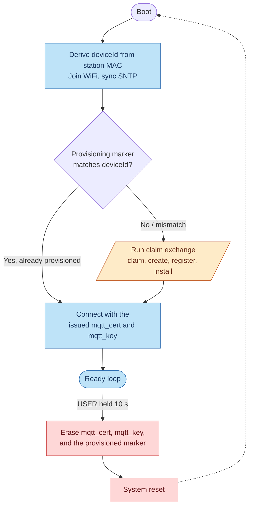
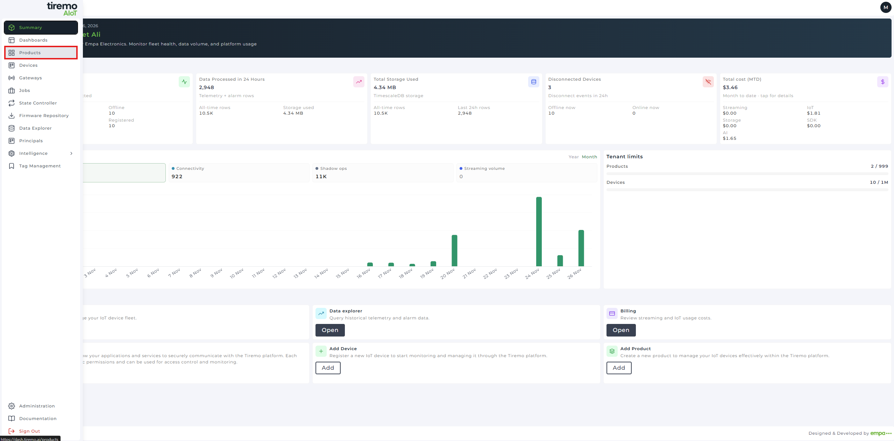
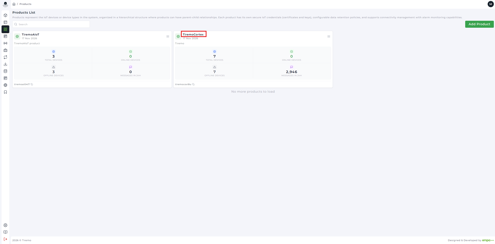
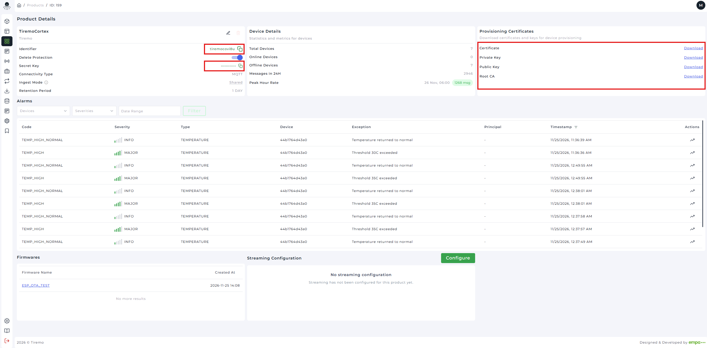
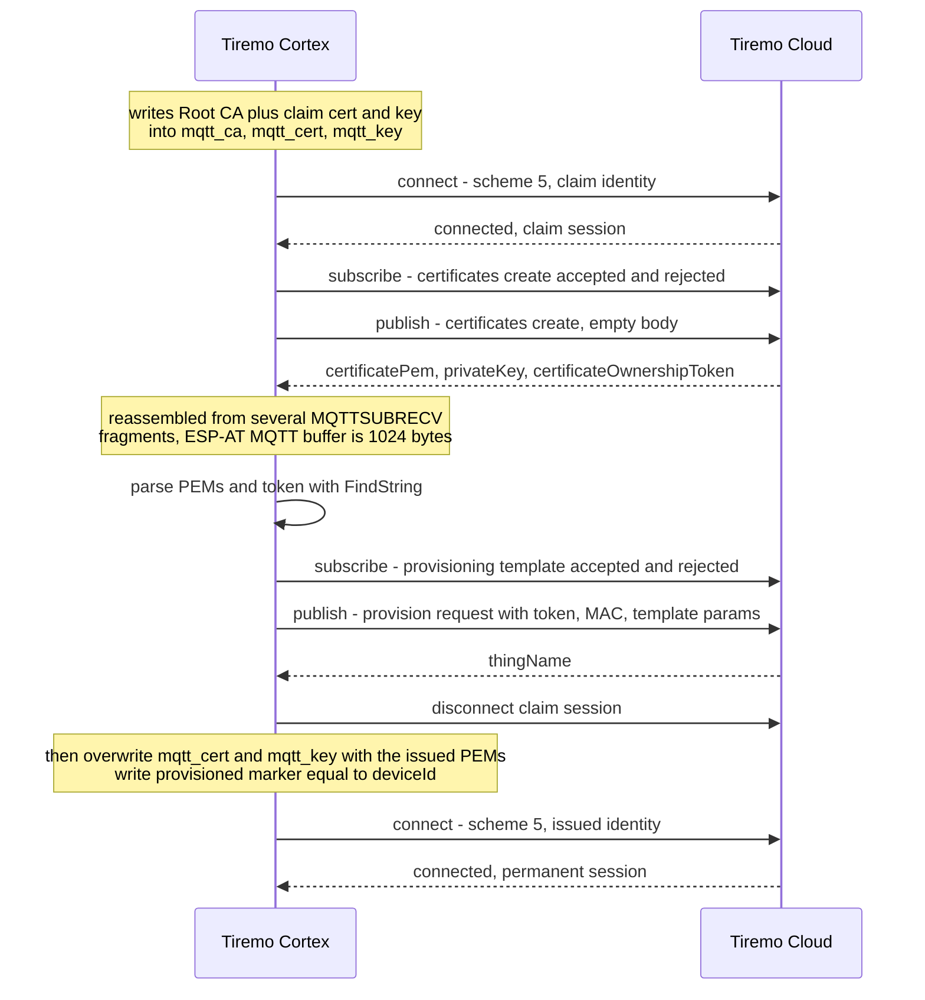

<p class="sphinxhide" align="right"><a href="../../../../Tiremo_Cloud/Feature_Tutorials/03-Fleet_Provisioning_By_Claim/README.md">English</a> | <a>Türkçe</a></p>
<table class="sphinxhide" width="100%">
  <tr>
    <td align="center">
      <picture>
        <source media="(prefers-color-scheme: dark)" srcset="../../../../images/tiremo_sub_brand_1_mono_white.png">
        
      </picture>
      <br>
      
    <h1>İddia Sertifikası ile Filo Kurulumu</h1>
      <sub>Tiremo Cortex Eğitimleri — ESP32 + Tiremo Cloud üretici yazılımı, ilk LED yanıp sönmesinden filoya hazır bir cihaza</sub>
    </td>
  </tr>
</table>


# Fleet Provisioning by Claim Certificate

***Kart: Tiremo Cortex (ABOV A34G43A, Cortex-M4) · Bölüm: Tiremo Cloud / Feature Tutorials · Zorluk: Zor***

> Bu sayfa [İngilizce orijinalinin](../../../../Tiremo_Cloud/Feature_Tutorials/03-Fleet_Provisioning_By_Claim/README.md)
> Türkçe çevirisidir. Kod ve dosya yolları İngilizce kalır; içerik farklılaşırsa
> İngilizce sürüm esas alınır.

## Giriş

[Cloud Messaging 03](../../../Cloud_Messaging/Feature_Tutorials/03-MQTT_mTLS_To_AWS_IoT/README.md),
ürün sayfanızdaki **Provisioning Certificates** ile Tiremo Cloud'a scheme 5
karşılıklı TLS oturumu açtı. Bu sertifika ürünün bütün cihazları tarafından
paylaşılır ve policy'si yalnızca fleet provisioning'e izin verir — bir
cihazın kalıcı olarak kullanması gereken bir kimlik değildir. Bu eğitim onu
amacına uygun kullanır: kart bu paylaşılan **claim** sertifikasıyla bir kez
bağlanır, Tiremo Cloud'dan MQTT üzerinden kendine özel bir cihaz sertifikası
ister, adı station MAC adresinden türetilen bir Thing kaydeder, verilen
kimlik bilgilerini ESP32'nin kendi NVS'ine yazar ve kendi kimliğiyle yeniden
bağlanır.

İkinci açılış bu alışverişi atlamalıdır. Üretici yazılımı, bu kartın
`deviceId` değerine eşit bir provisioning işaretçisi (`tiremo` /
`provisioned`) yazar; `TIREMO_Provision_IsDone()` onu geri okur ve kalıcı
yolu seçer.

## Bütün Yaşam Döngüsü, Tek Bakışta



Tek kart, bu grafikte üç yol: **ilk açılış** (turuncu — claim alışverişini
bir kez çalıştırır), **sonraki her açılış** (mavi — verilen kimlik
bilgilerini doğrudan NVS'ten okur, Tiremo Cloud'un provisioning uç
noktasına hiç ağ çağrısı yapmaz) ve **fabrika sıfırlaması** (kırmızı —
USER 10 sn basılı tutulunca verilen kimlik silinir ve ilk açılışa dönülür).

## Neler Öğreneceksiniz

- Paylaşılan claim sertifikasının (Provisioning Certificates) Tiremo Cloud'un verdiği cihaza özel sertifikadan farkı
- Tiremo Cloud'un claim ile provisioning MQTT topic'leri: önce `CreateKeysAndCertificate`, sonra `RegisterThing`
- `deviceIdentifier`'ın neden MQTT client ID değil de [Eğitim 01](../01-Device_Identity_From_MAC/README.md)'deki çıplak 12 hex MAC olduğu
- JSON içindeki PEM'i [Eğitim 02](../02-Minimal_JSON_Helpers/README.md)'nin `FindString`'i ile ayrıştırmak (satır sonları kaçışlı gelir)
- Verilen sertifika/anahtarı `mqtt_cert` / `mqtt_key`'e ve tek seferlik bir işaretçiye yazmak, böylece provisioning bir kez çalışır
- Bu slotları silen ve kartın yeniden claim yapmasını sağlayan 10 saniyelik USER butonu fabrika sıfırlaması (Getting Started 04'teki basılı tutma, debounce yok)

## Ön Koşullar

- [01-Device_Identity_From_MAC](../01-Device_Identity_From_MAC/README.md) ve [02-Minimal_JSON_Helpers](../02-Minimal_JSON_Helpers/README.md)
- [Cloud Messaging 03](../../../Cloud_Messaging/Feature_Tutorials/03-MQTT_mTLS_To_AWS_IoT/README.md) — scheme 5, bağlanmadan önce SNTP, `MQTTUSERCFG` → `MQTTSNI` → `MQTTCONN` ve bu eğitimin kopyaladığı `certs/` gitignore deseni
- **Tiremo UI**'daki ürün sayfanızdan: **Identifier**, **Secret Key** ve **Provisioning Certificates** — bkz. [Tiremo UI'dan kimlik bilgileri](#tiremo-uidan-kimlik-bilgileri)
- İnternet erişimi olan 2.4 GHz bir WiFi ağı ve bu `Sw/`'nin kendi `wifi_secrets.h` dosyası (gitignore'lu) — [Cloud Messaging eğitim 01](../../../Cloud_Messaging/Feature_Tutorials/01-MQTT_To_Public_Broker/README.md#kimlik-bilgileri-şifreyi-commit-etmeyin) ile aynı
- [Getting Started](../../../Getting_Started/) bölümündeki kurulum betikleri çalıştırılmış olmalı, böylece `tdf` kullanılabilir
- Logu izlemek için: `tdf monitor` veya herhangi bir seri terminal (Tera Term, PuTTY, screen, minicom, …), kartın USB seri portunda 115200 8N1
- Bilgisayarınıza USB kablosuyla bağlı bir Tiremo Cortex kartı (ABOV A34G43A MCU — bkz. [Donanım Genel Bakışı](../../../Hardware.md))

## Platform dökümanı

Bu üretici yazılımı,
[Device provisioning](https://docs.tiremo.ai/device-provisioning/getting-started)
sürecinin cihaz tarafını uygular:

- [Phase 1](https://docs.tiremo.ai/device-provisioning/first-phase) — bootstrap (claim) sertifikası, ürün tanımlayıcısı, ürün secret'ı
- [Phase 2](https://docs.tiremo.ai/device-provisioning/second-phase) — fleet provisioning MQTT (`CreateKeysAndCertificate` / `RegisterThing`)
- [TLS SNI](https://docs.tiremo.ai/device-provisioning/tls-sni) — `iot.tiremo.ai` için `AT+MQTTSNI`
- [Phase 3](https://docs.tiremo.ai/device-provisioning/third-phase) — verilen kalıcı sertifikayla yeniden bağlanma
- İsteğe bağlı: [device tags](https://docs.tiremo.ai/device-provisioning/device-tags)

## `certs/` Klasörünü Anlamak (Gerçek ve Gitignore'lu)

Cloud Messaging 03 ile aynı üç dosya fikri:

| Dosya | Commit edilir mi? | Nedir |
|---|---|---|
| [`certs/root_ca.pem`](../../../../Tiremo_Cloud/Feature_Tutorials/03-Fleet_Provisioning_By_Claim/Sw/certs/root_ca.pem) | Evet | **Amazon Root CA 1** — herkese açık, her Tiremo Cloud cihazı için aynı, `https://www.amazontrust.com/repository/AmazonRootCA1.pem` adresinden. Tiremo Cloud'un sunucu sertifikasını doğrular. |
| `certs/claim_cert.pem.example` / `claim_key.pem.example` | Evet | Biçimi gösteren yer tutucular. |
| `certs/claim_cert.pem` | **Hayır** (gitignore'lu) | Ürün sayfanızdaki **Provisioning Certificates** içindeki claim sertifikası. Policy'si yalnızca fleet provisioning'e (`CreateKeysAndCertificate` / `RegisterThing`) izin verir, normal uygulama topic'lerine değil. |
| `certs/claim_key.pem` | **Hayır** (gitignore'lu) | Claim sertifikasının özel anahtarı. Ona sahip olan herkes ürününüz için yeni cihaz sertifikaları isteyebilir. |

Provisioning Certificates indirmesi, ürününüzün tanımlayıcısıyla
adlandırılmış iki dosya verir. Bunları `Sw/certs/` içine koyun ve yeniden
adlandırın:

| İndirilen dosya | Yeni adı |
|---|---|
| `<identifier>.certificate.pem` | `claim_cert.pem` |
| `<identifier>.private.key` | `claim_key.pem` |

Bunları Cloud Messaging 03'e zaten `device_cert.pem` / `device_key.pem`
olarak koyduysanız, bu iki dosyayı yeni adlarıyla buraya kopyalayın —
aynı sertifika ve anahtardır. Dosyalardan biri eksikse derleme
`Missing claim credentials` ile durur; `.example` yer tutucularını asla
gömmez. Bkz. [`certs/README.md`](../../../../Tiremo_Cloud/Feature_Tutorials/03-Fleet_Provisioning_By_Claim/Sw/certs/README.md).

Verilen cihaza özel sertifika hiçbir zaman `certs/` içinde durmaz. Tiremo
Cloud onu CreateKeysAndCertificate JSON'unda döndürür ve üretici yazılımı
doğrudan modülün `mqtt_cert` / `mqtt_key` SYSMFG slotlarına yazar.

## Tiremo UI'dan kimlik bilgileri

Claim sertifikası ve anahtarı, ürün tanımlayıcısı ve ürün secret'ı,
ürününüz için **Tiremo UI**'da verilir. Şablon adı varsayılan olarak
`tiremo-default`'tur; broker `iot.tiremo.ai`'dir.

**1. Sol kenar çubuğundan Products'ı açın.**



*Şekil: Tiremo UI — ana menüde **Products**'a tıklayın.*

**2. Provision edeceğiniz ürünü açın.** Zaten o ürünün sayfasındaysanız bu
adımı atlayın.



*Şekil: Tiremo UI — açmak için ürün adına tıklayın.*

**3. Ürün sayfasından tanımlayıcıyı ve secret'ı kopyalayın, provisioning
sertifikalarını indirin.**



*Şekil: Tiremo UI — solda **Identifier** ve **Secret Key**, sağda
**Provisioning Certificates**.*

O sayfada:

- **Identifier** → gitignore'lu `aws_iot_config.h` içinde `TIREMO_AWS_PRODUCT_IDENTIFIER`
- **Secret Key** → `TIREMO_AWS_PRODUCT_SECRET`. Bu dosyayı asla commit etmeyin, secret'ı herkese açık bir issue'ya veya sohbete yapıştırmayın.
- **Provisioning Certificates** → **Certificate** ve **Private Key**'i indirin ve `certs/claim_cert.pem` ile `certs/claim_key.pem` olarak yeniden adlandırın (yukarıdaki tablo). Bu üretici yazılımı Amazon Root CA 1'i zaten `certs/root_ca.pem` olarak içerir; bu eğitim için UI'daki **Public Key** gerekmez.

Aynı bootstrap sertifikası, tanımlayıcı ve secret
[Phase 1: Prerequisites & Manufacturing Setup](https://docs.tiremo.ai/device-provisioning/first-phase)
sayfasında anlatılır.

PEM olmayan kurulum değerleri gitignore'lu `aws_iot_config.h` içindedir
(`aws_iot_config.h.example`'dan kopyalayın): endpoint (`iot.tiremo.ai`),
şablon adı (başka bir şablon kullanmıyorsanız `tiremo-default`), ürün
tanımlayıcısı, ürün secret'ı, `isGateway`. Yalnızca tanımlayıcının ve
secret'ın doldurulması gerekir.

## Provisioning Sırasını Anlamak

Önce kimlik, sonra ağ, sonra claim oturumu, en son verilen kimlikle oturum.



```c
TIREMO_ESP32_GetHwEui(eui);
TIREMO_Identity_FromEui(eui, deviceId, sizeof(deviceId));
/* clientId = "<product>_<deviceId>" */

TIREMO_ESP32_JoinAP(...);
TIREMO_ESP32_EnableSntp();
TIREMO_ESP32_WaitSntpEpoch(&epoch, ...);   /* scheme 5 needs a real clock */

if (TIREMO_Provision_IsDone(deviceId)) {
    /* mqtt_cert/mqtt_key already hold the issued identity */
    ConnectPermanent(clientId);
} else {
    TIREMO_Provision_Run(deviceId, clientId);
}
```

`TIREMO_Provision_Run()` claim alışverişinin tamamıdır:

1. Amazon Root CA 1'i, claim sertifikasını ve claim anahtarını
   `mqtt_ca` / `mqtt_cert` / `mqtt_key` slotlarına yazar (`AT+SYSMFG=2`).
2. Scheme 5 ile bağlanır: `MQTTUSERCFG` → `MQTTSNI` → `MQTTCONN`. Cloud
   Messaging 03 ile aynı sıra ve aynı SNTP gereksinimi.
3. `$aws/certificates/create/json/accepted` ve `.../rejected`'a abone
   olur, `$aws/certificates/create/json`'a `{}` yayınlar.
4. `certificateOwnershipToken`, `certificatePem` ve `privateKey`'i Eğitim
   02'nin `FindString`'i ile ayrıştırır (PEM satır sonları `\n` olarak gelir).
5. RegisterThing gövdesini `JsonWriter` ile kurar. `deviceIdentifier`,
   `clientId` değil, çıplak MAC'tir (`<deviceId>`).
6. `$aws/provisioning-templates/<name>/provision/json/accepted|rejected`'a
   abone olur, gövdeyi yayınlar, `thingName`'i bekler.
7. Bağlantıyı keser, `mqtt_cert` / `mqtt_key`'in üzerine verilen PEM'i
   yazar, işaretçiyi yazar (`namespace tiremo`, anahtar `provisioned` = `deviceId`).
8. Aynı `clientId` ile, bu kez verilen sertifikayı sunarak yeniden bağlanır.

RX halkası ve MQTT tutma tamponu 8192 bayttır. Bu, *birleştirilmiş*
CreateKeysAndCertificate JSON'u için yeterlidir. ESP-AT'nin kendi MQTT
istemci tamponu 1024 bayt olduğundan modül bu içeriği aynı topic'te
birkaç `+MQTTSUBRECV` URC'si olarak gönderir (ilk parça `{` ile başlayan
~979 bayt, sonra 1024 baytlık PEM dilimleri — aşağıdaki logdaki `frag=` /
`accum=` satırları). `prvWaitAccepted()` bu parçaları JSON nesnesi
tamamlanana kadar birleştirir. Her URC'yi tam bir MQTT mesajı saymak,
`certificateOwnershipToken`'ı son dilimde, sertifikayı/anahtarı
öncekilerde bırakır — ayrıştırma başarısız olur.

## Fabrika Sıfırlaması: 10 sn USER Basılı Tutma

İşaretçi ve verilen sertifika ESP32'nin NVS'inde durur, bu yüzden MCU'yu
yeniden yüklemek onları silmez — zaten provision edilmiş bir kartın (bu
eğitimle veya aynı ürünü kullanan sonraki bir eğitimle) bir sonraki
açılışta alışverişi atlamasının sebebi budur. USER'ı 10 sn basılı tutun —
[Getting Started 04](../../../Getting_Started/04-Button_Read_And_Debounce/README.md)
ile aynı ham basma kontrolü, debounce yok, bırakmayı beklemeden eşikte
tetiklenir. Bu `mqtt_cert`, `mqtt_key` ve `tiremo`/`provisioned`'ı siler,
ardından `NVIC_SystemReset()` çağırır. Sonraki açılış claim alışverişini
yeniden çalıştırır ve aynı Thing adını yeni verilmiş bir sertifikayla kaydeder.

Hem hazır döngüsünde hem de başarısız bir provisioning sonrası durma
yolunda çalışır.

## Çözüm

### Kimlik bilgileri

Bu `Sw/` gitignore'lu dört dosyaya ihtiyaç duyar:

- **`wifi_secrets.h`**: `wifi_secrets.h.example` dosyasını `wifi_secrets.h` olarak kopyalayın ve WiFi SSID'nizi ve şifrenizi yazın.
- **`aws_iot_config.h`**: `aws_iot_config.h.example` dosyasını `aws_iot_config.h` olarak kopyalayın, sonra `TIREMO_AWS_PRODUCT_IDENTIFIER` değerine **Identifier**'ınızı, `TIREMO_AWS_PRODUCT_SECRET` değerine **Secret Key**'inizi yazın. Endpoint ve şablon zaten doldurulmuştur.
- **`certs/claim_cert.pem`** ve **`certs/claim_key.pem`**: yeniden adlandırılmış **Provisioning Certificates** — bkz. [`certs/` klasörü](#certs-klasörünü-anlamak-gerçek-ve-gitignorelu).

Dört ad da gitignore'ludur; yine de commit etmeden önce `git status` ile kontrol edin. Biri eksikse derleme, ne yapılacağını söyleyen bir mesajla durur.

### Derle, yükle, izle

Depo kök dizininden:

```sh
cd Tiremo_Cloud/Feature_Tutorials/03-Fleet_Provisioning_By_Claim/Sw
tdf build
tdf flash
tdf monitor
```

(`tdf`'nin ne olduğu için [Getting_Started/01-Hello_Blink'in Çözüm bölümüne](../../../Getting_Started/01-Hello_Blink/README.md#çözüm) bakın. macOS/Linux'ta `tdf.py` de takma ad olarak çalışır; Windows'ta `tdf` kullanın. `tdf monitor` çalıştırmadan önce kartın seri portundaki diğer terminalleri kapatın — port aynı anda yalnızca bir program tarafından açılabilir.)

Temel: Cloud Messaging 03'ün WiFi + scheme 5 MQTT + SYSMFG sürücüsü, artı
Eğitim 01'in `GetHwEui` / `Identity_FromEui`'si ve Eğitim 02'nin JSON
yardımcıları. Bu `Sw/`'de yeni olanlar: `tiremo_provision.c` ve
`TIREMO_ESP32_CREDSLOT_PROV_MARKER` slotu.

**Gerçek donanımda doğrulandı:** `tdf build` macOS ve Windows 11'de hatasız derler ve bağlar (`.text` yaklaşık 30 KB; tam boyut araç zinciri sürümüne göre biraz değişir ve bağlayıcı, [01-Hello_Blink'in Çözüm bölümünde](../../../Getting_Started/01-Hello_Blink/README.md#çözüm) açıklanan aynı beklenen, zararsız `_close` / `_lseek` / `_read` / `_write is not implemented` uyarılarını yazdırır). `tdf flash`, bağlı gerçek bir Tiremo Cortex kartında SWD üzerinden tam bir programlama ve doğrulama döngüsünü tamamladı (`** Verified OK **`); kart kendini Tiremo Cloud'a provision etti, sonraki açılışta alışverişi atladı ve 10 sn USER basılı tutulduktan sonra yeniden provision oldu. Aşağıda ürün tanımlayıcısı ve kartın MAC adresi yer tutucularla değiştirilmiştir.

### Zaten provision edilmiş bir kart

```text
[INFO] Fleet_Provisioning_By_Claim: boot
[INFO] hold USER 10000 ms to factory-reset (erase issued cert + marker)
[INFO] ESP32: power cycling module...
[INFO] ESP32: power-on boot delay elapsed
[INFO] TIREMO_ESP32_Init: UART2 ready
[INFO] ESP32: command echo disabled (ATE0)
[INFO] identity: deviceId=<deviceId> clientId=<product>_<deviceId>
[INFO] ESP32: online, SNTP epoch=...
[INFO] provision: marker matches <deviceId>
[INFO] provision: already done; using permanent credentials
[INFO] provision: ready deviceId=<deviceId>
```

### Fabrika sıfırlaması, ardından claim alışverişi

Hazır döngüsündeyken USER 10 sn basılı tutulduğunda:

```text
[WARN] USER button: hold 10000 ms to factory-reset
[WARN] USER button: factory-reset hold reached
[WARN] factory reset: erase mqtt_cert, mqtt_key, provisioned marker
[INFO] factory reset: rebooting
[INFO] Fleet_Provisioning_By_Claim: boot
...
[INFO] identity: deviceId=<deviceId> clientId=<product>_<deviceId>
[INFO] ESP32: online, SNTP epoch=...
[WARN] ESP32: SYSMFG read "tiremo"/"provisioned": ERROR (empty slot?)
[INFO] provision: no matching marker
[INFO] provision: write root CA (1206 bytes)
[INFO] provision: write claim certificate (1220 bytes)
[INFO] provision: write claim private key (1679 bytes)
[INFO] provision: claim MQTT connected
[INFO] provision: CreateKeysAndCertificate
[INFO] provision: MQTT RX topic=$aws/certificates/create/json/accepted frag=979 accum=979
[INFO] provision: MQTT RX topic=$aws/certificates/create/json/accepted frag=1024 accum=2003
[INFO] provision: MQTT RX topic=$aws/certificates/create/json/accepted frag=1024 accum=3027
[INFO] provision: MQTT RX topic=$aws/certificates/create/json/accepted frag=530 accum=3557
[INFO] provision: RegisterThing deviceIdentifier=<deviceId>
[INFO] provision: MQTT RX topic=$aws/provisioning-templates/tiremo-default/provision/json/accepted frag=66 accum=66
[INFO] provision: registered Thing <product>_<deviceId>
[INFO] provision: complete; permanent MQTT connected
[INFO] provision: ready deviceId=<deviceId>
```

`[WARN] SYSMFG read ... (empty slot?)` satırı burada beklenir: sıfırlama
işaretçiyi sildiği için okunacak bir şey yoktur. Kart ardından Tiremo
UI'da ürününüzün altında `<product>_<deviceId>` adıyla görünür
(`<deviceId>`, kartın 12 haneli hex MAC adresidir).

## Adım Adım İnceleme

1. [`certs/`](../../../../Tiremo_Cloud/Feature_Tutorials/03-Fleet_Provisioning_By_Claim/Sw/certs/) — Amazon Root CA 1 commit edilmiş; claim PEM
   şablonları commit edilmiş; gerçek claim dosyaları, Cloud Messaging
   03'ün `device_*.pem` dosyaları gibi gitignore'lu.
2. [`prv_user_code.c`](../../../../Tiremo_Cloud/Feature_Tutorials/03-Fleet_Provisioning_By_Claim/Sw/Src/prv_user_code.c) — MAC → `deviceId` /
   `clientId`, WiFi, SNTP, ardından `IsDone` veya `Run`. USER 10 sn basılı
   tutulursa verilen kimlik fabrika ayarlarına sıfırlanır.
3. [`tiremo_provision.c`](../../../../Tiremo_Cloud/Feature_Tutorials/03-Fleet_Provisioning_By_Claim/Sw/Common/Src/tiremo_provision.c) —
   claim bağlantısı, create, ayrıştırma, register, kurulum, işaretçi,
   yeniden bağlanma, `FactoryReset` silme.
4. [`tiremo_esp32.c`](../../../../Tiremo_Cloud/Feature_Tutorials/03-Fleet_Provisioning_By_Claim/Sw/Drivers/esp32/Src/tiremo_esp32.c) — işaretçi
   slotu `tiremo`/`provisioned`; PEM JSON'u için boyutlandırılmış MQTT RX
   tamponu; DEBUG dökümünde WiFi şifresi gizlenir
   (`AT+CWJAP=<credentials hidden>`).

## Tamamlanma Ölçütü

- Verilmiş kimliği olmayan bir kart, elle sertifika adımı olmadan kendini `<product>_<deviceId>` adlı bir Thing olarak provision eder ve `provision: complete; permanent MQTT connected` loglar.
- Sonraki açılış `provision: already done; using permanent credentials` loglar ve alışverişi atlar.
- USER 10 sn basılı tutulunca bu kimlik silinir ve kart bir sonraki açılışta yeniden provision olur.

<p align="center"></p>

<p class="sphinxhide" align="center"><sub>Tiremo Cortex Eğitimleri — Empa Electronics</sub></p>
