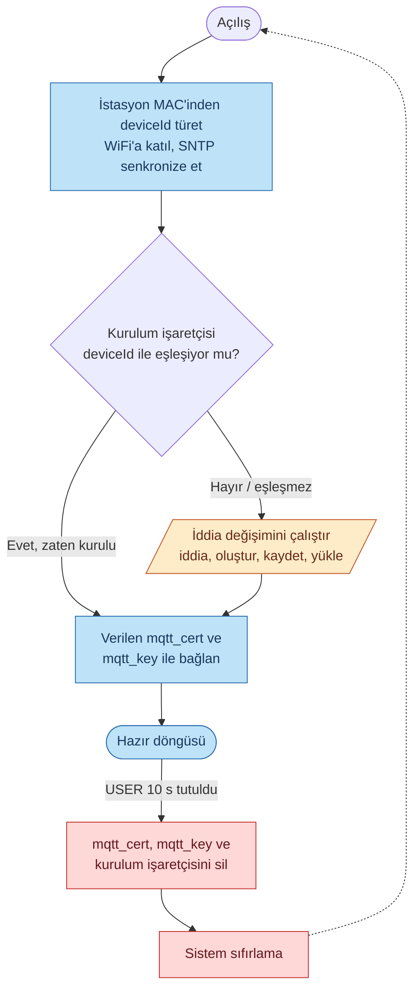
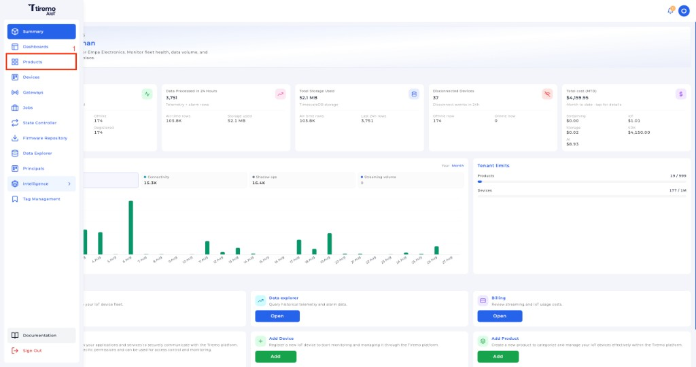
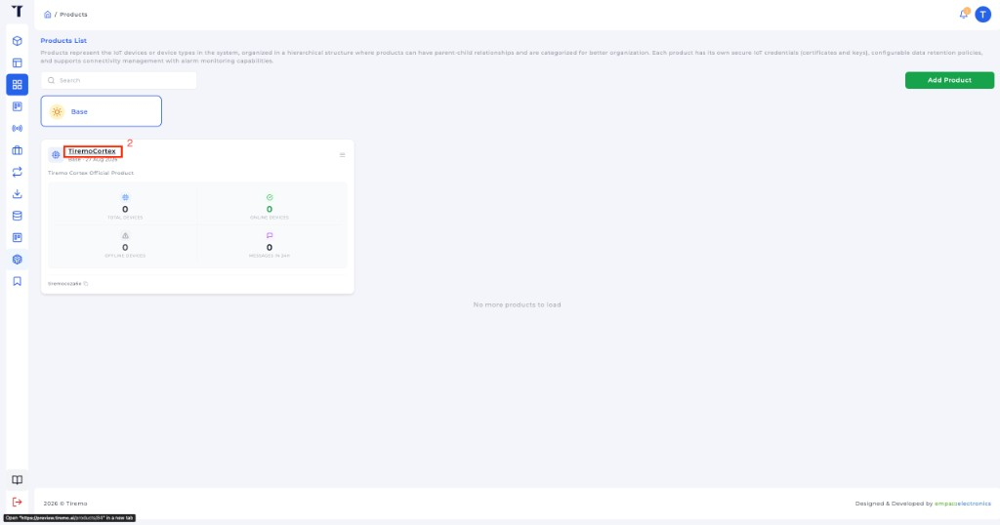
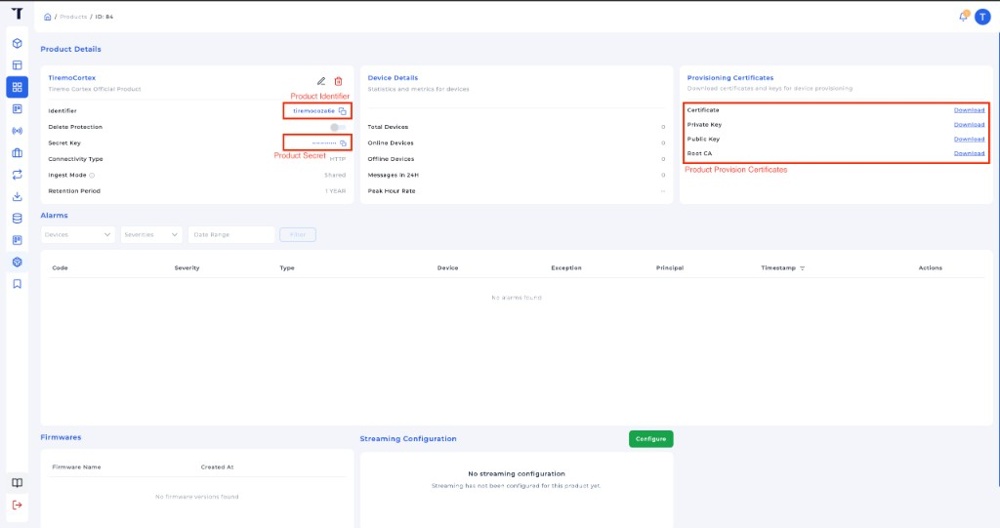
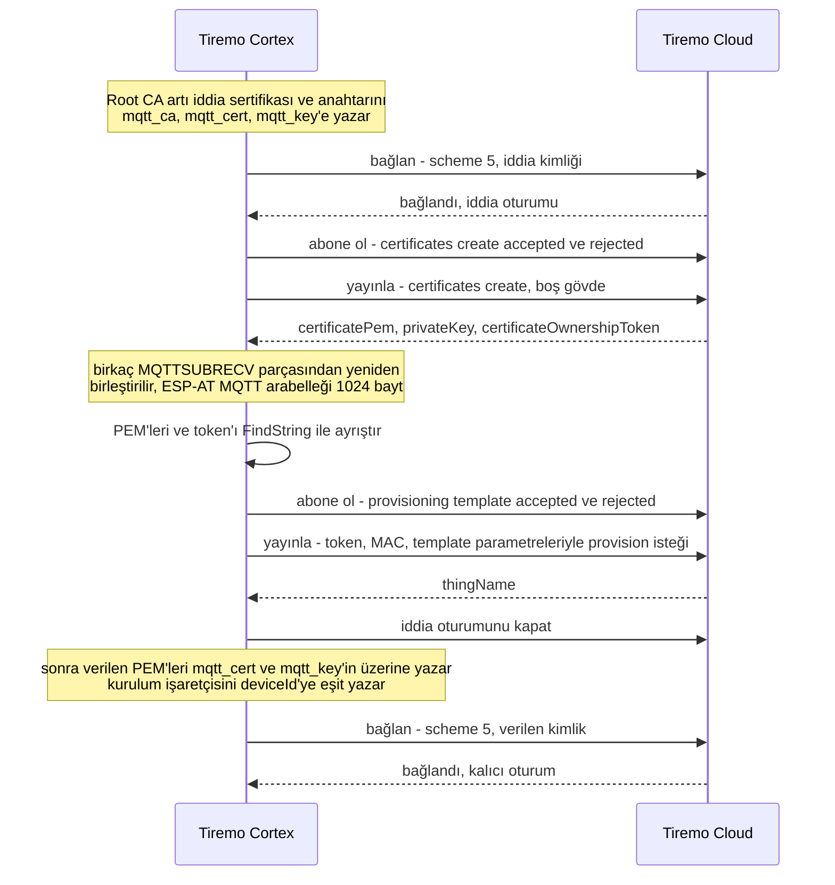

<p class="sphinxhide" align="right"><a href="../../../../Tiremo_Cloud/Feature_Tutorials/03-Fleet_Provisioning_By_Claim/README.md">English</a> | <a>Türkçe</a></p>
<table class="sphinxhide" width="100%">
  <tr>
    <td align="center">
      <picture>
        <source media="(prefers-color-scheme: dark)" srcset="../../../../images/tiremo_sub_brand_1_mono_white.png">
        
      </picture>
      <br>
      
    <h1>İddia Sertifikası ile Filo Kurulumu</h1>
      <sub>Tiremo Cortex Eğitimleri — ESP32 + Tiremo Cloud üretici yazılımı, ilk LED yanıp sönmesinden filoya hazır bir cihaza</sub>
    </td>
  </tr>
</table>


# Fleet Provisioning by Claim Certificate

***Kart: Tiremo Cortex (ESP32) · Bölüm: Tiremo Cloud / Feature Tutorials · Zorluk: Zor***

> Bu sayfa [İngilizce orijinalinin](../../../../Tiremo_Cloud/Feature_Tutorials/03-Fleet_Provisioning_By_Claim/README.md)
> Türkçe çevirisidir. Kod ve dosya yolları İngilizce kalır; içerik farklılaşırsa
> İngilizce sürüm esas alınır.

## Giriş

[Cloud Messaging 03](../../../../Cloud_Messaging/Feature_Tutorials/03-MQTT_mTLS_To_AWS_IoT/)
Tiremo Cloud (`iot.tiremo.ai`) uç noktasına karşı scheme-5 karşılıklı-TLS oturumunu
kanıtladı — tek bir Thing için elle oluşturduğunuz sertifika ile. Bu ölçeklenmez.
Bu eğitim o elle yapılmış kimliği claim-based fleet provisioning ile değiştirir:
kart bir kez paylaşılan, dar kapsamlı **iddia** (claim) sertifikasıyla bağlanır,
MQTT üzerinden benzersiz bir cihaz sertifikası ister, station MAC'ten türetilen
bir Thing kaydeder, verilen kimlik bilgilerini ESP32'nin kendi NVS'sine yazar
ve kendisi olarak yeniden bağlanır.

İkinci açılış bu değişimi atlamalıdır. Üretici yazılımı `deviceId`'ye eşit bir
kurulum işaretçisi (`tiremo` / `provisioned`) yazar; `TIREMO_Provision_IsDone()`
onu okur ve kalıcı yola geçer.

## Bütün Yaşam Döngüsü, Tek Bakışta



Bir kart, bu grafikte üç farklı yolculuk: **ilk açılış** (turuncu — iddia
değişimini bir kez çalıştırır), **sonraki her açılış** (mavi — verilen
kimlik bilgilerini doğrudan NVS'den okur, Tiremo Cloud kurulum uç noktasına hiç
ağ çağrısı yapmadan), ve bir **fabrika sıfırlama** (kırmızı — 10 s'lik bir
USER tutuşu verilen kimliği siler ve ilk açılışa geri döner).

## Neler Öğreneceksiniz

- İddia sertifikasının Cloud Messaging 03'ün Thing başına cihaz sertifikasından farkı — aynı `certs/` düzeni, farklı platform nesnesi
- İddia ile kurulum MQTT konuları: önce `CreateKeysAndCertificate`, sonra `RegisterThing`
- `deviceIdentifier`'ın MQTT istemci kimliği değil, [eğitim 01](../../../../Tiremo_Cloud/Feature_Tutorials/01-Device_Identity_From_MAC/)'in çıplak 12 hex MAC'i olduğu
- PEM-içinde-JSON'u [eğitim 02](../../../../Tiremo_Cloud/Feature_Tutorials/02-Minimal_JSON_Helpers/)'nin `FindString`'i ile ayrıştırmak (satır sonları kaçışlı gelir)
- Verilen sertifika/anahtarı `mqtt_cert` / `mqtt_key`'e ve tek seferlik işaretçiye yazmak
- 10 saniyelik USER düğmesi fabrika sıfırlaması (Getting Started 04'ün tutuşu, debounce yok) — slotları siler, kart yeniden iddia eder

## Önkoşullar

- [01-Device_Identity_From_MAC](../../../../Tiremo_Cloud/Feature_Tutorials/01-Device_Identity_From_MAC/) ve [02-Minimal_JSON_Helpers](../../../../Tiremo_Cloud/Feature_Tutorials/02-Minimal_JSON_Helpers/)
- [Cloud Messaging 03](../../../../Cloud_Messaging/Feature_Tutorials/03-MQTT_mTLS_To_AWS_IoT/) — scheme 5, bağlantıdan önce SNTP, `MQTTUSERCFG` → `MQTTSNI` → `MQTTCONN`, ve bu eğitimin kopyaladığı `certs/` gitignore deseni
- Ürününüz için **Tiremo UI** kimlik bilgileri: iddia sertifikası ve
  anahtarı, ürün kimliği ve ürün sırrı — bkz.
  [Tiremo UI'dan kimlik bilgileri](#tiremo-uidan-kimlik-bilgileri)
- Bu `Sw/` içinde `wifi_secrets.h` (gitignore'lu)
- [Getting Started](../../../../Getting_Started/) ile toolchain ve flaş

## Platform belgelendirmesi

Bu üretici yazılımı
[cihaz kurulumu](https://docs.tiremo.ai/device-provisioning/getting-started)
cihaz tarafını uygular:

- [Faz 1](https://docs.tiremo.ai/device-provisioning/first-phase) — bootstrap (iddia) sertifikası, ürün kimliği, ürün sırrı
- [Faz 2](https://docs.tiremo.ai/device-provisioning/second-phase) — filo kurulumu MQTT (`CreateKeysAndCertificate` / `RegisterThing`)
- [TLS SNI](https://docs.tiremo.ai/device-provisioning/tls-sni) — `iot.tiremo.ai` için `AT+MQTTSNI`
- [Faz 3](https://docs.tiremo.ai/device-provisioning/third-phase) — verilen kalıcı sertifika ile yeniden bağlanma
- İsteğe bağlı: [cihaz etiketleri](https://docs.tiremo.ai/device-provisioning/device-tags)

## `certs/` Klasörünü Anlamak (Gerçek ve Gitignore'lu)

Cloud Messaging 03 ile aynı üç dosya fikri. Gitignore'lu çift, cihaz başına
Thing sertifikası değil, paylaşılan **iddia** kimliğidir:

| Dosya | Commit'lendi mi? | Ne olduğu |
|---|---|---|
| [`certs/root_ca.pem`](../../../../Tiremo_Cloud/Feature_Tutorials/03-Fleet_Provisioning_By_Claim/Sw/certs/root_ca.pem) | Evet | **Amazon Root CA 1** — gerçekten public, her Tiremo Cloud hesabı için aynı, `https://www.amazontrust.com/repository/AmazonRootCA1.pem`'den. Tiremo Cloud sunucu sertifikasını (`iot.tiremo.ai`) doğrular. |
| `certs/claim_cert.pem.example` / `claim_key.pem.example` | Evet | Formatı gösteren yer tutucular. |
| `certs/claim_cert.pem` | **Hayır** (gitignore'lu) | Kısıtlı filo-kurulum politikasına bağlı paylaşılan iddia sertifikası. |
| `certs/claim_key.pem` | **Hayır** (gitignore'lu) | İddia sertifikasının özel anahtarı. Elinde olan herkes şablonunuzdan yeni cihaz sertifikası isteyebilir. |

Bu, `wifi_secrets.h` ile aynı desendir: gitignore'lu gerçek dosya, commit'li
`.example` şablon. İki `.example` dosyasını aynı klasörde `claim_cert.pem` ve
`claim_key.pem` olarak kopyalayıp gerçek iddia sertifikası ve anahtarını
yapıştırın — [`certs/README.md`](../../../../Tiremo_Cloud/Feature_Tutorials/03-Fleet_Provisioning_By_Claim/Sw/certs/README.md).
Bu iki dosya yoksa CMake yapılandırmayı reddeder; örnekleri sessizce gömmez.

Cloud Messaging 03'ün `device_cert.pem` / `device_key.pem` dosyalarını buraya
**kopyalamayın**. O çift elle yapılmış bir Thing kimliğidir. İddia sertifikası
farklı bir platform nesnesidir: IoT politikası yalnızca `iot:Connect` ve
`$aws/certificates/create/*` ile `$aws/provisioning-templates/<şablon>/provision/*`
konularında `iot:Publish`/`Subscribe` izin vermelidir — sıradan uygulama konuları değil.

Verilen cihaz sertifikası `certs/` içinde başlamaz. Tiremo Cloud onu CreateKeysAndCertificate
JSON'unda döner; üretici yazılımı doğrudan modülün `mqtt_cert` / `mqtt_key`
SYSMFG slotlarına yazar.

## Tiremo UI'dan kimlik bilgileri

İddia PEM'leri, ürün kimliği ve ürün sırrı **Tiremo UI**'da ürününüz
için verilir. Oradan indirin; uydurma değer kullanmayın. Şablon adı
varsayılanı `tiremo-default`'tur; aracı `iot.tiremo.ai`'dir.

**1. Sol menüden Products** öğesini açın.



*Şekil: Tiremo UI — ana menüden **Products** öğesine tıklayın.*

**2. Kurulum yapacağınız ürünü açın.** Zaten o ürünün sayfasındaysanız
bu adımı atlayın.



*Şekil: Tiremo UI — ürün adına tıklayarak açın.*

**3. Ürün sayfasından kimliği, sırrı ve kurulum sertifikalarını** kopyalayın.



*Şekil: Tiremo UI — solda **Identifier** ve **Secret Key**, sağda
**Provisioning Certificates**.*

O sayfada:

- **Identifier** → gitignore'lu `aws_iot_config.h` içinde `TIREMO_AWS_PRODUCT_IDENTIFIER`
- **Secret Key** → `TIREMO_AWS_PRODUCT_SECRET`. Bu dosyayı commit etmeyin; sırrı herkese açık bir issue veya sohbete yapıştırmayın.
- **Provisioning Certificates** → **Certificate** ve **Private Key** dosyalarını gitignore'lu `certs/claim_cert.pem` ve `certs/claim_key.pem` olarak indirin. Bu üretici yazılımı Amazon Root CA 1'i `certs/root_ca.pem` olarak zaten taşır; bu eğitim için UI'daki **Public Key** gerekmez.

Aynı bootstrap sertifikası, kimlik ve sır
[Faz 1: Önkoşullar ve üretim kurulumu](https://docs.tiremo.ai/device-provisioning/first-phase)
sayfasında anlatılır.

PEM olmayan dağıtım değerleri gitignore'lu `aws_iot_config.h` içindedir
(`aws_iot_config.h.example`'ı kopyalayın): uç nokta (`iot.tiremo.ai`),
şablon adı (başka kullanmıyorsanız `tiremo-default`), ürün kimliği,
ürün sırrı, `isGateway`. Kimlik ve sırrı yukarıdaki ürün sayfasından kopyalayın.

## Kurulum Sırasını Anlamak

Önce kimlik, sonra ağ, sonra iddia oturumu, en sonda verilen oturum.



```c
TIREMO_ESP32_GetHwEui(eui);
TIREMO_Identity_FromEui(eui, deviceId, sizeof(deviceId));
/* clientId = "<product>_<deviceId>" */

TIREMO_ESP32_JoinAP(...);
TIREMO_ESP32_EnableSntp();
TIREMO_ESP32_WaitSntpEpoch(&epoch, ...);   /* scheme 5 gerçek saat ister */

if (TIREMO_Provision_IsDone(deviceId)) {
    ConnectPermanent(clientId);
} else {
    TIREMO_Provision_Run(deviceId, clientId);
}
```

`TIREMO_Provision_Run()` tüm iddia değişimidir:

1. Amazon Root CA 1, iddia sertifikası ve iddia anahtarını `mqtt_ca` /
   `mqtt_cert` / `mqtt_key`'e yaz (`AT+SYSMFG=2`).
2. Scheme 5 ile bağlan: `MQTTUSERCFG` → `MQTTSNI` → `MQTTCONN`. Cloud
   Messaging 03 ile aynı sıra ve aynı SNTP gereksinimi.
3. `$aws/certificates/create/json/accepted` ve `.../rejected`'e abone ol,
   `$aws/certificates/create/json`'a `{}` yayınla.
4. `certificateOwnershipToken`, `certificatePem` ve `privateKey`'i eğitim
   02'nin `FindString`'i ile ayrıştır (PEM satır sonları `\n` olarak gelir).
5. RegisterThing gövdesini `JsonWriter` ile kur. `deviceIdentifier` çıplak
   MAC'tir (`30eda0806324`), `clientId` değil.
6. `$aws/provisioning-templates/<ad>/provision/json/accepted|rejected`'e
   abone ol, gövdeyi yayınla, `thingName` bekle.
7. Bağlantıyı kes, `mqtt_cert` / `mqtt_key`'i verilen PEM ile üzerine yaz,
   işaretçiyi yaz (`namespace tiremo`, key `provisioned` = `deviceId`).
8. Aynı `clientId` ile yeniden bağlan; artık verilen sertifikayı sunar.

RX halkası ve MQTT tutma tamponu 8192 bayttır. ESP-AT'nin kendi MQTT
tamponu 1024 bayttır; CreateKeysAndCertificate birkaç `+MQTTSUBRECV`
parçası olarak gelir. `prvWaitAccepted()` bunları nesne tamamlanana
kadar birleştirir.

## Fabrika Sıfırlama: 10 s USER Tutuşu

İşaretçi ve verilen sertifika ESP32 NVS'sindedir; MCU flaşı bunları silmez.
USER'ı 10 s tutun — [Getting Started 04](../../../../Getting_Started/04-Button_Read_And_Debounce/)
ile aynı ham basış, debounce yok. `mqtt_cert`, `mqtt_key` ve
`tiremo`/`provisioned` silinir, sonra `NVIC_SystemReset()`. Sonraki
açılış iddia değişimini yeniden çalıştırır.

## Çözüm

[`Sw/`](../../../../Tiremo_Cloud/Feature_Tutorials/03-Fleet_Provisioning_By_Claim/Sw/)
gerçek, derlenebilir bir uygulamadır:

```sh
cd Sw
cp wifi_secrets.h.example wifi_secrets.h
cp aws_iot_config.h.example aws_iot_config.h          # sonra uç nokta / şablon / ürün
cp certs/claim_cert.pem.example certs/claim_cert.pem  # sonra gerçek iddia sertifikası
cp certs/claim_key.pem.example certs/claim_key.pem    # sonra gerçek iddia anahtarı
tdf.py build
tdf.py flash
tdf.py monitor
```

`tdf.py build` iki iddia PEM dosyası varken temiz bağlar (`.text` 27944).
Bu dosyalar yokken CMake yapılandırmaz.

Taban: Cloud Messaging 03'ün WiFi + scheme-5 MQTT + SYSMFG sürücüsü, artı
eğitim 01'in `GetHwEui` / `Identity_FromEui` ve eğitim 02'nin JSON
yardımcıları. Bu `Sw/`'de yeni: `tiremo_provision.c` ve
`TIREMO_ESP32_CREDSLOT_PROV_MARKER` slotu.

Gerçek iddia kimlik bilgileri ve canlı bir şablonla ilk açılış iddia
bağlantısını, create/register değişimini, sonra kalıcı yeniden bağlantıyı
loglamalıdır. Bir reset sonrası işaretçi eşleşir ve MQTT değişimi atlanır.

create/register gidiş-dönüşünün donanımda doğrulanması `certs/` ve
`aws_iot_config.h` içinde gerçek bir iddia sertifikası ve şablon ister —
bu dosyalar gitignore'ludur ve bu depo ile gelmez. `claim_cert.pem` ve
`claim_key.pem` yokken CMake yapılandırmaz.

## Adım Adım

1. [`certs/`](../../../../Tiremo_Cloud/Feature_Tutorials/03-Fleet_Provisioning_By_Claim/Sw/certs/) — Amazon Root CA 1 commit'li; iddia PEM şablonları commit'li; gerçek iddia dosyaları gitignore'lu, Cloud Messaging 03'ün `device_*.pem` ile aynı.
2. [`prv_user_code.c`](../../../../Tiremo_Cloud/Feature_Tutorials/03-Fleet_Provisioning_By_Claim/Sw/Src/prv_user_code.c) — MAC → `deviceId` / `clientId`, WiFi, SNTP, sonra `IsDone` veya `Run`. 10 s USER tutuşu verilen kimliği sıfırlar.
3. [`tiremo_provision.c`](../../../../Tiremo_Cloud/Feature_Tutorials/03-Fleet_Provisioning_By_Claim/Sw/Common/Src/tiremo_provision.c) — iddia bağlantısı, create, ayrıştırma, register, kurulum, işaretçi, yeniden bağlanma, `FactoryReset` silme.
4. [`tiremo_esp32.c`](../../../../Tiremo_Cloud/Feature_Tutorials/03-Fleet_Provisioning_By_Claim/Sw/Drivers/esp32/Src/tiremo_esp32.c) — işaretçi slotu `tiremo`/`provisioned`; MQTT RX tamponu PEM JSON için boyutlandırıldı.

## Bittiğinde

Fabrika taze bir kart, konsolda elle sertifika adımı olmadan benzersiz adlı
bir Thing'e kendini kurar, verilen kimlik bilgilerini modül NVS'sine
yazar ve sonraki açılışta kurulumu atlar. USER'ı 10 s tutmak o kimliği siler;
sonraki açılış yeniden iddia eder.

<p align="center"></p>

<p class="sphinxhide" align="center"><sub>Tiremo Cortex Tutorials — Empa Electronics</sub></p>
