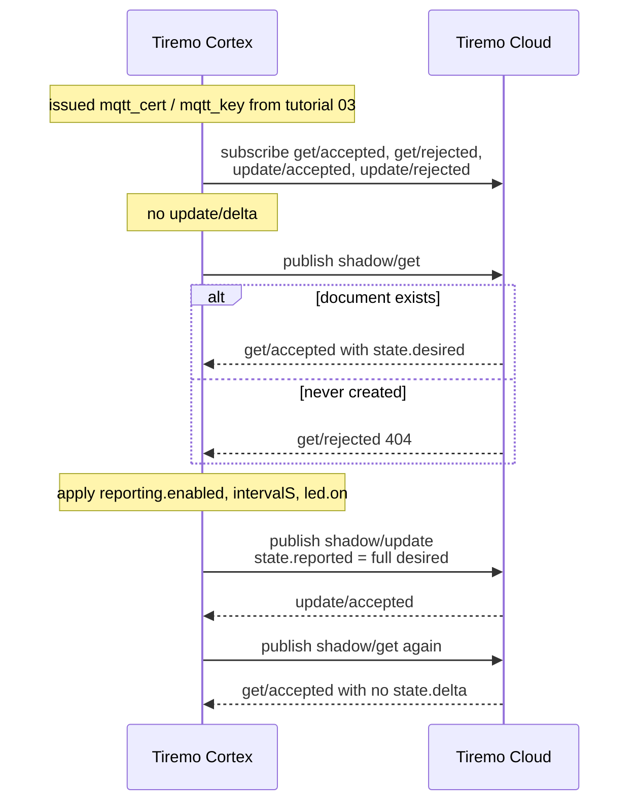
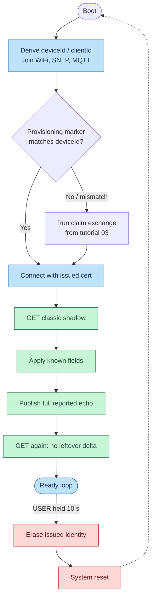

<p class="sphinxhide" align="right"><a href="../../../../Tiremo_Cloud/Feature_Tutorials/04-Shadow_Get_Apply_Report/README.md">English</a> | <a>Türkçe</a></p>
<table class="sphinxhide" width="100%">
  <tr>
    <td align="center">
      <picture>
        <source media="(prefers-color-scheme: dark)" srcset="../../../../images/tiremo_sub_brand_1_mono_white.png">
        
      </picture>
      <br>
      
      <h1>Shadow Get + Apply + Report</h1>
      <sub>Tiremo Cortex Eğitimleri — ESP32 + Tiremo Cloud üretici yazılımı, ilk LED yanıp sönmesinden filoya hazır bir cihaza</sub>
    </td>
  </tr>
</table>


# Shadow Get + Apply + Report

***Kart: Tiremo Cortex (ABOV A34G43A, Cortex-M4) · Bölüm: Tiremo Cloud / Feature Tutorials · Zorluk: Zor***

> Bu sayfa [İngilizce orijinalinin](../../../../Tiremo_Cloud/Feature_Tutorials/04-Shadow_Get_Apply_Report/README.md)
> Türkçe çevirisidir. Kod ve dosya yolları İngilizce kalır; içerik farklılaşırsa
> İngilizce sürüm esas alınır.

## Giriş

[Eğitim 03](../03-Fleet_Provisioning_By_Claim/README.md), kartı ESP32'nin
NVS'inde duran, kendine özel verilmiş bir kimlikle bıraktı. Bu eğitimde
kart, o kimliği ilk uygulama MQTT trafiği için kullanır. Açılışta klasik
Device Shadow'u alır, tanıdığı alanları uygular ve Tiremo Cloud'un
delta'yı temizleyebilmesi için `state.reported` yayınlar.

Sık yapılan bir hata, yalnızca değişen anahtarı raporlamaktır. Tiremo
Cloud delta'yı *desired eksi reported* olarak hesaplar. Desired iç içe
bir nesneyse (`reporting`, `led`, `note`) ve reported yalnızca
`{"reporting":{"enabled":true}}` ise, diğer anahtarlar delta'da sonsuza
kadar kalır. Bu üretici yazılımı desired nesnesinin **tamamını**, iç içe
alanlar dahil, `TIREMO_JsonWriter_Raw` ile geri yansıtır.

Bu eğitim `shadow/update/delta`'ya abone **olmaz**; o sürekli abonelik
[eğitim 05](../05-Live_Shadow_Delta_Handling/README.md)'in konusudur.
Burada alışveriş her açılışta bir kez çalışır: al, uygula, raporla,
doğrula, sonra bekle.

## Alışveriş, Tek Bakışta





## Neler Öğreneceksiniz

- Klasik shadow istek/yanıtı: `shadow/get` → `get/accepted` (veya `get/rejected`)
- Reported'ın neden yalnızca değişen anahtarları değil, desired nesnesinin *tamamını* yansıtması gerektiği
- Bir `FindObject` dilimini yazıcıya kopyalamanın ucuz yolu olarak `TIREMO_JsonWriter_Raw`
- Parçalı gelen bir `get/accepted`'ı, eğitim 03'ün CreateKeysAndCertificate'i birleştirdiği şekilde birleştirmek (ESP-AT MQTT tamponu 1024 bayt)
- `update/delta`'yı açmadan, ikinci bir get ile delta'nın kalmadığını doğrulamak

## Ön Koşullar

- [03-Fleet_Provisioning_By_Claim](../03-Fleet_Provisioning_By_Claim/README.md) — paylaşılan claim sertifikası değil, kendine özel verilmiş bir kimlik. 03'ten sonra `tiremo` / `provisioned` işaretçisi bu kartla zaten eşleşir, bu yüzden bu üretici yazılımı claim alışverişini atlar.
- [02-Minimal_JSON_Helpers](../02-Minimal_JSON_Helpers/README.md) — `FindObject` / `FindBool` / `FindUint` ve yazıcı
- Bu `Sw/` içinde eğitim 03 ile aynı dört gitignore'lu dosya — bkz. [Kimlik bilgileri](#kimlik-bilgileri)
- [Getting Started](../../../Getting_Started/) bölümündeki kurulum betikleri çalıştırılmış olmalı, böylece `tdf` kullanılabilir
- Logu izlemek için: `tdf monitor` veya herhangi bir seri terminal (Tera Term, PuTTY, screen, minicom, …), kartın USB seri portunda 115200 8N1
- Bilgisayarınıza USB kablosuyla bağlı bir Tiremo Cortex kartı (ABOV A34G43A MCU — bkz. [Donanım Genel Bakışı](../../../Hardware.md))

## Platform dökümanı

Klasik Device Shadow (al / uygula / raporla, kalan delta)
[Device State Controller](https://docs.tiremo.ai/device-state-controller/introduction)
ve [cihaz üretici yazılımı entegrasyonu](https://docs.tiremo.ai/device-state-controller/device-integration)
sayfalarında anlatılır. Bu açılış yolunun kullandığı verilmiş kimlik
[fleet provisioning](https://docs.tiremo.ai/device-provisioning/getting-started)
sürecinden gelir.

## Thing Adı ile Client ID'yi Anlamak

Shadow topic'leri MQTT client ID'ye göre değil, **Thing**'e göre adlandırılır:

```text
$aws/things/<thingName>/shadow/get
$aws/things/<thingName>/shadow/get/accepted
$aws/things/<thingName>/shadow/get/rejected
$aws/things/<thingName>/shadow/update
```

Eğitim 03, RegisterThing'in döndürdüğü `thingName`'i saklamaz. Bu
üretici yazılımı `thingName` olarak MQTT client ID'yi
(`<product>_<deviceId>`) kullanır. Varsayılan `tiremo-default`
şablonunun kaydettiği ad budur (eğitim 03'ün logunda
`registered Thing <product>_<deviceId>` görünür).

Şablonunuz Thing'i farklı adlandırıyorsa, örneğin çıplak 12 hex MAC ile,
`aws_iot_config.h` içinde `TIREMO_AWS_THING_NAME`'i o ada ayarlayın.
Yanlış Thing için `404` dönen bir get ya da shadow topic'lerinde MQTT
`not authorized` hatası genellikle adın eşleşmediği anlamına gelir.

## Tam Yansıtılan Reported'ı Anlamak

Gerçekçi bir desired belgesi (eğitim 02'nin zaten ayrıştırdığı şekil):

```json
{
  "reporting": { "enabled": true, "intervalS": 60 },
  "led": { "on": false },
  "note": "colon:not-a-key"
}
```

Uygulama adımı `reporting.enabled`, `reporting.intervalS` ve `led.on`'u
okur. Bu eğitimde "uygulama" yalnızca okuduğu değerleri loglar
(`shadow: applied ...`); bir LED sürmez. Shadow'dan çıkışları sürmek
[Design 01](../../Design_Tutorials/01-Sensor_Telemetry_And_Shadow_Control/README.md)'in konusudur.

Raporlama bu üç anahtarı yeniden **kurmaz**. Desired nesnesinin
tamamını, `note` dahil, `TIREMO_JsonWriter_Raw` ile `state.reported`
içine kopyalar. Tiremo Cloud desired == reported görür ve bir sonraki
get'te `state.delta`'yı yazmaz.

Desired yoksa (boş bir shadow ya da ilk get'te 404), üretici yazılımı
belgenin bir reported durumu olsun diye varsayılan
`{reporting:{enabled:true,intervalS:60},led:{on:false}}` raporlar.

Demo belgesini küçük tutun. ESP-AT, 1024 bayttan büyük her şeyi, sertifika
oluşturma PEM'ini böldüğü gibi birkaç mesaja böler; buradaki birleştirme
tamponu 8 KB'tır.

## Çözüm

### Kimlik bilgileri

Bu `Sw/`, eğitim 03 ile aynı dört gitignore'lu dosyaya ihtiyaç duyar.
En kolayı onları eğitim 03'ün `Sw/`'sinden kopyalamaktır:

- **`wifi_secrets.h`**: WiFi SSID'niz ve şifreniz (`wifi_secrets.h.example`'dan).
- **`aws_iot_config.h`**: ürününüzün **Identifier**'ı ve **Secret Key**'i (`aws_iot_config.h.example`'dan). Bu eğitimin örneği isteğe bağlı bir `TIREMO_AWS_THING_NAME` ekler; client ID'nin kullanılması için tanımlamayın veya boş bırakın.
- **`certs/claim_cert.pem`** ve **`certs/claim_key.pem`**: yeniden adlandırılmış **Provisioning Certificates** — bkz. [`certs/README.md`](../../../../Tiremo_Cloud/Feature_Tutorials/04-Shadow_Get_Apply_Report/Sw/certs/README.md). Kart bunları yalnızca henüz verilmiş bir kimliği yoksa (fabrikadan yeni veya 10 sn USER basılı tutulduktan sonra) kullanır, ama derleme her durumda bunlara ihtiyaç duyar.

Dört ad da gitignore'ludur; yine de commit etmeden önce `git status` ile kontrol edin. Biri eksikse derleme, ne yapılacağını söyleyen bir mesajla durur. Değerlerin Tiremo UI'da nerede olduğu: [eğitim 03](../03-Fleet_Provisioning_By_Claim/README.md#tiremo-uidan-kimlik-bilgileri).

### Derle, yükle, izle

Depo kök dizininden:

```sh
cd Tiremo_Cloud/Feature_Tutorials/04-Shadow_Get_Apply_Report/Sw
tdf build
tdf flash
tdf monitor
```

(`tdf`'nin ne olduğu için [Getting_Started/01-Hello_Blink'in Çözüm bölümüne](../../../Getting_Started/01-Hello_Blink/README.md#çözüm) bakın. macOS/Linux'ta `tdf.py` de takma ad olarak çalışır; Windows'ta `tdf` kullanın. `tdf monitor` çalıştırmadan önce kartın seri portundaki diğer terminalleri kapatın — port aynı anda yalnızca bir program tarafından açılabilir.)

**Gerçek donanımda doğrulandı:** `tdf build` macOS ve Windows 11'de hatasız derler ve bağlar (`.text` yaklaşık 34 KB; tam boyut araç zinciri sürümüne göre biraz değişir ve bağlayıcı, [01-Hello_Blink'in Çözüm bölümünde](../../../Getting_Started/01-Hello_Blink/README.md#çözüm) açıklanan aynı beklenen, zararsız `_close` / `_lseek` / `_read` / `_write is not implemented` uyarılarını yazdırır). `tdf flash`, bağlı gerçek bir Tiremo Cortex kartında SWD üzerinden tam bir programlama ve doğrulama döngüsünü tamamladı (`** Verified OK **`). Kart eğitim 03 ile provision edilmişti, bu yüzden claim alışverişini atlayıp doğrudan shadow'a geçti. Aşağıda ürün tanımlayıcısı ve kartın MAC adresi yer tutucularla değiştirilmiştir:

```text
[INFO] Shadow_Get_Apply_Report: boot
[INFO] hold USER 10000 ms to factory-reset (erase issued cert + marker)
[INFO] ESP32: power cycling module...
[INFO] ESP32: power-on boot delay elapsed
[INFO] TIREMO_ESP32_Init: UART2 ready
[INFO] ESP32: command echo disabled (ATE0)
[INFO] identity: deviceId=<deviceId> clientId=<product>_<deviceId> thingName=<product>_<deviceId>
[INFO] ESP32: online, SNTP epoch=...
[INFO] provision: marker matches <deviceId>
[INFO] provision: already done; using permanent credentials
[INFO] shadow: thingName=<product>_<deviceId>
[INFO] shadow: subscribe get/accepted get/rejected (no update/delta)
[INFO] shadow: get
[INFO] shadow: MQTT RX topic=$aws/things/<product>_<deviceId>/shadow/get/accepted frag=696 accum=696
[INFO] shadow: desired 88 bytes
[INFO] shadow: applied reporting.enabled=true intervalS=1 led.on=false
[INFO] shadow: update reported (146 bytes, full desired echo)
[INFO] shadow: MQTT RX topic=$aws/things/<product>_<deviceId>/shadow/update/accepted frag=398 accum=398
[INFO] shadow: update accepted
[INFO] shadow: get again to confirm delta is gone
[INFO] shadow: MQTT RX topic=$aws/things/<product>_<deviceId>/shadow/get/accepted frag=696 accum=696
[INFO] shadow: no leftover delta
[INFO] shadow: ready thingName=<product>_<deviceId> (no live delta; that is tutorial 05)
```

`ready` satırı 10 sn'de bir tekrarlanır. Bayt sayıları shadow'unuzda ne
olduğuna bağlıdır. Thing'in henüz bir shadow belgesi yoksa, ilk get
`desired N bytes` yerine `shadow: no document yet (404); will report defaults`
loglar ve sonraki açılış `get/accepted` görür.

Daha zengin bir desired belgesi denemek için: Tiremo UI'da Thing'in
klasik shadow desired'ını yukarıdaki örnek nesneye ayarlayın, kartı
sıfırlayın ve `desired N bytes` ardından `no leftover delta` geldiğini
kontrol edin. Rapordan sonra konsoldaki delta boş olmalıdır.

## Adım Adım İnceleme

1. [`prv_user_code.c`](../../../../Tiremo_Cloud/Feature_Tutorials/04-Shadow_Get_Apply_Report/Sw/Src/prv_user_code.c) — 03 ile aynı kimlik /
   WiFi / SNTP / provision-veya-atla yolu, ardından
   `TIREMO_Shadow_GetApplyReport(thingName)`. USER'ı 10 sn basılı tutmak
   verilen kimliği hâlâ siler (fabrika sıfırlaması).
2. [`tiremo_shadow.c`](../../../../Tiremo_Cloud/Feature_Tutorials/04-Shadow_Get_Apply_Report/Sw/Common/Src/tiremo_shadow.c) — topic'ler, get,
   uygulama, tam yansıtmalı rapor, doğrulama get'i. `update/delta` aboneliği yok.
3. [`tiremo_json.c`](../../../../Tiremo_Cloud/Feature_Tutorials/04-Shadow_Get_Apply_Report/Sw/Common/Src/tiremo_json.c) — `JsonWriter_Raw`,
   bu eğitimin 02'nin üzerine eklediği tek yeni yardımcı.
4. [`aws_iot_config.h.example`](../../../../Tiremo_Cloud/Feature_Tutorials/04-Shadow_Get_Apply_Report/Sw/aws_iot_config.h.example) — şablonun
   Thing adı client ID değilse kullanılan isteğe bağlı `TIREMO_AWS_THING_NAME`.
5. [`tiremo_esp32.c`](../../../../Tiremo_Cloud/Feature_Tutorials/04-Shadow_Get_Apply_Report/Sw/Drivers/esp32/Src/tiremo_esp32.c) — 03 ile aynı
   sürücü; DEBUG dökümünde WiFi şifresi gizlenir
   (`AT+CWJAP=<credentials hidden>`).

## Tamamlanma Ölçütü

- Açılıştaki GET en az `reporting.enabled`'ı uygular ve `shadow: applied ...` loglar.
- Yayınlanan `reported`, desired nesnesinin tamamını iç içe alanlarla birlikte yansıtır ve log `shadow: update accepted` gösterir.
- İkinci GET'te `state.delta` yoktur ve log `shadow: no leftover delta` gösterir.

Kart hazır döngüsündeyken desired'ı değiştirmek bir sonraki sıfırlamaya
kadar hiçbir şey yapmaz; buna canlı tepki vermek eğitim 05'in konusudur.

<p align="center"></p>

<p class="sphinxhide" align="center"><sub>Tiremo Cortex Eğitimleri — Empa Electronics</sub></p>
