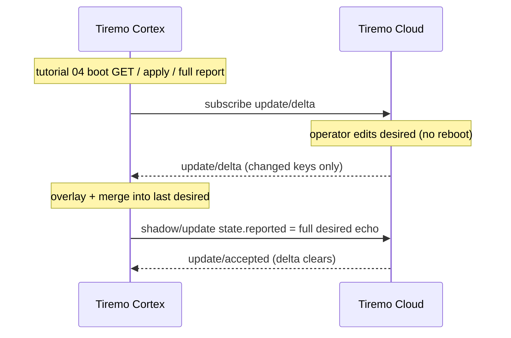
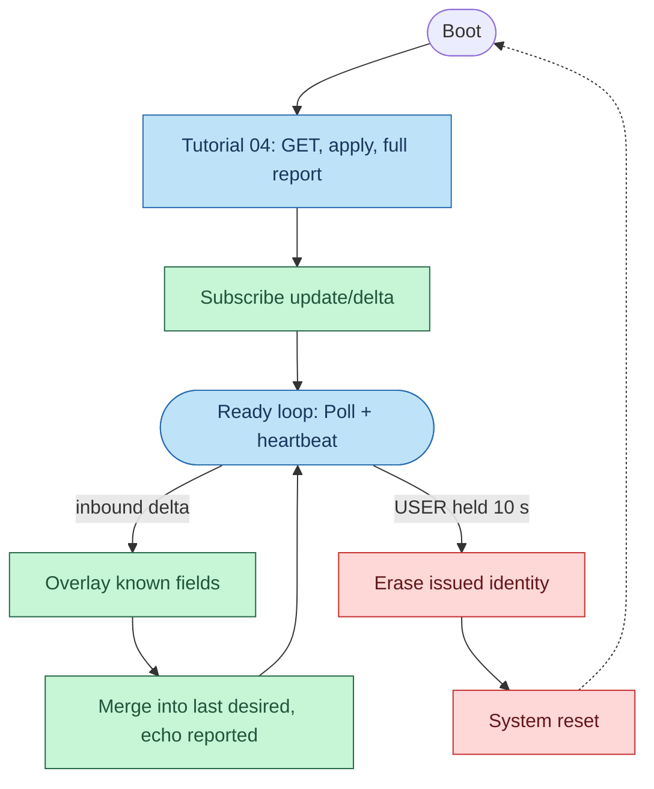
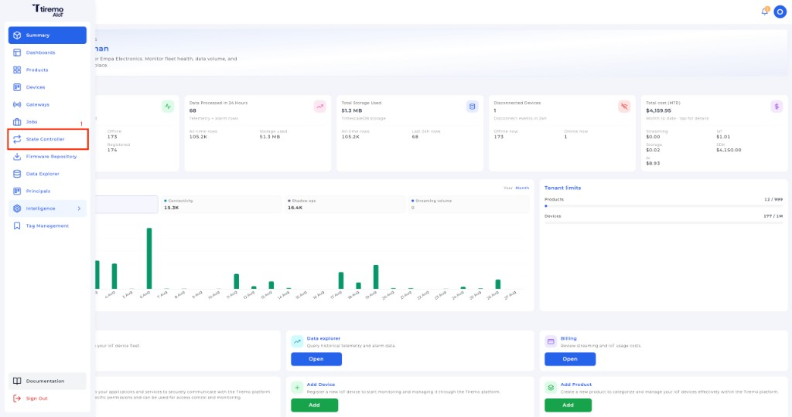
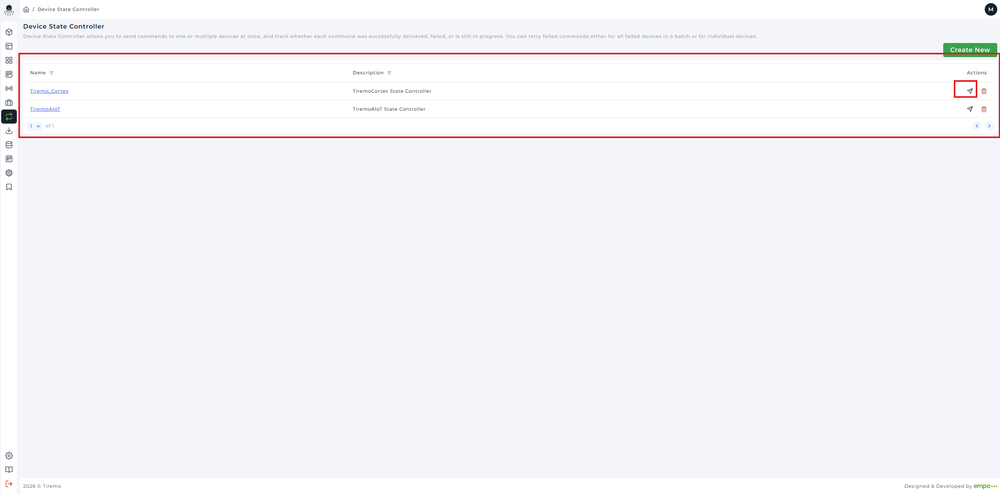
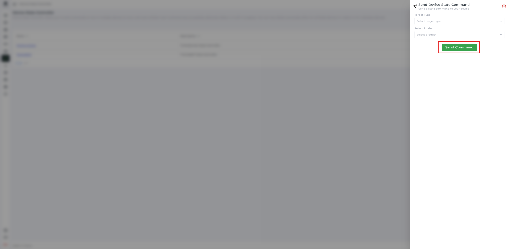
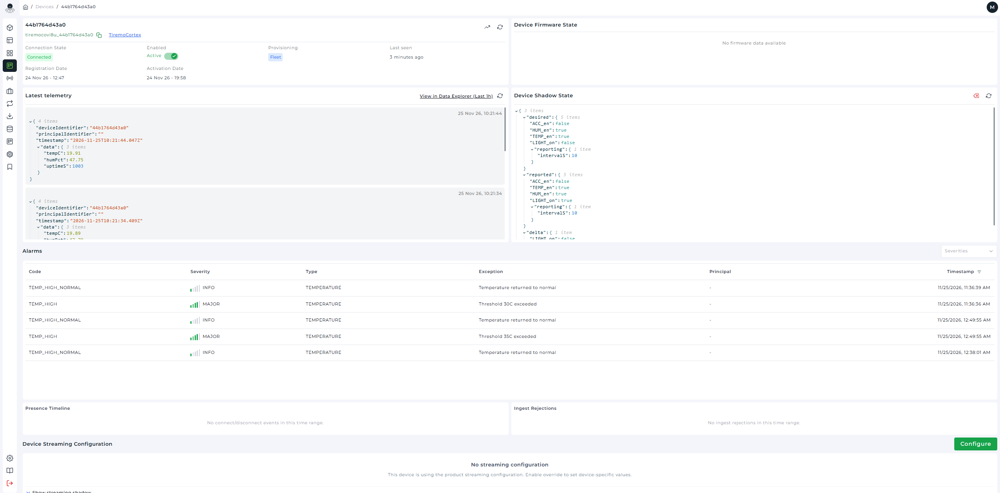
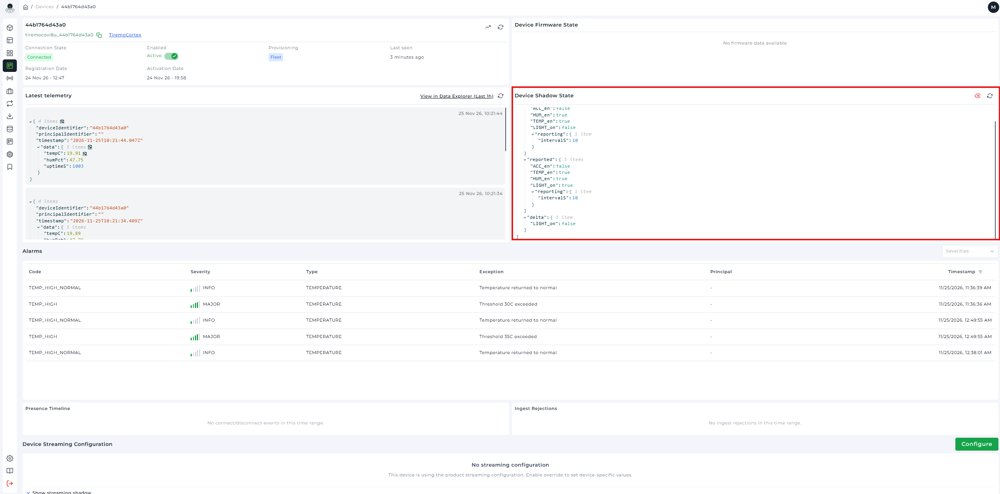

<p class="sphinxhide" align="right"><a href="../../../../Tiremo_Cloud/Feature_Tutorials/05-Live_Shadow_Delta_Handling/README.md">English</a> | <a>Türkçe</a></p>
<table class="sphinxhide" width="100%">
  <tr>
    <td align="center">
      <picture>
        <source media="(prefers-color-scheme: dark)" srcset="../../../../images/tiremo_sub_brand_1_mono_white.png">
        
      </picture>
      <br>
      
      <h1>Live Shadow Delta Handling</h1>
      <sub>Tiremo Cortex Eğitimleri — ESP32 + Tiremo Cloud üretici yazılımı, ilk LED yanıp sönmesinden filoya hazır bir cihaza</sub>
    </td>
  </tr>
</table>


# Live Shadow Delta Handling

***Kart: Tiremo Cortex (ABOV A34G43A, Cortex-M4) · Bölüm: Tiremo Cloud / Feature Tutorials · Zorluk: Zor***

> Bu sayfa [İngilizce orijinalinin](../../../../Tiremo_Cloud/Feature_Tutorials/05-Live_Shadow_Delta_Handling/README.md)
> Türkçe çevirisidir. Kod ve dosya yolları İngilizce kalır; içerik farklılaşırsa
> İngilizce sürüm esas alınır.

## Giriş

[Eğitim 04](../04-Shadow_Get_Apply_Report/README.md) desired durumu bir
kez, açılışta uygular. Gerçek bir kontrol düzlemi ise cihaz çalışırken
`desired`'ı değiştirir. Tiremo Cloud farkı
`$aws/things/<thingName>/shadow/update/delta` üzerinde yayınlar. Bu
eğitim 04'ün açılıştaki GET / uygula / raporla adımlarını korur, ardından
bu sürekli aboneliği ekler ve gelen her delta'yı yeniden başlatmadan
uygular.

04'ün dersi hâlâ geçerlidir. Bir delta belgesi yalnızca farklı olan
anahtarları içerir. Yalnızca o anahtarları raporlamak ya da yalnızca
`reporting` ve `led`'i yeniden kurmak, desired'daki diğer her anahtarı
(`note`, iç içe ek alanlar, …) delta'da sonsuza kadar bırakır. Tiremo
Cloud her rapordan sonra `update/delta`'yı yeniden yayınlar ve log hiç
temizlenmeyen delta'larla dolar. Canlı yol, tanıdığı alanları uygular,
delta'yı son tam desired nesnesiyle birleştirir ve bu nesnenin tamamını
`reported` olarak geri yansıtır.

## Alışveriş, Tek Bakışta





## Neler Öğreneceksiniz

- Tek seferlik `shadow/get`'ten farklı, sürekli bir abonelik olarak `shadow/update/delta`
- Delta yükündeki `state`'in neden `{desired, reported, delta}` değil, kısmi desired farkının *kendisi* olduğu
- Canlı bir değişikliğin arkasında delta bırakmaması için 04'ün uygulama ve tam desired yansıtma adımlarını yeniden kullanmak
- 10 sn USER fabrika sıfırlaması çalışmaya devam etsin diye MQTT'yi hazır döngüsünde yoklamak

## Ön Koşullar

- [04-Shadow_Get_Apply_Report](../04-Shadow_Get_Apply_Report/README.md) — açılıştaki GET / uygula / tam rapor, Thing adı ve 03'ten gelen verilmiş kimlik
- Bu `Sw/` içinde 04 ile aynı dört gitignore'lu dosya — bkz. [Kimlik bilgileri](#kimlik-bilgileri)
- [Getting Started](../../../Getting_Started/) bölümündeki kurulum betikleri çalıştırılmış olmalı, böylece `tdf` kullanılabilir
- Logu izlemek için: `tdf monitor` veya herhangi bir seri terminal (Tera Term, PuTTY, screen, minicom, …), kartın USB seri portunda 115200 8N1
- Bilgisayarınıza USB kablosuyla bağlı bir Tiremo Cortex kartı (ABOV A34G43A MCU — bkz. [Donanım Genel Bakışı](../../../Hardware.md))

## Platform dökümanı

Canlı `update/delta`,
[Device State Controller](https://docs.tiremo.ai/device-state-controller/introduction)'ın
üretici yazılımı tarafıdır (ayrıca bkz. [cihaz entegrasyonu](https://docs.tiremo.ai/device-state-controller/device-integration)).
Operatörler desired'ı Tiremo UI'da değiştirir; bu eğitim onu yeniden
başlatmadan uygular.

## `update/delta`'yı Anlamak

Yalnızca LED değiştiğinde klasik shadow delta'sı şöyle görünür:

```json
{
  "version": 12,
  "timestamp": 1787785000,
  "state": {
    "led": { "on": true }
  }
}
```

Buradaki `state`, get/accepted zarfı **değildir**; iç içe bir `desired`
yoktur. Bu dilimi `reported` olarak `JsonWriter_Raw`'a vermek
`{"led":{"on":true}}` yayınlar ve Tiremo Cloud `reporting`'i (ve
desired'daki diğer her anahtarı) delta'da tutar.

Yalnızca bilinen üç anahtarı yeniden kurmak da aynı sorunu doğurur:
desired'daki başka her anahtar hiç eşleşmez, bu yüzden `update/delta`
hiç temizlenmez.

Bu üretici yazılımı açılıştaki GET'ten gelen son tam desired nesnesini
saklar. Her delta'da:

1. delta içeriyorsa `reporting.*` / `led.on` güncellenir ve uygulanan
   değerler loglanır,
2. delta, saklanan desired nesnesiyle derinlemesine birleştirilir
   (`null` değeri anahtarı siler),
3. birleştirilmiş nesne `JsonWriter_Raw` ile `reported` olarak geri
   yansıtılır.

Birleştirilmiş desired son yayınlanana bayt bayt eşitse rapor atlanır,
böylece kalan bir delta döngüye giremez.

`update/delta`'ya açılıştaki yansıtmadan **sonra** abone olunur. Daha
erken abone olmak, açılış yolu get/accepted veya update/accepted
beklerken bir delta mesajını okuyup atmasına yol açardı.

Thing adı 04 ile aynı kurala uyar: `TIREMO_AWS_THING_NAME` tanımlı
değilse MQTT client ID (`<product>_<deviceId>`).

## Çözüm

### Kimlik bilgileri

Bu `Sw/`, eğitim 04 ile aynı dört gitignore'lu dosyaya ihtiyaç duyar.
En kolayı onları eğitim 04'ün `Sw/`'sinden kopyalamaktır:

- **`wifi_secrets.h`**: WiFi SSID'niz ve şifreniz (`wifi_secrets.h.example`'dan).
- **`aws_iot_config.h`**: ürününüzün **Identifier**'ı ve **Secret Key**'i (`aws_iot_config.h.example`'dan) ve isteğe bağlı `TIREMO_AWS_THING_NAME`.
- **`certs/claim_cert.pem`** ve **`certs/claim_key.pem`**: yeniden adlandırılmış **Provisioning Certificates** — bkz. [`certs/README.md`](Sw/certs/README.md).

Dört ad da gitignore'ludur; yine de commit etmeden önce `git status` ile kontrol edin. Biri eksikse derleme, ne yapılacağını söyleyen bir mesajla durur. Değerlerin Tiremo UI'da nerede olduğu: [eğitim 03](../03-Fleet_Provisioning_By_Claim/README.md#tiremo-uidan-kimlik-bilgileri).

### Derle, yükle, izle

Depo kök dizininden:

```sh
cd Tiremo_Cloud/Feature_Tutorials/05-Live_Shadow_Delta_Handling/Sw
tdf build
tdf flash
tdf monitor
```

(`tdf`'nin ne olduğu için [Getting_Started/01-Hello_Blink'in Çözüm bölümüne](../../../Getting_Started/01-Hello_Blink/README.md#çözüm) bakın. macOS/Linux'ta `tdf.py` de takma ad olarak çalışır; Windows'ta `tdf` kullanın. `tdf monitor` çalıştırmadan önce kartın seri portundaki diğer terminalleri kapatın — port aynı anda yalnızca bir program tarafından açılabilir.)

**Gerçek donanımda doğrulandı:** `tdf build` macOS ve Windows 11'de hatasız derler ve bağlar (`.text` yaklaşık 36 KB; tam boyut araç zinciri sürümüne göre biraz değişir ve bağlayıcı, [01-Hello_Blink'in Çözüm bölümünde](../../../Getting_Started/01-Hello_Blink/README.md#çözüm) açıklanan aynı beklenen, zararsız `_close` / `_lseek` / `_read` / `_write is not implemented` uyarılarını yazdırır). `tdf flash`, bağlı gerçek bir Tiremo Cortex kartında SWD üzerinden tam bir programlama ve doğrulama döngüsünü tamamladı (`** Verified OK **`). Kart eğitim 03 ile provision edilmişti; claim alışverişini atladı, 04'ün açılıştaki GET / tam rapor adımlarını çalıştırdı ve ardından `update/delta`'ya abone oldu. Aşağıda ürün tanımlayıcısı ve kartın MAC adresi yer tutucularla değiştirilmiştir:

```text
[INFO] Live_Shadow_Delta: boot
[INFO] hold USER 10000 ms to factory-reset (erase issued cert + marker)
[INFO] ESP32: power cycling module...
[INFO] ESP32: power-on boot delay elapsed
[INFO] TIREMO_ESP32_Init: UART2 ready
[INFO] ESP32: command echo disabled (ATE0)
[INFO] identity: deviceId=<deviceId> clientId=<product>_<deviceId> thingName=<product>_<deviceId>
[INFO] ESP32: online, SNTP epoch=...
[INFO] provision: marker matches <deviceId>
[INFO] provision: already done; using permanent credentials
[INFO] shadow: thingName=<product>_<deviceId>
[INFO] shadow: subscribe get/accepted get/rejected (delta after boot report)
[INFO] shadow: get
[INFO] shadow: MQTT RX topic=$aws/things/<product>_<deviceId>/shadow/get/accepted frag=696 accum=696
[INFO] shadow: desired 88 bytes
[INFO] shadow: applied reporting.enabled=true intervalS=1 led.on=false
[INFO] shadow: update reported (146 bytes, full desired echo)
[INFO] shadow: MQTT RX topic=$aws/things/<product>_<deviceId>/shadow/update/accepted frag=398 accum=398
[INFO] shadow: update accepted
[INFO] shadow: get again to confirm delta is gone
[INFO] shadow: MQTT RX topic=$aws/things/<product>_<deviceId>/shadow/get/accepted frag=696 accum=696
[INFO] shadow: no leftover delta
[INFO] shadow: subscribed update/delta
[INFO] shadow: ready thingName=<product>_<deviceId> (live update/delta)
```

`ready` satırı 10 sn'de bir tekrarlanır. Kart artık `desired`'daki bir
değişikliği bekler; bunu aşağıdaki gibi Tiremo UI'dan gönderirsiniz.

## Tiremo UI'da shadow güncellemesi gönderme

Kart hazır döngüsündeyken **Device State Controller**'dan bir komut
gönderin. Sonra cihaz sayfasını açın ve **Device Shadow State**'te
`desired` / `reported` / `delta`'yı kontrol edin.

**1. Ana menüden State Controller'ı açın.**



*Şekil: Tiremo UI — ana menüde **State Controller**'a tıklayın.*

**2. Bir komut gönderin.** Bir satırdaki kâğıt uçak simgesine tıklayın
(örneğin **LightOn**).



*Şekil: Tiremo UI — Device State Controller komutundaki gönder simgesi.*

**3. Bu cihazı hedefleyin, ardından Send Command.** Hedef tipini
**Device** yapın, ürünü ve bu kartın cihaz tanımlayıcısını (12 hex MAC)
seçin, sonra **Send Command**'a tıklayın.



*Şekil: Tiremo UI — **Send Command** desired güncellemesini kuyruğa alır.*

Komut bir değeri değiştirmelidir. Desired, komutun gönderdiği değeri
zaten tutuyorsa desired ve reported yine eşleşir, Tiremo Cloud delta
yayınlamaz ve UART'ta yalnızca `ready` satırları görünür. Bu durumda
tersini gönderin (örneğin **LightOn**'dan sonra **LightOff**).

Bir delta geldiğinde UART şunu gösterir (yer tutucular yukarıdaki gibi):

```text
[INFO] shadow: MQTT RX topic=$aws/things/<product>_<deviceId>/shadow/update/delta frag=113 accum=113
[INFO] shadow: delta 113 bytes
[INFO] shadow: applied reporting.enabled=true intervalS=1 led.on=false
[INFO] shadow: desired now 89 bytes (merged)
[INFO] shadow: update reported (148 bytes, full desired echo)
[INFO] shadow: ready thingName=<product>_<deviceId> (live update/delta)
```

Bu denemede komut, bu üretici yazılımının uygulamadığı bir anahtarı
değiştirdi; bu yüzden `applied` satırı aynı kaldı. Anahtar yine de
desired ile birleştirildi (88 → 89 bayt) ve reported olarak geri
yansıtıldı, böylece delta'da kalmadı. Rapordan sonra ikinci bir delta
gelmedi.

**4. Cihaz sayfasını açın.** Eğitim 01 ve 06'daki aynı tanımlayıcıyı kullanın.



*Şekil: Tiremo UI — cihaz ayrıntıları, ortada **Device Shadow State**.*

**5. Delta'yı kontrol edin.** `desired` ve `reported` uyuşmadığında kart,
eşleşmeyen anahtarları içeren bir `delta` nesnesi gösterir. Bu üretici
yazılımı desired belgesinin tamamını `reported` olarak yansıttıktan
sonra o `delta` temizlenir.



*Şekil: Tiremo UI — `desired`, `reported` ve `delta`'nın göründüğü
**Device Shadow State**.*

Kartı sıfırlamadan başka bir komut gönderin. Bir değeri değiştiren her
komut yeni bir delta / uygulama / tam rapor loglar ve her rapordan sonra
konsoldaki delta temizlenir.

## Adım Adım İnceleme

1. [`prv_user_code.c`](../../../../Tiremo_Cloud/Feature_Tutorials/05-Live_Shadow_Delta_Handling/Sw/Src/prv_user_code.c) — 04'ün kimlik / WiFi /
   SNTP / provision-veya-atla / açılış GET yolu, ardından hazır
   döngüsünde `TIREMO_Shadow_Poll()`.
2. [`tiremo_shadow.c`](../../../../Tiremo_Cloud/Feature_Tutorials/05-Live_Shadow_Delta_Handling/Sw/Common/Src/tiremo_shadow.c) — 04'ün açılış
   alışverişi; `update/delta`'ya yalnızca bu başarılı olduktan sonra abone
   olur; `Poll` her delta'yı son desired nesnesiyle birleştirir ve geri yansıtır.
3. [`tiremo_shadow.h`](../../../../Tiremo_Cloud/Feature_Tutorials/05-Live_Shadow_Delta_Handling/Sw/Common/Include/tiremo_shadow.h) —
   `GetApplyReport` ve `Poll`.
4. [`tiremo_json.c`](../../../../Tiremo_Cloud/Feature_Tutorials/05-Live_Shadow_Delta_Handling/Sw/Common/Src/tiremo_json.c) — birleştirmenin
   04'ün üzerine eklediği iki yardımcı: `FindRaw` ve `ForEachKey`.
5. [`tiremo_esp32.c`](../../../../Tiremo_Cloud/Feature_Tutorials/05-Live_Shadow_Delta_Handling/Sw/Drivers/esp32/Src/tiremo_esp32.c) — 04'teki
   sürücü. Zaman aşımına uğrayan bir MQTT beklemesi burada loglanmaz,
   çünkü hazır döngüsündeki yoklama her 200 ms'de zaman aşımına uğrar;
   açılıştaki shadow ve provisioning kodu kendi zaman aşımlarını loglar.
   DEBUG dökümünde WiFi şifresi gizlenir (`AT+CWJAP=<credentials hidden>`).

## Tamamlanma Ölçütü

- Kart `shadow: subscribed update/delta` loglar ve hazır döngüsüne girer.
- Tiremo UI'dan desired'ı değiştiren bir komut, yeniden başlatma olmadan `shadow: delta ... bytes`, `desired now ... bytes (merged)` ve `update reported` loglar.
- Reported nesnesi desired'ın tam bir yansımasıdır (ek anahtarlar dahil), konsoldaki delta temizlenir ve ardından ikinci bir delta gelmez.

<p align="center"></p>

<p class="sphinxhide" align="center"><sub>Tiremo Cortex Eğitimleri — Empa Electronics</sub></p>
