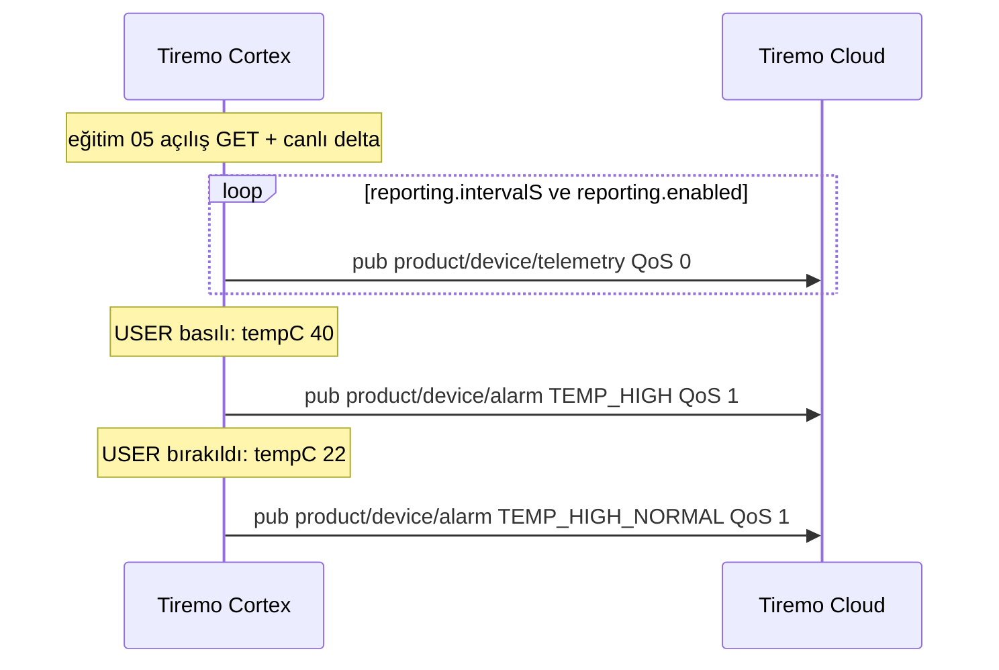
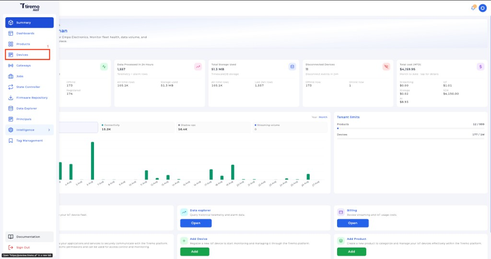
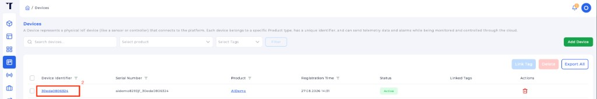
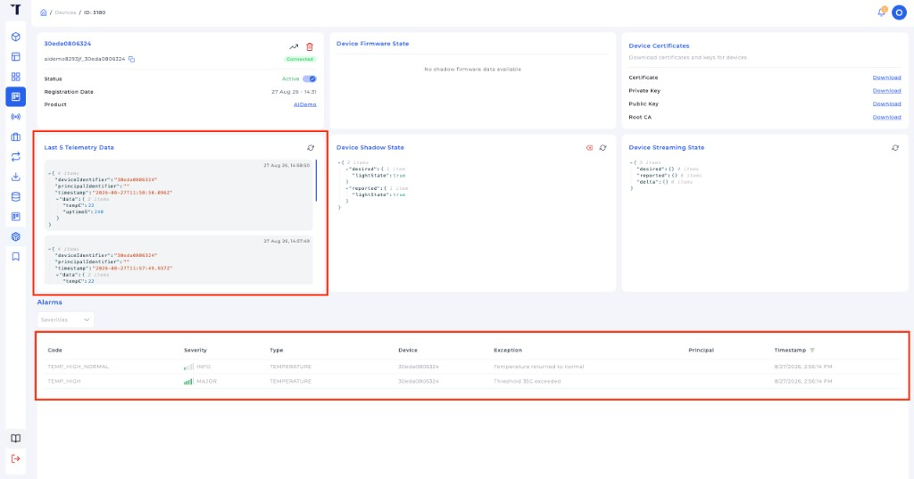

<p class="sphinxhide" align="right"><a href="../../../../Tiremo_Cloud/Feature_Tutorials/06-Publishing_Alarms_And_Telemetry/README.md">English</a> | <a>Türkçe</a></p>
<table class="sphinxhide" width="100%">
  <tr>
    <td align="center">
      <picture>
        <source media="(prefers-color-scheme: dark)" srcset="../../../../images/tiremo_sub_brand_1_mono_white.png">
        
      </picture>
      <br>
      
      <h1>Publishing Alarms and Telemetry</h1>
      <sub>Tiremo Cortex Eğitimleri — ESP32 + Tiremo Cloud üretici yazılımı, ilk LED yanıp sönmesinden filoya hazır bir cihaza</sub>
    </td>
  </tr>
</table>


# Publishing Alarms and Telemetry

***Kart: Tiremo Cortex (ESP32) · Bölüm: Tiremo Cloud / Feature Tutorials · Zorluk: Zor***

> Bu sayfa [İngilizce orijinalinin](../../../../Tiremo_Cloud/Feature_Tutorials/06-Publishing_Alarms_And_Telemetry/README.md)
> Türkçe çevirisidir. Kod ve dosya yolları İngilizce kalır; içerik farklılaşırsa
> İngilizce sürüm esas alınır.

## Giriş

[Eğitim 05](../../../../Tiremo_Cloud/Feature_Tutorials/05-Live_Shadow_Delta_Handling/)
**kontrol düzlemidir**: klasik Device Shadow desired / delta / reported.
Bu eğitim **veri düzlemini** ekler. Örnekler ve kenarda yükselen olaylar
kendi MQTT konularına gider; bu akış shadow belgesine doldurulmaz.

Her örnekte `tempC`'yi `state.reported`'a yazmak shadow'u şişirir,
desired ile eşleşmeyince `update/delta` yeniden basar ve UART fırtına
yapılır. Telemetri periyodik bir JSON yayınıdır. Alarm bir **mandaldır**:
eşik aşılınca bir yayın, normale dönünce bir yayın — çizginin üstünde
otururken tekrar yok.

Bu `Sw/` SHT40 açmaz. Kısa USER basışı demo sensördür (basılıyken 40 °C,
bırakılınca 22 °C); MQTT dersi I2C'den ayrı kalır. Gerçek sensörler
[Tasarım eğitimi 01](../../../../Tiremo_Cloud/Design_Tutorials/01-Sensor_Telemetry_And_Shadow_Control/)
içindir.

## Bir Bakışta Alışveriş



## Neler Öğreneceksiniz

- `pub/{product}/{device}/telemetry` (QoS 0) ve `pub/{product}/{device}/alarm` (QoS 1) — `$aws/` altında değil, `{thingName}/...` değil
- Periyodik telemetrinin shadow `reported` yeniden yazımı değil, veri konusu JSON'u olduğu
- Alarmın histerezis mandalı (`TEMP_HIGH` / `TEMP_HIGH_NORMAL`) olduğu
- 05'in `reporting.enabled` / `reporting.intervalS` değerlerini, onları sensör verisi olarak reported'a eklemeden kullanmak

## Önkoşullar

- [05-Live_Shadow_Delta_Handling](../../../../Tiremo_Cloud/Feature_Tutorials/05-Live_Shadow_Delta_Handling/)
- [02-Minimal_JSON_Helpers](../../../../Tiremo_Cloud/Feature_Tutorials/02-Minimal_JSON_Helpers/)
- 05 ile aynı gitignore'lu dosyalar bu `Sw/` içinde. İddia PEM'leri, ürün kimliği ve ürün sırrını Tiremo UI'dan kopyalayın — [03 eğitimi](../../../../Tiremo_Cloud/Feature_Tutorials/03-Fleet_Provisioning_By_Claim/#tiremo-uidan-kimlik-bilgileri).
- [Getting Started](../../../../Getting_Started/) ile araç zinciri

## Platform belgelendirmesi

Kalıcı sertifikadan sonraki yayın konuları:
[Faz 3 — ilk bağlantı](https://docs.tiremo.ai/device-provisioning/third-phase).
Telemetri veri düzlemidir, shadow kontrol döngüsü değildir. Ayrıca
[mimari ve veri akışı](https://docs.tiremo.ai/introduction/phase-1)
ve [düşük hızlı telemetri](https://docs.tiremo.ai/use-cases/scenario-low-rate-telemetry)
senaryosu. Shadow
[Device State Controller](https://docs.tiremo.ai/device-state-controller/introduction)
olarak kalır.

## Konuları anlamak

`$aws/things/<thingName>/shadow/...` Device Shadow için ayrılmıştır.
Uygulama telemetrisi orada yaşamaz. Tiremo ingest `pub/...` dinler
([Faz 3](https://docs.tiremo.ai/device-provisioning/third-phase));
`{thingName}/telemetry` değil.

Bu üretici yazılım **eski yolu** kullanır (uç kullanıcı principal yok):

```text
pub/{productIdentifier}/{deviceIdentifier}/telemetry     QoS 0   periyodik örnek
pub/{productIdentifier}/{deviceIdentifier}/alarm         QoS 1   yükselt / temizle kenarı
```

`productIdentifier` `TIREMO_AWS_PRODUCT_IDENTIFIER`'dır.
`deviceIdentifier` eğitim 01'deki 12 hex MAC'tir. MQTT istemci kimliğinin
(`{product}_{device}`) iki yarısıdır; alt çizgiyle birleşmiş Thing adı
değildir.

Alarm JSON tam dört string alandır. Ek anahtar (`tempC`, boolean
`exception`, `CRITICAL` severity) ingest tarafından reddedilir.
Severity yalnızca `MAJOR` / `MINOR` / `WARNING` / `INFO`:

```json
{"alarmType":"TEMPERATURE","severity":"MAJOR","code":"TEMP_HIGH","exception":"Threshold 35C exceeded"}
{"alarmType":"TEMPERATURE","severity":"INFO","code":"TEMP_HIGH_NORMAL","exception":"Temperature returned to normal"}
```

Histerezis: **≥ 35 °C** yükselt, **≤ 30 °C** temizle. 10 s USER **tutuşu**
hâlâ fabrika sıfırlamadır. 10 s'den önce **dokunuş** demo sıcaklıktır.

## Çözüm

[`Sw/`](../../../../Tiremo_Cloud/Feature_Tutorials/06-Publishing_Alarms_And_Telemetry/Sw/)
derlenebilir bir uygulamadır. Eğitim 05'teki gitignore'lu dosyaları kopyalayın:

```sh
cd Sw
cp ../05-Live_Shadow_Delta_Handling/Sw/wifi_secrets.h .
cp ../05-Live_Shadow_Delta_Handling/Sw/aws_iot_config.h .
cp ../05-Live_Shadow_Delta_Handling/Sw/certs/claim_cert.pem certs/
cp ../05-Live_Shadow_Delta_Handling/Sw/certs/claim_key.pem certs/
tdf.py build
tdf.py flash
tdf.py monitor
```

USER'a dokunun (10 s tutmayın): tam bir `TEMP_HIGH` yükseltmesi ve bir
`TEMP_HIGH_NORMAL` temizliği. Shadow delta boş kalmalıdır.

## Tiremo UI'da telemetri ve alarmlar

UART kartın yayınladığını kanıtlar. Operatör aynı mesajları Tiremo UI'da
görür. [03
eğitiminde](../../../../Tiremo_Cloud/Feature_Tutorials/03-Fleet_Provisioning_By_Claim/#tiremo-uidan-kimlik-bilgileri)
kurduğunuz ürünü, sonra eğitim 01'deki 12 hex MAC cihazını açın.

**1. Ana menüden Devices** açın.



*Şekil: Tiremo UI — ana menüden **Devices**.*

**2. Cihazı açın.** **Device Identifier**'a tıklayın (12 hex MAC; Serial
Number'daki `{product}_{device}` Thing adı değil).



*Şekil: Tiremo UI — cihazı açmak için tanımlayıcıya tıklayın.*

**3. Telemetri ve alarmları** o cihaz sayfasında doğrulayın.



*Şekil: Tiremo UI — **Last 5 Telemetry Data** (`tempC` / `uptimeS`) ve
**Alarms** tablosu (`TEMP_HIGH` MAJOR, sonra `TEMP_HIGH_NORMAL` INFO).*

**Last 5 Telemetry Data** `pub/{product}/{device}/telemetry` ingest'idir.
**Alarms** `pub/{product}/{device}/alarm` ingest'idir: USER basılıyken
bir `TEMP_HIGH`, bırakılınca bir `TEMP_HIGH_NORMAL`. Aynı sayfadaki
shadow hâlâ eğitim 05 kontrol düzlemidir — örnekler orada görünmez.

## Adım taslağı

1. [`prv_user_code.c`](../../../../Tiremo_Cloud/Feature_Tutorials/06-Publishing_Alarms_And_Telemetry/Sw/Src/prv_user_code.c) — 05 hazır döngüsü artı `TIREMO_Telemetry_Poll`
2. [`tiremo_telemetry.c`](../../../../Tiremo_Cloud/Feature_Tutorials/06-Publishing_Alarms_And_Telemetry/Sw/Common/Src/tiremo_telemetry.c) — konular, demo örnek, mandal
3. [`tiremo_shadow.h`](../../../../Tiremo_Cloud/Feature_Tutorials/06-Publishing_Alarms_And_Telemetry/Sw/Common/Include/tiremo_shadow.h) — `ReportingEnabled()` / `IntervalS()`

## Bitti sayılınca

UART periyodik `pub/{product}/{device}/telemetry` yayını gösterir; USER dokunuşu
tam bir `TEMP_HIGH` ve bir `TEMP_HIGH_NORMAL` üretir
(`pub/{product}/{device}/alarm`). Tiremo UI aynı
örnekleri telemetri görünümünde, yükselt/temizle çiftini alarm
tablosunda gösterir. `reporting.enabled` telemetriyi durdurup sürdürür;
artakalan shadow delta fırtınası yoktur.

<p align="center"></p>

<p class="sphinxhide" align="center"><sub>Tiremo Cortex Eğitimleri — Empa Electronics</sub></p>
