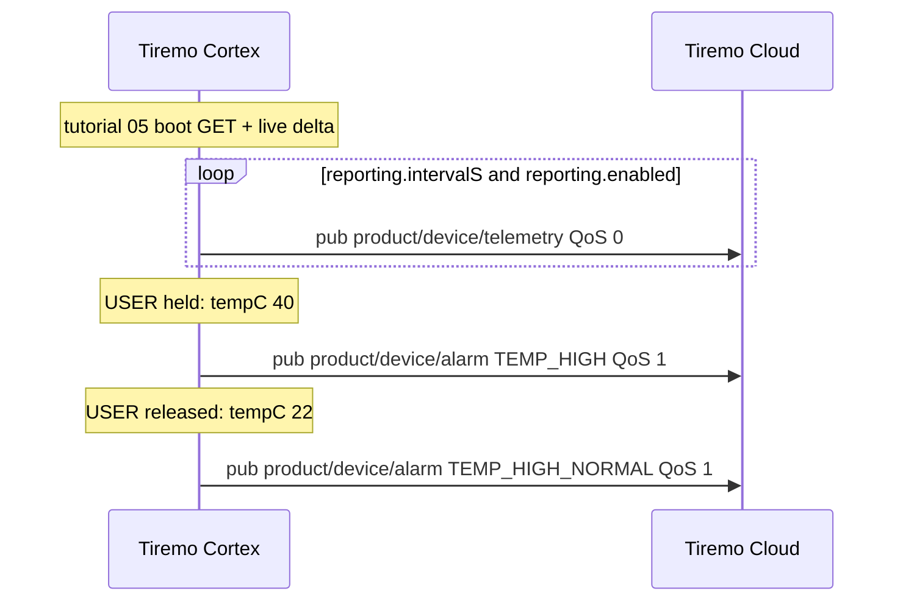
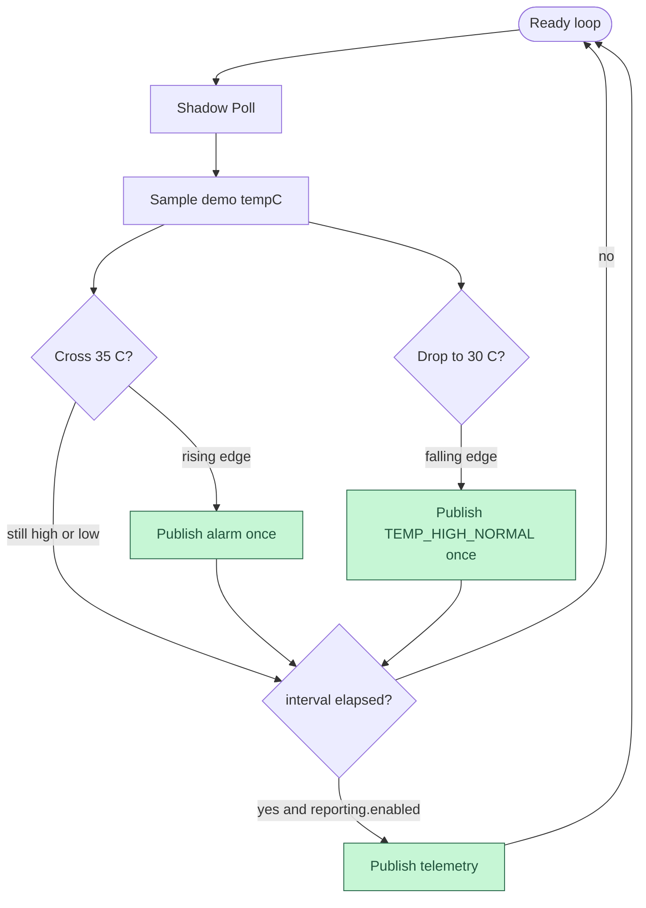
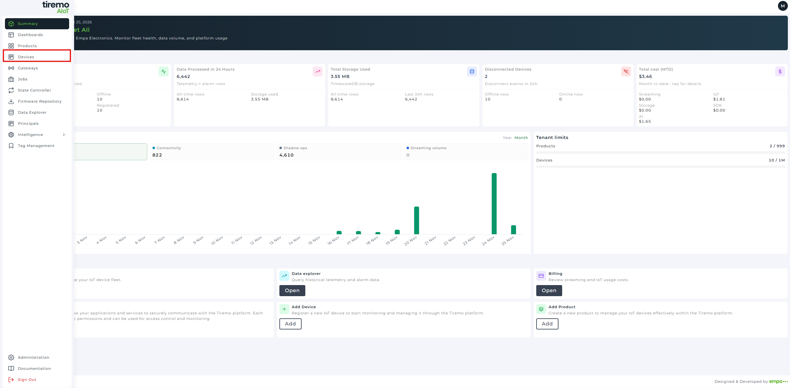
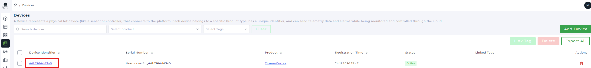
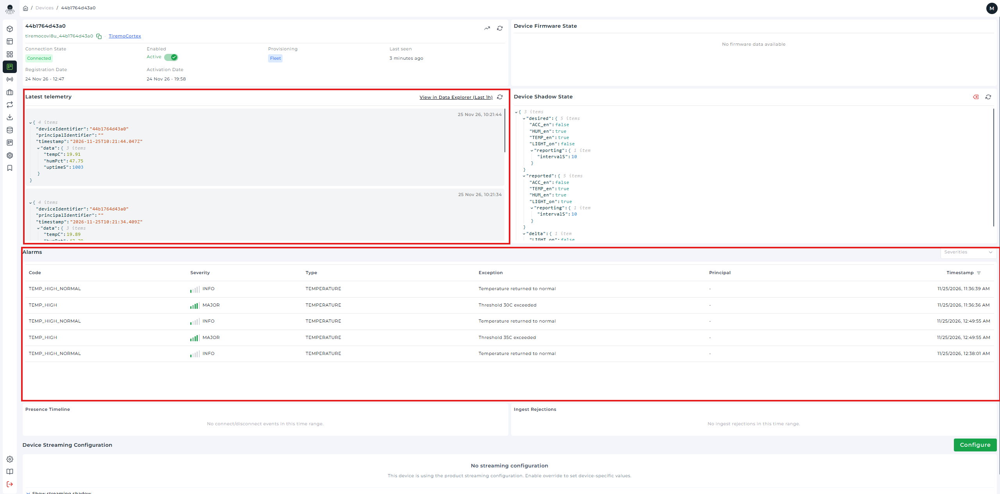

<p class="sphinxhide" align="right"><a href="../../../../Tiremo_Cloud/Feature_Tutorials/06-Publishing_Alarms_And_Telemetry/README.md">English</a> | <a>Türkçe</a></p>
<table class="sphinxhide" width="100%">
  <tr>
    <td align="center">
      <picture>
        <source media="(prefers-color-scheme: dark)" srcset="../../../../images/tiremo_sub_brand_1_mono_white.png">
        
      </picture>
      <br>
      
      <h1>Publishing Alarms and Telemetry</h1>
      <sub>Tiremo Cortex Eğitimleri — ESP32 + Tiremo Cloud üretici yazılımı, ilk LED yanıp sönmesinden filoya hazır bir cihaza</sub>
    </td>
  </tr>
</table>


# Publishing Alarms and Telemetry

***Kart: Tiremo Cortex (ABOV A34G43A, Cortex-M4) · Bölüm: Tiremo Cloud / Feature Tutorials · Zorluk: Zor***

> Bu sayfa [İngilizce orijinalinin](../../../../Tiremo_Cloud/Feature_Tutorials/06-Publishing_Alarms_And_Telemetry/README.md)
> Türkçe çevirisidir. Kod ve dosya yolları İngilizce kalır; içerik farklılaşırsa
> İngilizce sürüm esas alınır.

## Giriş

[Eğitim 05](../05-Live_Shadow_Delta_Handling/README.md) **kontrol
düzlemidir**: klasik Device Shadow'un desired / delta / reported'ı. Bu
eğitim **veri düzlemini** ekler. Sensör örnekleri ve cihazda oluşan
olaylar kendi MQTT topic'lerine gider; böylece Tiremo Cloud bu akışı
shadow belgesine koymadan saklayabilir veya alarm üretebilir.

Her örnekte `tempC`'yi `state.reported`'a yazmak shadow'u büyütür ve her
örnek yeni bir shadow güncellemesi tetikler. Bunun yerine telemetri
periyodik bir JSON yayınıdır. Alarm ise bir **mandaldır**: eşik
aşıldığında bir yayın, değer geri döndüğünde bir yayın; çizginin
üstünde kaldığı sürece tekrar yok.

Bu `Sw/` gerçek bir sensör **okumaz**. `tempC` bir demo değeridir:
normalde **22 °C**, USER basılıyken **40 °C**. Kartı ısıtmak bunu
değiştirmez. Böylece MQTT konusu I2C'den ayrı kalır. Ondalıklı gerçek
SHT40 okuması
[Design eğitimi 01](../../Design_Tutorials/01-Sensor_Telemetry_And_Shadow_Control/README.md)'dedir.

## Alışveriş, Tek Bakışta





## Neler Öğreneceksiniz

- `pub/{product}/{device}/telemetry` (QoS 0) ve `pub/{product}/{device}/alarm` (QoS 1) topic'leri — `$aws/` altında değil, `{thingName}/...` değil
- Periyodik telemetrinin neden shadow `reported`'ını yeniden yazmak değil, bir veri topic'inde JSON olduğu
- Tekrar tekrar yayınlanan bir seviye değil, histerezisli bir mandal olarak alarm (`TEMP_HIGH` / `TEMP_HIGH_NORMAL`)
- 05'in `reporting.enabled` / `reporting.intervalS` alanlarıyla veri düzlemini canlı kontrol etmek
- Üretici yazılımı sık yayın yaparken gelen shadow delta'larını kaybetmemek

## Ön Koşullar

- [05-Live_Shadow_Delta_Handling](../05-Live_Shadow_Delta_Handling/README.md) — MQTT oturumu, Thing adı ve sürekli `update/delta`
- [02-Minimal_JSON_Helpers](../02-Minimal_JSON_Helpers/README.md) — sınırlı JSON yazıcı
- Bu `Sw/` içinde 05 ile aynı dört gitignore'lu dosya — bkz. [Kimlik bilgileri](#kimlik-bilgileri)
- [Getting Started](../../../Getting_Started/) bölümündeki kurulum betikleri çalıştırılmış olmalı, böylece `tdf` kullanılabilir
- Logu izlemek için: `tdf monitor` veya herhangi bir seri terminal (Tera Term, PuTTY, screen, minicom, …), kartın USB seri portunda 115200 8N1
- Bilgisayarınıza USB kablosuyla bağlı bir Tiremo Cortex kartı (ABOV A34G43A MCU — bkz. [Donanım Genel Bakışı](../../../Hardware.md))

## Platform dökümanı

Yayın topic'leri
[Phase 3 — ilk bağlantı](https://docs.tiremo.ai/device-provisioning/third-phase)
sayfasında anlatılır. Telemetri shadow kontrol döngüsü değil, veri
düzlemidir. Ayrıca bkz.
[mimari ve veri akışı](https://docs.tiremo.ai/introduction/phase-1) ve
[düşük hızlı telemetri](https://docs.tiremo.ai/use-cases/scenario-low-rate-telemetry)
kullanım senaryosu. Shadow hâlâ
[Device State Controller](https://docs.tiremo.ai/device-state-controller/introduction)'dır.

## Topic'leri Anlamak

`$aws/things/<thingName>/shadow/...` Device Shadow'a ayrılmıştır;
uygulama telemetrisi oraya ait değildir. Tiremo ingest
`{thingName}/telemetry`'yi değil, `pub/...`'ı dinler
([Phase 3](https://docs.tiremo.ai/device-provisioning/third-phase)).

Bu üretici yazılımı **eski yolu** (son kullanıcı principal'ı olmadan) kullanır:

```text
pub/{productIdentifier}/{deviceIdentifier}/telemetry     QoS 0   periodic sample
pub/{productIdentifier}/{deviceIdentifier}/alarm         QoS 1   raise / clear
```

`productIdentifier`, `TIREMO_AWS_PRODUCT_IDENTIFIER`'dır.
`deviceIdentifier`, eğitim 01'deki 12 hex MAC'tir. Bunlar MQTT client
ID'nin (`{product}_{device}`) iki parçasıdır; burada `/` ile ayrılırlar,
alt çizgiyle birleşik Thing adı değildir.

Cihaz bir son kullanıcı principal'ı altında kayıtlıysa Phase 3, ürün ile
cihaz arasına `{principalIdentifier}` ekler. Bu eğitim eklemez.

Telemetri yükü yalnızca tamsayı kullanır:

```json
{"uptimeS":12,"tempC":22}
```

Alarm yükleri tam olarak dört string alandır. Tiremo ingest fazladan
anahtarları (örneğin `tempC`), boolean bir `exception`'ı ve
`MAJOR` / `MINOR` / `WARNING` / `INFO` dışındaki `severity` değerlerini
reddeder:

```json
{"alarmType":"TEMPERATURE","severity":"MAJOR","code":"TEMP_HIGH","exception":"Threshold 35C exceeded"}
{"alarmType":"TEMPERATURE","severity":"INFO","code":"TEMP_HIGH_NORMAL","exception":"Temperature returned to normal"}
```

Histerezis: **≥ 35 °C**'de yükselt, **≤ 30 °C**'de temizle. 40 °C'de
kalmak `TEMP_HIGH`'ı tekrar yayınlamaz; 22 °C'de kalmak da temizlemeyi
tekrar yayınlamaz.

`reporting.intervalS` telemetrinin ne sıklıkla yayınlanacağını belirler,
`reporting.enabled=false` onu duraklatır. İkisi de eğitim 05'in delta
yolu üzerinden, yeniden başlatma olmadan canlı uygulanır. Alarmlar her
durumda değerlendirilir; bu yüzden USER'a dokunmak yine bir yükselt /
temizle çifti üretir.

USER'ı 10 sn basılı tutmak hâlâ fabrika sıfırlamasıdır. Bir **dokunuş**
(10 sn'den çok önce basıp bırakmak) demo sıcaklık adımıdır.

## Yayın Yaparken Delta'ları Korumak

Üretici yazılımı artık kendi başına, saniyede bir kadar sık yayın
yapıyor. ESP32 bir shadow delta'sını (`+MQTTSUBRECV`) her an, bir yayın
sürerken bile iletebilir. Bu eğitimden önce sürücü, her komuttan önce
modülden gelmiş ama okunmamış veriyi atıyor ve her yayının başında MQTT
tutma tamponunu temizliyordu. Sık telemetride, bir yayın civarında gelen
delta kayboluyordu. Tiremo Cloud onu tekrar göndermez; bu yüzden
`desired` ve `reported` bir sonraki yeniden başlatmaya kadar farklı
kalıyordu.

`TIREMO_ESP32_MqttPublishRaw()` artık:

1. okunmamış baytları atmak yerine MQTT tutma tamponuna taşır,
2. `>` istemi beklenirken gelen bir mesajı da tutma tamponuna taşır,
3. `+MQTTPUB:OK`'u yalnızca kendi komutundan sonra gelen baytlarda arar,
4. tutma tamponunda yalnızca gelen mesajları tutar; böylece komut sonuçları tamponu dolduramaz.

Bir sonraki `TIREMO_Shadow_Poll()` delta'yı her zamanki gibi tutma
tamponundan okur.

## Çözüm

### Kimlik bilgileri

Bu `Sw/`, eğitim 05 ile aynı dört gitignore'lu dosyaya ihtiyaç duyar.
En kolayı onları eğitim 05'in `Sw/`'sinden kopyalamaktır:

- **`wifi_secrets.h`**: WiFi SSID'niz ve şifreniz (`wifi_secrets.h.example`'dan).
- **`aws_iot_config.h`**: ürününüzün **Identifier**'ı ve **Secret Key**'i (`aws_iot_config.h.example`'dan) ve isteğe bağlı `TIREMO_AWS_THING_NAME`.
- **`certs/claim_cert.pem`** ve **`certs/claim_key.pem`**: yeniden adlandırılmış **Provisioning Certificates** — bkz. [`certs/README.md`](Sw/certs/README.md).

Dört ad da gitignore'ludur; yine de commit etmeden önce `git status` ile kontrol edin. Biri eksikse derleme, ne yapılacağını söyleyen bir mesajla durur. Değerlerin Tiremo UI'da nerede olduğu: [eğitim 03](../03-Fleet_Provisioning_By_Claim/README.md#tiremo-uidan-kimlik-bilgileri).

### Derle, yükle, izle

Depo kök dizininden:

```sh
cd Tiremo_Cloud/Feature_Tutorials/06-Publishing_Alarms_And_Telemetry/Sw
tdf build
tdf flash
tdf monitor
```

(`tdf`'nin ne olduğu için [Getting_Started/01-Hello_Blink'in Çözüm bölümüne](../../../Getting_Started/01-Hello_Blink/README.md#çözüm) bakın. macOS/Linux'ta `tdf.py` de takma ad olarak çalışır; Windows'ta `tdf` kullanın. `tdf monitor` çalıştırmadan önce kartın seri portundaki diğer terminalleri kapatın — port aynı anda yalnızca bir program tarafından açılabilir.)

**Gerçek donanımda doğrulandı:** `tdf build` macOS ve Windows 11'de hatasız derler ve bağlar (`.text` yaklaşık 38 KB; tam boyut araç zinciri sürümüne göre biraz değişir ve bağlayıcı, [01-Hello_Blink'in Çözüm bölümünde](../../../Getting_Started/01-Hello_Blink/README.md#çözüm) açıklanan aynı beklenen, zararsız `_close` / `_lseek` / `_read` / `_write is not implemented` uyarılarını yazdırır). `tdf flash`, bağlı gerçek bir Tiremo Cortex kartında SWD üzerinden tam bir programlama ve doğrulama döngüsünü tamamladı (`** Verified OK **`). Aşağıda ürün tanımlayıcısı ve kartın MAC adresi yer tutucularla değiştirilmiştir.

Açılış eğitim 05'i tekrarlar (burada shadow'da `intervalS=10` vardı),
ardından telemetri başlar:

```text
[INFO] Alarms_And_Telemetry: boot
[INFO] hold USER 10000 ms to factory-reset; tap USER to raise TEMP_HIGH
...
[INFO] shadow: desired 89 bytes
[INFO] shadow: applied reporting.enabled=true intervalS=10 led.on=false
[INFO] shadow: update reported (147 bytes, full desired echo)
[INFO] shadow: update accepted
[INFO] shadow: get again to confirm delta is gone
[INFO] shadow: no leftover delta
[INFO] shadow: subscribed update/delta
[INFO] telemetry: topics pub/<product>/<deviceId>/telemetry  pub/<product>/<deviceId>/alarm
[INFO] telemetry: pub pub/<product>/<deviceId>/telemetry (24 bytes) {"uptimeS":0,"tempC":22}
[INFO] telemetry: pub pub/<product>/<deviceId>/telemetry (25 bytes) {"uptimeS":10,"tempC":22}
[INFO] ready thingName=<product>_<deviceId> telemetry=on intervalS=10
```

`ready` satırı, telemetri aralığı ne olursa olsun 10 sn'de bir tekrarlanır.

**Aralığı canlı değiştirmek.** Kart çalışırken Tiremo UI'da desired'ı
`{"reporting":{"intervalS":1}}` yapın, ardından kart saniyede bir yayın
yaparken `{"reporting":{"intervalS":5}}` yapın:

```text
[INFO] shadow: MQTT RX topic=$aws/things/<product>_<deviceId>/shadow/update/delta frag=139 accum=139
[INFO] shadow: delta 139 bytes
[INFO] shadow: applied reporting.enabled=true intervalS=1 led.on=false
[INFO] shadow: desired now 88 bytes (merged)
[INFO] shadow: update reported (147 bytes, full desired echo)
[INFO] telemetry: pub pub/<product>/<deviceId>/telemetry (26 bytes) {"uptimeS":240,"tempC":22}
[INFO] ready thingName=<product>_<deviceId> telemetry=on intervalS=1
[INFO] telemetry: pub pub/<product>/<deviceId>/telemetry (26 bytes) {"uptimeS":241,"tempC":22}
[INFO] telemetry: pub pub/<product>/<deviceId>/telemetry (26 bytes) {"uptimeS":242,"tempC":22}
...
[INFO] telemetry: pub pub/<product>/<deviceId>/telemetry (26 bytes) {"uptimeS":268,"tempC":22}
[INFO] shadow: MQTT RX topic=$aws/things/<product>_<deviceId>/shadow/update/delta frag=139 accum=139
[INFO] shadow: delta 139 bytes
[INFO] shadow: applied reporting.enabled=true intervalS=5 led.on=false
[INFO] shadow: desired now 88 bytes (merged)
[INFO] shadow: update reported (147 bytes, full desired echo)
[INFO] ready thingName=<product>_<deviceId> telemetry=on intervalS=5
[INFO] telemetry: pub pub/<product>/<deviceId>/telemetry (26 bytes) {"uptimeS":273,"tempC":22}
```

İkinci delta, kart saniyede bir yayın yaparken geldi;
[Yayın Yaparken Delta'ları Korumak](#yayın-yaparken-deltaları-korumak)
bölümünün düzelttiği durum budur. Reported ile aynı olan bir desired
belgesi delta üretmez; bu yüzden mevcut değerden farklı bir değer gönderin.

**USER'a dokunun** (basıp bırakın; 10 sn basılı tutmayın):

```text
[INFO] telemetry: demo tempC=40 (USER held)
[WARN] alarm: RAISE TEMP_HIGH tempC=40
[INFO] telemetry: pub pub/<product>/<deviceId>/alarm (102 bytes) {"alarmType":"TEMPERATURE","severity":"MAJOR","code":"TEMP_HIGH","exception":"Threshold 35C exceeded"}
[INFO] telemetry: demo tempC=22 (released)
[INFO] alarm: CLEAR TEMP_HIGH_NORMAL tempC=22
[INFO] telemetry: pub pub/<product>/<deviceId>/alarm (116 bytes) {"alarmType":"TEMPERATURE","severity":"INFO","code":"TEMP_HIGH_NORMAL","exception":"Temperature returned to normal"}
```

Her dokunuşta tam olarak bir yükseltme ve bir temizleme. Daha uzun bir
basış `[WARN] USER button: hold 10000 ms to factory-reset` de loglayabilir;
10 sn dolmadan bırakırsanız hiçbir şey silinmez. Konsoldaki shadow
delta'sı boş kalır, çünkü örnekler `reported`'a yazılmaz.

## Tiremo UI'da telemetri ve alarmlar

UART logu kartın yayın yaptığını gösterir. Tiremo UI, bir operatörün bu
mesajları gördüğü yerdir. [Eğitim 03](../03-Fleet_Provisioning_By_Claim/README.md#tiremo-uidan-kimlik-bilgileri)'te
provision ettiğiniz ürünü, ardından tanımlayıcısı eğitim 01'deki 12 hex
MAC olan cihazı açın.

**1. Ana menüden Devices'ı açın.**



*Şekil: Tiremo UI — ana menüde **Devices**'a tıklayın.*

**2. Cihazı açın.** **Device Identifier**'ına tıklayın (Serial Number'daki
`{product}_{device}` Thing adına değil, 12 hex MAC'e).



*Şekil: Tiremo UI — açmak için cihaz tanımlayıcısına tıklayın.*

**3. O cihaz sayfasında telemetri ve alarmları kontrol edin.**



*Şekil: Tiremo UI — **Last 5 Telemetry Data** (`tempC` / `uptimeS`) ve
**Alarms** tablosu (`TEMP_HIGH` MAJOR, ardından `TEMP_HIGH_NORMAL` INFO).*

**Last 5 Telemetry Data**, `pub/{product}/{device}/telemetry` üzerinden
geleni gösterir. **Alarms**, `pub/{product}/{device}/alarm` üzerinden
geleni gösterir: USER basıldığında bir `TEMP_HIGH` satırı, bırakıldığında
bir `TEMP_HIGH_NORMAL` satırı. Aynı sayfadaki shadow hâlâ eğitim 05'in
kontrol düzlemidir; örnekler orada görünmez.

## Adım Adım İnceleme

1. [`prv_user_code.c`](../../../../Tiremo_Cloud/Feature_Tutorials/06-Publishing_Alarms_And_Telemetry/Sw/Src/prv_user_code.c) — 05'in kimlik / WiFi /
   SNTP / provision-veya-atla / açılış GET / `Shadow_Poll` yolu, ardından
   aynı hazır döngüsünde `TIREMO_Telemetry_Poll`.
2. [`tiremo_telemetry.c`](../../../../Tiremo_Cloud/Feature_Tutorials/06-Publishing_Alarms_And_Telemetry/Sw/Common/Src/tiremo_telemetry.c) — Phase 3
   `pub/{product}/{device}/...` topic'leri, demo örnek, histerezis
   mandalı, QoS 0 telemetri / QoS 1 alarm.
3. [`tiremo_shadow.h`](../../../../Tiremo_Cloud/Feature_Tutorials/06-Publishing_Alarms_And_Telemetry/Sw/Common/Include/tiremo_shadow.h) —
   veri düzleminin son uygulanan kontrol alanlarını okuyabilmesi için
   `ReportingEnabled()` / `IntervalS()`.
4. [`tiremo_esp32.c`](../../../../Tiremo_Cloud/Feature_Tutorials/06-Publishing_Alarms_And_Telemetry/Sw/Drivers/esp32/Src/tiremo_esp32.c) —
   `MqttPublishRaw` bir yayın civarında gelen mesajları korur (bkz.
   [Yayın Yaparken Delta'ları Korumak](#yayın-yaparken-deltaları-korumak));
   DEBUG dökümünde WiFi şifresi gizlenir (`AT+CWJAP=<credentials hidden>`).
5. [`tiremo_debug.c`](../../../../Tiremo_Cloud/Feature_Tutorials/06-Publishing_Alarms_And_Telemetry/Sw/Common/Src/tiremo_debug.c) — log satırı
   tamponu tam bir alarm yayın satırını alır; yine de fazla uzun olan bir
   satır kesilir ama her zaman satır sonuyla biter.

## Tamamlanma Ölçütü

- UART, shadow'daki `reporting.intervalS` aralığında periyodik `pub/{product}/{device}/telemetry` yayınları gösterir.
- Tiremo UI'da `reporting.intervalS` veya `reporting.enabled`'ı değiştirmek, telemetri saniyede bir yayınlanırken bile yeniden başlatma olmadan etkili olur.
- USER'a bir dokunuş, `pub/{product}/{device}/alarm` üzerinde tam olarak bir `TEMP_HIGH` ve bir `TEMP_HIGH_NORMAL` üretir.
- Tiremo UI, örnekleri **Last 5 Telemetry Data** altında, yükseltme / temizleme çiftini **Alarms** altında gösterir.

<p align="center"></p>

<p class="sphinxhide" align="center"><sub>Tiremo Cortex Eğitimleri — Empa Electronics</sub></p>
