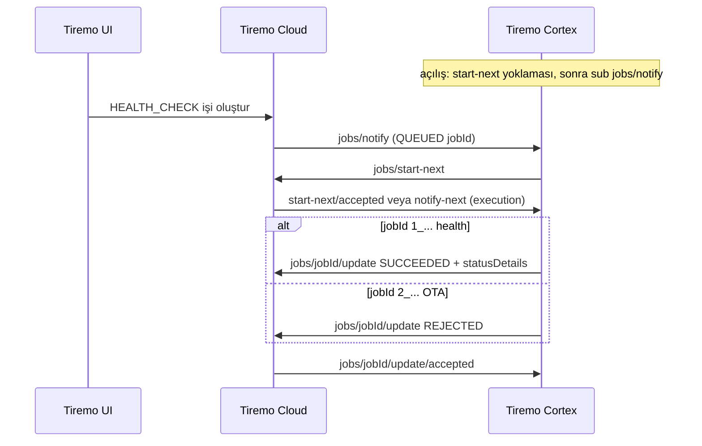
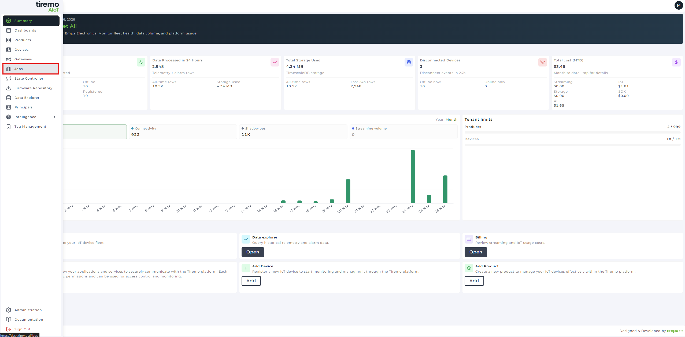
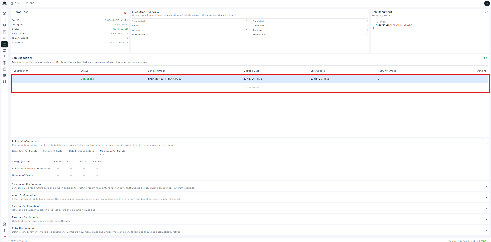
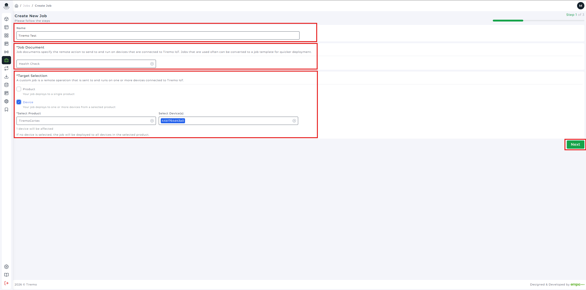
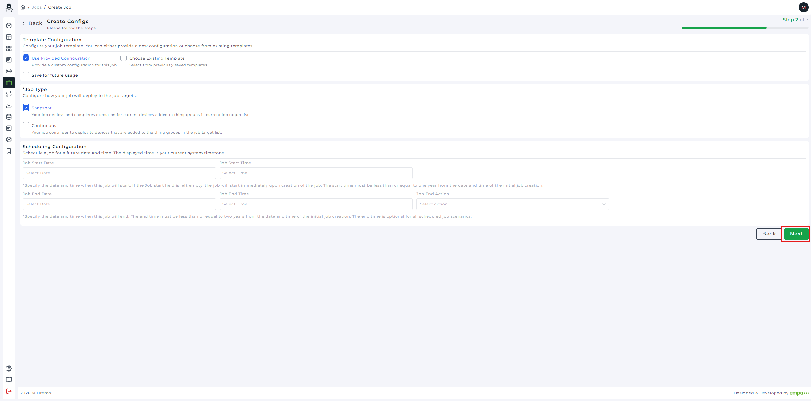
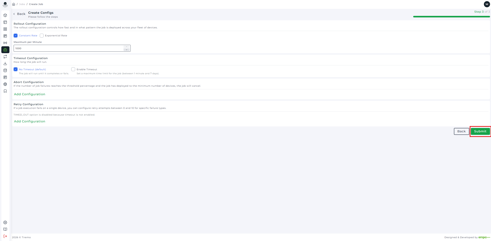
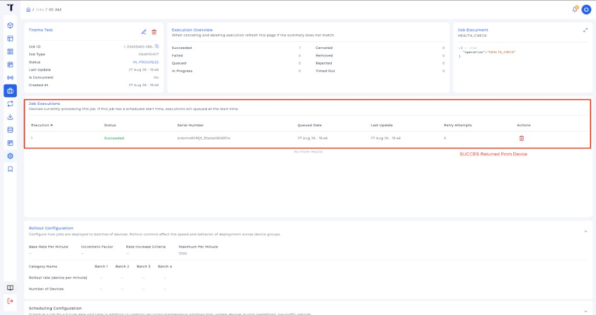

<p class="sphinxhide" align="right"><a href="../../../../Tiremo_Cloud/Feature_Tutorials/07-Tiremo_Jobs/README.md">English</a> | <a>Türkçe</a></p>
<table class="sphinxhide" width="100%">
  <tr>
    <td align="center">
      <picture>
        <source media="(prefers-color-scheme: dark)" srcset="../../../../images/tiremo_sub_brand_1_mono_white.png">
        
      </picture>
      <br>
      
      <h1>Tiremo Jobs</h1>
      <sub>Tiremo Cortex Eğitimleri — ESP32 + Tiremo Cloud üretici yazılımı, ilk LED yanıp sönmesinden filoya hazır bir cihaza</sub>
    </td>
  </tr>
</table>


# Tiremo Jobs

***Kart: Tiremo Cortex (ABOV A34G43A, Cortex-M4) · Bölüm: Tiremo Cloud / Feature Tutorials · Zorluk: Zor***

> Bu sayfa [İngilizce orijinalinin](../../../../Tiremo_Cloud/Feature_Tutorials/07-Tiremo_Jobs/README.md)
> Türkçe çevirisidir. Kod ve dosya yolları İngilizce kalır; içerik farklılaşırsa
> İngilizce sürüm esas alınır.

## Giriş

[Eğitim 06](../06-Publishing_Alarms_And_Telemetry/README.md) **veri
düzlemidir**. Bu eğitim **kuyruğa alınan işi** ekler. Bir Tiremo Job,
Thing üzerine bir JSON yürütme (execution) koyar; kart onu üstlenir,
kısa bir yerel eylem çalıştırır ve `SUCCEEDED` ya da `REJECTED`
bildirir. Shadow'dan farklı olarak iş, sürekli bir desired/reported
döngüsü değildir: bir durumu vardır, sonra biter.

Referans, üretim firmware'inin jobs yoludur. Bir `jobs/notify` mesajı
bir **özet** (yalnızca QUEUED `jobId`) veya **tam bir execution** belgesi
olabilir. Kart özeti `jobs/start-next` ile üstlenir. Health-check iş
kimlikleri `1_<uuid>` biçimindedir ve `statusDetails` ile `SUCCEEDED`
olarak tamamlanır. OTA biçimli kimlikler (`2_<uuid>`) burada `REJECTED`
olur; firmware indirme ve yazma
[eğitim 08](../08-OTA_Firmware_Update/README.md)'in konusudur.

## Alışveriş, Tek Bakışta



## Neler Öğreneceksiniz

- Jobs MQTT ailesi: `jobs/notify`, `jobs/notify-next`, `jobs/start-next`, `jobs/<jobId>/update`
- Özet notify'ın neden yetmediği: execution'ı `start-next` üstlenir
- Bir health check'i `statusDetails` ile tamamlamak (`result`, `firmware_version`, `connectivity`, `mqtt`, `uptime_s`)
- OTA biçimli bir işi `IN_PROGRESS`'te kalmasın diye reddetmek
- Bulutun kendi güncellemenize verdiği cevabı yeni bir işten ayırmak

## Ön Koşullar

- [06-Publishing_Alarms_And_Telemetry](../06-Publishing_Alarms_And_Telemetry/README.md) — hazır döngüsü, Thing adı, sürekli `update/delta` ve telemetri
- [05-Live_Shadow_Delta_Handling](../05-Live_Shadow_Delta_Handling/README.md)
- Bu `Sw/` içinde 06 ile aynı dört gitignore'lu dosya — bkz. [Kimlik bilgileri](#kimlik-bilgileri)
- [Getting Started](../../../Getting_Started/) bölümündeki kurulum betikleri çalıştırılmış olmalı, böylece `tdf` kullanılabilir
- Logu izlemek için: `tdf monitor` veya herhangi bir seri terminal (Tera Term, PuTTY, screen, minicom, …), kartın USB seri portunda 115200 8N1
- Bilgisayarınıza USB kablosuyla bağlı bir Tiremo Cortex kartı (ABOV A34G43A MCU — bkz. [Donanım Genel Bakışı](../../../Hardware.md))

## Platform dökümanı

- [Tiremo Jobs'a giriş](https://docs.tiremo.ai/developer-guide/jobs/jobs-introduction)
- [İş şablonları](https://docs.tiremo.ai/developer-guide/jobs/jobs-phase-1-definition) (`HEALTH_CHECK`)
- [İş oluşturma](https://docs.tiremo.ai/developer-guide/jobs/jobs-phase-2-creation)
- [Yürütme izleme](https://docs.tiremo.ai/developer-guide/jobs/jobs-phase-3-monitoring)

Jobs MQTT'yi klasik shadow topic'leriyle karıştırmayın — bkz.
[cihaz firmware entegrasyonu](https://docs.tiremo.ai/device-state-controller/device-integration).

## Topic'leri Anlamak

Jobs topic'leri `$aws/things/<thingName>/jobs/...` altında kalır (Tiremo
Cloud üzerindeki AWS Jobs protokolü). Bunlar
[Phase 3](https://docs.tiremo.ai/device-provisioning/third-phase)'teki
`pub/{product}/{device}/...` veri düzlemi değildir.

```text
$aws/things/<thing>/jobs/notify                    gelen: bir iş kuyruğa alındı ya da kuyruk değişti
$aws/things/<thing>/jobs/notify-next               gelen: sıradaki bekleyen execution
$aws/things/<thing>/jobs/start-next                giden: sıradaki QUEUED execution'ı üstlen
$aws/things/<thing>/jobs/start-next/accepted       gelen: o execution (yoksa {})
$aws/things/<thing>/jobs/<jobId>/update            giden: IN_PROGRESS / SUCCEEDED / REJECTED
$aws/things/<thing>/jobs/<jobId>/update/accepted   gelen: bulut güncellemeyi kabul etti
```

Kart açılışta `notify-next` ve `start-next/accepted`'a abone olur, bir
`start-next` yoklaması gönderir (kart kapalıyken kuyruğa alınan bir iş
burada yakalanır), sonra `notify`'a abone olur. Execution
`start-next/accepted` veya `notify-next` üzerinden gelebilir; kart hangisi
önce gelirse onu kabul eder.

Health-check tamamlama yükü (`uptime_s`, jobs modülünün başladığı andan,
açılıştan birkaç saniye sonradan itibaren sayılır):

```json
{"status":"SUCCEEDED","statusDetails":{"result":"ok","firmware_version":"cortex-07","connectivity":"wifi","mqtt":"connected","uptime_s":12}}
```

OTA taslağı:

```json
{"status":"REJECTED","statusDetails":{"reason":"ota_not_implemented"}}
```

`start-next` execution döndürmez ama notify bir `jobId` taşıyorsa, kart o
kimliği doğrudan üstlenir: önce `IN_PROGRESS`, sonra `SUCCEEDED` (veya
`REJECTED`) gönderir; üretimdeki yedek yolun aynısı.

Kart `start-next` cevabını beklerken (en fazla 12 s) yalnızca Jobs
topic'lerine bakar; bu aralıkta gelen bir shadow delta'sı uygulanmaz.
Cevap genellikle bir saniyeden çok daha kısa sürede gelir.

## Çözüm

### Kimlik bilgileri

Bu `Sw/`, eğitim 06 ile aynı dört gitignore'lu dosyaya ihtiyaç duyar.
En kolayı onları eğitim 06'nın `Sw/`'sinden kopyalamaktır:

- **`wifi_secrets.h`**: WiFi SSID'niz ve şifreniz (`wifi_secrets.h.example`'dan).
- **`aws_iot_config.h`**: ürününüzün **Identifier**'ı ve **Secret Key**'i (`aws_iot_config.h.example`'dan) ve isteğe bağlı `TIREMO_AWS_THING_NAME`.
- **`certs/claim_cert.pem`** ve **`certs/claim_key.pem`**: yeniden adlandırılmış **Provisioning Certificates** — bkz. [`certs/README.md`](Sw/certs/README.md).

Dört ad da gitignore'ludur; yine de commit etmeden önce `git status` ile kontrol edin. Biri eksikse derleme, ne yapılacağını söyleyen bir mesajla durur. Değerlerin Tiremo UI'da nerede olduğu: [eğitim 03](../03-Fleet_Provisioning_By_Claim/README.md#tiremo-uidan-kimlik-bilgileri).

### Derle, yükle, izle

Depo kök dizininden:

```sh
cd Tiremo_Cloud/Feature_Tutorials/07-Tiremo_Jobs/Sw
tdf build
tdf flash
tdf monitor
```

(`tdf`'nin ne olduğu için [Getting_Started/01-Hello_Blink'in Çözüm bölümüne](../../../Getting_Started/01-Hello_Blink/README.md#çözüm) bakın. macOS/Linux'ta `tdf.py` de takma ad olarak çalışır; Windows'ta `tdf` kullanın. `tdf monitor` çalıştırmadan önce kartın seri portundaki diğer terminalleri kapatın — port aynı anda yalnızca bir program tarafından açılabilir.)

**Gerçek donanımda doğrulandı:** `tdf build` macOS ve Windows 11'de hatasız derler ve bağlar (`.text` yaklaşık 42 KB; tam boyut araç zinciri sürümüne göre biraz değişir ve bağlayıcı, [01-Hello_Blink'in Çözüm bölümünde](../../../Getting_Started/01-Hello_Blink/README.md#çözüm) açıklanan aynı beklenen, zararsız `_close` / `_lseek` / `_read` / `_write is not implemented` uyarılarını yazdırır). `tdf flash`, bağlı gerçek bir Tiremo Cortex kartında SWD üzerinden tam bir programlama ve doğrulama döngüsünü tamamladı (`** Verified OK **`). Aşağıda ürün tanımlayıcısı, kartın MAC adresi ve işin UUID'si yer tutucularla değiştirilmiştir.

Açılış eğitim 06'yı tekrarlar (burada shadow'da `intervalS=1` vardı),
ardından jobs modülü başlar. Kuyrukta iş yoksa açılış yoklaması boş bir
cevap alır:

```text
[INFO] Tiremo_Jobs: boot
[INFO] hold USER 10000 ms to factory-reset; tap USER to raise TEMP_HIGH; queue a health-check job in the Tiremo UI
...
[INFO] shadow: applied reporting.enabled=true intervalS=1 led.on=false
...
[INFO] shadow: subscribed update/delta
[INFO] telemetry: topics pub/<product>/<deviceId>/telemetry  pub/<product>/<deviceId>/alarm
[INFO] jobs: subscribe notify-next start-next/accepted
[INFO] jobs: start-next
[INFO] jobs: MQTT RX topic=$aws/things/<product>_<deviceId>/jobs/start-next/accepted accum=24
[INFO] jobs: start-next accepted with no execution
[INFO] jobs: subscribed jobs/notify
[INFO] telemetry: pub pub/<product>/<deviceId>/telemetry (24 bytes) {"uptimeS":0,"tempC":22}
[INFO] telemetry: pub pub/<product>/<deviceId>/telemetry (24 bytes) {"uptimeS":1,"tempC":22}
...
[INFO] ready thingName=<product>_<deviceId> telemetry=on intervalS=1
```

Bulut 12 s içinde cevap vermezse satır bunun yerine
`jobs: start-next empty/timeout (no queued job)` olur; kart her iki
durumda da devam eder.

## Tiremo UI'da iş oluşturma

Bu cihaza bir **HEALTH_CHECK** işi oluşturun (kart hazır döngüsünde
olmalı). Sonra iş sayfasında **Succeeded** olduğunu doğrulayın.

**1. Ana menüden Jobs**'u açın.



*Şekil: Tiremo UI — ana menüde **Jobs**'a tıklayın.*

**2. Create Job**'a tıklayın.



*Şekil: Tiremo UI — Jobs listesinde **Create Job**.*

**3. Adım 1 / 3 — ad, belge, hedef.** İşe bir ad verin, **Job Document**'ı
**HEALTH_CHECK** yapın, hedef olarak **Device** seçin (ürününüzü ve bu
kartın cihaz tanımlayıcısını seçin), sonra **Next**.



*Şekil: Tiremo UI — **HEALTH_CHECK**, Device hedefi, sonra **Next**.*

**4. Adım 2 / 3 — varsayılanları bırakın.** **Use Provided Configuration**,
**Snapshot**, boş zamanlama (hemen başlar), sonra **Next**.



*Şekil: Tiremo UI — Snapshot işi, sonra **Next**.*

**5. Adım 3 / 3 — Submit.** Tek bir cihaz için sabit hız / zaman aşımı
yok yeterlidir.



*Şekil: Tiremo UI — işi kuyruğa almak için **Submit**.*

Birkaç saniye içinde UART tüm alışverişi gösterir. Bu çalıştırmada
telemetri saniyede bir gidiyordu; notify iki yayın arasında geldi ve
kaybolmadı:

```text
[INFO] telemetry: pub pub/<product>/<deviceId>/telemetry (25 bytes) {"uptimeS":15,"tempC":22}
[INFO] jobs: MQTT RX topic=$aws/things/<product>_<deviceId>/jobs/notify len=182
[INFO] jobs: notify jobId='1_<uuid>'
[INFO] jobs: start-next
[INFO] jobs: MQTT RX topic=$aws/things/<product>_<deviceId>/jobs/start-next/accepted accum=303
[INFO] jobs: health-check '1_<uuid>' -- SUCCEEDED (type 1_)
[INFO] jobs: update 1_<uuid> status=SUCCEEDED (140 bytes)
[INFO] jobs: update accepted
[INFO] telemetry: pub pub/<product>/<deviceId>/telemetry (25 bytes) {"uptimeS":16,"tempC":22}
[INFO] jobs: MQTT RX topic=$aws/things/<product>_<deviceId>/jobs/notify len=34
[INFO] jobs: notify (no jobId at this depth)
[INFO] jobs: start-next
[INFO] jobs: MQTT RX topic=$aws/things/<product>_<deviceId>/jobs/start-next/accepted accum=24
[INFO] jobs: start-next accepted with no execution
```

- `notify len=182`, QUEUED `jobId`'yi taşıyan özettir.
- Execution, `start-next/accepted` yerine `.../jobs/notify-next accum=...`
  olarak da gelebilir; sonuç aynıdır.
- `update accepted`, bulutun `jobs/<jobId>/update/accepted` üzerindeki
  cevabıdır. Yeni bir iş değildir, bu yüzden kart onun için ikinci bir
  `start-next` göndermez.
- `notify len=34`, bulutun kuyruğun artık boş olduğunu söylemesidir. Kart
  `start-next` ile bir kez kontrol eder ve boş cevap alır.

**6. İşi açıp Succeeded olduğunu doğrulayın.** Execution Overview
**Succeeded: 1** gösterir. **Job Executions**'ta bu Thing'in seri
numarasının satırında **Status** yeşil **Succeeded**'dır. Job Document
`{"operation": "HEALTH_CHECK"}`'tir.



*Şekil: Tiremo UI — kartın `jobs/<id>/update`'inden sonra **Job
Executions** **Succeeded** gösterir.*

## Adım Adım İnceleme

1. [`prv_user_code.c`](../../../../Tiremo_Cloud/Feature_Tutorials/07-Tiremo_Jobs/Sw/Src/prv_user_code.c) — 06'nın döngüsü, ardından
   telemetriden sonra `TIREMO_Jobs_Init` ve `Shadow_Poll`'dan sonra
   `TIREMO_Jobs_Poll` (böylece `start-next`, gelen bir mesajın
   işleyicisinin içinden gönderilmez).
2. [`tiremo_jobs.c`](../../../../Tiremo_Cloud/Feature_Tutorials/07-Tiremo_Jobs/Sw/Common/Src/tiremo_jobs.c) — açılış yoklaması,
   notify işleme, health / OTA ayrımı, `jobs/<jobId>/update` ve
   `update/accepted` / `update/rejected` cevapları (reddedilen bir
   güncelleme bulutun gerekçesiyle WARN olarak loglanır).
3. [`tiremo_shadow.c`](../../../../Tiremo_Cloud/Feature_Tutorials/07-Tiremo_Jobs/Sw/Common/Src/tiremo_shadow.c) — `Shadow_Poll`
   `/jobs/` topic'lerini `TIREMO_Jobs_OnMessage`'a iletir; böylece bir
   notify "delta değil" diye atılmaz.
4. [`tiremo_esp32.c`](../../../../Tiremo_Cloud/Feature_Tutorials/07-Tiremo_Jobs/Sw/Drivers/esp32/Src/tiremo_esp32.c) —
   `MqttPublishRaw` bir yayın civarında gelen mesajları korur (bkz.
   eğitim 06'daki
   [Yayın Yaparken Delta'ları Korumak](../06-Publishing_Alarms_And_Telemetry/README.md#yayın-yaparken-deltaları-korumak));
   burada telemetri saniyede bir giderken bir iş notify'ının
   kaybolmasını önleyen budur.
5. [`tiremo_debug.c`](../../../../Tiremo_Cloud/Feature_Tutorials/07-Tiremo_Jobs/Sw/Common/Src/tiremo_debug.c) — fazla uzun bir log
   satırı kesilir ama her zaman satır sonuyla biter.

## Tamamlanma Ölçütü

- Açılışta UART, `start-next` yoklamasını ve `jobs: subscribed jobs/notify`'ı gösterir.
- Tiremo UI'da oluşturulan bir HEALTH_CHECK işi bir kez üstlenilir, `statusDetails` içinde `firmware_version` / `mqtt` / `uptime_s` ile `SUCCEEDED` olarak işaretlenir ve UART `jobs: update accepted` gösterir.
- İş sayfası bu cihaz için **Succeeded** gösterir.
- Telemetri ve shadow delta'ları, `intervalS=1` iken bile aynı döngüde çalışmaya devam eder.
- OTA biçimli bir iş (`2_...`) kuyruğa alırsanız, `IN_PROGRESS`'te asılı kalmak yerine `ota_not_implemented` ile `REJECTED` olur.

<p align="center"></p>

<p class="sphinxhide" align="center"><sub>Tiremo Cortex Eğitimleri — Empa Electronics</sub></p>
