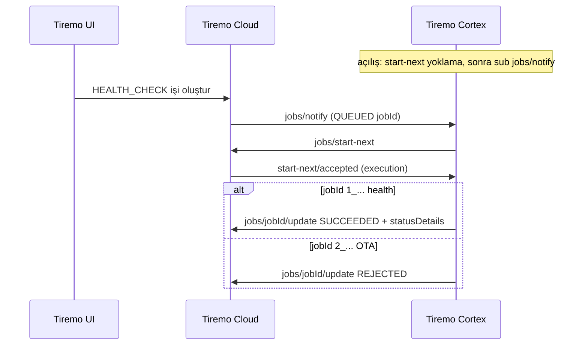
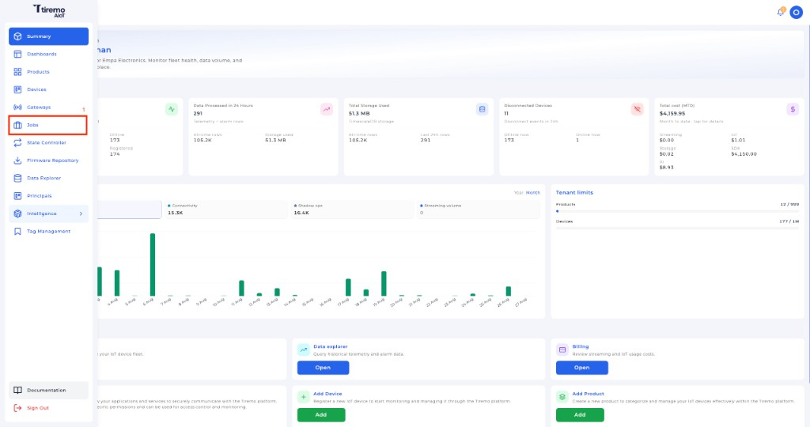
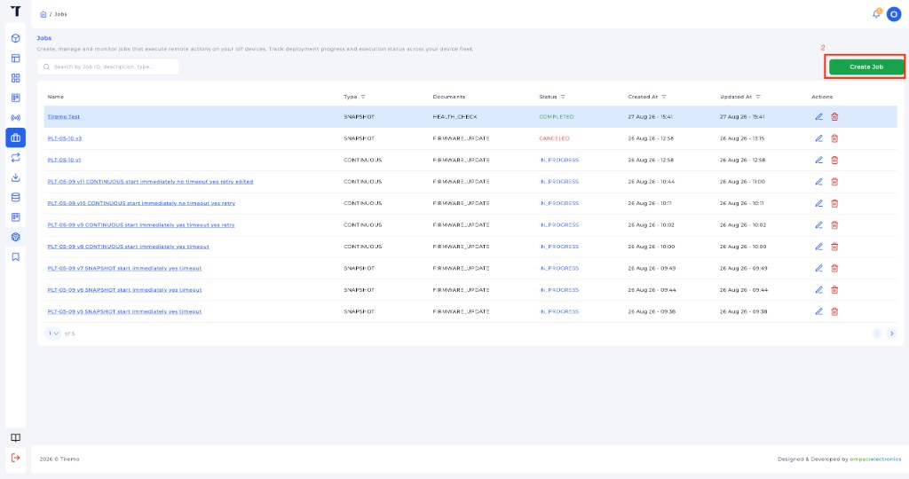
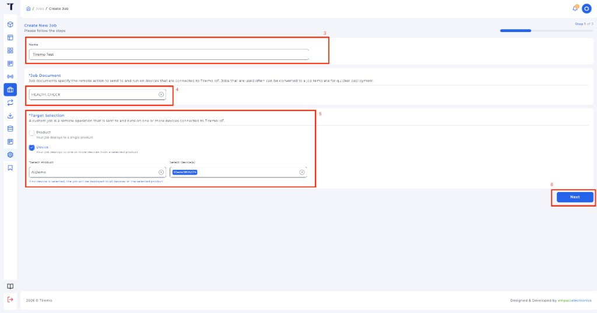
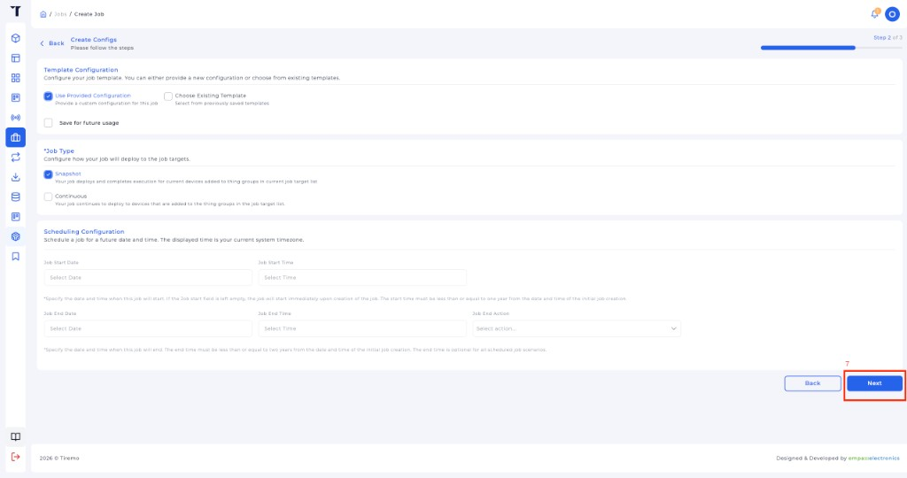
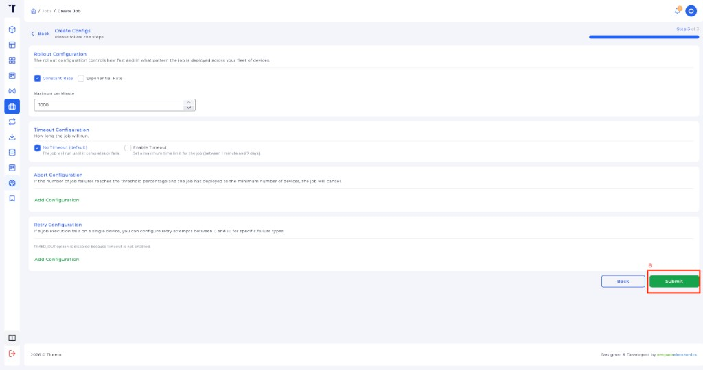
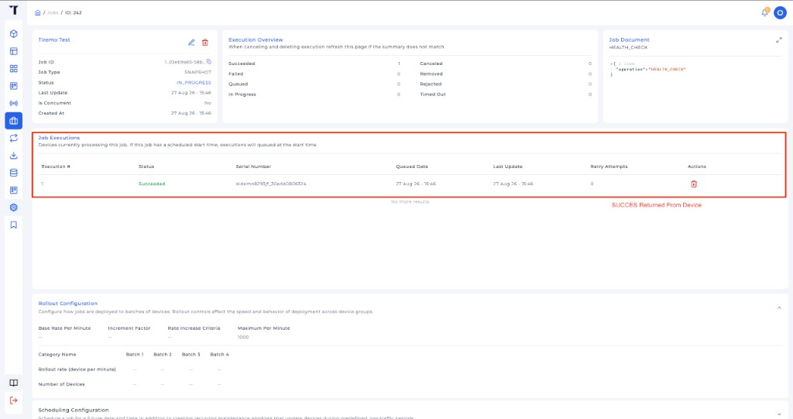

<p class="sphinxhide" align="right"><a href="../../../../Tiremo_Cloud/Feature_Tutorials/07-Tiremo_Jobs/README.md">English</a> | <a>Türkçe</a></p>
<table class="sphinxhide" width="100%">
  <tr>
    <td align="center">
      <picture>
        <source media="(prefers-color-scheme: dark)" srcset="../../../../images/tiremo_sub_brand_1_mono_white.png">
        
      </picture>
      <br>
      
      <h1>Tiremo Jobs</h1>
      <sub>Tiremo Cortex Eğitimleri — ESP32 + Tiremo Cloud üretici yazılımı, ilk LED yanıp sönmesinden filoya hazır bir cihaza</sub>
    </td>
  </tr>
</table>


# Tiremo Jobs

***Kart: Tiremo Cortex (ESP32) · Bölüm: Tiremo Cloud / Feature Tutorials · Zorluk: Zor***

> Bu sayfa [İngilizce orijinalinin](../../../../Tiremo_Cloud/Feature_Tutorials/07-Tiremo_Jobs/README.md)
> Türkçe çevirisidir. Kod ve dosya yolları İngilizce kalır; içerik farklılaşırsa
> İngilizce sürüm esas alınır.

## Giriş

[Eğitim 06](../../../../Tiremo_Cloud/Feature_Tutorials/06-Publishing_Alarms_And_Telemetry/)
**veri düzlemidir**. Bu eğitim **kuyruğa alınan iştir**. Tiremo Jobs
Thing üzerine bir JSON yürütme koyar; kart onu alır, sınırlı bir yerel
eylem çalıştırır, `SUCCEEDED` veya `REJECTED` bildirir. Shadow gibi
duran bir desired/reported döngüsü değildir — durumu vardır, sonra biter.

Üretim üretici yazılımının jobs yolu referanstır: `jobs/notify` bir
**özet** (yalnızca QUEUED `jobId`) veya **tam execution** belgesi olabilir.
Özet `jobs/start-next` ile alınır. Health-check kimlikleri `1_<uuid>`
olup `statusDetails` ile `SUCCEEDED` biter. OTA biçimli kimlikler
(`2_<uuid>`) burada `REJECTED` olur — indirme/yazma bu ders değildir.

## Bir Bakışta Alışveriş



## Neler Öğreneceksiniz

- Jobs MQTT ailesi: `jobs/notify`, `jobs/start-next`, `jobs/<id>/update`
- Özet notify'ın yetmemesi — execution `start-next` ile alınır
- Health check'i `statusDetails` ile tamamlama
- OTA biçimli işi `IN_PROGRESS` bırakmamak için `REJECTED`

## Önkoşullar

- [06-Publishing_Alarms_And_Telemetry](../../../../Tiremo_Cloud/Feature_Tutorials/06-Publishing_Alarms_And_Telemetry/)
- [05-Live_Shadow_Delta_Handling](../../../../Tiremo_Cloud/Feature_Tutorials/05-Live_Shadow_Delta_Handling/)
- 06 ile aynı gitignore'lu dosyalar bu `Sw/` içinde
- [Getting Started](../../../../Getting_Started/) ile araç zinciri

## Platform belgelendirmesi

- [Tiremo Jobs'a giriş](https://docs.tiremo.ai/developer-guide/jobs/jobs-introduction)
- [İş şablonları](https://docs.tiremo.ai/developer-guide/jobs/jobs-phase-1-definition) (`HEALTH_CHECK`)
- [İş oluşturma](https://docs.tiremo.ai/developer-guide/jobs/jobs-phase-2-creation)
- [Yürütme izleme](https://docs.tiremo.ai/developer-guide/jobs/jobs-phase-3-monitoring)

## Çözüm

[`Sw/`](../../../../Tiremo_Cloud/Feature_Tutorials/07-Tiremo_Jobs/Sw/)
derlenebilir bir uygulamadır. Eğitim 06'daki gitignore'lu dosyaları kopyalayın:

```sh
cd Sw
cp ../06-Publishing_Alarms_And_Telemetry/Sw/wifi_secrets.h .
cp ../06-Publishing_Alarms_And_Telemetry/Sw/aws_iot_config.h .
cp ../06-Publishing_Alarms_And_Telemetry/Sw/certs/claim_cert.pem certs/
cp ../06-Publishing_Alarms_And_Telemetry/Sw/certs/claim_key.pem certs/
tdf.py build
tdf.py flash
tdf.py monitor
```

Eğitim 06 açılış satırlarından sonra:

```text
[INFO] jobs: subscribe notify-next start-next/accepted
[INFO] jobs: start-next
[INFO] jobs: start-next empty/timeout (no queued job)
[INFO] jobs: subscribed jobs/notify
```

UART aboneliği kanıtlar. Tiremo UI işi kuyruğa alır ve **Succeeded**
doğrular.

## Tiremo UI'da iş oluşturma

Bu cihaza bir **HEALTH_CHECK** işi oluşturun (kart hazır döngüde
olmalı). Sonra iş sayfasında **Succeeded** doğrulayın.

**1. Ana menüden Jobs** açın.



*Şekil: Tiremo UI — ana menüden **Jobs**.*

**2. Create Job** tıklayın.



*Şekil: Tiremo UI — Jobs listesinde **Create Job**.*

**3. Adım 1 / 3 — ad, belge, hedef.** İşe ad verin, **Job Document** =
**HEALTH_CHECK**, hedef **Device** (ürün ve bu kartın cihaz tanımlayıcısı),
sonra **Next**.



*Şekil: Tiremo UI — **HEALTH_CHECK**, Device hedefi, **Next**.*

**4. Adım 2 / 3 — varsayılanlar.** **Use Provided Configuration**,
**Snapshot**, boş zamanlama (hemen başlar), **Next**.



*Şekil: Tiremo UI — Snapshot, **Next**.*

**5. Adım 3 / 3 — Submit.** Tek cihaz için sabit hız / zaman aşımı yok yeter.



*Şekil: Tiremo UI — kuyruğa almak için **Submit**.*

UART:

```text
[INFO] jobs: MQTT RX topic=$aws/things/<thing>/jobs/notify ...
[INFO] jobs: notify jobId='1_<uuid>'
[INFO] jobs: start-next
[INFO] jobs: health-check '1_<uuid>' -- SUCCEEDED (type 1_)
[INFO] jobs: update 1_<uuid> status=SUCCEEDED
```

**6. İşi açıp Succeeded doğrulayın.** Execution Overview **Succeeded: 1**.
**Job Executions** satırında **Status** yeşil **Succeeded**. Job Document
`{"operation": "HEALTH_CHECK"}`.



*Şekil: Tiremo UI — **Job Executions** kartın `jobs/<id>/update` sonrası
**Succeeded** gösterir.*

`start-next` execution dönmez ama notify'da `jobId` varsa kart o id'yi
doğrudan alır (üretimdeki aynı yedek yol). `2_...` OTA işi `REJECTED`
olur.

## Bitti Sayılınca

Tiremo UI'da oluşturulan health-check bir kez kabul edilir, `SUCCEEDED`
olur (`firmware_version` / `mqtt` / `uptime_s`). Shadow delta ve telemetri
aynı döngüde çalışmaya devam eder.

<p align="center"></p>

<p class="sphinxhide" align="center"><sub>Tiremo Cortex Eğitimleri — Empa Electronics</sub></p>
