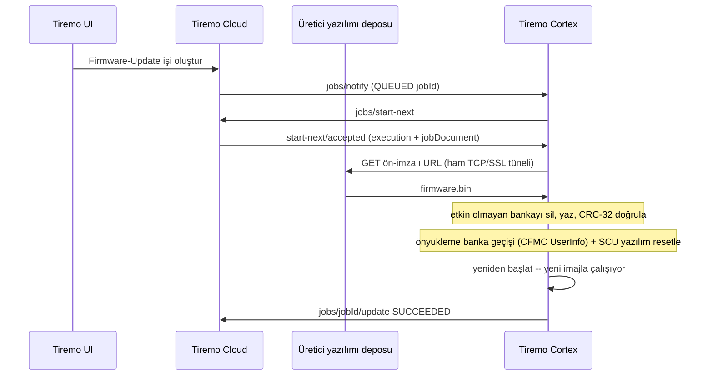
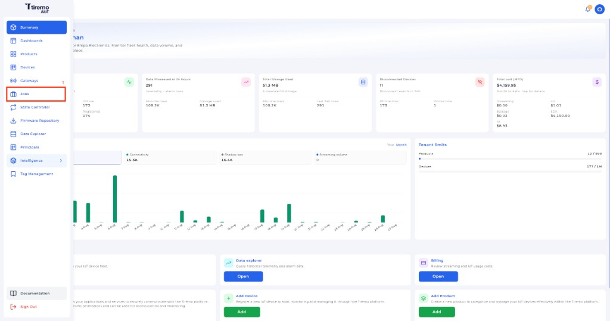
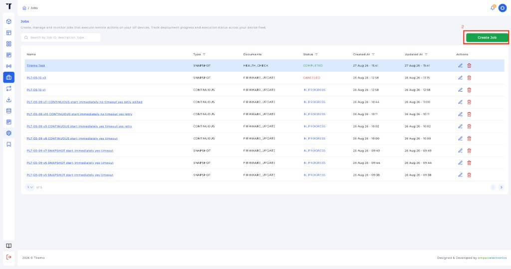
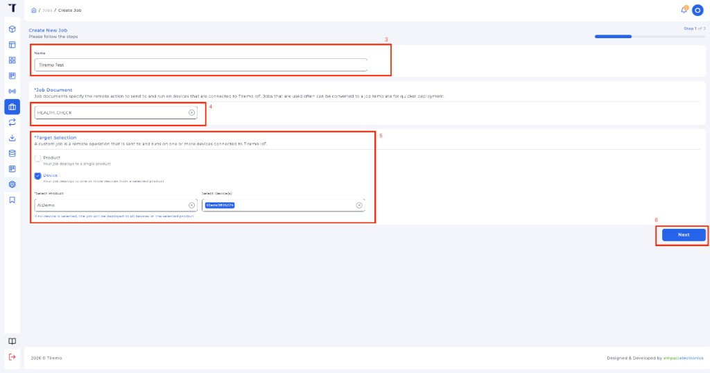
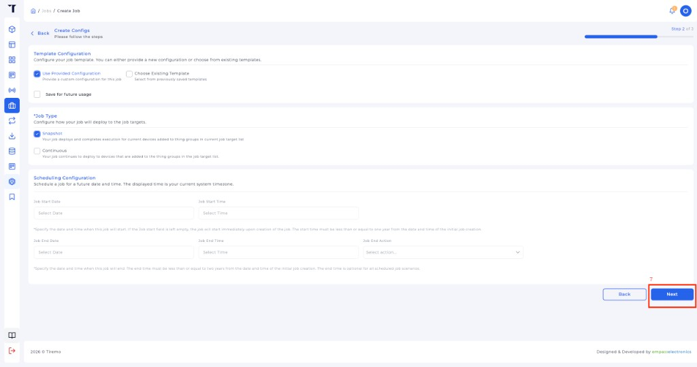
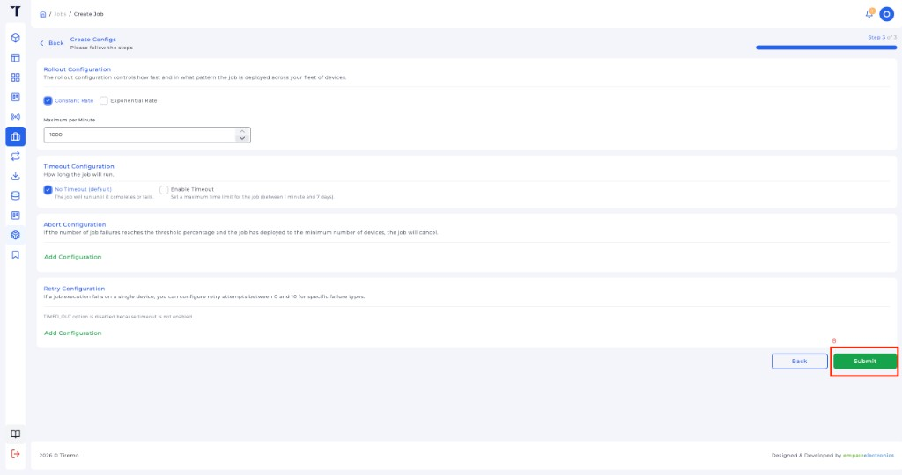
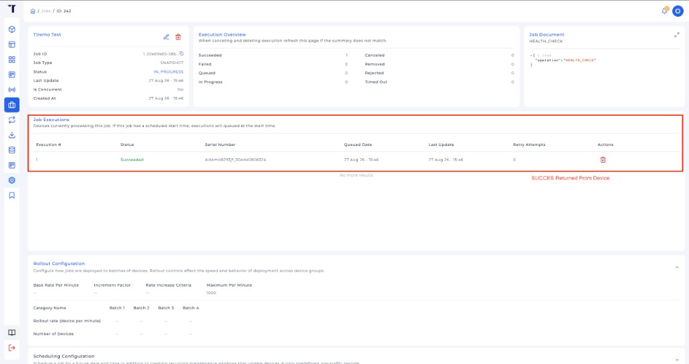

<p class="sphinxhide" align="right"><a href="../../../../Tiremo_Cloud/Feature_Tutorials/08-OTA_Firmware_Update/README.md">English</a> | <a>Türkçe</a></p>
<table class="sphinxhide" width="100%">
  <tr>
    <td align="center">
      <picture>
        <source media="(prefers-color-scheme: dark)" srcset="../../../../images/tiremo_sub_brand_1_mono_white.png">
        
      </picture>
      <br>
      
      <h1>OTA Üretici Yazılımı Güncellemesi</h1>
      <sub>Tiremo Cortex Eğitimleri — ESP32 + Tiremo Cloud üretici yazılımı, ilk LED yanıp sönmesinden filoya hazır bir cihaza</sub>
    </td>
  </tr>
</table>


# OTA Üretici Yazılımı Güncellemesi

***Kart: Tiremo Cortex (ESP32) · Bölüm: Tiremo Cloud / Feature Tutorials · Zorluk: Zor***

> Bu sayfa [İngilizce orijinalinin](../../../../Tiremo_Cloud/Feature_Tutorials/08-OTA_Firmware_Update/README.md)
> Türkçe çevirisidir. Kod ve dosya yolları İngilizce kalır; içerik farklılaşırsa
> İngilizce sürüm esas alınır.

## Giriş

[Eğitim 07](../../../../Tiremo_Cloud/Feature_Tutorials/07-Tiremo_Jobs/)
bir Firmware-Update işini `REJECTED "ota_not_implemented"` ile geçiştirir.
Bu eğitim onu gerçek yapar: kart yeni imajı ağ üzerinden indirir,
doğrular ve kendi kendine geçiş yapar — A34G43x'in donanım A/B kod-flash
bankaları üzerinde, gerçek bir kablosuz (OTA) güncelleme.

A34G43x'in CFMC denetleyicisi kod flash'ı iki eşit banka olarak
çalıştırabilir. Hangi banka açılmışsa `0x0` adresine eşlenir; diğer
banka, çalışan imajın bakış açısından her zaman sabit bir ofsette
görünür. Bir güncelleme *diğer* bankayı yazar, doğrular, önyükleme
banka seçimini ona yönlendirir ve resetler — imaj her iki banka için de
aynıdır (donanım, hangisi etkinse onu `0x0`'a eşler), bu yüzden ikinci
bir linker script'e veya konumdan bağımsız koda gerek yoktur.

## Bir Bakışta Alışveriş



## Neler Öğreneceksiniz

- A34G43x'in donanım A/B kod-flash bankaları (CFMC multi-bank): etkin
  olmayan bankayı sil + yaz, sonra önyükleme bankasını CFMC UserInfo'da
  değiştir
- Bu geçişin neden bir SCU yazılım resetine ihtiyaç duyduğu, bir CMSIS
  sistem resetine değil
- Gerçek bir Tiremo Cloud üretici-yazılımı-güncelleme iş belgesini
  ayrıştırma — iç içe `fileInfo` / `operationInfo` biçimi, base64 ile
  kodlanmış bir CRC-32 sağlama toplamı, KB'ye yuvarlanmış bir boyut
- ESP32 modülünün kendi AT HTTP istemcisinin alamayacağı kadar uzun,
  çok-kilobaytlık bir ön-imzalı URL'yi ham bir TCP/SSL geçiş tüneli
  üzerinden indirme
- Hiçbir zaman bildirimde bulunmayan yeni bir imajın kendiliğinden geri
  dönmesini sağlayan, 1 önyüklemelik bir onay/geri-alma durum makinesi
- Bir işin sonucunu, hazır döngünün kendi önyükleme yoklamasının onu
  yeniden ele geçirme fırsatı bulmasından *önce* bildirme

## Önkoşullar

- [07-Tiremo_Jobs](../../../../Tiremo_Cloud/Feature_Tutorials/07-Tiremo_Jobs/) — hazır döngü, Thing adı, `jobs/notify` + `start-next`
- 06/07 ile aynı gitignore'lu dosyalar bu `Sw/` içinde
- [Getting Started](../../../../Getting_Started/) ile araç zinciri ve yanıp sönme kurulumu

## Platform belgelendirmesi

- [Tiremo Jobs'a giriş](https://docs.tiremo.ai/developer-guide/jobs/jobs-introduction)
- [İş şablonları](https://docs.tiremo.ai/developer-guide/jobs/jobs-phase-1-definition)
- [İş oluşturma](https://docs.tiremo.ai/developer-guide/jobs/jobs-phase-2-creation)
- [Yürütme izleme](https://docs.tiremo.ai/developer-guide/jobs/jobs-phase-3-monitoring)

## İş belgesi

Gerçek bir Tiremo Cloud üretici-yazılımı-güncelleme işi, imajı çıplak
bir dosya adı değil, ön-imzalı bir URL'nin arkasında taşır:

```json
{
  "operation": "Firmware-Update",
  "operationInfo": {
    "firmwareType": "MCU",
    "firmwareUpdateType": "FOTA",
    "firmwareVersion": "v2.0.0"
  },
  "fileInfo": {
    "s3Path": "https://.../mcu/fota/v2.0.0/firmware.bin?X-Amz-Security-Token=...&X-Amz-Signature=...",
    "checksum": {"function": "CRC32", "value": "5CAmFw=="},
    "fileSizeKB": "53"
  }
}
```

`s3Path` indirme URL'sidir, `checksum.value` büyük-uçlu (big-endian)
CRC-32'nin base64 kodudur (AWS'in kendi nesne sağlama toplamları için
kullandığı kodlamanın aynısı), `fileSizeKB` ise KB'ye yuvarlanmıştır —
tam değil, bu yüzden kart onu bir eşitlik kontrolü değil bir üst sınır
olarak ele alır.

Yerel bir sunucuya karşı tezgah testi için düz bir iş belgesi de
çalışır — her iki biçim de aynı ayrıştırıcı tarafından kabul edilir:

```json
{
  "operation": "FIRMWARE_UPDATE",
  "url": "http://<ip-adresiniz>:8000/OtaFirmwareUpdate.bin",
  "crc32": 3827312151,
  "size": 53948
}
```

Sağlama toplamı taşımayan bir iş belgesi de uygulanır — indirme, mTLS
ile güvenli Jobs kanalı üzerinden geldiği için yine de kimliği
doğrulanmıştır ve kart yine de bir flash-yazma kendi kendini doğrulama
çalıştırır (indirilen baytların CRC-32'si, yeni yazılan bankanın geri
okunmasıyla eşleşmelidir) — ama bu içerik bütünlüğü kapısı zorunlu
değil, yalnızca bir uyarıdır.

## Çözüm

[`Sw/`](../../../../Tiremo_Cloud/Feature_Tutorials/08-OTA_Firmware_Update/Sw/)
derlenebilir bir uygulamadır. Eğitim 07'deki gitignore'lu dosyaları kopyalayın:

```sh
cd Sw
cp ../07-Tiremo_Jobs/Sw/wifi_secrets.h .
cp ../07-Tiremo_Jobs/Sw/aws_iot_config.h .
cp ../07-Tiremo_Jobs/Sw/certs/claim_cert.pem certs/
cp ../07-Tiremo_Jobs/Sw/certs/claim_key.pem certs/
tdf.py build
tdf.py flash
tdf.py monitor
```

**Gerçek bir ABOV A34G43A Starter Kit üzerinde, gerçek bir Tiremo Cloud
kiracısına karşı doğrulandı:** Tiremo UI'da kuyruğa alınan bir
Firmware-Update işi ele alındı, ~53 KB'lık imajı işin gerçek ön-imzalı
S3 URL'sinden ham TCP/SSL tüneli üzerinden indirildi, işin CRC-32'sine
karşı bayt bayt doğrulandı, etkin olmayan bankaya yazıldı ve kart onunla
çalışır şekilde yeniden başladı:

```text
[INFO] jobs: FIRMWARE_UPDATE '1_e803e942-...' -- applying
[INFO] ota: job crc32=E4202617 size~54272
[INFO] ota: downloading v2.0.0 -> bank B
[INFO] flash_ab: inactive bank erased (52 KB)
[INFO] http: SSL tiremo-app-....s3.eu-west-1.amazonaws.com:443  path 1180 bytes
[WARN] http: dropping MQTT to free the TLS context for SSL
[INFO] http: 2xx, Content-Length=53948
[INFO] http: got 53948 bytes
[INFO] ota: bank B verified -- 53948 bytes, crc E4202617
[INFO] flash_ab: user-info boot=2 active=1 done=1 (want boot=2)
[INFO] ota: boot bank -> B, resetting into the new image
[INFO] OTA_Firmware_Update: boot fw=cortex-08b
[INFO] ota: running cortex-08b from bank B
[INFO] ota: reporting job 1_e803e942-... SUCCEEDED (now fw=cortex-08b)
[INFO] jobs: update 1_e803e942-... status=SUCCEEDED (140 bytes)
[INFO] ota: confirmed running cortex-08b (bank marked good)
[INFO] jobs: start-next
[INFO] jobs: start-next accepted with no execution
```

Tiremo UI'daki iş sayfası hemen ardından **Succeeded** gösterdi ve
kartın bir sonraki `start-next`'i boş döndü — iş kapalı kalır, bir
sonraki önyüklemede yeniden ele geçirilmez.

Olumsuz yollar da geliştirme sırasında aynı donanımda çalıştırıldı,
sadece yazılıp umut edilmedi: işin bildirdiği boyuttan kısa gelen bir
indirme `FAILED size_mismatch` bildirdi ve çalışan bankayı olduğu gibi
bıraktı; kalıcı olmayan bir önyükleme-banka geçişi tespit edildi ve
`FAILED rollback_switch_failed` olarak bildirildi, kart yine de kendi
özgün imajıyla çalışmaya devam etti. Hiçbir yol kartı önyüklenemez
bırakmadı.

## Tiremo UI'da iş oluşturma

Bu cihaza bir **firmware-update** işi oluşturun (kart hazır döngüde ve
[eğitim 03](../../../../Tiremo_Cloud/Feature_Tutorials/03-Fleet_Provisioning_By_Claim/)
ile kurulmuş olmalı).

**1. Ana menüden Jobs** açın.



*Şekil: Tiremo UI — ana menüden **Jobs**.*

**2. Create Job** tıklayın.



*Şekil: Tiremo UI — Jobs listesinde **Create Job**.*

**3. Adım 1 / 3 — ad, belge, hedef.** İşe ad verin, **Job Document**'i
üretici-yazılımı-güncelleme şablonuna ayarlayın (`operationInfo`
`firmwareUpdateType: FOTA` bildirir), gönderilecek üretici yazılımı
sürümünü/depo girdisini seçin, hedef **Device** (bu kartın cihaz
tanımlayıcısı), sonra **Next**.



*Şekil: Tiremo UI — üretici-yazılımı-güncelleme belgesi, Device hedefi, **Next**.*

**4. Adım 2 / 3 — varsayılanlar.** **Use Provided Configuration**,
**Snapshot**, boş zamanlama (hemen başlar), **Next**.



*Şekil: Tiremo UI — Snapshot, **Next**.*

**5. Adım 3 / 3 — Submit.** Tek cihaz için sabit hız / zaman aşımı yok yeter.



*Şekil: Tiremo UI — kuyruğa almak için **Submit**.*

**6. İşi açıp Succeeded doğrulayın.**



*Şekil: Tiremo UI — **Job Executions**, kartın önyükleme sonrası
`jobs/<id>/update`'i geldikten sonra **Succeeded** gösterir.*

## İnceleme

1. [`prv_user_code.c`](../../../../Tiremo_Cloud/Feature_Tutorials/08-OTA_Firmware_Update/Sw/Src/prv_user_code.c) —
   `TIREMO_OTA_Init()` radyoya dokunmadan önce ilk iş olarak çalışır:
   CFMC multi-bank modunu zorlar ve önceki bir geçişten kalan DFMC
   devir-teslim kaydını okur. `NetworkBringUp()`, ağ/bulut oturumu
   ayağa kalkar kalkmaz, `TIREMO_Jobs_Init()`'in kendi önyükleme
   yoklamasından *önce* bekleyen bir işin sonucunu bildirir — aksi
   halde o yoklama aynı hâlâ `IN_PROGRESS` işi bulur ve sonsuza kadar
   yeniden uygular.

2. [`tiremo_ota.c`](../../../../Tiremo_Cloud/Feature_Tutorials/08-OTA_Firmware_Update/Sw/Common/Src/tiremo_ota.c) —
   düzenleyici. `TIREMO_OTA_Apply()` iş belgesini ayrıştırır, indirmeyi
   4 KB'lık sektörler hâlinde etkin olmayan bankaya akıtır, doğrular,
   devir-teslimi [`tiremo_ota_state.c`](../../../../Tiremo_Cloud/Feature_Tutorials/08-OTA_Firmware_Update/Sw/Common/Src/tiremo_ota_state.c)
   içine kaydeder (veri flash'ında bir magic+CRC kaydı — değiştirilen
   kod-flash bankasından farklı bir denetleyici, bu yüzden geçişten
   etkilenmeden kalır), önyükleme bankasını ayarlar ve resetler.

3. [`tiremo_flash_ab.c`](../../../../Tiremo_Cloud/Feature_Tutorials/08-OTA_Firmware_Update/Sw/Common/Src/tiremo_flash_ab.c) —
   CFMC A/B ilkelleri. Geçişi gerçek kılan reset
   `HAL_SCU_SetReset(SCU_RST_SW, true)` + `HAL_SCU_SetSWReset()`'tir —
   CFMC önyükleme ROM'u UserInfo banka-geçiş komutunu yalnızca bu SCU
   yazılım-reset yolunda yeniden okur, bir CMSIS `NVIC_SystemReset()`'te
   değil.

4. [`tiremo_esp32.c`](../../../../Tiremo_Cloud/Feature_Tutorials/08-OTA_Firmware_Update/Sw/Drivers/esp32/Src/tiremo_esp32.c) —
   `TIREMO_ESP32_HttpGetToSink()`. `AT+CIPMODE=1` modülü ham soket
   geçiş moduna sokar, `AT+CIPSTART` bağlantıyı açar, `AT+CIPSEND`
   UART'ın kendisini sokete devreder, elle kurulmuş bir
   `GET <path> HTTP/1.1` isteği doğrudan o tünelden akıtılır (uzun
   yol/sorgu dizesi asla bir komut satırına dokunmaz), yanıt aynı
   şekilde geri okunur.

## Bitti Sayılınca

Tiremo UI'da oluşturulan bir Firmware-Update işi ele alınır, imajı
indirilir ve doğrulanır, kart onunla yeniden başlar ve iş
**Succeeded** gösterir — sonraki önyüklemelerde yeniden uygulanmadan.
Bildirilen boyutu veya sağlama toplamı gerçekte inen ile eşleşmeyen bir
iş, herhangi bir banka geçişinden önce reddedilir; etkiye girmeyen bir
önyükleme-banka geçişi tespit edilir ve kartı önyüklenemez bırakmadan
bildirilir.

<p align="center"></p>

<p class="sphinxhide" align="center"><sub>Tiremo Cortex Eğitimleri — Empa Electronics</sub></p>
